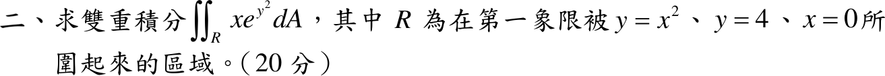
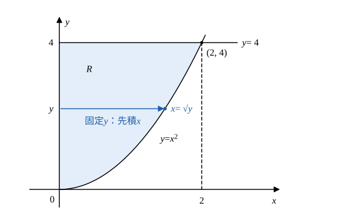

# 109 年第 2 題

## 已知與所求

\(\iint_Rxe^{y^2}\,dA\)，\(R\) 為第一象限中被 \(y=x^2\)、\(y=4\)、\(x=0\) 所圍的區域（20 分）。

## 考場標準作答

### 步驟 1：區域 \(R\) 與交點

- 邊界：\(x=0\)（\(y\) 軸）、拋物線 \(y=x^2\)、水平線 \(y=4\)；第一象限內被圍住的是拋物線「上方」、\(y=4\)「下方」、\(y\) 軸右側的區域。
- 拋物線與 \(y=4\) 的交點：
\[
x^2=4\;\Rightarrow\;x=2\quad(\text{第一象限取正根})
\]
- 原次序（外層 \(x\)）：\(0\le x\le2,\ x^2\le y\le4\)。

### 步驟 2：改變積分次序

- 以 \(y\) 為外層：區域最低點 \(y=0\)、最高 \(y=4\)，故 \(0\le y\le4\)。
- 固定 \(y\) 畫水平線，左端在 \(y\) 軸 \(x=0\)，右端在拋物線上：由 \(y=x^2\)、\(x\ge0\) 解得 \(x=\sqrt y\)。故 \(0\le x\le\sqrt y\)。

\[
\iint_Rxe^{y^2}\,dA=\int_0^4\int_0^{\sqrt y}xe^{y^2}\,dx\,dy
\]

### 求重積分（20 分）

\(e^{y^2}\) 對 \(y\) 無初等反導函數，故依步驟 2 的次序內層先積 \(x\)，外層以 \(u=y^2\) 代換。

內層對 \(x\) 積分（\(e^{y^2}\) 提出）：
\[
\int_0^{\sqrt y}xe^{y^2}\,dx=e^{y^2}\Big[\frac{x^2}{2}\Big]_0^{\sqrt y}=e^{y^2}\cdot\frac{(\sqrt y)^2}{2}=\frac y2e^{y^2}
\]
外層：
\[
\iint_Rxe^{y^2}\,dA=\int_0^4\frac y2e^{y^2}\,dy
\]
代換 \(u=y^2\)，\(du=2y\,dy\Rightarrow y\,dy=\frac{du}{2}\)；上下限 \(y:0\to4\) 對應 \(u:0\to16\)：
\[
\int_0^4\frac y2e^{y^2}\,dy=\frac12\int_0^{16}e^u\cdot\frac{du}{2}=\frac14\int_0^{16}e^u\,du
\]
\[
=\frac14\Big[e^u\Big]_0^{16}=\frac14\left(e^{16}-e^0\right)=\frac14\left(e^{16}-1\right)
\]
數值：\(e^{16}\approx8886111\)，
\[
\frac{e^{16}-1}{4}\approx\frac{8886111-1}{4}=\frac{8886110}{4}=2221527.5
\]
\[
\boxed{\frac{e^{16}-1}{4}\approx2.22\times10^6}
\]

## 驗算

保留原次序，令 \(G(x)=\int_{x^2}^4e^{y^2}dy\)（\(G(2)=0\)，\(G'(x)=-2xe^{x^4}\)），分部積分：
\[
\int_0^2xG(x)\,dx=\left[\frac{x^2}{2}G\right]_0^2+\int_0^2x^3e^{x^4}dx=0+\left[\frac{e^{x^4}}{4}\right]_0^2=\frac{e^{16}-1}{4}\approx2.22\times10^6
\]
與正文一致。

## 失分點

- 區域是拋物線 \(y=x^2\) 上方、\(y=4\) 下方；畫成拋物線下方會得不可積的式子。
- 換次序後上限是 \(x=\sqrt y\)（\(y\) 從 0 到 4），不是 \(x=y^2\)。
- 代換後未把上下限改成 \(u:0\to16\)，或漏掉 \(du=2y\,dy\) 的 \(\frac12\)。
