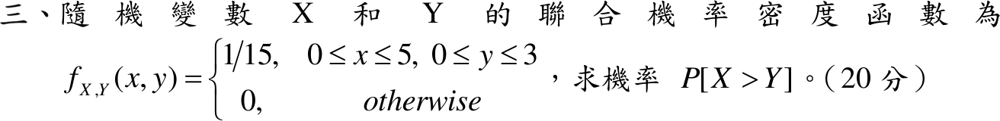
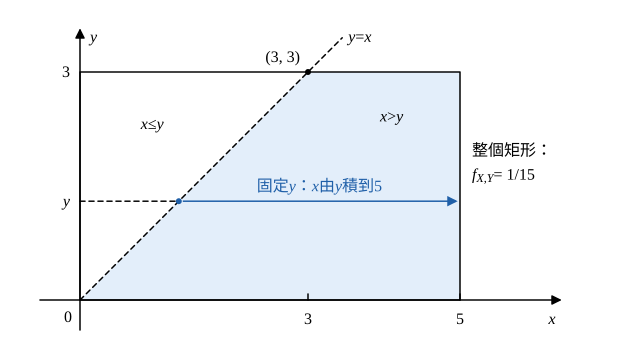

# 109 年第 3 題｜均勻聯合密度下的機率

## 已知與所求

\(f_{X,Y}(x,y)=\frac1{15}\)（\(0\le x\le5,\ 0\le y\le3\)），其餘為 0。求 \(P[X>Y]\)（20 分）（下文記為 \(P(X>Y)\)）。

## 考場標準作答

**解題邏輯**：事件的機率等於聯合密度在「事件區域 ∩ 支撐區」上的二重積分。支撐區是 \(0\le x\le5,\ 0\le y\le3\) 的矩形，密度為常數 \(\frac1{15}=\frac1{5\times3}\)（矩形面積的倒數，即均勻分布）；事件 \(X>Y\) 是直線 \(y=x\) 右下方。先畫出交集區域定上下限（步驟 1），再以「外層 \(y\)、內層 \(x\)」逐層積分。

### 步驟 1：積分區域與上下限

- 支撐區外密度為 0，只需在矩形內積分；\(X>Y\) 即矩形內 \(x>y\) 的部分（圖 1 著色區）。
- 直線 \(y=x\) 與矩形上緣 \(y=3\) 交於 \((3,3)\)；因 \(y\le3<5\)，對每個 \(y\in[0,3]\)，水平線上 \(x\) 都是由 \(x=y\) 走到右緣 \(x=5\)，不必分段。
- 故外層 \(y:0\to3\)、內層 \(x:y\to5\)。

### 求 \(P[X>Y]\)（20 分）

**邏輯**：\(P[(X,Y)\in A]=\iint_A f_{X,Y}(x,y)\,dA\)，\(A\) 取步驟 1 的區域與上下限；密度為常數，可提出積分號。

\[
P(X>Y)=\int_0^3\int_y^5\frac1{15}\,dx\,dy
\]
先對 \(x\) 積分（\(y\) 視為常數）：
\[
\int_y^5\frac1{15}\,dx=\frac1{15}\Big[x\Big]_y^5=\frac{5-y}{15}
\]
再對 \(y\) 積分：
\[
P(X>Y)=\frac1{15}\int_0^3(5-y)\,dy=\frac1{15}\Big[5y-\frac{y^2}{2}\Big]_0^3
\]
\[
=\frac1{15}\Big(15-\frac92\Big)=\frac1{15}\cdot\frac{21}{2}=\frac{21}{30}=\frac{7}{10}
\]
\[
\boxed{P(X>Y)=0.70}
\]

## 驗算

均勻分布下機率 = 面積比。矩形內 \(x\le y\) 的部分是頂點 \((0,0),(0,3),(3,3)\) 的直角三角形，面積 \(\frac12\cdot3\cdot3=4.50\)，故 \(P(X>Y)=1-\frac{4.50}{15}=1-0.30=0.70\)，一致。

## 失分點

- 積分上下限：\(X>Y\) 時 \(x\) 由 \(y\) 積到 5，不是 0 到 \(y\)；寫反會得 \(0.30\)。
- 密度 \(\frac1{15}\) 的區域是 \(5\times3\) 矩形，三角形面積要用 \(3\times3\) 而非 \(5\times3\) 的一半。
