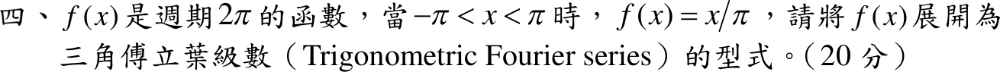
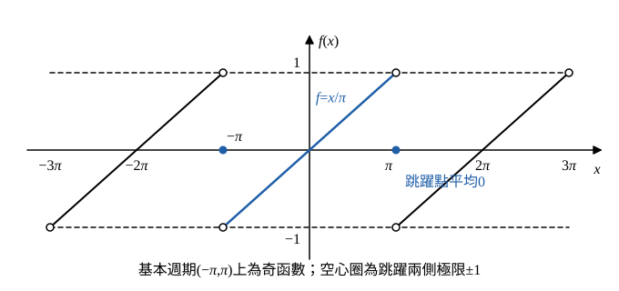

# 109 年第 4 題｜週期函數的傅立葉級數

## 已知與所求

\(f(x)\) 週期 \(2\pi\)，\(-\pi<x<\pi\) 時 \(f(x)=x/\pi\)。求 \(f(x)\) 的三角傅立葉級數（20 分）。

## 考場標準作答

**解題邏輯**：週期 \(2\pi\)（\(L=\pi\)），用 Euler 公式求係數：
\[
f(x)\sim\frac{a_0}{2}+\sum_{n=1}^{\infty}(a_n\cos nx+b_n\sin nx),\quad
a_n=\frac1\pi\int_{-\pi}^{\pi}f(x)\cos nx\,dx,\quad
b_n=\frac1\pi\int_{-\pi}^{\pi}f(x)\sin nx\,dx
\]
先判斷奇偶：\(x/\pi\) 是奇函數，餘弦係數全為 0，只需算 \(b_n\)；\(b_n\) 的被積函數 \(x\sin nx\) 用分部積分。最後依 Dirichlet 定理說明級數在跳躍點 \(x=\pm\pi\) 收斂到兩側極限的平均。

### 步驟 1：週期延拓、奇偶性與跳躍點

- 基本週期 \((-\pi,\pi)\) 上 \(f(-x)=\dfrac{-x}{\pi}=-f(x)\)，為奇函數。
- 奇函數乘偶函數 \(\cos nx\) 仍為奇函數，對稱區間積分為 0；奇函數乘奇函數 \(\sin nx\) 為偶函數，積分可改為 \(2\int_0^\pi\)。
- 跳躍點 \(x=\pm\pi\)：以 \(x=\pi\) 為例，左極限取基本週期右端，右極限依週期性 \(f(\pi^+)=f(-\pi^+)\)，取基本週期左端：
\[
f(\pi^-)=\frac{\pi}{\pi}=1,\qquad f(\pi^+)=f(-\pi^+)=\frac{-\pi}{\pi}=-1
\]
\[
\frac{f(\pi^-)+f(\pi^+)}{2}=\frac{1+(-1)}{2}=0
\]

### 常數項 \(a_0\) 與餘弦係數 \(a_n\)

**邏輯**：被積函數 \(\frac x\pi\cdot1\)、\(\frac x\pi\cos nx\) 都是奇函數，在對稱區間 \((-\pi,\pi)\) 上積分為 0。

\[
a_0=\frac1\pi\int_{-\pi}^{\pi}\frac x\pi\,dx=\frac1{\pi^2}\Big[\frac{x^2}{2}\Big]_{-\pi}^{\pi}=\frac1{\pi^2}\Big(\frac{\pi^2}{2}-\frac{\pi^2}{2}\Big)=0
\]
\[
a_n=\frac1\pi\int_{-\pi}^{\pi}\frac x\pi\cos nx\,dx=0\qquad(\text{奇函數在對稱區間})
\]
\[
\boxed{a_0=0,\qquad a_n=0}
\]

### 正弦係數 \(b_n\)

**邏輯**：\(\frac x\pi\sin nx\) 為偶函數，積分改為 \(2\int_0^\pi\)；\(x\sin nx\) 用分部積分（取 \(u=x\)、\(dv=\sin nx\,dx\)），再以 \(\cos n\pi=(-1)^n\)、\(\sin n\pi=0\) 代入上下限。

\[
b_n=\frac1\pi\int_{-\pi}^{\pi}\frac x\pi\sin nx\,dx=\frac2\pi\int_0^{\pi}\frac x\pi\sin nx\,dx=\frac{2}{\pi^2}\int_0^{\pi}x\sin nx\,dx
\]
分部積分（\(u=x\)，\(du=dx\)；\(dv=\sin nx\,dx\)，\(v=-\frac{\cos nx}{n}\)）：
\[
\int_0^{\pi}x\sin nx\,dx=\Big[-\frac{x\cos nx}{n}\Big]_0^{\pi}+\frac1n\int_0^{\pi}\cos nx\,dx
\]
第一項代上下限（\(\cos n\pi=(-1)^n\)）：
\[
\Big[-\frac{x\cos nx}{n}\Big]_0^{\pi}=-\frac{\pi\cos n\pi}{n}-0=-\frac{\pi(-1)^n}{n}
\]
第二項（\(\sin n\pi=0\)）：
\[
\frac1n\int_0^{\pi}\cos nx\,dx=\frac1n\Big[\frac{\sin nx}{n}\Big]_0^{\pi}=\frac1n\cdot\frac{0-0}{n}=0
\]
合併（\(-(-1)^n=(-1)^{n+1}\)）：
\[
\int_0^{\pi}x\sin nx\,dx=-\frac{\pi(-1)^n}{n}=\frac{\pi(-1)^{n+1}}{n}
\]
代回 \(b_n\)：
\[
b_n=\frac{2}{\pi^2}\cdot\frac{\pi(-1)^{n+1}}{n}
\]
\[
\boxed{b_n=\frac{2(-1)^{n+1}}{\pi n}}
\]

### 傅立葉級數

**邏輯**：把 \(a_0=a_n=0\) 與 \(b_n\) 代回 \(\dfrac{a_0}{2}+\sum(a_n\cos nx+b_n\sin nx)\)，只剩正弦項；收斂值依步驟 1。

\[
f(x)\sim\sum_{n=1}^{\infty}b_n\sin nx
\]
\[
\boxed{f(x)=\sum_{n=1}^{\infty}\frac{2(-1)^{n+1}}{\pi n}\sin nx}
\]
前幾項（\(b_1=\frac2\pi\)、\(b_2=-\frac1\pi\)、\(b_3=\frac{2}{3\pi}\)，提出 \(\frac2\pi\)）：
\[
f(x)=\frac2\pi\left(\sin x-\frac{\sin2x}{2}+\frac{\sin3x}{3}-\cdots\right)
\]
等號在 \(-\pi<x<\pi\) 成立；在 \(x=\pm\pi\)（及其 \(2\pi\) 平移）級數收斂到步驟 1 的平均值 \(0\)。

## 驗算

\(x=\frac\pi2\)：\(\sin\frac{n\pi}{2}\) 只在奇數 \(n=2m+1\) 非零，且等於 \((-1)^m\)，級數為 \(\frac2\pi\left(1-\frac13+\frac15-\cdots\right)=\frac2\pi\cdot\frac\pi4=\frac12=f\!\left(\frac\pi2\right)\)。\(x=\pm\pi\) 處每項 \(\sin(\pm n\pi)=0\)，級數為 0，等於跳躍 \(\pm1\) 的平均。

## 失分點

- 常數項與餘弦項應先以奇函數說明為 0，不寫理由直接略去會被扣步驟分。
- 分部積分第一項代 \(x=\pi\) 時 \(\cos n\pi=(-1)^n\)，正負號錯會得 \(b_n=\frac{2(-1)^n}{\pi n}\)。
- 漏寫 \(x=\pm\pi\) 的收斂值：級數在跳躍點收斂到 \(0\)，不等於 \(f(\pi^-)=1\)。
