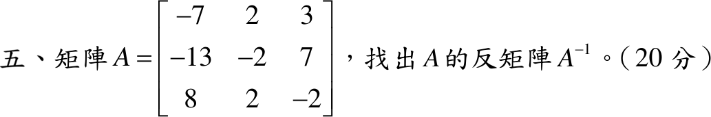

# 109 年第 5 題｜矩陣反矩陣

## 已知與所求

\(A=\begin{bmatrix}-7&2&3\\-13&-2&7\\8&2&-2\end{bmatrix}\)，求 \(A^{-1}\)（20 分）。

## 考場標準作答

**解題邏輯**：用伴隨矩陣公式 \(A^{-1}=\dfrac{\operatorname{adj}A}{\det A}\)。先算 9 個餘因子 \(C_{ij}=(-1)^{i+j}M_{ij}\)（\(M_{ij}\) 為刪去第 \(i\) 列第 \(j\) 行的 \(2\times2\) 子行列式）；再用第一列的三個餘因子展開得 \(\det A\)（不為 0 才可逆）；最後把餘因子矩陣轉置成 \(\operatorname{adj}A\) 並除以 \(\det A\)。

### 步驟 1：九個餘因子

符號棋盤 \((-1)^{i+j}\)：
\[
\begin{bmatrix}+&-&+\\-&+&-\\+&-&+\end{bmatrix}
\]
第一列（刪第 1 列）：
\[
C_{11}=+\begin{vmatrix}-2&7\\2&-2\end{vmatrix}=(-2)(-2)-(7)(2)=4-14=-10
\]
\[
C_{12}=-\begin{vmatrix}-13&7\\8&-2\end{vmatrix}=-\big[(-13)(-2)-(7)(8)\big]=-(26-56)=30
\]
\[
C_{13}=+\begin{vmatrix}-13&-2\\8&2\end{vmatrix}=(-13)(2)-(-2)(8)=-26+16=-10
\]
第二列（刪第 2 列）：
\[
C_{21}=-\begin{vmatrix}2&3\\2&-2\end{vmatrix}=-\big[(2)(-2)-(3)(2)\big]=-(-4-6)=10
\]
\[
C_{22}=+\begin{vmatrix}-7&3\\8&-2\end{vmatrix}=(-7)(-2)-(3)(8)=14-24=-10
\]
\[
C_{23}=-\begin{vmatrix}-7&2\\8&2\end{vmatrix}=-\big[(-7)(2)-(2)(8)\big]=-(-14-16)=30
\]
第三列（刪第 3 列）：
\[
C_{31}=+\begin{vmatrix}2&3\\-2&7\end{vmatrix}=(2)(7)-(3)(-2)=14+6=20
\]
\[
C_{32}=-\begin{vmatrix}-7&3\\-13&7\end{vmatrix}=-\big[(-7)(7)-(3)(-13)\big]=-(-49+39)=10
\]
\[
C_{33}=+\begin{vmatrix}-7&2\\-13&-2\end{vmatrix}=(-7)(-2)-(2)(-13)=14+26=40
\]
餘因子矩陣：
\[
C=\begin{bmatrix}-10&30&-10\\10&-10&30\\20&10&40\end{bmatrix}
\]

### 步驟 2：行列式

沿第一列展開 \(\det A=a_{11}C_{11}+a_{12}C_{12}+a_{13}C_{13}\)：
\[
\det A=(-7)(-10)+(2)(30)+(3)(-10)
\]
\[
=70+60-30
\]
\[
=100\neq0\quad(\text{可逆})
\]

### 步驟 3：伴隨矩陣

\(\operatorname{adj}A=C^T\)（第 \(i\) 列餘因子放到第 \(i\) 行）：
\[
\operatorname{adj}A=C^T=\begin{bmatrix}-10&10&20\\30&-10&10\\-10&30&40\end{bmatrix}
\]

### 反矩陣 \(A^{-1}\)（20 分）

**邏輯**：\(A\,\operatorname{adj}A=(\det A)I\)，\(\det A=100\neq0\)，兩邊除以 \(\det A\) 即得 \(A^{-1}\)；每個元素都是 10 的倍數，提出 \(\frac1{10}\)。

\[
A^{-1}=\frac{\operatorname{adj}A}{\det A}=\frac1{100}\begin{bmatrix}-10&10&20\\30&-10&10\\-10&30&40\end{bmatrix}
\]
每個元素除以 10，提出 \(\frac{10}{100}=\frac1{10}\)：
\[
\boxed{A^{-1}=\frac1{10}\begin{bmatrix}-1&1&2\\3&-1&1\\-1&3&4\end{bmatrix}}
\]

## 驗算

逐列乘 \(10A^{-1}\) 的三欄，例如第一列 \((-7,2,3)\)：第一欄 \(7+6-3=10\)、第二欄 \(-7-2+9=0\)、第三欄 \(-14+2+12=0\)；同法第二列 \((-13,-2,7)\to(0,10,0)\)、第三列 \((8,2,-2)\to(0,0,10)\)，故 \(A(10A^{-1})=10I\)，\(AA^{-1}=I\)。另以 Gauss–Jordan 消去 \([A\mid I]\) 得相同結果。

## 失分點

- 伴隨矩陣是餘因子矩陣的轉置；漏轉置會得 \(C/100\)，與 \(A\) 相乘不為 \(I\)。
- \(C_{12},C_{21},C_{23},C_{32}\) 位於棋盤「\(-\)」位置，最容易漏掉負號。
- 先確認 \(\det A=100\neq0\)，才可寫 \(A^{-1}\) 存在。
