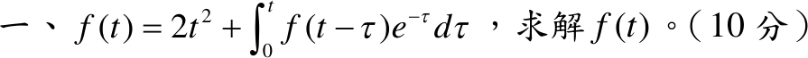

# 110 年第 1 題｜卷積型積分方程

## 已知與所求

\(f(t)=2t^2+\int_0^tf(t-\tau)\,e^{-\tau}\,d\tau\)（10 分），求 \(f(t)\)。

## 考場標準作答

**解題邏輯**：積分項 \(\int_0^tf(t-\tau)e^{-\tau}d\tau\) 是卷積 \(e^{-t}*f\)；由卷積定理，轉換後變成 \(\dfrac{F(s)}{s+1}\)，積分方程化為 \(F(s)\) 的一次代數方程。解出 \(F(s)\) 後拆成 \(\dfrac{n!}{s^{n+1}}\) 的倍數，逐項反轉換成 \(t^n\)。前提：\(f(t)\) 的拉氏轉換存在。

### 步驟 1：辨識卷積並列出所需轉換

卷積定義 \((g*f)(t)=\int_0^tg(\tau)\,f(t-\tau)\,d\tau\)，取 \(g(\tau)=e^{-\tau}\)：
\[
\int_0^tf(t-\tau)\,e^{-\tau}\,d\tau=(g*f)(t),\qquad g(t)=e^{-t}
\]
查表 \(\mathcal L\{t^n\}=\dfrac{n!}{s^{n+1}}\)（\(n=2\)，\(2!=2\)）：
\[
\mathcal L\{2t^2\}=2\cdot\frac{2!}{s^3}=\frac{4}{s^3}
\]
查表 \(\mathcal L\{e^{-t}\}=\dfrac{1}{s+1}\)，再用卷積定理 \(\mathcal L\{g*f\}=G(s)F(s)\)：
\[
\mathcal L\{g*f\}=\frac{F(s)}{s+1}
\]

### 求 \(f(t)\)（10 分）

**邏輯**：兩邊取拉氏轉換（線性＋卷積定理），\(F\) 只以一次方出現，移項提出 \(F\) 解出；結果是 \(1/s^3\)、\(1/s^4\) 的組合，配成 \(n!/s^{n+1}\) 查表。

全式取轉換：
\[
F=\frac{4}{s^3}+\frac{F}{s+1}
\]
\(F\) 項移到左邊：
\[
F-\frac{F}{s+1}=\frac{4}{s^3}
\]
提出 \(F\) 並通分：
\[
F\cdot\frac{(s+1)-1}{s+1}=\frac{4}{s^3}
\]
\[
F\cdot\frac{s}{s+1}=\frac{4}{s^3}
\]
兩邊乘 \(\dfrac{s+1}{s}\)：
\[
F=\frac{4}{s^3}\cdot\frac{s+1}{s}=\frac{4(s+1)}{s^4}
\]
拆成兩項：
\[
F=\frac{4s}{s^4}+\frac{4}{s^4}
\]
\[
F=\frac{4}{s^3}+\frac{4}{s^4}
\]
配成 \(\dfrac{n!}{s^{n+1}}\)（\(2!=2\)、\(3!=6\)）：
\[
\frac{4}{s^3}=2\cdot\frac{2!}{s^3},\qquad \frac{4}{s^4}=\frac{4}{6}\cdot\frac{3!}{s^4}=\frac23\cdot\frac{3!}{s^4}
\]
逐項反轉換：
\[
f(t)=2\,\mathcal L^{-1}\left\{\frac{2!}{s^3}\right\}+\frac23\,\mathcal L^{-1}\left\{\frac{3!}{s^4}\right\}
\]
\[
\boxed{f(t)=2t^2+\frac23t^3}
\]

## 驗算

改用時域微分：令 \(g(t)=\int_0^tf(u)e^{-(t-u)}du\)，則 \(g'=f-g\)；原式 \(g=f-2t^2\)，代入得 \(f'-4t=f-(f-2t^2)\)，即 \(f'=4t+2t^2\)、\(f(0)=0\)，積分得 \(f=2t^2+\frac23t^3\)。

## 失分點

- 積分項是卷積，不是 \(f(t)\cdot e^{-t}\) 的乘積；轉換後是 \(\dfrac{F(s)}{s+1}\)，不是 \(F(s+1)\)。
- \(\mathcal L\{2t^2\}=2\cdot\dfrac{2!}{s^3}=\dfrac4{s^3}\)，漏掉 \(2!\) 會使答案係數減半。
- \(\dfrac4{s^4}\) 要除以 \(3!=6\) 才是 \(t^3\) 的係數：\(\tfrac23t^3\)，不是 \(4t^3\)。
