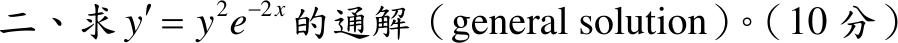

# 110 年第 2 題｜可分離變數微分方程

## 已知與所求

求 \(y'=y^2e^{-2x}\) 的通解（10 分）。

## 考場標準作答

### 步驟 1：\(y\equiv0\) 的情形

分離變數須除以 \(y^2\)，故先檢查常數解。\(y\equiv0\) 時 \(y'=0\)，右邊 \(0^2e^{-2x}=0\)，兩邊相等：
\[
\boxed{y\equiv0}\ \text{為一解}
\]

### 步驟 2：\(y\neq0\) 時分離變數並積分

\[
\frac{dy}{dx}=y^2e^{-2x}
\]
兩邊除以 \(y^2\)、乘 \(dx\)：
\[
y^{-2}\,dy=e^{-2x}\,dx
\]
左邊積分（冪次律 \(\int y^{m}dy=\frac{y^{m+1}}{m+1}\)，\(m=-2\)）：
\[
\int y^{-2}\,dy=\frac{y^{-1}}{-1}=-\frac1y
\]
右邊積分（\(\int e^{ax}dx=\frac{e^{ax}}{a}\)，\(a=-2\)）：
\[
\int e^{-2x}\,dx=\frac{e^{-2x}}{-2}=-\frac12e^{-2x}
\]
兩邊積分常數合併為一個 \(C_1\)：
\[
-\frac1y=-\frac12e^{-2x}+C_1
\]
兩邊乘 \(-1\)，並令 \(C=-C_1\)（任意常數）：
\[
\frac1y=\frac12e^{-2x}+C
\]

### 通解（10 分）

取倒數得 \(y\)，另補上不在此族中的 \(y\equiv0\)：

\[
y=\frac{1}{\frac12e^{-2x}+C}
\]
\[
\boxed{y(x)=\frac{1}{C+\frac12e^{-2x}}}
\]
另有 \(y\equiv0\)（步驟 1）：它使 \(\frac1y\) 無定義，任何有限 \(C\) 都得不到，須另列為奇異解。

## 驗算

視為 Bernoulli 方程，令 \(u=1/y\)：\(u'=-y'/y^2=-e^{-2x}\)，積分 \(u=\frac12e^{-2x}+C\)，與上式相同。直接代回：\(y=(C+\frac12e^{-2x})^{-1}\)，\(y'=-(C+\frac12e^{-2x})^{-2}\cdot(-e^{-2x})=y^2e^{-2x}\)。\(y\equiv0\) 代入兩邊皆為 0。

## 失分點

- 除以 \(y^2\) 時遺失 \(y\equiv0\)，且它不屬於任何有限 \(C\) 的通解族。
- \(\int e^{-2x}dx=-\frac12e^{-2x}\)，漏掉 \(-\frac12\) 的係數會得錯誤的 \(e^{-2x}\) 係數。
- 積分常數只需一個；合併後再取倒數，不可寫成 \(y=2e^{2x}+C\)（倒數不能逐項取）。
