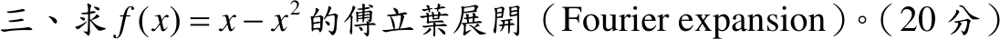
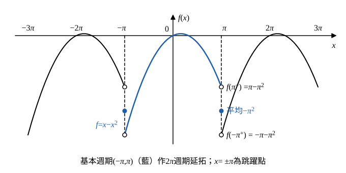

# 110 年第 3 題｜\(f(x)=x-x^2\) 的傅立葉展開

## 已知與所求

求 \(f(x)=x-x^2\) 的傅立葉展開（20 分）。題目未給區間，依慣例取 \(-\pi<x<\pi\) 並作 \(2\pi\) 週期延拓（見條件與疑義）。

## 考場標準作答

### 步驟 1：週期延拓與跳躍點

題目未給區間，假設取基本區間 \(-\pi<x<\pi\)、作 \(2\pi\) 週期延拓（\(L=\pi\)；一般 \((-L,L)\) 見條件與疑義），由 Euler 公式：
\[
f(x)\sim\frac{a_0}{2}+\sum_{n=1}^{\infty}(a_n\cos nx+b_n\sin nx),\quad
a_n=\frac1\pi\int_{-\pi}^{\pi}f(x)\cos nx\,dx,\quad
b_n=\frac1\pi\int_{-\pi}^{\pi}f(x)\sin nx\,dx
\]

- 區間內 \(f\) 連續，級數收斂到 \(f(x)\)。
- 端點兩側極限不相等，延拓後為跳躍點；以 \(x=\pi\) 為例，右極限依週期性 \(f(\pi^+)=f(-\pi^+)\)：
\[
f(\pi^-)=\pi-\pi^2,\qquad f(\pi^+)=f(-\pi^+)=-\pi-(-\pi)^2=-\pi-\pi^2
\]
\[
\frac{f(\pi^-)+f(\pi^+)}{2}=\frac{(\pi-\pi^2)+(-\pi-\pi^2)}{2}=\frac{-2\pi^2}{2}=-\pi^2
\]

### 步驟 2：奇偶拆分

- \(x\cos nx\)（奇）、\(-x^2\sin nx\)（奇）：在 \((-\pi,\pi)\) 積分為 0。
- \(-x^2\cos nx\)（偶）、\(x\sin nx\)（偶）：\(\int_{-\pi}^{\pi}=2\int_0^{\pi}\)。

因此
\[
a_n=\frac2\pi\int_0^{\pi}(-x^2)\cos nx\,dx,\qquad b_n=\frac2\pi\int_0^{\pi}x\sin nx\,dx
\]

### 步驟 3：共用積分

\(I_1=\int_0^{\pi}x\sin nx\,dx\)（\(u=x\)，\(dv=\sin nx\,dx\)，\(v=-\frac{\cos nx}{n}\)）：
\[
I_1=\Big[-\frac{x\cos nx}{n}\Big]_0^{\pi}+\frac1n\int_0^{\pi}\cos nx\,dx
\]
\[
\Big[-\frac{x\cos nx}{n}\Big]_0^{\pi}=-\frac{\pi(-1)^n}{n}-0,\qquad \frac1n\int_0^{\pi}\cos nx\,dx=\frac1n\Big[\frac{\sin nx}{n}\Big]_0^{\pi}=0
\]
\[
I_1=-\frac{\pi(-1)^n}{n}=\frac{\pi(-1)^{n+1}}{n}
\]
\(I_2=\int_0^{\pi}x^2\cos nx\,dx\)（\(u=x^2\)，\(du=2x\,dx\)；\(dv=\cos nx\,dx\)，\(v=\frac{\sin nx}{n}\)）：
\[
I_2=\Big[\frac{x^2\sin nx}{n}\Big]_0^{\pi}-\frac2n\int_0^{\pi}x\sin nx\,dx
\]
第一項 \(\sin n\pi=0\)、\(\sin0=0\)，為 0；第二項代 \(I_1\)：
\[
I_2=0-\frac2n\cdot\frac{\pi(-1)^{n+1}}{n}=-\frac{2\pi(-1)^{n+1}}{n^2}=\frac{2\pi(-1)^n}{n^2}
\]

### 常數項 \(a_0\)

\[
a_0=\frac1\pi\int_{-\pi}^{\pi}(x-x^2)\,dx=\frac1\pi\int_{-\pi}^{\pi}(-x^2)\,dx=-\frac2\pi\int_0^{\pi}x^2\,dx
\]
\[
\int_0^{\pi}x^2\,dx=\Big[\frac{x^3}{3}\Big]_0^{\pi}=\frac{\pi^3}{3}
\]
\[
a_0=-\frac2\pi\cdot\frac{\pi^3}{3}=-\frac{2\pi^2}{3}
\]
\[
\boxed{\frac{a_0}{2}=-\frac{\pi^2}{3}}
\]

### 餘弦係數 \(a_n\)

\[
a_n=\frac2\pi\int_0^{\pi}(-x^2)\cos nx\,dx=-\frac2\pi I_2
\]
\[
a_n=-\frac2\pi\cdot\frac{2\pi(-1)^n}{n^2}
\]
\[
\boxed{a_n=-\frac{4(-1)^n}{n^2}}
\]

### 正弦係數 \(b_n\)

\[
b_n=\frac2\pi\int_0^{\pi}x\sin nx\,dx=\frac2\pi I_1
\]
\[
b_n=\frac2\pi\cdot\frac{\pi(-1)^{n+1}}{n}
\]
\[
\boxed{b_n=\frac{2(-1)^{n+1}}{n}}
\]

### 傅立葉展開（20 分）

\[
\boxed{x-x^2=-\frac{\pi^2}{3}+\sum_{n=1}^{\infty}\left[-\frac{4(-1)^n}{n^2}\cos nx+\frac{2(-1)^{n+1}}{n}\sin nx\right],\quad -\pi<x<\pi}
\]
前幾項：\(-\frac{\pi^2}{3}+4\cos x-\cos2x+\frac49\cos3x-\cdots+2\sin x-\sin2x+\frac23\sin3x-\cdots\)。在 \(x=\pm\pi\)（及其 \(2\pi\) 平移）級數收斂到步驟 1 的平均值 \(-\pi^2\)。

## 驗算

用 \(\sum\frac1{n^2}=\frac{\pi^2}{6}\)、\(\sum\frac{(-1)^n}{n^2}=-\frac{\pi^2}{12}\) 檢查兩點：
- \(x=0\)：\(\sin0=0\)，\(-\frac{\pi^2}{3}-4\left(-\frac{\pi^2}{12}\right)=-\frac{\pi^2}{3}+\frac{\pi^2}{3}=0=f(0)\)。
- \(x=\pi\)（跳躍點）：\(\cos n\pi=(-1)^n\)，\((-1)^n(-1)^n=1\)，\(-\frac{\pi^2}{3}-4\cdot\frac{\pi^2}{6}=-\pi^2\)，與步驟 1 平均值一致。

## 失分點

- 常數項是 \(\frac{a_0}{2}=-\frac{\pi^2}{3}\)，誤寫 \(a_0\) 會差一倍。
- \(x\) 項只貢獻 \(b_n\)、\(-x^2\) 項只貢獻 \(a_n\)；混算時常把 \(\int x\cos nx\) 誤當非零。
- 題目未給區間，作答開頭須寫明假設 \((-\pi,\pi)\)、週期 \(2\pi\)，並寫出端點收斂到 \(-\pi^2\)。

## 條件與疑義

官方題幹只給 \(f(x)=x-x^2\)，未指定展開區間與週期，上式採最常見的 \((-\pi,\pi)\)。若改取 \((-L,L)\)、週期 \(2L\)，同法得
\[
\frac{a_0}{2}=-\frac{L^2}{3},\qquad a_n=-\frac{4L^2(-1)^n}{n^2\pi^2},\qquad b_n=\frac{2L(-1)^{n+1}}{n\pi},
\]
展開於 \(\cos\frac{n\pi x}{L}\)、\(\sin\frac{n\pi x}{L}\)；\(L=\pi\) 時即回到主解。
