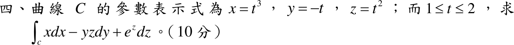

# 110 年第 4 題｜參數曲線線積分

## 已知與所求

曲線 \(C\)：\(x=t^3,\ y=-t,\ z=t^2\)，\(1\le t\le2\)。求 \(\int_C x\,dx-yz\,dy+e^z\,dz\)（10 分）。

## 考場標準作答

**解題邏輯**：這是第二類（對座標）線積分。被積向量場 \((x,\,-yz,\,e^z)\) 的旋度 \(\vec i\) 分量 \(\partial_y(e^z)-\partial_z(-yz)=0-(-y)=y\ne0\)，不是保守場，結果與路徑有關，必須沿給定曲線計算。依參數化法：把 \(x,y,z\) 與 \(dx,dy,dz\) 全換成 \(t\) 的函數，化為 \(t:1\to2\) 的單變數定積分，三項分別積分後相加。

### 步驟 1：參數化與微分

\[
x=t^3\;\Rightarrow\;dx=3t^2\,dt
\]
\[
y=-t\;\Rightarrow\;dy=-dt
\]
\[
z=t^2\;\Rightarrow\;dz=2t\,dt
\]

### 步驟 2：三項各自換成 \(t\)

\[
x\,dx=t^3\cdot3t^2\,dt=3t^5\,dt
\]
\[
-yz\,dy=-(-t)(t^2)(-dt)=-t^3\,dt
\]
（三個負號相乘仍為負。）
\[
e^z\,dz=e^{t^2}\cdot2t\,dt
\]
\[
I=\int_1^2\left(3t^5-t^3+2te^{t^2}\right)dt
\]

### 求線積分（10 分）

**邏輯**：參數化後線積分等於對 \(t\) 的定積分，可逐項積分；前兩項用冪次積分，第三項用代換 \(u=t^2\)（\(du=2t\,dt\)）。

第 1 項（冪次積分 \(\int t^n\,dt=\frac{t^{n+1}}{n+1}\)）：
\[
\int_1^2 3t^5\,dt=\Big[\frac{t^6}{2}\Big]_1^2=\frac{64}{2}-\frac12=\frac{63}{2}
\]
第 2 項：
\[
\int_1^2(-t^3)\,dt=-\Big[\frac{t^4}{4}\Big]_1^2=-\Big(\frac{16}{4}-\frac14\Big)=-\frac{15}{4}
\]
第 3 項（代換 \(u=t^2\)，\(du=2t\,dt\)，上下限 \(t:1\to2\) 對應 \(u:1\to4\)）：
\[
\int_1^2 2te^{t^2}\,dt=\int_1^4e^u\,du=\Big[e^u\Big]_1^4=e^4-e
\]
前兩項合併（通分為 4）：
\[
\frac{63}{2}-\frac{15}{4}=\frac{126}{4}-\frac{15}{4}=\frac{111}{4}=27.75
\]
第 3 項數值：
\[
e^4\approx54.60,\qquad e\approx2.718
\]
\[
e^4-e\approx54.60-2.718=51.88
\]
相加：
\[
I=\frac{111}{4}+e^4-e\approx27.75+51.88
\]
\[
\boxed{\frac{111}{4}+e^4-e\approx79.63}
\]

## 驗算

拆場：\(x\,dx+e^z\,dz=d\left(\frac{x^2}{2}+e^z\right)\) 為全微分，由 \(t=1\) 的 \((1,-1,1)\) 到 \(t=2\) 的 \((8,-2,4)\) 得 \(\frac{64-1}{2}+e^4-e\approx31.50+51.88=83.38\)；剩下 \(-yz\,dy\) 沿曲線為 \(\int_1^2(-t^3)dt=-\frac{15}{4}=-3.75\)。合計 \(83.38-3.75=79.63\)，相同。

## 失分點

- \(dy=-dt\) 的負號漏掉，\(-yz\,dy\) 會變成 \(+t^3\,dt\)，結果差 \(7.50\)。
- 第 3 項未換上下限：代換成 \(u=t^2\) 後要積 \(u:1\to4\)，不是 \(1\to2\)。
- 誤當保守場只用端點相減（\(-yz\,dy\) 不是全微分）。
