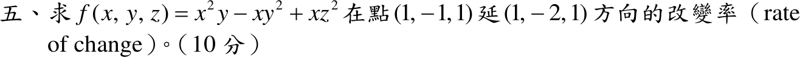

# 110 年第 5 題｜多變數函數的方向導數

## 已知與所求

\(f(x,y,z)=x^2y-xy^2+xz^2\)。求在點 \((1,-1,1)\) 沿方向 \((1,-2,1)\) 的改變率（方向導數）（10 分）。

## 考場標準作答

### 步驟 1：梯度及其在 \((1,-1,1)\) 的值

對某變數偏微分時其餘變數視為常數（冪次法則 \(\frac{d}{dx}x^n=nx^{n-1}\)），逐項微分：
\[
\frac{\partial}{\partial x}(x^2y)=2xy,\qquad \frac{\partial}{\partial x}(-xy^2)=-y^2,\qquad \frac{\partial}{\partial x}(xz^2)=z^2
\]
\[
f_x=2xy-y^2+z^2
\]
\[
\frac{\partial}{\partial y}(x^2y)=x^2,\qquad \frac{\partial}{\partial y}(-xy^2)=-2xy,\qquad \frac{\partial}{\partial y}(xz^2)=0
\]
\[
f_y=x^2-2xy
\]
\[
\frac{\partial}{\partial z}(x^2y)=0,\qquad \frac{\partial}{\partial z}(-xy^2)=0,\qquad \frac{\partial}{\partial z}(xz^2)=2xz
\]
\[
f_z=2xz
\]
代入 \(x=1,\ y=-1,\ z=1\)：
\[
f_x=2(1)(-1)-(-1)^2+1^2=-2-1+1=-2
\]
\[
f_y=1^2-2(1)(-1)=1+2=3
\]
\[
f_z=2(1)(1)=2
\]
\[
\nabla f(1,-1,1)=(-2,\ 3,\ 2)
\]

### 步驟 2：方向單位化

\[
\|(1,-2,1)\|=\sqrt{1^2+(-2)^2+1^2}=\sqrt{1+4+1}=\sqrt6
\]
\[
\mathbf u=\frac{(1,-2,1)}{\sqrt6}
\]

### 求改變率（10 分）

\(f\) 為多項式、處處可微，沿單位向量 \(\mathbf u\) 的方向導數等於梯度在 \(\mathbf u\) 上的投影：

\[
D_{\mathbf u}f=\nabla f\cdot\mathbf u=\frac{(-2)(1)+(3)(-2)+(2)(1)}{\sqrt6}
\]
\[
=\frac{-2-6+2}{\sqrt6}=\frac{-6}{\sqrt6}
\]
分母有理化：
\[
\frac{-6}{\sqrt6}=\frac{-6\sqrt6}{6}=-\sqrt6
\]
\[
D_{\mathbf u}f=\boxed{-\sqrt6}\approx-2.45
\]
負號表示沿此方向 \(f\) 遞減。

## 驗算

沿 \(\mathbf r(h)=(1+h,\,-1-2h,\,1+h)\) 一階展開（略去 \(h^2\) 以上）：\(x^2y\approx-1-4h\)、\(-xy^2\approx-1-5h\)、\(xz^2\approx1+3h\)，合計 \(f\approx-1-6h\)（\(f(1,-1,1)=-1\)）；每單位 \(h\) 走 \(\sqrt6\) 長，故變化率 \(-6/\sqrt6=-\sqrt6\approx-2.45\)，一致。

## 失分點

- 未把方向 \((1,-2,1)\) 單位化，會得 \(-6\)。
- \(f_x\) 漏掉 \(xz^2\) 貢獻的 \(z^2\)，或把 \(-(-1)^2\) 算成 \(+1\)。
