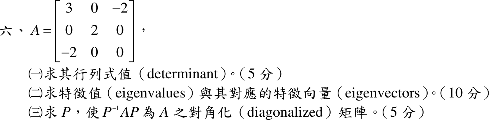

# 110 年第 6 題｜對稱矩陣對角化

## 已知與所求

\(A=\begin{bmatrix}3&0&-2\\0&2&0\\-2&0&0\end{bmatrix}\)。（一）行列式（5 分）；（二）特徵值與特徵向量（10 分）；（三）求 \(P\) 使 \(P^{-1}AP\) 為對角矩陣（5 分）。

## 考場標準作答

**解題邏輯**：第 2 列（與第 2 行）除對角元外全為 0，\(x_2\) 與 \((x_1,x_3)\) 不耦合，行列式與特徵多項式都沿第 2 列展開，只剩一個 \(2\times2\) 子行列式。特徵值由 \(\det(A-\lambda I)=0\) 求得；每個特徵值代入 \((A-\lambda I)\mathbf x=\mathbf 0\) 逐列解出特徵向量 \(\mathbf p_k\)（分量記 \(x_1,x_2,x_3\)）；三個特徵值相異，三個特徵向量線性獨立，排成 \(P\) 即可對角化。

### （一）行列式（5 分）

**邏輯**：沿第 2 列展開，該列只有 \(a_{22}=2\) 非零，\((2,2)\) 位置符號 \((-1)^{2+2}=+\)。

\[
\det A=a_{22}\,C_{22}=2\begin{vmatrix}3&-2\\-2&0\end{vmatrix}
\]
子行列式：
\[
\begin{vmatrix}3&-2\\-2&0\end{vmatrix}=(3)(0)-(-2)(-2)=0-4=-4
\]
\[
\det A=2\times(-4)
\]
\[
\boxed{\det A=-8}
\]

### （二）特徵值與特徵向量（10 分）

**邏輯**：\(\det(A-\lambda I)=0\) 的根即特徵值；\(A-\lambda I\) 第 2 列仍只有對角元 \(2-\lambda\)，同（一）沿第 2 列展開。每個特徵值的係數矩陣秩為 2，一個自由變數，取最簡整數比。

\[
A-\lambda I=\begin{bmatrix}3-\lambda&0&-2\\0&2-\lambda&0\\-2&0&-\lambda\end{bmatrix}
\]
沿第 2 列展開：
\[
\det(A-\lambda I)=(2-\lambda)\begin{vmatrix}3-\lambda&-2\\-2&-\lambda\end{vmatrix}
\]
子行列式：
\[
\begin{vmatrix}3-\lambda&-2\\-2&-\lambda\end{vmatrix}=(3-\lambda)(-\lambda)-(-2)(-2)=\lambda^2-3\lambda-4
\]
因式分解（兩根積 \(-4\)、和 \(3\)）：
\[
\lambda^2-3\lambda-4=(\lambda-4)(\lambda+1)
\]
特徵方程：
\[
(2-\lambda)(\lambda-4)(\lambda+1)=0
\]
\[
\boxed{\lambda_1=4,\qquad \lambda_2=2,\qquad \lambda_3=-1}
\]

\(\lambda_1=4\)：
\[
A-4I=\begin{bmatrix}-1&0&-2\\0&-2&0\\-2&0&-4\end{bmatrix}
\]
第 2 列：
\[
-2x_2=0\quad\Longrightarrow\quad x_2=0
\]
第 1 列：
\[
-x_1-2x_3=0\quad\Longrightarrow\quad x_1=-2x_3
\]
第 3 列 \(-2x_1-4x_3=0\) 是第 1 列的 2 倍，自動成立；取 \(x_3=1\)：
\[
\boxed{\mathbf p_1=(-2,\ 0,\ 1)^T}
\]

\(\lambda_2=2\)：
\[
A-2I=\begin{bmatrix}1&0&-2\\0&0&0\\-2&0&-2\end{bmatrix}
\]
第 1 列：
\[
x_1-2x_3=0\quad\Longrightarrow\quad x_1=2x_3
\]
第 3 列代入 \(x_1=2x_3\)：
\[
-2(2x_3)-2x_3=-6x_3=0\quad\Longrightarrow\quad x_3=0,\ x_1=0
\]
第 2 列全為 0，\(x_2\) 自由，取 \(x_2=1\)：
\[
\boxed{\mathbf p_2=(0,\ 1,\ 0)^T}
\]

\(\lambda_3=-1\)：
\[
A+I=\begin{bmatrix}4&0&-2\\0&3&0\\-2&0&1\end{bmatrix}
\]
第 2 列：
\[
3x_2=0\quad\Longrightarrow\quad x_2=0
\]
第 1 列：
\[
4x_1-2x_3=0\quad\Longrightarrow\quad x_3=2x_1
\]
第 3 列 \(-2x_1+x_3=0\) 是第 1 列的 \(-\tfrac12\) 倍，自動成立；取 \(x_1=1\)：
\[
\boxed{\mathbf p_3=(1,\ 0,\ 2)^T}
\]
（特徵向量可乘任意非零常數。）

### （三）對角化矩陣 \(P\)（5 分）

**邏輯**：\(A\mathbf p_k=\lambda_k\mathbf p_k\) 合寫成 \(AP=PD\)（\(P\) 的第 \(k\) 欄為 \(\mathbf p_k\)、\(D\) 的第 \(k\) 個對角元為 \(\lambda_k\)）；\(\det P\neq0\) 時左乘 \(P^{-1}\) 得 \(P^{-1}AP=D\)。

\[
P=\begin{bmatrix}\mathbf p_1&\mathbf p_2&\mathbf p_3\end{bmatrix}=\begin{bmatrix}-2&0&1\\0&1&0\\1&0&2\end{bmatrix}
\]
可逆性（沿第 2 列展開）：
\[
\det P=1\cdot\begin{vmatrix}-2&1\\1&2\end{vmatrix}=(-2)(2)-(1)(1)=-5\neq0
\]
\[
\boxed{P=\begin{bmatrix}-2&0&1\\0&1&0\\1&0&2\end{bmatrix},\qquad P^{-1}AP=D=\begin{bmatrix}4&0&0\\0&2&0\\0&0&-1\end{bmatrix}}
\]
（\(A\) 為對稱矩陣，三個特徵向量兩兩正交；各欄除以長度 \(\sqrt5\)、\(1\)、\(\sqrt5\) 後亦可得正交矩陣 \(P\)，此時 \(P^{-1}=P^T\)。）

## 驗算

- \(\operatorname{tr}A=3+2+0=5=4+2-1\)；\(\lambda_1\lambda_2\lambda_3=4\cdot2\cdot(-1)=-8=\det A\)，與（一）一致。
- \(A\mathbf p_1=(-6-2,\ 0,\ 4)^T=(-8,0,4)^T=4\mathbf p_1\)，\(A\mathbf p_2=(0,2,0)^T=2\mathbf p_2\)，\(A\mathbf p_3=(3-4,\ 0,\ -2)^T=(-1,0,-2)^T=-\mathbf p_3\)。

## 失分點

- \(P\) 的欄順序必須與對角矩陣中特徵值順序一致。
- 特徵向量要寫成三維（含 \(x_2\) 分量 0），不能只寫 \(x_1,x_3\) 子區塊的二維向量。
- \(\lambda=2\) 時第 2 列全為 0，自由變數是 \(x_2\)；誤把 \(x_1,x_3\) 當自由變數會得錯誤向量。
