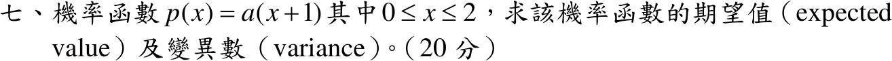

# 110 年第 7 題｜線性機率密度的期望值與變異數

## 已知與所求

\(p(x)=a(x+1)\)，\(0\le x\le2\)。求期望值與變異數（20 分）。

## 考場標準作答

**解題邏輯**：\(p(x)\) 是連續型隨機變數的機率密度，支撐區間 \(0\le x\le2\)，區間外為 0。先由「總機率 = 1」定出常數 \(a\)（步驟 1）；期望值用 \(E[X]=\int x\,p(x)\,dx\)；變異數用捷徑 \(\operatorname{Var}(X)=E[X^2]-(E[X])^2\)，需再求二階動差 \(E[X^2]\)。所有中間值保留精確分數，只在框內附兩位小數。

### 步驟 1：正規化求 \(a\)（期望值、變異數共用）

總機率等於 1：
\[
\int_0^2a(x+1)\,dx=1
\]
冪次積分 \(\int x^n\,dx=\frac{x^{n+1}}{n+1}\)：
\[
\int_0^2(x+1)\,dx=\Big[\frac{x^2}{2}+x\Big]_0^2=\Big(\frac{4}{2}+2\Big)-0=4
\]
\[
4a=1
\]
\[
\boxed{a=\frac14=0.25}
\]
故 \(p(x)=\frac14(x+1)\)，\(0\le x\le2\)；且 \(p(x)\ge0\)，為合法密度。

### 期望值

**邏輯**：連續型隨機變數的期望值 \(E[X]=\int x\,p(x)\,dx\)，只在支撐區間 \([0,2]\) 上積分，\(p(x)\) 取步驟 1 的結果。

\[
E[X]=\int_0^2x\cdot\frac14(x+1)\,dx=\frac14\int_0^2(x^2+x)\,dx
\]
\[
\int_0^2(x^2+x)\,dx=\Big[\frac{x^3}{3}+\frac{x^2}{2}\Big]_0^2=\frac83+\frac42=\frac83+2=\frac{14}{3}
\]
\[
E[X]=\frac14\cdot\frac{14}{3}=\frac{14}{12}
\]
\[
\boxed{E[X]=\frac76\approx1.17}
\]

### 變異數

**邏輯**：\(\operatorname{Var}(X)=E[(X-\mu)^2]\) 展開平方得 \(E[X^2]-(E[X])^2\)；先以 \(E[X^2]=\int x^2p(x)\,dx\) 求二階動差，再減去期望值平方（\(E[X]=\frac76\) 取自上一小題）。

二階動差：
\[
E[X^2]=\int_0^2x^2\cdot\frac14(x+1)\,dx=\frac14\int_0^2(x^3+x^2)\,dx
\]
\[
\int_0^2(x^3+x^2)\,dx=\Big[\frac{x^4}{4}+\frac{x^3}{3}\Big]_0^2=\frac{16}{4}+\frac83=4+\frac83=\frac{20}{3}
\]
\[
E[X^2]=\frac14\cdot\frac{20}{3}=\frac{20}{12}=\frac53
\]
期望值平方：
\[
(E[X])^2=\Big(\frac76\Big)^2=\frac{49}{36}
\]
代入捷徑（通分為 36）：
\[
\operatorname{Var}(X)=E[X^2]-(E[X])^2=\frac53-\frac{49}{36}=\frac{60}{36}-\frac{49}{36}
\]
\[
\boxed{\operatorname{Var}(X)=\frac{11}{36}\approx0.31}
\]

## 驗算

用 CDF \(F(x)=\int_0^x\frac14(u+1)\,du=\frac{x^2+2x}{8}\)（\(F(2)=\frac{8}{8}=1\)）與非負隨機變數的尾端公式：
\[
E[X]=\int_0^2(1-F)\,dx=2-\frac18\Big(\frac83+4\Big)=2-\frac18\cdot\frac{20}{3}=2-\frac56=\frac76,
\]
\[
E[X^2]=\int_0^2 2x(1-F)\,dx=4-\frac14\Big(4+\frac{16}{3}\Big)=4-\frac14\cdot\frac{28}{3}=4-\frac73=\frac53,
\]
與正文一致，故 \(\operatorname{Var}(X)=\frac53-\frac{49}{36}=\frac{11}{36}\)。

## 失分點

- 未先由正規化求 \(a\)，直接以 \(x+1\) 當密度，\(E[X]\) 會得 \(14/3\)，變異數 \(20/3-(14/3)^2\) 甚至為負。
- 把 \(E[X^2]=\frac53\) 當成變異數，漏減 \((E[X])^2=\frac{49}{36}\)。
