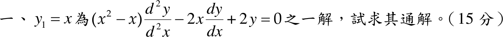

# 111 年第 1 題｜已知一解的二階 ODE

## 已知與所求

\(y_1=x\) 為 \((x^2-x)\dfrac{d^2y}{dx^2}-2x\dfrac{dy}{dx}+2y=0\) 的一解（題中 \(\frac{d^2y}{d^2x}\) 即 \(y''\)），求通解（15 分）。

## 考場標準作答

### 步驟 1：化為標準式

\(x=0\)、\(x=1\) 為奇異點，解在不含 0、1 的區間上成立。兩邊除以首項係數 \(x^2-x=x(x-1)\)（\(x\neq0,1\)），讀出 \(P(x)\)：

\[
y''-\frac{2x}{x(x-1)}\,y'+\frac{2}{x(x-1)}\,y=0
\]
約去 \(x\)：
\[
P(x)=-\frac{2x}{x(x-1)}=-\frac{2}{x-1}
\]

### 步驟 2：積分因子 \(e^{-\int P\,dx}\)

\[
\int P\,dx=-2\int\frac{dx}{x-1}=-2\ln|x-1|
\]
\[
e^{-\int P\,dx}=e^{2\ln|x-1|}=|x-1|^2=(x-1)^2
\]

### 步驟 3：第二解 \(y_2\)

已知一解 \(y_1\)，令 \(y=u\,y_1\) 降階，得第二解公式：
\[
y_2=y_1\int\frac{e^{-\int P\,dx}}{y_1^2}\,dx
\]
積分常數只會多出 \(y_1\) 的倍數，取 0：

\[
y_2=x\int\frac{(x-1)^2}{x^2}\,dx
\]
展開被積函數：
\[
\frac{(x-1)^2}{x^2}=\frac{x^2-2x+1}{x^2}=1-\frac2x+\frac1{x^2}
\]
逐項積分（\(\int\frac{dx}{x}=\ln|x|\)，\(\int x^{-2}dx=-x^{-1}\)）：
\[
\int\Big(1-\frac2x+\frac1{x^2}\Big)dx=x-2\ln|x|-\frac1x
\]
乘回 \(y_1=x\)：
\[
y_2=x\Big(x-2\ln|x|-\frac1x\Big)=x^2-2x\ln|x|-1
\]

### 通解（15 分）

\(y_2/y_1=x-2\ln|x|-\frac1x\) 不是常數，\(y_1\)、\(y_2\) 線性獨立：

\[
\boxed{y=C_1x+C_2\left(x^2-2x\ln|x|-1\right)}
\]
（在不含 \(x=0\)、\(x=1\) 的任一區間上成立。）

## 驗算

直接代回 \(y_2\)：\(y_2'=2x-2\ln|x|-2\)，\(y_2''=2-\frac2x\)；\((x^2-x)(2-\frac2x)=2x^2-4x+2\)，\(-2xy_2'=-4x^2+4x\ln|x|+4x\)，\(2y_2=2x^2-4x\ln|x|-2\)，三項相加為 0。Abel 公式：\(W=Ce^{-\int P\,dx}=C(x-1)^2\)；直接算 \(W(x,y_2)=xy_2'-y_2=x(2x-2\ln|x|-2)-(x^2-2x\ln|x|-1)=(x-1)^2\)，相符且不恆為零，兩解線性獨立。

## 失分點

- 未先除以 \(x^2-x\)，把 \(P\) 誤取為 \(-2x\)，積分因子就錯。
- \(e^{-\int P\,dx}\) 的負號：\(-\int P\,dx=+2\ln|x-1|\)，誤得 \((x-1)^{-2}\) 會使 \(y_2\) 錯。
- 只寫 \(y_2\) 不寫 \(C_1y_1+C_2y_2\) 的通解形式。
