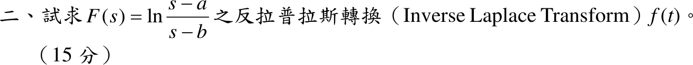

# 111 年第 2 題

## 已知與所求

已知 \(F(s)=\ln\dfrac{s-a}{s-b}\)，求反拉普拉斯轉換 \(f(t)\)（15 分）。

## 考場標準作答

### 步驟 1：拆開對數並對 \(s\) 微分

取 \(s>a\)、\(s>b\)，使對數與轉換都有意義。對數商法則 \(\ln\dfrac pq=\ln p-\ln q\)：
\[
F(s)=\ln(s-a)-\ln(s-b)
\]
逐項微分，\(\dfrac{d}{ds}\ln(s-c)=\dfrac{1}{s-c}\)：
\[
F'(s)=\frac{1}{s-a}-\frac{1}{s-b}
\]
乘以 \(-1\)：
\[
-F'(s)=\frac{1}{s-b}-\frac{1}{s-a}
\]

### 求 \(f(t)\)（15 分）

\[
\mathcal L\{t\,f(t)\}=-F'(s)=\frac{1}{s-b}-\frac{1}{s-a}
\]
兩邊反轉換（線性）：
\[
t\,f(t)=\mathcal L^{-1}\left\{\frac{1}{s-b}\right\}-\mathcal L^{-1}\left\{\frac{1}{s-a}\right\}
\]
逐項查表：
\[
t\,f(t)=e^{bt}-e^{at}
\]
兩邊除以 \(t\)（\(t>0\)）：
\[
\boxed{f(t)=\frac{e^{bt}-e^{at}}{t}}
\]

## 驗算

用頻域積分 \(\mathcal L\{g(t)/t\}=\int_s^\infty G(\sigma)\,d\sigma\)，\(g=e^{bt}-e^{at}\)：
\[
\int_s^\infty\left(\frac{1}{\sigma-b}-\frac{1}{\sigma-a}\right)d\sigma
=\left[\ln\frac{\sigma-b}{\sigma-a}\right]_s^\infty=\ln\frac{s-a}{s-b}
\]
與 \(F(s)\) 相同；且 \(t\to0\) 時 \(f(t)\to b-a\)，函數有界。

## 失分點

- 由 \(-F'(s)\) 反轉換得到的是 \(tf(t)\)，忘記再除以 \(t\)。
- 漏掉 \(-F'(s)\) 的負號，會得到相反號的 \(\dfrac{e^{at}-e^{bt}}{t}\)。
