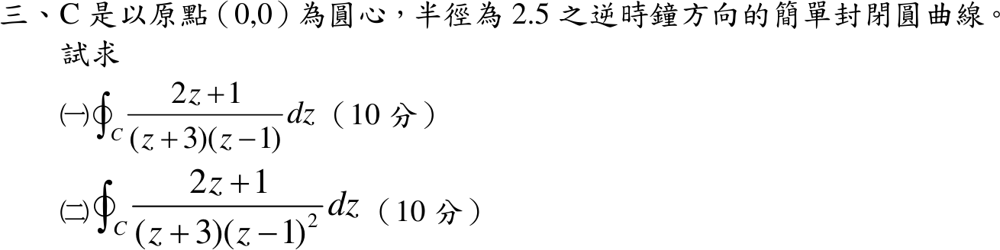
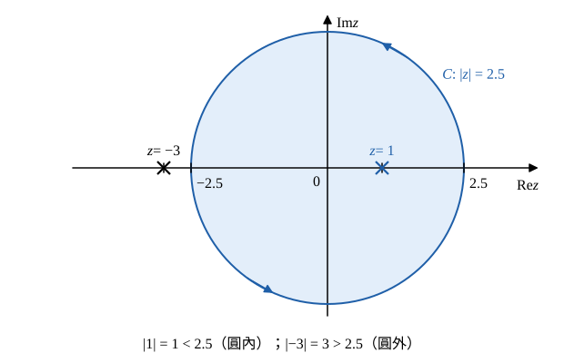

# 111 年第 3 題｜兩個圓周留數積分

## 已知與所求

\(C\)：圓心原點、半徑 2.5 的簡單封閉圓，逆時針。求（一）\(\oint_C\frac{2z+1}{(z+3)(z-1)}dz\)（10 分）；（二）\(\oint_C\frac{2z+1}{(z+3)(z-1)^2}dz\)（10 分）。

## 考場標準作答

**解題邏輯**：兩個被積函數除分母零點 \(z=1\)、\(z=-3\) 外處處解析，用留數定理 \(\oint_Cf\,dz=2\pi i\sum\operatorname{Res}\)（只加 \(C\) 內部的極點；題目已給逆時針，即正向）。先以「極點到圓心距離 vs 半徑 2.5」判斷哪些極點在圓內，兩小題共用；（一）\(z=1\) 為一階極點，用 \(\lim(z-1)f\)；（二）\(z=1\) 為二階極點，用一次微分的留數公式。兩極點都不在圓周上，積分有定義。

### 步驟 1：極點位置（兩小題共用）

兩個分母的零點都是 \(z=1\) 與 \(z=-3\)（分子 \(2z+1\) 在這兩點為 \(3\)、\(-5\)，不為 0，不會約掉）。到圓心 \(0\) 的距離：
\[
|1-0|=1<2.5\quad(\text{圓內})
\]
\[
|-3-0|=3>2.5\quad(\text{圓外})
\]
故兩小題都只計 \(z=1\) 的留數。

### （一）一階極點（10 分）

**邏輯**：\(f_1=\dfrac{2z+1}{(z+3)(z-1)}\) 中 \((z-1)\) 只出現一次，\(z=1\) 是一階極點，留數 \(=\lim_{z\to1}(z-1)f_1(z)\)；再代入留數定理。

一階極點留數公式：
\[
\operatorname{Res}_{z=1}f_1=\lim_{z\to1}(z-1)\frac{2z+1}{(z+3)(z-1)}
\]
約去 \((z-1)\)：
\[
=\lim_{z\to1}\frac{2z+1}{z+3}
\]
代入 \(z=1\)：
\[
=\frac{2(1)+1}{1+3}=\frac34
\]
留數定理（只有圓內一個極點）：
\[
I_1=2\pi i\operatorname{Res}_{z=1}f_1=2\pi i\cdot\frac34
\]
\[
\boxed{I_1=\frac{3\pi i}{2}}\approx4.71\,i
\]

### （二）二階極點（10 分）

**邏輯**：\(f_2=\dfrac{2z+1}{(z+3)(z-1)^2}\) 中 \((z-1)\) 為二次，\(z=1\) 是二階極點，用 \(m\) 階極點公式 \(\operatorname{Res}=\dfrac{1}{(m-1)!}\lim\dfrac{d^{m-1}}{dz^{m-1}}\bigl[(z-z_0)^mf\bigr]\)，取 \(m=2\)。

令
\[
g(z)=(z-1)^2f_2(z)=\frac{2z+1}{z+3}
\]
\(m=2\) 的留數公式（\((m-1)!=1!=1\)）：
\[
\operatorname{Res}_{z=1}f_2=\frac1{1!}\lim_{z\to1}\frac{d}{dz}g(z)=g'(1)
\]
商法則 \(\left(\dfrac pq\right)'=\dfrac{p'q-pq'}{q^2}\)，\(p=2z+1\)、\(q=z+3\)、\(p'=2\)、\(q'=1\)：
\[
g'(z)=\frac{2(z+3)-(2z+1)(1)}{(z+3)^2}
\]
展開分子：
\[
2z+6-2z-1=5
\]
\[
g'(z)=\frac{5}{(z+3)^2}
\]
代入 \(z=1\)：
\[
\operatorname{Res}_{z=1}f_2=g'(1)=\frac{5}{(1+3)^2}=\frac5{16}
\]
留數定理：
\[
I_2=2\pi i\operatorname{Res}_{z=1}f_2=2\pi i\cdot\frac5{16}
\]
\[
\boxed{I_2=\frac{5\pi i}{8}}\approx1.96\,i
\]

## 驗算

用「全部有限留數和 \(=\) 無窮遠處展開的 \(1/z\) 係數」：
- （一）\(|z|\to\infty\) 時被積函數 \(\sim 2/z\)，有限留數和為 2；\(\operatorname{Res}_{z=-3}f_1=\frac{2(-3)+1}{-3-1}=\frac{-5}{-4}=\frac54\)，故圓內為 \(2-\frac54=\frac34\)，一致。
- （二）被積函數 \(\sim 2/z^2\)，有限留數和為 0；\(\operatorname{Res}_{z=-3}f_2=\frac{2(-3)+1}{(-3-1)^2}=\frac{-5}{16}\)，故圓內為 \(0-\left(-\frac5{16}\right)=\frac5{16}\)，一致。

## 失分點

- 把圓外的 \(z=-3\)（距離 \(3>2.5\)）也計入留數和。
- （二）的 \(z=1\) 是二階極點，仍用一階公式 \(\lim(z-1)f\) 會發散；要先乘 \((z-1)^2\) 再微分一次。
- 商法則分子順序寫反成 \(pq'-p'q\)，會得 \(-\frac5{16}\)。
