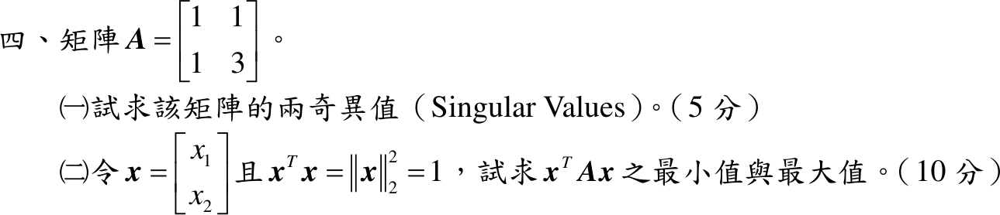

# 111 年第 4 題｜奇異值與二次型極值

## 已知與所求

\(A=\begin{bmatrix}1&1\\1&3\end{bmatrix}\)。（一）求兩奇異值（5 分）；（二）\(x=[x_1\ x_2]^T\)、\(x^Tx=\lVert x\rVert_2^2=1\)，求 \(x^TAx\) 的最小值與最大值（10 分）。

## 考場標準作答

### （一）奇異值（5 分）

奇異值 \(\sigma_i=\sqrt{\mu_i}\)，\(\mu_i\) 為 \(A^TA\) 的特徵值（\(A^TA\) 對稱半正定，\(\mu_i\ge0\)）。

\(A\) 對稱，\(A^T=A\)，矩陣乘法逐元素：
\[
(A^TA)_{11}=1\cdot1+1\cdot1=2,\qquad (A^TA)_{12}=(A^TA)_{21}=1\cdot1+1\cdot3=4,\qquad (A^TA)_{22}=1\cdot1+3\cdot3=10
\]
\[
A^TA=\begin{bmatrix}2&4\\4&10\end{bmatrix}
\]
特徵方程 \(\det(A^TA-\mu I)=0\)：
\[
(2-\mu)(10-\mu)-4\cdot4=0
\]
展開：
\[
\mu^2-12\mu+20-16=\mu^2-12\mu+4=0
\]
公式解：
\[
\mu=\frac{12\pm\sqrt{144-16}}{2}=\frac{12\pm\sqrt{128}}{2}=\frac{12\pm8\sqrt2}{2}=6\pm4\sqrt2
\]
配成完全平方（\((2\pm\sqrt2)^2=4\pm4\sqrt2+2=6\pm4\sqrt2\)）後開根號：
\[
\sigma=\sqrt{6\pm4\sqrt2}=2\pm\sqrt2
\]
\[
\boxed{\sigma_1=2+\sqrt2,\quad \sigma_2=2-\sqrt2}
\]
數值 \(\sigma_1\approx3.41\)、\(\sigma_2\approx0.59\)。

### （二）\(x^TAx\) 的極值（10 分）

\(A\) 實對稱，\(A=Q\Lambda Q^T\)（\(Q\) 正交）；令 \(y=Q^Tx\)，則 \(\lVert y\rVert=\lVert x\rVert=1\)，\(x^TAx=\lambda_1y_1^2+\lambda_2y_2^2\)。

特徵方程 \(\det(A-\lambda I)=0\)：
\[
(1-\lambda)(3-\lambda)-1\cdot1=0
\]
展開：
\[
\lambda^2-4\lambda+3-1=\lambda^2-4\lambda+2=0
\]
公式解：
\[
\lambda=\frac{4\pm\sqrt{16-8}}{2}=\frac{4\pm2\sqrt2}{2}=2\pm\sqrt2
\]
加權平均的範圍（\(y_1^2+y_2^2=1\)）：
\[
x^TAx=(2-\sqrt2)y_1^2+(2+\sqrt2)y_2^2\in\bigl[\,2-\sqrt2,\ 2+\sqrt2\,\bigr]
\]
\[
\boxed{\min x^TAx=2-\sqrt2},\qquad \boxed{\max x^TAx=2+\sqrt2}
\]
數值 \(\min\approx0.59\)、\(\max\approx3.41\)。取到極值的 \(x\)：由 \((A-\lambda I)v=0\) 第一列 \((1-\lambda)v_1+v_2=0\) 得 \(v_2=(\lambda-1)v_1\)，最小值在 \(x\parallel(1,\,1-\sqrt2)^T\)、最大值在 \(x\parallel(1,\,1+\sqrt2)^T\)（各取單位長）。

## 驗算

- （一）\(\sigma_1\sigma_2=(2+\sqrt2)(2-\sqrt2)=4-2=2=|\det A|=|1\cdot3-1\cdot1|\)；\(\sigma_1^2+\sigma_2^2=(6+4\sqrt2)+(6-4\sqrt2)=12=\lVert A\rVert_F^2=1+1+1+9\)。
- （二）令 \(x=(\cos\theta,\sin\theta)\)：\(x^TAx=\cos^2\theta+2\sin\theta\cos\theta+3\sin^2\theta=2-\cos2\theta+\sin2\theta=2+\sqrt2\sin(2\theta-\tfrac\pi4)\)，範圍正是 \([2-\sqrt2,\ 2+\sqrt2]\)。

## 失分點

- 把奇異值寫成 \(\sqrt{2\pm\sqrt2}\)（對 \(A\) 的特徵值再開根號）；應是 \(A^TA\) 特徵值的平方根。
- （二）只寫特徵值而未說明 \(A\) 對稱、約束為單位向量，極值論據不完整。
- \(A^TA\) 的 \((2,2)\) 元是 \(1+9=10\)，誤算成 \(9\) 會使 \(\mu\) 錯誤、\(\sigma_1\sigma_2\ne|\det A|\)。
