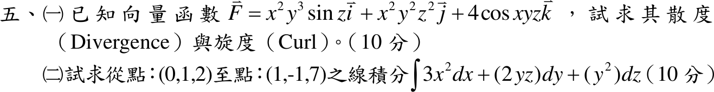

# 111 年第 5 題

## 已知與所求

（一）\(\vec F=x^2y^3\sin z\,\vec i+x^2y^2z^2\,\vec j+4\cos(xyz)\,\vec k\)，求散度與旋度（10 分）。（二）求由點 \((0,1,2)\) 至點 \((1,-1,7)\) 的 \(\int 3x^2dx+(2yz)dy+(y^2)dz\)（10 分）。

## 考場標準作答

**解題邏輯**：（一）散度是三個分量對「各自」變數的偏導數之和；旋度用行列式（叉積）公式展開，每個分量是兩個交叉偏導數相減，所以先把散度的 3 個偏導數與旋度的 6 個交叉偏導數逐一算出（步驟 1），再代入公式組合。（二）題目沒有指定路徑，先驗證被積向量場 \(\vec G=(3x^2,\,2yz,\,y^2)\) 的旋度為零（保守場，定義域 \(\mathbb R^3\) 單連通），再以逐項積分求位勢 \(\phi\)，線積分 \(=\phi(\text{終點})-\phi(\text{起點})\)。前提：題幹的 \(4\cos xyz\) 讀作 \(4\cos(xyz)\)。

### 步驟 1：\(\vec F\) 的分量與九個偏導數（（一）共用）

\(F_1=x^2y^3\sin z,\quad F_2=x^2y^2z^2,\quad F_3=4\cos(xyz)\)。對某變數偏微分時，其餘變數視為常數；\(\cos(xyz)\) 用鏈鎖律 \(\frac{\partial}{\partial x}\cos(xyz)=-\sin(xyz)\cdot\frac{\partial(xyz)}{\partial x}\)。

散度用的三個：
\[
\frac{\partial F_1}{\partial x}=2x\cdot y^3\sin z=2xy^3\sin z
\]
\[
\frac{\partial F_2}{\partial y}=x^2\cdot 2y\cdot z^2=2x^2yz^2
\]
\[
\frac{\partial F_3}{\partial z}=4\cdot\big(-\sin(xyz)\big)\cdot xy=-4xy\sin(xyz)
\]
旋度用的六個：
\[
\frac{\partial F_3}{\partial y}=4\cdot\big(-\sin(xyz)\big)\cdot xz=-4xz\sin(xyz)
\]
\[
\frac{\partial F_2}{\partial z}=x^2y^2\cdot 2z=2x^2y^2z
\]
\[
\frac{\partial F_1}{\partial z}=x^2y^3\cos z
\]
\[
\frac{\partial F_3}{\partial x}=4\cdot\big(-\sin(xyz)\big)\cdot yz=-4yz\sin(xyz)
\]
\[
\frac{\partial F_2}{\partial x}=2x\cdot y^2z^2=2xy^2z^2
\]
\[
\frac{\partial F_1}{\partial y}=x^2\cdot 3y^2\sin z=3x^2y^2\sin z
\]

### （一）散度與旋度（10 分）

**邏輯**：散度 \(\nabla\cdot\vec F=\partial_xF_1+\partial_yF_2+\partial_zF_3\)；旋度為行列式 \(\begin{vmatrix}\vec i&\vec j&\vec k\\ \partial_x&\partial_y&\partial_z\\ F_1&F_2&F_3\end{vmatrix}\) 對第一列展開，各偏導數取自步驟 1。

散度：
\[
\nabla\cdot\vec F=\frac{\partial F_1}{\partial x}+\frac{\partial F_2}{\partial y}+\frac{\partial F_3}{\partial z}
\]
\[
\boxed{\nabla\cdot\vec F=2xy^3\sin z+2x^2yz^2-4xy\sin(xyz)}
\]
旋度公式：
\[
\nabla\times\vec F=
\left(\frac{\partial F_3}{\partial y}-\frac{\partial F_2}{\partial z}\right)\vec i
+\left(\frac{\partial F_1}{\partial z}-\frac{\partial F_3}{\partial x}\right)\vec j
+\left(\frac{\partial F_2}{\partial x}-\frac{\partial F_1}{\partial y}\right)\vec k
\]
\(\vec i\) 分量：
\[
\frac{\partial F_3}{\partial y}-\frac{\partial F_2}{\partial z}=-4xz\sin(xyz)-2x^2y^2z=-\left[4xz\sin(xyz)+2x^2y^2z\right]
\]
\(\vec j\) 分量（減去負項變加號）：
\[
\frac{\partial F_1}{\partial z}-\frac{\partial F_3}{\partial x}=x^2y^3\cos z-\big(-4yz\sin(xyz)\big)=x^2y^3\cos z+4yz\sin(xyz)
\]
\(\vec k\) 分量：
\[
\frac{\partial F_2}{\partial x}-\frac{\partial F_1}{\partial y}=2xy^2z^2-3x^2y^2\sin z
\]
合併三個分量：
\[
\boxed{\nabla\times\vec F=-\left[4xz\sin(xyz)+2x^2y^2z\right]\vec i+\left[x^2y^3\cos z+4yz\sin(xyz)\right]\vec j+\left(2xy^2z^2-3x^2y^2\sin z\right)\vec k}
\]

### （二）線積分（10 分）

**邏輯**：路徑未指定，只有保守場（\(\nabla\times\vec G=\vec 0\)）的線積分才與路徑無關；此時存在位勢 \(\phi\) 使 \(\nabla\phi=\vec G\)，由線積分基本定理 \(\int_A^B\vec G\cdot d\vec r=\phi(B)-\phi(A)\)。

被積式寫成 \(\vec G\cdot d\vec r\)，\(G_1=3x^2,\ G_2=2yz,\ G_3=y^2\)。逐分量檢查旋度：
\[
\vec i:\ \frac{\partial G_3}{\partial y}-\frac{\partial G_2}{\partial z}=2y-2y=0
\]
\[
\vec j:\ \frac{\partial G_1}{\partial z}-\frac{\partial G_3}{\partial x}=0-0=0
\]
\[
\vec k:\ \frac{\partial G_2}{\partial x}-\frac{\partial G_1}{\partial y}=0-0=0
\]
\(\nabla\times\vec G=\vec 0\) 且 \(\vec G\) 在 \(\mathbb R^3\) 上連續可微，故為保守場。

求位勢（逐項積分，每次補上與該變數無關的待定函數）：
\[
\frac{\partial\phi}{\partial x}=3x^2\;\Rightarrow\;\phi=x^3+g(y,z)
\]
\[
\frac{\partial\phi}{\partial y}=\frac{\partial g}{\partial y}=2yz\;\Rightarrow\;g=y^2z+h(z)
\]
\[
\frac{\partial\phi}{\partial z}=y^2+h'(z)=y^2\;\Rightarrow\;h'(z)=0\;\Rightarrow\;h=C
\]
\[
\phi=x^3+y^2z\quad(\text{常數 }C\text{ 相減後消去，取 }0)
\]
代入兩端點：
\[
\phi(1,-1,7)=1^3+(-1)^2\cdot7=1+7=8
\]
\[
\phi(0,1,2)=0^3+1^2\cdot2=0+2=2
\]
\[
\int_{(0,1,2)}^{(1,-1,7)}3x^2dx+2yz\,dy+y^2dz=\phi(1,-1,7)-\phi(0,1,2)=8-2
\]
\[
\boxed{6}
\]

## 驗算

- （一）\(\nabla\cdot(\nabla\times\vec F)\) 應恆為 0：\(\partial_x\) 項 \(-4z\sin(xyz)-4xyz^2\cos(xyz)-4xy^2z\)，\(\partial_y\) 項 \(3x^2y^2\cos z+4z\sin(xyz)+4xyz^2\cos(xyz)\)，\(\partial_z\) 項 \(4xy^2z-3x^2y^2\cos z\)，三者相加為 0。
- （二）不用位勢，沿直線 \((t,\,1-2t,\,2+5t)\)，\(0\le t\le1\)（\(dx=dt,\ dy=-2\,dt,\ dz=5\,dt\)）：被積式 \(3t^2-2(1-2t)(2+5t)\cdot2+5(1-2t)^2\)，積分得 \(1-10+\frac{40}{3}+\frac53=6\)，一致。

## 失分點

- 旋度 \(\vec j\) 分量是 \(\partial_zF_1-\partial_xF_3\)，順序寫反會整項變號。
- \(4\cos(xyz)\) 對 \(x\) 偏微分要乘鏈鎖因子 \(yz\)，得 \(-4yz\sin(xyz)\)。
- （二）未先驗證保守場就直接用端點相減，論據不完整。
