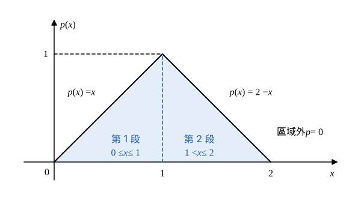

# 111 年第 6 題｜三角形機率密度的動差

## 已知與所求

\(p(x)=x\)（\(0\le x\le1\)）、\(2-x\)（\(1<x\le2\)）、其他為 0。求（一）\(E\{X\}\)；（二）\(E\{(X-E\{X\})^2\}\)；（三）\(E\{X^3\}\)，各 5 分。

## 考場標準作答

**解題邏輯**：三問都是連續型隨機變數的動差 \(E[X^k]=\int x^k p(x)\,dx\)。\(p(x)\) 是分段函數（三角形密度），區域外為 0，所以每個積分都拆成 \([0,1]\) 與 \([1,2]\) 兩段，各代入該段的式子。（一）取 \(k=1\)；（二）用變異數捷徑 \(E[(X-\mu)^2]=E[X^2]-\mu^2\)，需先求 \(E[X^2]\)；（三）取 \(k=3\)。所有中間值保留精確分數。

### 步驟 1：分段積分的寫法（三問共用）

- 區域外 \(p=0\)，積分範圍只剩 \(0\le x\le2\)，並在 \(x=1\) 切成兩段：
\[
E[X^k]=\int_0^1x^k\cdot x\,dx+\int_1^2x^k(2-x)\,dx
\]
- 先確認是合法密度（總面積 = 1）：
\[
\int_0^1x\,dx=\Big[\frac{x^2}{2}\Big]_0^1=\frac12
\]
\[
\int_1^2(2-x)\,dx=\Big[2x-\frac{x^2}{2}\Big]_1^2=(4-2)-\Big(2-\frac12\Big)=2-\frac32=\frac12
\]
\[
\frac12+\frac12=1
\]

### （一）平均值 \(E\{X\}\)（5 分）

**邏輯**：\(E[X]=\int x\,p(x)\,dx\)，步驟 1 公式取 \(k=1\)。

\[
E[X]=\int_0^1x^2\,dx+\int_1^2(2x-x^2)\,dx
\]
第 1 段（冪次積分 \(\int x^n dx=\frac{x^{n+1}}{n+1}\)）：
\[
\int_0^1x^2\,dx=\Big[\frac{x^3}{3}\Big]_0^1=\frac13
\]
第 2 段：
\[
\int_1^2(2x-x^2)\,dx=\Big[x^2-\frac{x^3}{3}\Big]_1^2=\Big(4-\frac83\Big)-\Big(1-\frac13\Big)
\]
\[
=\frac43-\frac23=\frac23
\]
兩段相加：
\[
E[X]=\frac13+\frac23
\]
\[
\boxed{E[X]=1}
\]

### （二）變異數 \(E\{(X-E\{X\})^2\}\)（5 分）

**邏輯**：展開平方得捷徑 \(\operatorname{Var}(X)=E[X^2]-(E[X])^2\)；\(E[X^2]\) 用步驟 1 公式取 \(k=2\)，\(E[X]=1\) 取自（一）。

\[
E[X^2]=\int_0^1x^3\,dx+\int_1^2(2x^2-x^3)\,dx
\]
第 1 段：
\[
\int_0^1x^3\,dx=\Big[\frac{x^4}{4}\Big]_0^1=\frac14
\]
第 2 段：
\[
\int_1^2(2x^2-x^3)\,dx=\Big[\frac{2x^3}{3}-\frac{x^4}{4}\Big]_1^2=\Big(\frac{16}{3}-4\Big)-\Big(\frac23-\frac14\Big)
\]
\[
=\frac43-\frac{5}{12}=\frac{16}{12}-\frac{5}{12}=\frac{11}{12}
\]
兩段相加（通分為 12）：
\[
E[X^2]=\frac14+\frac{11}{12}=\frac{3}{12}+\frac{11}{12}=\frac{14}{12}=\frac76
\]
代入捷徑：
\[
\operatorname{Var}(X)=E[X^2]-(E[X])^2=\frac76-1^2
\]
\[
\boxed{\operatorname{Var}(X)=\frac16\approx0.17}
\]

### （三）期望值 \(E\{X^3\}\)（5 分）

**邏輯**：\(E[X^3]=\int x^3p(x)\,dx\)，步驟 1 公式取 \(k=3\)。

\[
E[X^3]=\int_0^1x^4\,dx+\int_1^2(2x^3-x^4)\,dx
\]
第 1 段：
\[
\int_0^1x^4\,dx=\Big[\frac{x^5}{5}\Big]_0^1=\frac15
\]
第 2 段：
\[
\int_1^2(2x^3-x^4)\,dx=\Big[\frac{x^4}{2}-\frac{x^5}{5}\Big]_1^2=\Big(8-\frac{32}{5}\Big)-\Big(\frac12-\frac15\Big)
\]
\[
=\frac85-\frac{3}{10}=\frac{16}{10}-\frac{3}{10}=\frac{13}{10}
\]
兩段相加：
\[
E[X^3]=\frac15+\frac{13}{10}=\frac{2}{10}+\frac{13}{10}=\frac{15}{10}
\]
\[
\boxed{E[X^3]=\frac32=1.50}
\]

## 驗算

此密度即兩個獨立 \(U(0,1)\) 之和 \(X=U_1+U_2\) 的分布：\(E[X]=\frac12+\frac12=1\)，\(\operatorname{Var}(X)=\frac1{12}+\frac1{12}=\frac16\)，一致。又 \(p(2-x)=p(x)\)（對稱於 \(x=1\)），三階中心動差 \(E[(X-1)^3]=0\)，展開得 \(E[X^3]=3E[X^2]-3E[X]+1=3\cdot\frac76-3+1=\frac72-2=\frac32\)，一致。

## 失分點

- 第 2 段代上下限出錯：\(\int_1^2x^2(2-x)dx=\big(\frac{16}{3}-4\big)-\big(\frac23-\frac14\big)=\frac{11}{12}\)，兩個括號都要算完再相減。
- 把 \(E[X^2]=\frac76\) 直接當成變異數，漏減 \((E[X])^2=1\)。
- 整段用同一個式子（如全用 \(x\)）積分到 2，未依分段切開。
