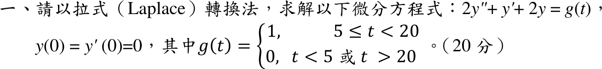
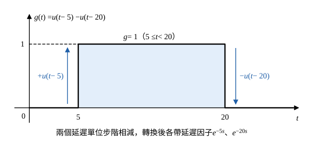

# 112 年第 1 題｜矩形脈衝

## 已知與所求

\(2y''+y'+2y=g(t)\)，\(y(0)=y'(0)=0\)，\(g(t)=1\)（\(5\le t<20\)）、\(g(t)=0\)（\(t<5\) 或 \(t>20\)）。以拉氏轉換求 \(y(t)\)（20 分）。

## 考場標準作答

**解題邏輯**：分段的 \(g(t)\) 先寫成兩個延遲單位步階之差 \(u(t-5)-u(t-20)\)，轉換後帶延遲因子 \(e^{-5s}\)、\(e^{-20s}\)；零初值下 ODE 轉成 \((2s^2+s+2)Y=G(s)\)。兩個延遲因子共用的部分 \(H(s)=\dfrac{1}{s(2s^2+s+2)}\) 以部分分式＋配方反轉換成 \(\Phi(t)\)（單位步階響應），最後用第二平移定理把 \(e^{-as}\) 還原成 \(u(t-a)\Phi(t-a)\)。題目未給 \(t=20\) 一點的 \(g\) 值，單點不影響拉氏積分，也不影響 \(y\)。

### 步驟 1：\(g(t)\) 寫成單位步階並轉換

\[
g(t)=u(t-5)-u(t-20)
\]
- 逐段核對：\(t<5\) 時 \(0-0=0\)；\(5\le t<20\) 時 \(1-0=1\)；\(t>20\) 時 \(1-1=0\)，與題給一致。

延遲步階的轉換 \(\mathcal L\{u(t-a)\}=\dfrac{e^{-as}}{s}\)（\(a\ge0\)）：
\[
G(s)=\frac{e^{-5s}}{s}-\frac{e^{-20s}}{s}=\frac{e^{-5s}-e^{-20s}}{s}
\]

### 步驟 2：ODE 轉成 \(Y(s)\) 的代數式

導數的轉換公式，代入 \(y(0)=y'(0)=0\)：
\[
\mathcal L\{y''\}=s^2Y-sy(0)-y'(0)=s^2Y
\]
\[
\mathcal L\{y'\}=sY-y(0)=sY
\]
代入 \(2y''+y'+2y=g\)：
\[
2s^2Y+sY+2Y=G(s)
\]
提出 \(Y\)：
\[
(2s^2+s+2)\,Y=\frac{e^{-5s}-e^{-20s}}{s}
\]
兩邊除以 \(2s^2+s+2\)：
\[
Y(s)=\left(e^{-5s}-e^{-20s}\right)H(s),\qquad H(s)=\frac{1}{s(2s^2+s+2)}
\]

### 步驟 3：\(H(s)\) 的部分分式與配方

二次式判別式 \(1^2-4(2)(2)=1-16=-15<0\)，不能再分解成實係數一次式，故設：
\[
\frac{1}{s(2s^2+s+2)}=\frac{A}{s}+\frac{Bs+C}{2s^2+s+2}
\]
兩邊乘 \(s(2s^2+s+2)\)：
\[
1=A(2s^2+s+2)+(Bs+C)s
\]
按 \(s\) 的次方整理：
\[
1=(2A+B)s^2+(A+C)s+2A
\]
比較係數，常數項：
\[
2A=1\ \Rightarrow\ A=\tfrac12
\]
\(s^2\) 項：
\[
2A+B=0\ \Rightarrow\ B=-2A=-1
\]
\(s\) 項：
\[
A+C=0\ \Rightarrow\ C=-A=-\tfrac12
\]
所以
\[
H(s)=\frac{1/2}{s}-\frac{s+\frac12}{2s^2+s+2}
\]
分母配方：
\[
2s^2+s+2=2\left(s^2+\frac s2+1\right)
\]
\[
=2\left[\left(s+\frac14\right)^2-\frac{1}{16}+1\right]
\]
\[
=2\left[\left(s+\frac14\right)^2+\frac{15}{16}\right]
\]
分子配成 \(s+\tfrac14\)：
\[
s+\frac12=\left(s+\frac14\right)+\frac14
\]
代回第二項（分母的 2 提出成 \(\tfrac12\)）：
\[
\frac{s+\frac12}{2s^2+s+2}=\frac12\cdot\frac{\left(s+\frac14\right)+\frac14}{\left(s+\frac14\right)^2+\frac{15}{16}}
\]
\[
H(s)=\frac12\left[\frac1s-\frac{\left(s+\frac14\right)+\frac14}{\left(s+\frac14\right)^2+\frac{15}{16}}\right]
\]

### 步驟 4：反轉換得 \(\Phi(t)=\mathcal L^{-1}\{H(s)\}\)

\(\tfrac{15}{16}=\left(\tfrac{\sqrt{15}}{4}\right)^2\)。第一平移定理：
\[
\mathcal L^{-1}\left\{\frac{s+\alpha}{(s+\alpha)^2+k^2}\right\}=e^{-\alpha t}\cos kt,\qquad
\mathcal L^{-1}\left\{\frac{k}{(s+\alpha)^2+k^2}\right\}=e^{-\alpha t}\sin kt
\]
此處 \(\alpha=\tfrac14\)、\(k=\tfrac{\sqrt{15}}{4}\)。常數 \(\tfrac14\) 改寫成 \(k\) 的倍數：
\[
\frac14=\frac{1}{\sqrt{15}}\cdot\frac{\sqrt{15}}{4}
\]
逐項反轉換：
\[
\mathcal L^{-1}\left\{\frac{s+\frac14}{\left(s+\frac14\right)^2+\frac{15}{16}}\right\}=e^{-t/4}\cos\frac{\sqrt{15}\,t}{4}
\]
\[
\mathcal L^{-1}\left\{\frac{\frac14}{\left(s+\frac14\right)^2+\frac{15}{16}}\right\}=\frac{1}{\sqrt{15}}\,e^{-t/4}\sin\frac{\sqrt{15}\,t}{4}
\]
\[
\mathcal L^{-1}\left\{\frac1s\right\}=1
\]
合併（乘上 \(\tfrac12\)）：
\[
\Phi(t)=\frac12-\frac12e^{-t/4}\left[\cos\frac{\sqrt{15}\,t}{4}+\frac{1}{\sqrt{15}}\sin\frac{\sqrt{15}\,t}{4}\right]
\]

### 求 \(y(t)\)（20 分）

**邏輯**：第二平移定理 \(\mathcal L^{-1}\{e^{-as}H(s)\}=u(t-a)\,\Phi(t-a)\)（\(a\ge0\)）；\(Y\) 是 \(e^{-5s}H\) 與 \(e^{-20s}H\) 之差，由線性各套一次再相減。

\[
y(t)=\mathcal L^{-1}\{e^{-5s}H(s)\}-\mathcal L^{-1}\{e^{-20s}H(s)\}
\]
\[
\boxed{y(t)=u(t-5)\,\Phi(t-5)-u(t-20)\,\Phi(t-20)}
\]
即 \(t<5\) 時 \(y=0\)；\(5\le t<20\) 時 \(y=\Phi(t-5)\)；\(t\ge20\) 時 \(y=\Phi(t-5)-\Phi(t-20)\)，其中 \(\Phi\) 見步驟 4。

## 驗算

- \(\Phi\) 回代：常數 \(\tfrac12\) 滿足 \(2(0)+0+2\cdot\tfrac12=1\)，其餘為特徵根 \(-\tfrac14\pm i\tfrac{\sqrt{15}}4\) 的齊次解；\(\Phi(0)=\tfrac12-\tfrac12=0\)，\(\Phi'(0)=\tfrac12\bigl(\tfrac14-\tfrac{\sqrt{15}}4\cdot\tfrac1{\sqrt{15}}\bigr)=0\)。
- 極限檢查：脈衝期間 \(y\to g/2=\tfrac12\)（直流增益 \(1/2\)）；\(t\to\infty\) 時 \(\Phi(t-5)-\Phi(t-20)\to\tfrac12-\tfrac12=0\)，與終值定理 \(\lim_{s\to0}sY(s)=0\) 一致。

## 失分點

- 二次式未先提出 2，誤寫 \((s+\tfrac12)^2+\cdots\)，阻尼與頻率都錯（正確 \(e^{-t/4}\)、角頻率 \(\sqrt{15}/4\)）。
- 平移後只寫 \(\Phi(t-5)-\Phi(t-20)\)，漏掉 \(u(t-5)\)、\(u(t-20)\) 使 \(t<5\) 時不為 0。
- 正弦項係數要把 \(\tfrac14\) 配成 \(\tfrac{1}{\sqrt{15}}\cdot\tfrac{\sqrt{15}}4\)，直接寫 \(\tfrac14\sin\) 會錯。
