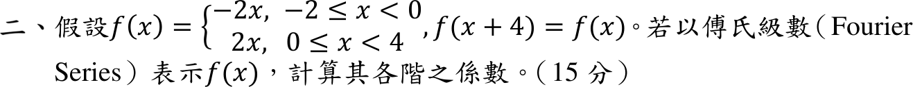
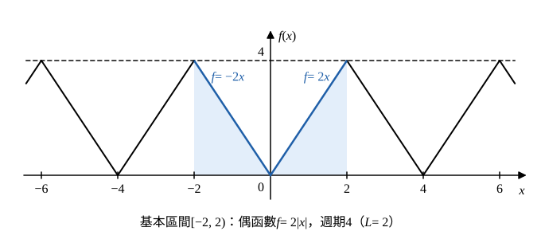

# 112 年第 2 題｜傅立葉級數

## 已知與所求

\(f(x)=-2x\)（\(-2\le x<0\)）、\(f(x)=2x\)（\(0\le x<4\)），\(f(x+4)=f(x)\)。求傅立葉級數各階係數（15 分）。

## 考場標準作答

**解題邏輯**：題面兩段定義合計 \([-2,4)\) 長 6，與週期 4 矛盾（見「條件與疑義」）；主解保留兩段公式與週期 4，取基本區間 \([-2,2)\)（\(L=2\)），此時 \(f=2|x|\) 為三角波。級數採 \(f(x)\sim a_0+\sum_{n\ge1}\bigl[a_n\cos\frac{n\pi x}{2}+b_n\sin\frac{n\pi x}{2}\bigr]\)（\(a_0\) 即平均值）。
1. 先判斷奇偶：偶函數使 \(b_n=0\)。
2. \(a_0\)、\(a_n\) 改用半區間 \([0,2]\) 積分乘 2。
3. \(a_n\) 以分部積分計算。
4. 最後依 \(n\) 奇偶整理並寫出級數。

### 步驟 1：基本區間、半週期與奇偶性

- 週期 \(T=4\)，半週期 \(L=T/2=2\)，基本區間取 \([-2,2)\)。
- \([-2,0)\) 上 \(f=-2x=2|x|\)，\([0,2)\) 上 \(f=2x=2|x|\)，合併為 \(f(x)=2|x|\)。
- \(f(-x)=2|-x|=2|x|=f(x)\)，為偶函數；\(f\) 在 \(x=0\) 為 0、在 \(x=\pm2\) 為 4，延拓後處處連續（三角波）。

係數公式（週期 \(2L\)）：
\[
a_0=\frac1{2L}\int_{-L}^{L}f\,dx,\qquad a_n=\frac1L\int_{-L}^{L}f\cos\frac{n\pi x}{L}\,dx,\qquad b_n=\frac1L\int_{-L}^{L}f\sin\frac{n\pi x}{L}\,dx
\]

### 步驟 2：\(b_n\)

**邏輯**：\(f\) 偶、\(\sin\frac{n\pi x}{2}\) 奇，乘積為奇函數，在對稱區間 \([-2,2]\) 上積分為 0。

\[
b_n=\frac12\int_{-2}^{2}\underbrace{2|x|\sin\frac{n\pi x}{2}}_{\text{奇函數}}\,dx=0
\]

### 步驟 3：\(a_0\)

**邏輯**：\(a_0\) 是一個週期的平均值；被積函數為偶函數，對稱區間積分 \(=2\times\) 半區間積分。

\[
a_0=\frac1{4}\int_{-2}^{2}2|x|\,dx
\]
偶函數化為半區間：
\[
=\frac14\cdot2\int_0^{2}2x\,dx
\]
\[
\int_0^2 2x\,dx=\Bigl[x^2\Bigr]_0^2=4-0=4
\]
\[
a_0=\frac14\cdot2\cdot4=2
\]

### 步驟 4：\(a_n\)

**邏輯**：\(f\cos\frac{n\pi x}{2}\) 為偶函數，化為 \([0,2]\) 上積分；\(x\cos(\cdot)\) 用分部積分 \(\int u\,dv=uv-\int v\,du\)。

\[
a_n=\frac12\int_{-2}^{2}2|x|\cos\frac{n\pi x}{2}\,dx
\]
偶函數化為半區間：
\[
=\frac12\cdot2\int_0^{2}2x\cos\frac{n\pi x}{2}\,dx=2\int_0^{2}x\cos\frac{n\pi x}{2}\,dx
\]
分部積分取 \(u=x\)、\(dv=\cos\frac{n\pi x}{2}dx\)，則 \(du=dx\)、\(v=\frac{2}{n\pi}\sin\frac{n\pi x}{2}\)：
\[
\int_0^{2}x\cos\frac{n\pi x}{2}\,dx=\Bigl[\frac{2x}{n\pi}\sin\frac{n\pi x}{2}\Bigr]_0^2-\frac{2}{n\pi}\int_0^2\sin\frac{n\pi x}{2}\,dx
\]
第一項上下限（\(\sin n\pi=0\)）：
\[
\Bigl[\frac{2x}{n\pi}\sin\frac{n\pi x}{2}\Bigr]_0^2=\frac{4}{n\pi}\sin n\pi-0=0
\]
第二項的積分（\(\cos n\pi=(-1)^n\)）：
\[
\int_0^2\sin\frac{n\pi x}{2}\,dx=\Bigl[-\frac{2}{n\pi}\cos\frac{n\pi x}{2}\Bigr]_0^2=-\frac{2}{n\pi}\bigl((-1)^n-1\bigr)
\]
代回：
\[
\int_0^{2}x\cos\frac{n\pi x}{2}\,dx=0-\frac{2}{n\pi}\cdot\Bigl(-\frac{2}{n\pi}\bigl((-1)^n-1\bigr)\Bigr)=\frac{4\bigl((-1)^n-1\bigr)}{n^2\pi^2}
\]
乘前係數 2：
\[
a_n=2\cdot\frac{4\bigl((-1)^n-1\bigr)}{n^2\pi^2}=\frac{8\bigl((-1)^n-1\bigr)}{n^2\pi^2}
\]
依 \(n\) 奇偶：\(n\) 奇時 \((-1)^n-1=-2\)，\(a_n=-\dfrac{16}{n^2\pi^2}\)；\(n\) 偶時 \((-1)^n-1=0\)，\(a_n=0\)。

### 各階係數與級數（15 分）

**邏輯**：彙整步驟 2–4 的係數；只有奇數 \(n\) 的餘弦項不為 0，令 \(n=2m+1\)（\(m=0,1,2,\dots\)）代入級數。

\[
\boxed{a_0=2,\quad a_n=\frac{8\bigl((-1)^n-1\bigr)}{n^2\pi^2}=\begin{cases}-\dfrac{16}{n^2\pi^2},&n\text{ 奇}\\[4pt]0,&n\text{ 偶}\end{cases},\quad b_n=0}
\]
代入級數形式（\(n=2m+1\)）：
\[
f(x)=2+\sum_{m=0}^{\infty}\Bigl(-\frac{16}{(2m+1)^2\pi^2}\Bigr)\cos\frac{(2m+1)\pi x}{2}
\]
\[
\boxed{f(x)=2-\frac{16}{\pi^2}\sum_{m=0}^{\infty}
\frac{1}{(2m+1)^2}\cos\frac{(2m+1)\pi x}{2}}
\]
前幾項 \(a_1=-\frac{16}{\pi^2}\approx-1.62\)、\(a_3=-\frac{16}{9\pi^2}\approx-0.18\)。

## 驗算

- \(x=0\)：\(\sum_{m\ge0}\frac1{(2m+1)^2}=\frac{\pi^2}8\)，得 \(2-\frac{16}{\pi^2}\cdot\frac{\pi^2}{8}=2-2=0=f(0)\)；\(x=2\)：\(\cos\bigl((2m+1)\pi\bigr)=-1\)，得 \(2+2=4=f(\pm2)\)。三角波連續，級數處處等於 \(f\)。
- 常數項 2 即三角波（0 到 4 線性往返）的平均值 \(\frac{0+4}{2}\)。

## 失分點

- 常數項慣例混用：寫成 \(a_0/2\) 時 \(a_0\) 應為 4，不可同時寫 \(a_0=2\) 又除以 2。
- 偶函數仍去算 \(b_n\)，或半區間積分漏乘 2（\(a_n=\frac2L\int_0^L\)）。
- 未寫明所採的基本區間：題面自相矛盾，必須說明取 \([-2,2)\)（或鋸齒波分支）再計算。

## 條件與疑義

題面兩段定義合計 \([-2,4)\) 長 6，與 \(f(x+4)=f(x)\) 的週期 4 衝突：在 \([-2,0)\) 上 \(-2x\) 與週期延拓的 \(2(x+4)\) 不同（例如 \(x=-1\) 時分別為 2 與 6）。上解假設第二段應為 \(0\le x<2\)（基本區間 \([-2,2)\)）。若改取完整一週期的 \(f=2x\)（\(0\le x<4\)）鋸齒波，則 \(a_0=4\)、\(a_n=0\)、\(b_n=-\dfrac{8}{n\pi}\)，即 \(f\sim4-\dfrac8\pi\sum_{n\ge1}\dfrac{1}{n}\sin\dfrac{n\pi x}{2}\)。作答時應寫明所採的基本區間。
