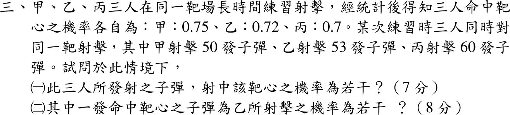
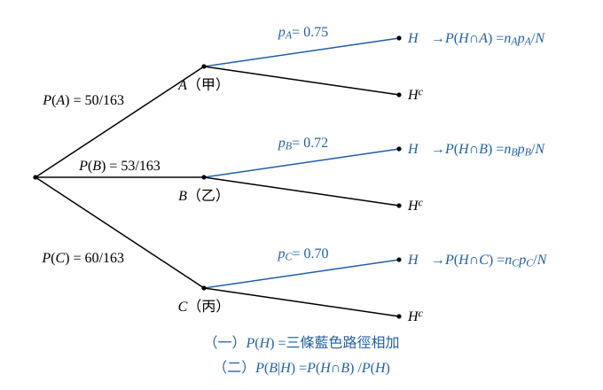

# 112 年第 3 題｜三人射擊命中率

## 已知與所求

命中率 \(p_A=0.75,\ p_B=0.72,\ p_C=0.70\)（甲、乙、丙）；本次射擊 \(n_A=50,\ n_B=53,\ n_C=60\) 發。求（一）三人所發射之子彈命中靶心的機率（7 分）；（二）已知一發子彈命中，為乙所射之機率（8 分）。

## 考場標準作答

### 步驟 1：事件、分割與權重

「三人所發射之子彈」讀作由 163 發中隨機取一發；設每發是否命中只取決於射手的命中率，互不影響。

- \(A,B,C\)：取到的子彈是甲、乙、丙所射；\(H\)：該發命中靶心。條件機率 \(P(H\mid A)=p_A\)、\(P(H\mid B)=p_B\)、\(P(H\mid C)=p_C\)。
- 總發數：
\[
N=n_A+n_B+n_C=50+53+60=163
\]
- 均勻取一發，取到某人子彈的機率為其發數比例：
\[
P(A)=\frac{50}{163},\qquad P(B)=\frac{53}{163},\qquad P(C)=\frac{60}{163}
\]
三者互斥且和為 \(\frac{163}{163}=1\)，構成分割。

### 步驟 2：各人期望命中數 \(n_ip_i\)（（一）、（二）共用）

每條命中路徑 \(P(H\cap A)=P(A)\,p_A=\dfrac{n_Ap_A}{N}\)，分子先算：
\[
n_Ap_A=50\times0.75=37.50
\]
\[
n_Bp_B=53\times0.72=38.16
\]
\[
n_Cp_C=60\times0.70=42.00
\]
相加：
\[
n_Ap_A+n_Bp_B+n_Cp_C=37.50+38.16+42.00=117.66
\]

### （一）隨機一發子彈命中的機率（7 分）

\[
P(H)=p_A\,P(A)+p_B\,P(B)+p_C\,P(C)=\frac{n_Ap_A+n_Bp_B+n_Cp_C}{N}
\]
代入步驟 1、2：
\[
P(H)=\frac{117.66}{163}
\]
分子分母同乘 100 化為整數，再同除以 2：
\[
P(H)=\frac{11766}{16300}=\frac{5883}{8150}
\]
\[
\boxed{P(H)=\frac{5883}{8150}\approx0.72}
\]
此為「隨機一發」的命中率；若題意是「163 發中至少一發命中」，則為 \(1-(1-p_A)^{50}(1-p_B)^{53}(1-p_C)^{60}\)，屬不同事件，本題不採用。

### （二）命中子彈為乙所射的機率（8 分）

\[
P(B\mid H)=\frac{P(H\mid B)\,P(B)}{P(H)}=\frac{p_B\,(n_B/N)}{(n_Ap_A+n_Bp_B+n_Cp_C)/N}
\]
\(N\) 上下約去：
\[
P(B\mid H)=\frac{n_Bp_B}{n_Ap_A+n_Bp_B+n_Cp_C}
\]
代入步驟 2：
\[
P(B\mid H)=\frac{38.16}{117.66}=\frac{3816}{11766}
\]
約分（\(3816=318\times12\)，\(11766=318\times37\)）：
\[
\boxed{P(B\mid H)=\frac{12}{37}\approx0.32}
\]

## 驗算

- 三人後驗機率：\(\frac{37.50}{117.66}\approx0.3187\)、\(\frac{38.16}{117.66}\approx0.3243\)、\(\frac{42.00}{117.66}\approx0.3570\)，和 \(0.3187+0.3243+0.3570=1.0000\)；且 \(12/37\approx0.3243\)，一致。
- \(P(H)\approx0.7218\) 落在 \(0.70\)–\(0.75\) 之間，符合加權平均的範圍。

## 失分點

- 三人命中率直接平均 \((0.75+0.72+0.70)/3\approx0.7233\)，未依發數 \(n_i\) 加權，方法錯誤。
- （二）只寫發數比例 \(53/163\)，忽略需以命中數 \(n_ip_i\) 加權（貝氏分母是 \(P(H)\)）。
