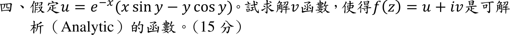

# 112 年第 4 題｜解析函數

## 已知與所求

\(u=e^{-x}(x\sin y-y\cos y)\)，求 \(v\) 使 \(f(z)=u+iv\) 為解析函數（15 分）。

## 考場標準作答

### 步驟 1：\(u_x\)

\(u\) 由 \(e^{-x}\)、多項式與三角函數組成，偏導處處連續，故 \(f=u+iv\) 解析 \(\iff\) 滿足 C–R 方程 \(u_x=v_y\)、\(u_y=-v_x\)。\(x\) 出現在 \(e^{-x}\) 與括號內，用乘積法則 \((pq)_x=p_xq+pq_x\)，\(p=e^{-x}\)、\(q=x\sin y-y\cos y\)：
\[
u_x=(-e^{-x})(x\sin y-y\cos y)+e^{-x}(\sin y)
\]
提出 \(e^{-x}\)：
\[
u_x=e^{-x}(-x\sin y+y\cos y+\sin y)
\]
合併 \(\sin y\) 項：
\[
u_x=e^{-x}\bigl[(1-x)\sin y+y\cos y\bigr]
\]

### 步驟 2：\(u_y\)

\(e^{-x}\) 對 \(y\) 為常數；\(y\cos y\) 對 \(y\) 用乘積法則 \((y\cos y)_y=\cos y-y\sin y\)：
\[
u_y=e^{-x}\bigl[x\cos y-(\cos y-y\sin y)\bigr]
\]
去括號、合併 \(\cos y\) 項：
\[
u_y=e^{-x}\bigl[(x-1)\cos y+y\sin y\bigr]
\]

### 步驟 3：由 \(v_y=u_x\) 對 \(y\) 積分

\[
v=\int e^{-x}\bigl[(1-x)\sin y+y\cos y\bigr]dy=e^{-x}\Bigl[(1-x)\int\sin y\,dy+\int y\cos y\,dy\Bigr]+g(x)
\]
第一個積分：
\[
\int\sin y\,dy=-\cos y
\]
第二個積分用分部積分 \(\int u\,dv=uv-\int v\,du\)（\(u=y\)、\(dv=\cos y\,dy\)，\(du=dy\)、\(v=\sin y\)）：
\[
\int y\cos y\,dy=y\sin y-\int\sin y\,dy=y\sin y+\cos y
\]
代回：
\[
v=e^{-x}\bigl[(1-x)(-\cos y)+y\sin y+\cos y\bigr]+g(x)
\]
展開 \((1-x)(-\cos y)=(x-1)\cos y\)，再與 \(+\cos y\) 合併：
\[
v=e^{-x}\bigl[(x-1)\cos y+\cos y+y\sin y\bigr]+g(x)=e^{-x}(x\cos y+y\sin y)+g(x)
\]

### 調和共軛 \(v\)（15 分）

代入另一條 C–R 方程 \(v_x=-u_y\)，比較兩邊定出 \(g'(x)\)。

對步驟 3 的 \(v\) 求 \(v_x\)（乘積法則，\(p=e^{-x}\)、\(q=x\cos y+y\sin y\)、\(q_x=\cos y\)）：
\[
v_x=(-e^{-x})(x\cos y+y\sin y)+e^{-x}\cos y+g'(x)
\]
提出 \(e^{-x}\)、合併 \(\cos y\) 項：
\[
v_x=e^{-x}\bigl[(1-x)\cos y-y\sin y\bigr]+g'(x)
\]
由步驟 2 的 \(u_y\)，變號：
\[
-u_y=-e^{-x}\bigl[(x-1)\cos y+y\sin y\bigr]=e^{-x}\bigl[(1-x)\cos y-y\sin y\bigr]
\]
令 \(v_x=-u_y\)，兩邊 \(e^{-x}[\cdots]\) 相同而消去：
\[
g'(x)=0\quad\Longrightarrow\quad g(x)=C
\]
代回步驟 3：
\[
\boxed{v(x,y)=e^{-x}(x\cos y+y\sin y)+C},\quad C\in\mathbb R
\]
對應 \(f(z)=ize^{-z}+iC\)。

## 驗算

直接展開 \(ize^{-z}=i(x+iy)e^{-x}(\cos y-i\sin y)\)：先乘 \((x+iy)(\cos y-i\sin y)=(x\cos y+y\sin y)+i(y\cos y-x\sin y)\)，再乘 \(i\) 得 \((x\sin y-y\cos y)+i(x\cos y+y\sin y)\)。乘上 \(e^{-x}\) 後實部即題給 \(u\)、虛部即所求 \(v\)；\(ize^{-z}\) 為整函數，處處解析。

## 失分點

- 對 \(y\) 積分後把 \(g(x)\) 直接當常數，沒用 \(v_x=-u_y\) 確認 \(g'(x)=0\)。
- C–R 符號寫成 \(u_y=v_x\)，會得到 \(v\) 差一個負號。
- \(\int y\cos y\,dy\) 漏掉分部積分的 \(+\cos y\)，\(v\) 會多出 \(-e^{-x}\cos y\) 而無法滿足 \(v_x=-u_y\)。
