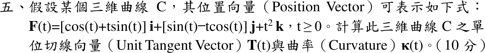

# 112 年第 5 題｜單位切線與曲率

## 已知與所求

\(\mathbf F(t)=[\cos t+t\sin t]\,\mathbf i+[\sin t-t\cos t]\,\mathbf j+t^2\,\mathbf k\)，\(t\ge0\)。求單位切線向量 \(\mathbf T(t)\) 與曲率 \(\kappa(t)\)（共 10 分）。

## 考場標準作答

**解題邏輯**：切線方向由速度向量 \(\mathbf F'(t)\) 給出，\(\mathbf T=\mathbf F'/\lVert\mathbf F'\rVert\)；曲率是單位切線向量對弧長的轉動率，\(\kappa=\lVert d\mathbf T/ds\rVert=\lVert\mathbf T'(t)\rVert/\lVert\mathbf F'(t)\rVert\)（因 \(ds/dt=\lVert\mathbf F'\rVert\)）。依序：乘積法則求 \(\mathbf F'\) → 求速率 \(\lVert\mathbf F'\rVert\) → \(\mathbf T\) → \(\mathbf T'\) → \(\kappa\)。前提：\(\mathbf T\)、\(\kappa\) 需 \(\lVert\mathbf F'\rVert\ne0\)，即 \(t>0\)。

### 步驟 1：速度向量 \(\mathbf F'(t)\)

\(x\) 分量（乘積法則 \((uv)'=u'v+uv'\) 用在 \(t\sin t\)）：
\[
\frac{d}{dt}(\cos t+t\sin t)=-\sin t+(1\cdot\sin t+t\cos t)=t\cos t
\]
\(y\) 分量（乘積法則用在 \(t\cos t\)）：
\[
\frac{d}{dt}(\sin t-t\cos t)=\cos t-(1\cdot\cos t-t\sin t)=t\sin t
\]
\(z\) 分量：
\[
\frac{d}{dt}(t^2)=2t
\]
合併並提出公因數 \(t\)：
\[
\mathbf F'(t)=(t\cos t,\ t\sin t,\ 2t)=t(\cos t,\ \sin t,\ 2)
\]

### 步驟 2：速率 \(\lVert\mathbf F'(t)\rVert\)

\[
\lVert\mathbf F'\rVert^2=t^2\cos^2t+t^2\sin^2t+(2t)^2
\]
用 \(\cos^2t+\sin^2t=1\)：
\[
\lVert\mathbf F'\rVert^2=t^2+4t^2=5t^2
\]
\(t\ge0\)，開根號取正：
\[
\lVert\mathbf F'(t)\rVert=\sqrt5\,t
\]
\(t=0\) 時 \(\mathbf F'=\mathbf 0\)，切線方向無定義，以下取 \(t>0\)。

### 單位切線向量 \(\mathbf T(t)\)

**邏輯**：\(\mathbf T=\mathbf F'/\lVert\mathbf F'\rVert\)，\(t>0\) 時分子分母的 \(t\) 可約去。

\[
\mathbf T(t)=\frac{\mathbf F'(t)}{\lVert\mathbf F'(t)\rVert}=\frac{t(\cos t,\ \sin t,\ 2)}{\sqrt5\,t}
\]
\[
\boxed{\mathbf T(t)=\frac{1}{\sqrt5}(\cos t,\ \sin t,\ 2)},\qquad t>0
\]

### 曲率 \(\kappa(t)\)

**邏輯**：\(\kappa=\lVert\mathbf T'(t)\rVert/\lVert\mathbf F'(t)\rVert\)（鏈鎖法則 \(d\mathbf T/ds=\mathbf T'(t)\,/\,(ds/dt)\)）。

\(\mathbf T\) 逐分量微分（常數 \(2/\sqrt5\) 的導數為 0）：
\[
\mathbf T'(t)=\frac{1}{\sqrt5}(-\sin t,\ \cos t,\ 0)
\]
\[
\lVert\mathbf T'(t)\rVert^2=\frac15(\sin^2t+\cos^2t+0)=\frac15
\]
\[
\lVert\mathbf T'(t)\rVert=\frac{1}{\sqrt5}
\]
代入曲率公式：
\[
\kappa(t)=\frac{\lVert\mathbf T'(t)\rVert}{\lVert\mathbf F'(t)\rVert}=\frac{1/\sqrt5}{\sqrt5\,t}
\]
\[
\boxed{\kappa(t)=\frac{1}{5t}},\qquad t>0
\]

## 驗算

另用 \(\kappa=\lVert\mathbf F'\times\mathbf F''\rVert/\lVert\mathbf F'\rVert^3\)：\(\mathbf F''=(\cos t-t\sin t,\ \sin t+t\cos t,\ 2)\)，
\(\mathbf F'\times\mathbf F''=(-2t^2\cos t,\ -2t^2\sin t,\ t^2)\)，範數 \(\sqrt{4t^4+t^4}=\sqrt5\,t^2\)；
\(\kappa=\dfrac{\sqrt5\,t^2}{(\sqrt5\,t)^3}=\dfrac{\sqrt5\,t^2}{5\sqrt5\,t^3}=\dfrac{1}{5t}\)，一致。另 \(\lVert\mathbf T\rVert^2=\frac{1+4}{5}=1\)，確為單位向量。

## 失分點

- \(t\sin t\)、\(t\cos t\) 漏用乘積法則，\(\mathbf F'\) 會多出 \(\sin t\)、\(\cos t\) 項而無法提出 \(t\)。
- 曲率寫成 \(\lVert\mathbf T'(t)\rVert=\frac1{\sqrt5}\)，漏除以速率 \(\lVert\mathbf F'\rVert=\sqrt5\,t\)。
- 未註明 \(t=0\) 時 \(\mathbf F'=\mathbf 0\)，\(\mathbf T\) 與 \(\kappa\) 無定義。
