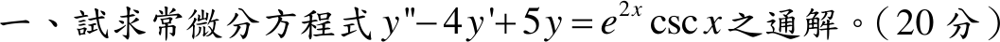

# 113 年第 1 題｜變係數法

## 已知與所求

\(y''-4y'+5y=e^{2x}\csc x\)，求通解（20 分）。

## 考場標準作答

### 步驟 1：齊次解

右邊含 \(\csc x\)，待定係數法不適用，用參數變異法；\(\csc x\) 在 \(\sin x=0\) 處無定義，解只在不含 \(x=k\pi\) 的區間上成立。特徵方程 \(r^2-4r+5=0\)，公式解：
\[
r=\frac{4\pm\sqrt{16-20}}{2}=\frac{4\pm\sqrt{-4}}{2}=\frac{4\pm2i}{2}=2\pm i
\]
共軛複根 \(\alpha\pm i\beta\)（\(\alpha=2\)、\(\beta=1\)）對應 \(e^{\alpha x}\cos\beta x\)、\(e^{\alpha x}\sin\beta x\)：
\[
y_1=e^{2x}\cos x,\qquad y_2=e^{2x}\sin x
\]
\[
y_h=e^{2x}(C_1\cos x+C_2\sin x)
\]

### 步驟 2：Wronskian

乘積法則求導：
\[
y_1'=2e^{2x}\cos x-e^{2x}\sin x=e^{2x}(2\cos x-\sin x)
\]
\[
y_2'=2e^{2x}\sin x+e^{2x}\cos x=e^{2x}(2\sin x+\cos x)
\]
代入 \(W=y_1y_2'-y_2y_1'\)：
\[
W=e^{4x}\bigl[\cos x(2\sin x+\cos x)-\sin x(2\cos x-\sin x)\bigr]
\]
展開括號：
\[
=e^{4x}\bigl[2\sin x\cos x+\cos^2x-2\sin x\cos x+\sin^2x\bigr]
\]
\(2\sin x\cos x\) 相消，\(\cos^2x+\sin^2x=1\)：
\[
W=e^{4x}
\]

### 步驟 3：\(u_1\)、\(u_2\)

方程已是 \(y''\) 係數為 1 的標準式，\(g=e^{2x}\csc x\)。令 \(y_p=u_1y_1+u_2y_2\)，聯立 \(u_1'y_1+u_2'y_2=0\)、\(u_1'y_1'+u_2'y_2'=g\)，由 Cramer 法則得 \(u_1'=-y_2g/W\)、\(u_2'=y_1g/W\)：

\[
u_1'=-\frac{y_2g}{W}=-\frac{e^{2x}\sin x\cdot e^{2x}\csc x}{e^{4x}}
\]
\(e^{4x}\) 約去、\(\sin x\csc x=1\)：
\[
u_1'=-1\quad\Longrightarrow\quad u_1=-x
\]
\[
u_2'=\frac{y_1g}{W}=\frac{e^{2x}\cos x\cdot e^{2x}\csc x}{e^{4x}}
\]
\(e^{4x}\) 約去、\(\cos x\csc x=\cot x\)：
\[
u_2'=\cot x
\]
積分（令 \(w=\sin x\)，\(dw=\cos x\,dx\)）：
\[
u_2=\int\frac{\cos x}{\sin x}\,dx=\int\frac{dw}{w}=\ln|\sin x|
\]
（\(u_1,u_2\) 的積分常數併入 \(C_1,C_2\)，此處省略。）

### 步驟 4：特解 \(y_p\)

\[
y_p=u_1y_1+u_2y_2=(-x)e^{2x}\cos x+\ln|\sin x|\cdot e^{2x}\sin x
\]
提出 \(e^{2x}\)：
\[
y_p=e^{2x}\bigl(-x\cos x+\sin x\ln|\sin x|\bigr)
\]

### 通解（20 分）

\[
y=y_h+y_p=e^{2x}(C_1\cos x+C_2\sin x)+e^{2x}\bigl(-x\cos x+\sin x\ln|\sin x|\bigr)
\]
提出 \(e^{2x}\)，在不含 \(\sin x=0\) 的區間上：
\[
\boxed{y=e^{2x}\bigl[C_1\cos x+C_2\sin x-x\cos x+\sin x\ln|\sin x|\bigr]}
\]

## 驗算

令 \(y=e^{2x}u\)，則 \(y'=e^{2x}(u'+2u)\)、\(y''=e^{2x}(u''+4u'+4u)\)，代入得 \(y''-4y'+5y=e^{2x}(u''+u)\)，原式化為 \(u''+u=\csc x\)。以 \(u_p=-x\cos x+\sin x\ln|\sin x|\) 檢查：
\[
u_p'=x\sin x+\cos x\ln|\sin x|,\qquad
u_p''=\sin x+x\cos x-\sin x\ln|\sin x|+\frac{\cos^2x}{\sin x},
\]
\[
u_p''+u_p=\sin x+\frac{\cos^2x}{\sin x}=\frac{\sin^2x+\cos^2x}{\sin x}=\frac{1}{\sin x}=\csc x.
\]

## 失分點

- 特徵方程 \(r^2-4r+5=0\) 的根是 \(2\pm i\)；正負號弄反成 \(-2\pm i\) 會使齊次解與 \(e^{2x}\csc x\) 無法配合。
- Wronskian 是 \(e^{4x}\) 而非 1；漏掉時 \(u_1',u_2'\) 會殘留 \(e^{-2x}\) 因子而無法積分。
- \(u_1'=-y_2g/W\) 的負號漏掉，\(y_p\) 會變成 \(+x\cos x\) 項而代回不成立。
