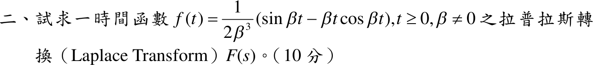

# 113 年第 2 題｜拉普拉斯轉換

## 已知與所求

\(f(t)=\dfrac{1}{2\beta^3}(\sin\beta t-\beta t\cos\beta t)\)，\(t\ge0\)，\(\beta\ne0\)，求拉普拉斯轉換 \(F(s)\)（10 分）。

## 考場標準作答

### 步驟 1：兩個基本轉換

取 \(\operatorname{Re}s>0\)。查表：
\[
\mathcal L\{\sin\beta t\}=\frac{\beta}{s^2+\beta^2},\qquad \mathcal L\{\cos\beta t\}=\frac{s}{s^2+\beta^2}
\]
\(s\) 域微分性質 \(\mathcal L\{t\,g(t)\}=-G'(s)\)，取 \(g=\cos\beta t\)：
\[
\mathcal L\{t\cos\beta t\}=-\frac{d}{ds}\left(\frac{s}{s^2+\beta^2}\right)
\]
商的微分法則 \(\left(\dfrac uv\right)'=\dfrac{u'v-uv'}{v^2}\)（\(u=s\)、\(v=s^2+\beta^2\)）：
\[
\frac{d}{ds}\left(\frac{s}{s^2+\beta^2}\right)=\frac{1\cdot(s^2+\beta^2)-s\cdot2s}{(s^2+\beta^2)^2}
\]
\[
=\frac{\beta^2-s^2}{(s^2+\beta^2)^2}
\]
乘以 \(-1\)：
\[
\mathcal L\{t\cos\beta t\}=\frac{s^2-\beta^2}{(s^2+\beta^2)^2}
\]

### 求 \(F(s)\)（10 分）

\[
F(s)=\frac{1}{2\beta^3}\Bigl[\mathcal L\{\sin\beta t\}-\beta\,\mathcal L\{t\cos\beta t\}\Bigr]
\]
代入步驟 1：
\[
F(s)=\frac{1}{2\beta^3}\left[\frac{\beta}{s^2+\beta^2}-\frac{\beta(s^2-\beta^2)}{(s^2+\beta^2)^2}\right]
\]
通分（第一項分子、分母同乘 \(s^2+\beta^2\)）：
\[
F(s)=\frac{1}{2\beta^3}\cdot\frac{\beta(s^2+\beta^2)-\beta(s^2-\beta^2)}{(s^2+\beta^2)^2}
\]
分子展開：
\[
\beta(s^2+\beta^2)-\beta(s^2-\beta^2)=\beta s^2+\beta^3-\beta s^2+\beta^3=2\beta^3
\]
代回：
\[
F(s)=\frac{1}{2\beta^3}\cdot\frac{2\beta^3}{(s^2+\beta^2)^2}
\]
約去 \(2\beta^3\)（\(\beta\) 換成 \(-\beta\) 時 \(f\) 不變，故 \(\beta\) 正負皆適用）：
\[
\boxed{F(s)=\frac{1}{(s^2+\beta^2)^2}}
\]

## 驗算

摺積定理：\(\mathcal L^{-1}\{\frac{1}{(s^2+\beta^2)^2}\}=\frac{1}{\beta^2}\int_0^t\sin\beta\tau\,\sin\beta(t-\tau)\,d\tau=\frac{1}{\beta^2}\cdot\frac{\sin\beta t-\beta t\cos\beta t}{2\beta}\)，正是題給 \(f(t)\)。

## 失分點

- \(\mathcal L\{t\cos\beta t\}=-G'(s)\) 漏掉負號，會得 \(\dfrac{\beta^2-s^2}{(s^2+\beta^2)^2}\)，合併後分子不再是 \(2\beta^3\)。
- 商的微分分子是 \((s^2+\beta^2)-2s^2=\beta^2-s^2\)，不要寫成 \(s^2+\beta^2+2s^2\)。
- \(-\beta t\cos\beta t\) 的係數 \(\beta\) 要乘進去：轉換是 \(-\beta\cdot\dfrac{s^2-\beta^2}{(s^2+\beta^2)^2}\)。
