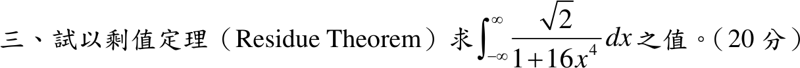
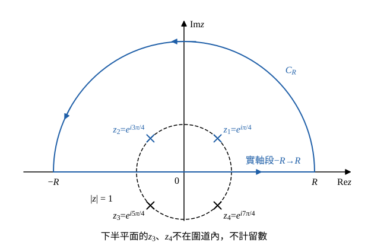

# 113 年第 3 題｜四次式實積分的留數驗算

## 已知與所求

以留數定理求 \(\displaystyle I=\int_{-\infty}^{\infty}\frac{\sqrt2}{1+16x^4}\,dx\)（20 分）。

## 考場標準作答

**解題邏輯**：被積函數是有理函數，分母 \(1+16x^4\) 在實軸上恆 \(>0\)（無實極點），且分母次數比分子高 4，故用「實軸段 \(+\) 上半平面半圓 \(C_R\)」的封閉圍道與留數定理：實積分 \(=2\pi i\times\)（上半平面極點留數和），半圓弧的積分在 \(R\to\infty\) 時趨於 0。先以 \(u=2x\) 把 \(16x^4\) 化成 \(u^4\)，使極點落在單位圓上；再求 \(1+z^4=0\) 的四根、挑上半平面兩個，以單極點公式算留數，最後乘回換元常數。

### 步驟 1：換元 \(u=2x\)

\[
u=2x\quad\Longrightarrow\quad dx=\frac{du}{2},\qquad 16x^4=(2x)^4=u^4
\]
\(x\) 由 \(-\infty\) 到 \(\infty\) 時 \(u\) 也由 \(-\infty\) 到 \(\infty\)（上下限不變）：
\[
I=\int_{-\infty}^{\infty}\frac{\sqrt2}{1+u^4}\cdot\frac{du}{2}=\frac{\sqrt2}{2}\,J,\qquad J=\int_{-\infty}^{\infty}\frac{du}{1+u^4}
\]

### 步驟 2：\(h(z)=\dfrac{1}{1+z^4}\) 的極點

令分母為 0：
\[
z^4=-1=e^{i(\pi+2k\pi)}
\]
開四次方根：
\[
z_{k+1}=e^{i(\pi+2k\pi)/4},\qquad k=0,1,2,3
\]
\[
z_1=e^{i\pi/4},\quad z_2=e^{i3\pi/4},\quad z_3=e^{i5\pi/4},\quad z_4=e^{i7\pi/4}
\]
- 四根相異，且 \(\dfrac{d}{dz}(1+z^4)=4z^3\ne0\)，皆為一階（簡單）極點，都在 \(|z|=1\) 上。
- 上半平面（\(\operatorname{Im}z>0\)，幅角在 \(0\) 與 \(\pi\) 之間）只有 \(z_1\)（\(45^\circ\)）、\(z_2\)（\(135^\circ\)）；\(z_3\)（\(225^\circ\)）、\(z_4\)（\(315^\circ\)）在下半平面，不計。

### 步驟 3：圍道與半圓弧積分趨於 0

取 \(R>1\)，圍道 \(C\) = 實軸段 \(-R\to R\) \(+\) 上半圓 \(C_R\)（逆時針），內含 \(z_1,z_2\)。留數定理：
\[
\oint_C h(z)\,dz=\int_{-R}^{R}\frac{du}{1+u^4}+\int_{C_R}\frac{dz}{1+z^4}=2\pi i\left[\operatorname{Res}(h,z_1)+\operatorname{Res}(h,z_2)\right]
\]
在 \(C_R\) 上 \(|z|=R\)，由三角不等式 \(|1+z^4|\ge|z|^4-1=R^4-1\)；弧長 \(\pi R\)（ML 不等式）：
\[
\left|\int_{C_R}\frac{dz}{1+z^4}\right|\le\frac{\pi R}{R^4-1}\xrightarrow{R\to\infty}0
\]
故令 \(R\to\infty\)：
\[
J=2\pi i\left[\operatorname{Res}(h,z_1)+\operatorname{Res}(h,z_2)\right]
\]

### 步驟 4：上半平面兩個留數

單極點公式（\(h=P/Q\)，\(Q(z_k)=0\)、\(Q'(z_k)\ne0\)）：
\[
\operatorname{Res}(h,z_k)=\frac{P(z_k)}{Q'(z_k)}=\frac{1}{4z_k^3}
\]
\(z_1=e^{i\pi/4}\)：
\[
z_1^3=e^{i3\pi/4}\quad\Longrightarrow\quad\operatorname{Res}(h,z_1)=\frac14e^{-i3\pi/4}
\]
\(z_2=e^{i3\pi/4}\)（\(9\pi/4\) 減一圈 \(2\pi\)）：
\[
z_2^3=e^{i9\pi/4}=e^{i\pi/4}\quad\Longrightarrow\quad\operatorname{Res}(h,z_2)=\frac14e^{-i\pi/4}
\]
化成直角座標（\(e^{i\theta}=\cos\theta+i\sin\theta\)）：
\[
e^{-i3\pi/4}=\cos\frac{3\pi}{4}-i\sin\frac{3\pi}{4}=-\frac{\sqrt2}{2}-i\frac{\sqrt2}{2}
\]
\[
e^{-i\pi/4}=\cos\frac{\pi}{4}-i\sin\frac{\pi}{4}=\frac{\sqrt2}{2}-i\frac{\sqrt2}{2}
\]
實部、虛部分別相加：
\[
e^{-i3\pi/4}+e^{-i\pi/4}=\left(-\frac{\sqrt2}{2}+\frac{\sqrt2}{2}\right)+i\left(-\frac{\sqrt2}{2}-\frac{\sqrt2}{2}\right)=0-i\sqrt2
\]
\[
\operatorname{Res}(h,z_1)+\operatorname{Res}(h,z_2)=\frac14\left(-i\sqrt2\right)=-\frac{i\sqrt2}{4}
\]

### 步驟 5：求 \(J\) 與 \(I\)

代入步驟 3：
\[
J=2\pi i\left(-\frac{i\sqrt2}{4}\right)=-\frac{2\sqrt2\,\pi\,i^2}{4}
\]
用 \(i^2=-1\)：
\[
J=\frac{2\sqrt2\,\pi}{4}=\frac{\sqrt2\,\pi}{2}=\frac{\pi}{\sqrt2}
\]
乘回步驟 1 的常數 \(\frac{\sqrt2}{2}\)：
\[
\boxed{I=\frac{\sqrt2}{2}\cdot\frac{\pi}{\sqrt2}=\frac\pi2}\approx1.57
\]

## 驗算

- 標準公式 \(\int_0^\infty\frac{du}{1+u^a}=\frac\pi a\csc\frac\pi a\)，取 \(a=4\)：\(\frac\pi4\cdot\sqrt2\)；偶函數全軸加倍得 \(J=2\cdot\frac{\sqrt2\,\pi}{4}=\frac{\pi}{\sqrt2}\)，與步驟 5 一致，\(I=\frac{\sqrt2}{2}\cdot\frac{\pi}{\sqrt2}=\frac\pi2\approx1.571\)。
- 合理性：被積函數 \(\le\sqrt2\) 且只在 \(|x|\lesssim\frac12\) 附近顯著，\(I\approx1.57\) 量級合理（為正實數，留數和必為純虛數）。

## 失分點

- 換元後漏乘 \(dx=du/2\)，答案變成 \(\pi\)。
- 把四個極點的留數全加（總和為 0）；上半平面只含 \(e^{i\pi/4}\)、\(e^{i3\pi/4}\)。
- 未說明半圓弧積分 \(\to0\)（分母次數比分子高 \(\ge2\)）就直接寫 \(2\pi i\sum\operatorname{Res}\)。
