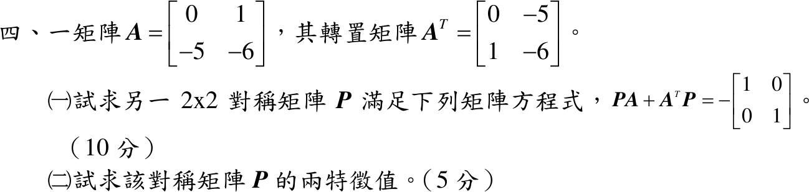

# 113 年第 4 題｜Lyapunov 矩陣方程

## 已知與所求

\(A=\begin{bmatrix}0&1\\-5&-6\end{bmatrix}\)、\(A^T=\begin{bmatrix}0&-5\\1&-6\end{bmatrix}\)。求（一）\(2\times2\) 對稱矩陣 \(P\) 使 \(PA+A^TP=-I\)（10 分）；（二）\(P\) 的兩特徵值（5 分）。

## 考場標準作答

### （一）對稱矩陣 \(P\)（10 分）

\(P\) 對稱，只有 \(p_1,p_2,p_3\) 三個未知數，且 \(A^TP=(PA)^T\)；左式對稱，\((1,2)\) 與 \((2,1)\) 元素給同一條方程，逐元素比較得三條一次方程。

令
\[
P=\begin{bmatrix}p_1&p_2\\p_2&p_3\end{bmatrix}
\]
矩陣乘法（列乘行）：
\[
PA=\begin{bmatrix}p_1(0)+p_2(-5)&p_1(1)+p_2(-6)\\p_2(0)+p_3(-5)&p_2(1)+p_3(-6)\end{bmatrix}
=\begin{bmatrix}-5p_2&p_1-6p_2\\-5p_3&p_2-6p_3\end{bmatrix}
\]
轉置（\(P^T=P\) 故 \(A^TP=A^TP^T=(PA)^T\)）：
\[
A^TP=(PA)^T=\begin{bmatrix}-5p_2&-5p_3\\p_1-6p_2&p_2-6p_3\end{bmatrix}
\]
相加：
\[
PA+A^TP=\begin{bmatrix}-10p_2&p_1-6p_2-5p_3\\p_1-6p_2-5p_3&2p_2-12p_3\end{bmatrix}
=\begin{bmatrix}-1&0\\0&-1\end{bmatrix}
\]
\((1,1)\) 元素：
\[
-10p_2=-1
\quad\Longrightarrow\quad
p_2=\frac1{10}
\]
\((2,2)\) 元素，代入 \(p_2=\frac1{10}\)：
\[
2p_2-12p_3=-1
\quad\Longrightarrow\quad
12p_3=1+2p_2=1+\frac2{10}=\frac{12}{10}
\quad\Longrightarrow\quad
p_3=\frac1{10}
\]
\((1,2)\) 元素，代入 \(p_2=p_3=\frac1{10}\)：
\[
p_1-6p_2-5p_3=0
\quad\Longrightarrow\quad
p_1=6\cdot\frac1{10}+5\cdot\frac1{10}=\frac{11}{10}
\]
\[
\boxed{P=\frac1{10}\begin{bmatrix}11&1\\1&1\end{bmatrix}}
\]

### （二）特徵值（5 分）

\[
\det(P-\lambda I)=\begin{vmatrix}\frac{11}{10}-\lambda&\frac1{10}\\\frac1{10}&\frac1{10}-\lambda\end{vmatrix}
=\Big(\frac{11}{10}-\lambda\Big)\Big(\frac1{10}-\lambda\Big)-\Big(\frac1{10}\Big)^2
\]
乘開：
\[
=\lambda^2-\frac{12}{10}\lambda+\frac{11}{100}-\frac1{100}
=\lambda^2-\frac65\lambda+\frac1{10}=0
\]
兩邊乘 10：
\[
10\lambda^2-12\lambda+1=0
\]
公式解：
\[
\lambda=\frac{12\pm\sqrt{12^2-4(10)(1)}}{2(10)}=\frac{12\pm\sqrt{104}}{20}=\frac{12\pm2\sqrt{26}}{20}
\]
\[
\boxed{\lambda=\frac{6\pm\sqrt{26}}{10}}
\]
數值（\(\sqrt{26}=5.0990\)）：\(\lambda_1=\frac{6+5.0990}{10}=1.1099\approx1.11\)，\(\lambda_2=\frac{6-5.0990}{10}=0.0901\approx0.09\)。兩者皆正，\(P\) 正定。

## 驗算

- 回代：\(-10\cdot\frac1{10}=-1\)；\(\frac{11}{10}-\frac6{10}-\frac5{10}=0\)；\(\frac2{10}-\frac{12}{10}=-1\)，三元素皆符合 \(-I\)。
- 特徵值和 \(=\frac{12}{10}=\operatorname{tr}P=\frac{11+1}{10}\)；積 \(=\frac{36-26}{100}=\frac1{10}=\det P=\frac{11-1}{100}\)。
- \(A\) 的特徵方程 \(\lambda^2+6\lambda+5=(\lambda+1)(\lambda+5)\)，特徵值 \(-1,-5\) 皆在左半平面，Lyapunov 定理保證 \(P\) 正定，與（二）兩正根一致。

## 失分點

- 只算 \(PA\) 漏掉 \(A^TP\)，非對角元素少一半而解出錯的 \(p_1\)。
- 右端是 \(-I\)：\((1,1)\) 方程應為 \(-10p_2=-1\)，寫成 \(+1\) 會得 \(p_2<0\)。
- 特徵方程常數項漏減 \(p_2^2=\frac1{100}\)，得 \(\frac{11}{100}\) 而非 \(\frac1{10}\)。
