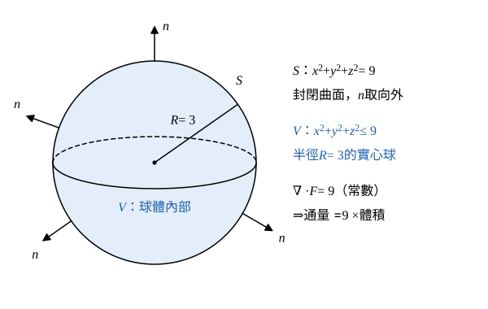

# 113 年第 5 題｜切線向量與球面通量

## 已知與所求

（一）\(r(t)=[3t,\ 4t^2,\ 8t^4]\)，求切線向量與單位切線向量（10 分）。（二）\(F=7x\,\mathbf i+3y\,\mathbf j-z\,\mathbf k\)，\(S:x^2+y^2+z^2=9\)，\(n\) 為向外單位法向量，求 \(\iint_SF\cdot n\,dA\)（10 分）。

## 考場標準作答

### （一）切線向量與單位切線向量（10 分）

切線向量為 \(r'(t)\)，單位切線向量 \(T=r'/\lVert r'\rVert\)，需 \(\lVert r'\rVert\ne0\)。

逐分量微分（冪次法則 \(\frac{d}{dt}t^n=nt^{n-1}\)）：
\[
\frac{d}{dt}(3t)=3
\]
\[
\frac{d}{dt}(4t^2)=4\cdot2t=8t
\]
\[
\frac{d}{dt}(8t^4)=8\cdot4t^3=32t^3
\]
\[
\boxed{r'(t)=[3,\ 8t,\ 32t^3]}
\]
長度：各分量平方後相加再開根號。
\[
\lVert r'(t)\rVert^2=3^2+(8t)^2+(32t^3)^2
\]
\[
\lVert r'(t)\rVert^2=9+64t^2+1024t^6
\]
\[
\lVert r'(t)\rVert=\sqrt{9+64t^2+1024t^6}
\]
因 \(64t^2\ge0\)、\(1024t^6\ge0\)，\(\lVert r'(t)\rVert\ge\sqrt9=3>0\)，對所有 \(t\) 都可除：
\[
T(t)=\frac{r'(t)}{\lVert r'(t)\rVert}
\]
\[
\boxed{T(t)=\frac{[3,\ 8t,\ 32t^3]}{\sqrt{9+64t^2+1024t^6}}}
\]

### （二）球面向外通量（10 分）

\(S\) 為封閉球面、\(n\) 取向外，\(F\) 各分量為多項式、處處連續可微，由散度定理 \(\iint_SF\cdot n\,dA=\iiint_V\nabla\cdot F\,dV\)。

散度（各分量對自己的變數偏微分後相加）：
\[
\nabla\cdot F=\frac{\partial(7x)}{\partial x}+\frac{\partial(3y)}{\partial y}+\frac{\partial(-z)}{\partial z}
\]
\[
\frac{\partial(7x)}{\partial x}=7,\qquad\frac{\partial(3y)}{\partial y}=3,\qquad\frac{\partial(-z)}{\partial z}=-1
\]
\[
\nabla\cdot F=7+3-1=9
\]

\(V\)：\(x^2+y^2+z^2\le9\)，半徑 \(R=\sqrt9=3\)。球體積公式代入：
\[
\iiint_VdV=\frac43\pi R^3=\frac43\pi(3)^3=\frac43\pi(27)=36\pi
\]
散度定理（常數 9 提出）：
\[
\iint_SF\cdot n\,dA=\iiint_V9\,dV=9\iiint_VdV
\]
\[
\iint_SF\cdot n\,dA=9\times36\pi
\]
\[
\boxed{\iint_SF\cdot n\,dA=324\pi\approx1017.88}
\]

## 驗算

- （一）取 \(t=1\)：\(r'(1)=[3,8,32]\)，\(\lVert r'(1)\rVert=\sqrt{9+64+1024}=\sqrt{1097}\approx33.12\)，\(T(1)\approx[0.0906,\ 0.2415,\ 0.9662]\)；\(T\cdot T=\frac{9+64+1024}{1097}=1\)，確為單位向量。
- （二）直接面積分：球面上 \(n=(x,y,z)/3\)，\(F\cdot n=(7x^2+3y^2-z^2)/3\)。球面對稱給 \(\iint_Sx^2dA=\iint_Sy^2dA=\iint_Sz^2dA=\frac13\iint_S9\,dA=\frac13\cdot9\cdot4\pi(3)^2=108\pi\)，故通量 \(=\frac{(7+3-1)\cdot108\pi}{3}=324\pi\)，一致。

## 失分點

- \(\lVert r'\rVert^2=9+64t^2+1024t^6\) 須逐項平方；把 \((8t)^2\) 寫成 \(8t^2\) 會使 \(T\) 不是單位向量。
- \(-z\,\mathbf k\) 的散度貢獻是 \(-1\)，漏掉負號得 \(11\cdot36\pi=396\pi\)。
- 只寫 \(\nabla\cdot F\cdot V\) 而未說明 \(S\) 封閉、\(n\) 向外、\(F\) 連續可微（散度定理條件）。
