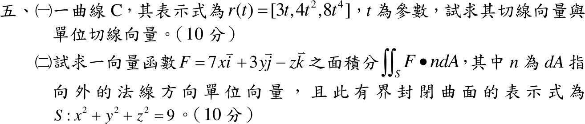

# 113 年第 5 題｜切線向量與球面通量

## 已知與所求

（一）\(r(t)=[3t,\ 4t^2,\ 8t^4]\)，求切線向量與單位切線向量。（二）\(F=7x\,\mathbf i+3y\,\mathbf j-z\,\mathbf k\)，\(S:x^2+y^2+z^2=9\)，求外向通量 \(\iint_SF\cdot n\,dA\)。

## 考場標準作答

### （一）切線向量

觀念：空間曲線的切線向量是位置向量對參數的導數 \(r'(t)\)，單位切線向量 \(T=r'/\lVert r'\rVert\)（\(r'\ne0\) 時有定義）。

逐分量對 \(t\) 微分：
\[
\frac{d}{dt}(3t)=3,\qquad \frac{d}{dt}(4t^2)=8t,\qquad \frac{d}{dt}(8t^4)=32t^3
\]
\[
\boxed{r'(t)=[3,\ 8t,\ 32t^3]}
\]
各分量平方後相加：
\[
\lVert r'(t)\rVert^2=3^2+(8t)^2+(32t^3)^2=9+64t^2+1024t^6
\]
\[
\lVert r'(t)\rVert=\sqrt{9+64t^2+1024t^6}\ \ (\ge3>0)
\]
\[
\boxed{T(t)=\frac{[3,\ 8t,\ 32t^3]}{\sqrt{9+64t^2+1024t^6}}}
\]

### （二）球面通量

觀念：\(S\) 是封閉曲面且 \(F\) 在球內連續可微，可用散度定理 \(\iint_SF\cdot n\,dA=\iiint_V\nabla\cdot F\,dV\)（\(n\) 取外向）把面積分改成球體體積分。

散度：
\[
\nabla\cdot F=\frac{\partial(7x)}{\partial x}+\frac{\partial(3y)}{\partial y}+\frac{\partial(-z)}{\partial z}=7+3-1=9
\]
球體半徑 \(R=3\)，體積：
\[
V=\frac43\pi R^3=\frac43\pi(3)^3=36\pi
\]
\[
\iint_SF\cdot n\,dA=\iiint_V9\,dV=9\cdot36\pi=\boxed{324\pi\approx1017.88}
\]

## 驗算

- （一）\(t=1\)：\(r'(1)=[3,8,32]\)，\(\lVert r'\rVert=\sqrt{9+64+1024}=\sqrt{1097}\approx33.12\)，\(T(1)\approx[0.09,\ 0.24,\ 0.97]\)，\(T\cdot T=1097/1097=1\)。
- （二）直接面積分：\(n=(x,y,z)/3\)，\(F\cdot n=(7x^2+3y^2-z^2)/3\)；球面對稱給 \(\iint x^2dA=\iint y^2dA=\iint z^2dA=\frac13\cdot9\cdot(4\pi\cdot9)=108\pi\approx339.29\)，故通量 \(=(7+3-1)\cdot108\pi/3=324\pi\approx1017.88\)。

## 失分點

- \(\|r'\|^2=9+64t^2+1024t^6\) 須逐項平方；把 \((8t)^2\) 寫成 \(8t^2\) 會使 \(\mathbf T\) 不是單位向量。
- \(-z\,\mathbf k\) 的散度貢獻是 \(-1\)，漏掉負號得 \(11\cdot36\pi=396\pi\)。
