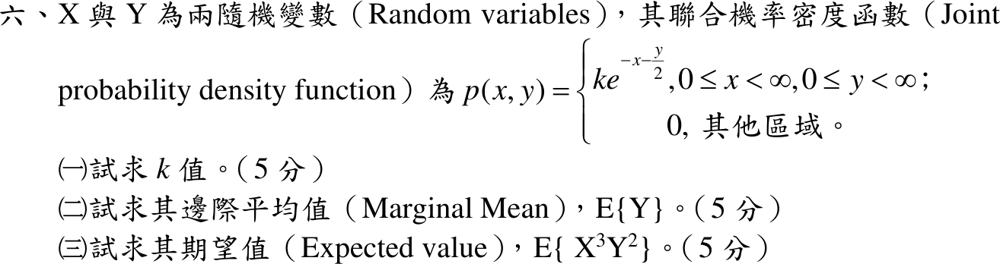
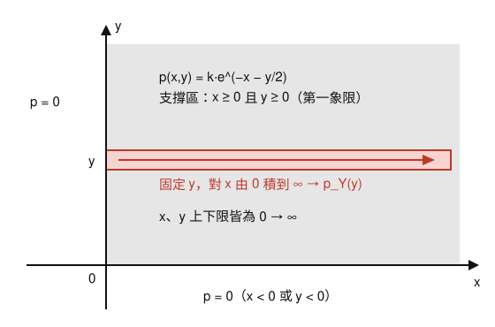

# 113 年第 6 題｜聯合機率密度

## 已知與所求

\(p(x,y)=ke^{-x-y/2}\)（\(x\ge0,\ y\ge0\)），其他區域為 0。求（一）\(k\)（5 分）；（二）邊際平均值 \(E\{Y\}\)（5 分）；（三）期望值 \(E\{X^3Y^2\}\)（5 分）。

## 考場標準作答

**解題邏輯**：三問都是在支撐區 \(x\ge0,\ y\ge0\)（第一象限）上對聯合密度做積分。先由「總機率 = 1」定出 \(k\)；再對另一變數積分得邊際密度 \(p_X(x)\)、\(p_Y(y)\)，由 \(p_Y(y)\) 求 \(E\{Y\}\)；最後確認 \(p(x,y)=p_X(x)p_Y(y)\)（獨立），把 \(E\{X^3Y^2\}\) 拆成 \(E[X^3]E[Y^2]\)。因 \(e^{-x-y/2}=e^{-x}e^{-y/2}\) 可分離且支撐區為矩形（上下限都是常數），每個重積分都拆成兩個單變數積分相乘。

### 步驟 1：支撐區、積分上下限與共用積分公式

- 支撐區為第一象限，區域外 \(p=0\)，故 \(x\)、\(y\) 的積分上下限都是 \(0\to\infty\)，且與另一變數無關。
- 求 \(p_Y(y)\) 時固定 \(y\)，沿水平線對 \(x\) 由 \(0\) 積到 \(\infty\)；求 \(p_X(x)\) 時固定 \(x\)，沿鉛直線對 \(y\) 積分。

三問共用的單變數積分（\(a>0\)，\(n=0,1,2,\dots\)；由 \(\Gamma(n+1)=n!\)，或重複分部積分）：
\[
\int_0^\infty t^n e^{-at}\,dt=\frac{n!}{a^{n+1}}
\]

### （一）\(k\) 值（5 分）

**邏輯**：聯合密度在整個支撐區上的總機率必為 1；被積函數可分離、上下限為常數，重積分等於兩個單變數積分相乘。

\[
\int_0^\infty\!\!\int_0^\infty k\,e^{-x-y/2}\,dx\,dy=1
\quad\Longrightarrow\quad
k\int_0^\infty e^{-x}\,dx\cdot\int_0^\infty e^{-y/2}\,dy=1
\]
兩個單變數積分：
\[
\int_0^\infty e^{-x}\,dx=\Big[-e^{-x}\Big]_0^\infty=0-(-1)=1
\]
\[
\int_0^\infty e^{-y/2}\,dy=\Big[-2e^{-y/2}\Big]_0^\infty=0-(-2)=2
\]
代回：
\[
k(1)(2)=1
\quad\Longrightarrow\quad
\boxed{k=\frac12}=0.50
\]

### 步驟 2：邊際密度與獨立性（（二）、（三）共用）

代入 \(k=\tfrac12\)。對 \(x\) 積分得 \(Y\) 的邊際密度（用（一）的 \(\int_0^\infty e^{-x}dx=1\)）：
\[
p_Y(y)=\int_0^\infty \frac12e^{-x-y/2}\,dx=\frac12e^{-y/2}\int_0^\infty e^{-x}\,dx=\frac12e^{-y/2}(1)=\frac12e^{-y/2},\qquad y\ge0
\]
對 \(y\) 積分得 \(X\) 的邊際密度（用（一）的 \(\int_0^\infty e^{-y/2}dy=2\)）：
\[
p_X(x)=\int_0^\infty \frac12e^{-x-y/2}\,dy=\frac12e^{-x}\int_0^\infty e^{-y/2}\,dy=\frac12e^{-x}(2)=e^{-x},\qquad x\ge0
\]
相乘檢查：\(p_X(x)\,p_Y(y)=e^{-x}\cdot\tfrac12e^{-y/2}=\tfrac12e^{-x-y/2}\)，故在 \(x,y\ge0\) 上 \(p(x,y)=p_X(x)p_Y(y)\)（區域外兩邊皆為 0），\(X\)、\(Y\) 獨立；\(X\sim\operatorname{Exp}(1)\)、\(Y\sim\operatorname{Exp}(\text{rate}=1/2)\)。

### （二）邊際平均值 \(E\{Y\}\)（5 分）

**邏輯**：邊際平均值只由 \(Y\) 的邊際密度決定，\(E[Y]=\int y\,p_Y(y)\,dy\)；積分用步驟 1 公式取 \(n=1\)、\(a=\tfrac12\)。

\[
E[Y]=\int_0^\infty y\,p_Y(y)\,dy=\frac12\int_0^\infty y\,e^{-y/2}\,dy
\]
\[
\int_0^\infty y\,e^{-y/2}\,dy=\frac{1!}{(1/2)^2}=\frac{1}{1/4}=4
\]
\[
E[Y]=\frac12\times4
\]
\[
\boxed{E[Y]=2}
\]

### （三）期望值 \(E\{X^3Y^2\}\)（5 分）

**邏輯**：步驟 2 已證 \(p(x,y)=p_X(x)p_Y(y)\)，重積分可拆成兩個單變數積分，即 \(E[X^3Y^2]=E[X^3]\,E[Y^2]\)；兩個動差各用步驟 1 公式。

\[
E[X^3Y^2]=\int_0^\infty\!\!\int_0^\infty x^3y^2\,p_X(x)p_Y(y)\,dx\,dy=\int_0^\infty x^3p_X(x)\,dx\cdot\int_0^\infty y^2p_Y(y)\,dy=E[X^3]\,E[Y^2]
\]
\(X\) 的三階動差（\(n=3\)、\(a=1\)）：
\[
E[X^3]=\int_0^\infty x^3e^{-x}\,dx=\frac{3!}{1^4}=6
\]
\(Y\) 的二階動差（\(n=2\)、\(a=\tfrac12\)）：
\[
E[Y^2]=\frac12\int_0^\infty y^2e^{-y/2}\,dy=\frac12\cdot\frac{2!}{(1/2)^3}=\frac12\cdot\frac{2}{1/8}=\frac12\times16=8
\]
相乘：
\[
E[X^3Y^2]=E[X^3]E[Y^2]=6\times8
\]
\[
E[X^3Y^2]=\boxed{48}
\]

## 驗算

直接對聯合密度積分（不經邊際密度，只用步驟 1 公式）：
\[
\frac12\int_0^\infty x^3e^{-x}dx\int_0^\infty y^2e^{-y/2}dy=\frac12\,\Gamma(4)\cdot\frac{\Gamma(3)}{(1/2)^3}=\frac12(6)(16)=48;
\]
同法 \(E[Y]=\frac12(1)\cdot\frac{\Gamma(2)}{(1/2)^2}=\frac12(1)(4)=2\)。另以指數分布平均值 \(1/\lambda\) 快驗：\(Y\) 的 rate 為 \(1/2\)，\(E[Y]=1/(1/2)=2\)，一致。

## 失分點

- 把指數 \(e^{-x-y/2}\) 誤讀成 \(e^{-x-2y}\)，會得 \(k=2\)、\(E[Y]=1/2\)。
- 未先說明 \(p(x,y)=p_X(x)p_Y(y)\) 就把 \(E[X^3Y^2]\) 拆成乘積。
- \(Y\) 的 rate 是 \(1/2\)：\(E[Y^2]=2/(1/2)^2=8\)，誤用 rate 2 得 \(1/2\)。
