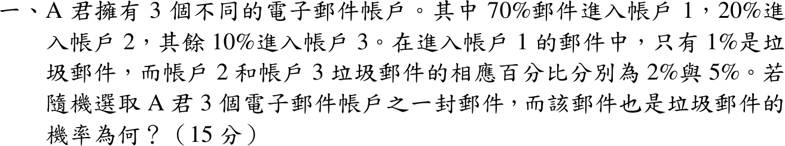
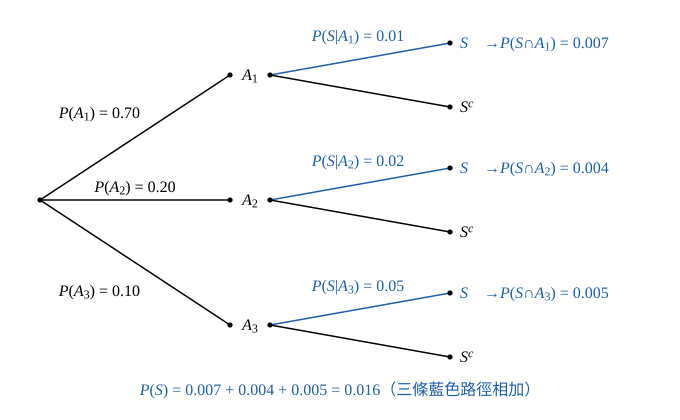

# 114 年第 1 題｜垃圾郵件的機率

## 已知與所求

郵件進入帳戶 1、2、3 的比例為 70%、20%、10%；各帳戶垃圾郵件比例為 1%、2%、5%。求隨機一封郵件為垃圾郵件的機率（15 分）。

## 考場標準作答

**解題邏輯**：隨機取一封郵件，它必定且只會落入三個帳戶之一（三帳戶構成樣本空間的分割），再依所在帳戶的垃圾比例判定是否為垃圾郵件，故用全機率公式：\(P(S)\) 是各帳戶垃圾比例依進信比例加權相加。前提：「70%、20%、10%」是進信比例 \(P(A_i)\)，「1%、2%、5%」是在該帳戶內的條件機率 \(P(S\mid A_i)\)。依序：定事件並確認分割 → 每條分支機率相乘 → 三項相加。

### 步驟 1：定義事件並確認構成分割

- \(A_i\)：郵件進入帳戶 \(i\)（\(i=1,2,3\)）；\(S\)：郵件為垃圾郵件。
- 已知（百分比化為小數）：
\[
P(A_1)=0.70,\quad P(A_2)=0.20,\quad P(A_3)=0.10
\]
\[
P(S\mid A_1)=0.01,\quad P(S\mid A_2)=0.02,\quad P(S\mid A_3)=0.05
\]
- 一封郵件只進一個帳戶，\(A_1,A_2,A_3\) 兩兩互斥；權重和：
\[
P(A_1)+P(A_2)+P(A_3)=0.70+0.20+0.10=1.00
\]
故三者涵蓋所有郵件，構成分割，可用全機率公式。畫樹狀圖時第一層分到帳戶 \(A_i\)、第二層分垃圾 \(S\)／非垃圾 \(S^c\)，沿路徑相乘（圖 1）。

### 步驟 2：全機率公式求 \(P(S)\)（15 分）

全機率公式（\(A_1,A_2,A_3\) 為分割）：
\[
P(S)=\sum_{i=1}^{3}P(S\cap A_i)=\sum_{i=1}^{3}P(S\mid A_i)\,P(A_i)
\]
每條路徑相乘（乘法規則 \(P(S\cap A_i)=P(S\mid A_i)P(A_i)\)）：
\[
P(S\cap A_1)=(0.01)(0.70)=0.007
\]
\[
P(S\cap A_2)=(0.02)(0.20)=0.004
\]
\[
P(S\cap A_3)=(0.05)(0.10)=0.005
\]
三項相加：
\[
P(S)=0.007+0.004+0.005
\]
\[
\boxed{P(S)=0.016=1.60\%}
\]

## 驗算

每 1000 封郵件：帳戶 1 有 \(700\) 封，其中 \(700\times0.01=7\) 封垃圾；帳戶 2 有 \(200\) 封，其中 \(200\times0.02=4\) 封；帳戶 3 有 \(100\) 封，其中 \(100\times0.05=5\) 封。共 \(7+4+5=16\) 封，\(16/1000=0.016=1.60\%\)，一致；且 \(1.60\%\) 落在條件率 \(1\%\)–\(5\%\) 之間，符合加權平均。

## 失分點

- 三個條件率直接平均得 \((1+2+5)/3\approx2.67\%\)，漏乘帳戶比例 \(0.70,0.20,0.10\)。
- 權重 \(P(A_i)\) 是進信比例（和為 1）；把 \(1\%,2\%,5\%\) 當成權重是角色顛倒。
