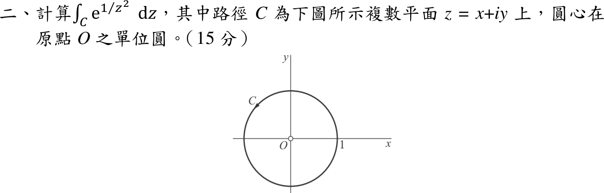

# 114 年第 2 題｜本性奇點的閉路積分

## 已知與所求

計算 \(\oint_C e^{1/z^2}\,dz\)，\(C\) 為圓心在原點 \(O\) 的單位圓 \(|z|=1\)（題圖箭頭為逆時針）（15 分）。

## 考場標準作答

**解題邏輯**：被積函數在 \(C\) 內只有 \(z=0\) 一個奇點，用留數定理 \(\oint_C f\,dz=2\pi i\sum\operatorname{Res}\)。\(z=0\) 是本性奇點（不是極點），極點的留數公式不能用，改由 Laurent 級數讀 \(z^{-1}\) 項係數：把指數函數的 Maclaurin 級數中的 \(w\) 換成 \(1/z^2\)。前提：\(C\) 逆時針一圈（依題圖）。

### 步驟 1：奇點位置與類型

- \(e^{w}\) 對所有 \(w\) 解析，\(w=1/z^2\) 只在 \(z=0\) 無定義，故唯一奇點為 \(z=0\)。
- \(|0|=0<1\)：\(z=0\) 在 \(C\) 內部，且不在圓周上。
- 步驟 2 的 Laurent 級數含無窮多個負冪項，故 \(z=0\) 為本性奇點，不能用 \(\lim (z-z_0)^m f\) 的極點公式。

### 閉路積分（15 分）

**邏輯**：留數 = Laurent 級數中 \(z^{-1}\) 項的係數 \(a_{-1}\)；指數函數級數對所有 \(w\) 收斂，代 \(w=1/z^2\) 即得 \(0<|z|<\infty\) 上的 Laurent 級數。

指數函數的 Maclaurin 級數：
\[
e^{w}=\sum_{k=0}^{\infty}\frac{w^k}{k!}
\]
代入 \(w=1/z^2\)：
\[
e^{1/z^2}=\sum_{k=0}^{\infty}\frac{(z^{-2})^k}{k!}=\sum_{k=0}^{\infty}\frac{z^{-2k}}{k!},\qquad 0<|z|<\infty
\]
前幾項：
\[
e^{1/z^2}=1+\frac1{z^2}+\frac1{2!\,z^4}+\frac1{3!\,z^6}+\cdots
\]
找 \(z^{-1}\) 項：需 \(-2k=-1\)，即 \(k=\tfrac12\)，不是整數，故級數中沒有 \(z^{-1}\) 項：
\[
\operatorname{Res}_{z=0}e^{1/z^2}=a_{-1}=0
\]
留數定理（\(C\) 逆時針、內部只有 \(z=0\)）：
\[
\oint_Ce^{1/z^2}\,dz=2\pi i\cdot\operatorname{Res}_{z=0}e^{1/z^2}=2\pi i\cdot0
\]
\[
\oint_Ce^{1/z^2}\,dz=\boxed{0}
\]

## 驗算

以 \(z=e^{i\theta}\)（\(dz=ie^{i\theta}d\theta\)）逐項積分：\(\oint_C z^{-2k}dz=i\int_0^{2\pi}e^{i(1-2k)\theta}d\theta\)，僅 \(1-2k=0\) 時非零，而整數 \(k\) 無解，故每項皆為 0，與留數法一致（結果與繞行方向無關）。

## 失分點

- 把常數項 1 或 \(z^{-2}\) 係數 1 當成留數，得出 \(2\pi i\)。
- 把 \(z=0\) 當二階極點套 \(\frac{d}{dz}\big[z^2f\big]\) 公式：\(z^2e^{1/z^2}\) 在 \(z=0\) 仍無極限，本性奇點只能用 Laurent 係數。
