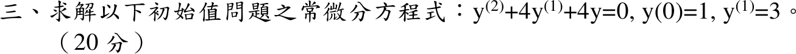

# 114 年第 3 題｜重根二階線性 ODE

## 已知與所求

\(y''+4y'+4y=0\)，\(y(0)=1\)，初值條件 \(y^{(1)}=3\)，求 \(y(t)\)（20 分）。題面第二個初值未標 \((0)\)，依初始值問題讀為 \(y'(0)=3\)。

## 考場標準作答

**解題邏輯**：二階常係數齊次線性 ODE，設 \(y=e^{rt}\) 得特徵方程；特徵根為重根時，第二個獨立解要乘 \(t\)，通解為 \((C_1+C_2t)e^{rt}\)。再求 \(y'\)，代入兩個初值解出 \(C_1,C_2\)。前提：題面第二個初值 \(y^{(1)}=3\) 未標 \((0)\)，依初始值問題讀為 \(y'(0)=3\)。

### 步驟 1：特徵方程與通解

代 \(y=e^{rt}\)（\(y'=re^{rt}\)、\(y''=r^2e^{rt}\)），約去 \(e^{rt}\neq0\)：
\[
r^2+4r+4=0
\]
完全平方：
\[
(r+2)^2=0
\quad\Longrightarrow\quad
r=-2\ (\text{二重根})
\]
重根的兩個獨立解為 \(e^{-2t}\)、\(te^{-2t}\)：
\[
y=(C_1+C_2t)e^{-2t}
\]

### 步驟 2：\(y'(t)\)

乘積法則 \((uv)'=u'v+uv'\)，\(u=C_1+C_2t\)、\(v=e^{-2t}\)：
\[
y'=C_2e^{-2t}+(C_1+C_2t)(-2e^{-2t})
\]
提出 \(e^{-2t}\)：
\[
y'=(C_2-2C_1-2C_2t)e^{-2t}
\]

### 初始值問題的解（20 分）

**邏輯**：兩個初值給兩條方程，恰好定出步驟 1 的兩個常數；\(t=0\) 時 \(e^{0}=1\)。

代 \(y(0)=1\)：
\[
y(0)=(C_1+C_2\cdot0)e^{0}=C_1=1
\]
代 \(y'(0)=3\)：
\[
y'(0)=(C_2-2C_1-2C_2\cdot0)e^{0}=C_2-2C_1=3
\]
代入 \(C_1=1\)：
\[
C_2=3+2C_1=3+2(1)=5
\]
代回步驟 1 的通解：
\[
\boxed{y(t)=(1+5t)e^{-2t}}
\]

## 驗算

拉氏轉換：\(\mathcal L\{y''\}=s^2Y-sy(0)-y'(0)\)、\(\mathcal L\{y'\}=sY-y(0)\)，代入得 \((s^2+4s+4)Y=s\,y(0)+y'(0)+4y(0)=s+3+4=s+7\)，
\[
Y=\frac{s+7}{(s+2)^2}=\frac{(s+2)+5}{(s+2)^2}=\frac{1}{s+2}+\frac{5}{(s+2)^2}\ \Rightarrow\ y=e^{-2t}+5te^{-2t},
\]
與主解相同。

## 失分點

- 重根只寫 \(C_1e^{-2t}+C_2e^{-2t}\)（兩項相依），漏乘 \(t\)。
- 把 \(y'(0)=3\) 直接當 \(C_2=3\)，漏掉乘積法則產生的 \(-2C_1\)。
