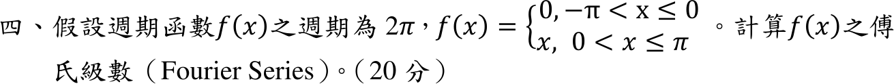
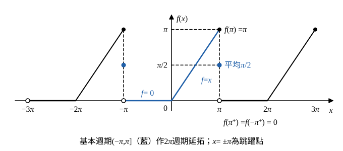

# 114 年第 4 題｜分段週期函數傅立葉級數

## 已知與所求

週期 \(2\pi\)，\(f(x)=0\)（\(-\pi<x\le0\)）、\(f(x)=x\)（\(0<x\le\pi\)）。求 \(f(x)\) 的傅立葉級數（20 分）。

## 考場標準作答

**解題邏輯**：週期 \(2\pi\)（\(L=\pi\)），用 Euler 公式求 \(a_0,a_n,b_n\)。\(f\) 不是奇函數也不是偶函數，三組係數都要算；因負半週期 \(f=0\)，所有積分只剩 \([0,\pi]\) 上的 \(x\)、\(x\cos nx\)、\(x\sin nx\)，後兩者各用一次分部積分，上下限用 \(\sin n\pi=0\)、\(\cos n\pi=(-1)^n\)。最後依 Dirichlet 定理說明跳躍點 \(x=(2m+1)\pi\) 的收斂值。

### 步驟 1：週期延拓與跳躍點

- \(x=0\)：\(f(0^-)=0\)、\(f(0^+)=0\)，連續。
- \(x=\pi\)：左極限 \(f(\pi^-)=\pi\)；右側依週期性 \(f(\pi^+)=f(-\pi^+)=0\)，為跳躍點，兩側平均：
\[
\frac{f(\pi^-)+f(\pi^+)}{2}=\frac{\pi+0}{2}=\frac\pi2
\]

### 步驟 2：係數公式化簡

**邏輯**：Euler 公式在 \((-\pi,\pi]\) 上積分；\((-\pi,0]\) 上被積函數為 \(0\)，該段積分為 0。

\[
f(x)\sim\frac{a_0}{2}+\sum_{n=1}^{\infty}(a_n\cos nx+b_n\sin nx)
\]
\[
a_0=\frac1\pi\int_{-\pi}^{\pi}f\,dx=\frac1\pi\int_0^{\pi}x\,dx,\qquad
a_n=\frac1\pi\int_0^{\pi}x\cos nx\,dx,\qquad
b_n=\frac1\pi\int_0^{\pi}x\sin nx\,dx
\]

### 常數項 \(a_0\)

**邏輯**：\(a_0\) 是 \(f\) 在一週期的積分除以 \(\pi\)；級數常數項是 \(\frac{a_0}{2}\)。

\[
\int_0^{\pi}x\,dx=\Big[\frac{x^2}{2}\Big]_0^{\pi}=\frac{\pi^2}{2}
\]
\[
a_0=\frac1\pi\cdot\frac{\pi^2}{2}=\frac\pi2
\]
\[
\boxed{\frac{a_0}{2}=\frac\pi4}
\]

### 餘弦係數 \(a_n\)

**邏輯**：分部積分 \(\int u\,dv=uv-\int v\,du\)，取 \(u=x\)、\(dv=\cos nx\,dx\)（\(du=dx\)、\(v=\frac{\sin nx}{n}\)）。

\[
\int_0^{\pi}x\cos nx\,dx=\Big[\frac{x\sin nx}{n}\Big]_0^{\pi}-\frac1n\int_0^{\pi}\sin nx\,dx
\]
第一項（\(\sin n\pi=0\)）：
\[
\Big[\frac{x\sin nx}{n}\Big]_0^{\pi}=\frac{\pi\sin n\pi}{n}-0=0
\]
第二項的積分（\(\cos n\pi=(-1)^n\)）：
\[
\int_0^{\pi}\sin nx\,dx=\Big[-\frac{\cos nx}{n}\Big]_0^{\pi}=-\frac{(-1)^n}{n}+\frac1n=\frac{1-(-1)^n}{n}
\]
代回：
\[
\int_0^{\pi}x\cos nx\,dx=0-\frac1n\cdot\frac{1-(-1)^n}{n}=\frac{(-1)^n-1}{n^2}
\]
\[
a_n=\frac1\pi\cdot\frac{(-1)^n-1}{n^2}
\]
\[
\boxed{a_n=\frac{(-1)^n-1}{\pi n^2}}
\]
即奇數 \(n\) 時 \(a_n=-2/(\pi n^2)\)、偶數時 \(a_n=0\)。

### 正弦係數 \(b_n\)

**邏輯**：同樣分部積分，取 \(u=x\)、\(dv=\sin nx\,dx\)（\(du=dx\)、\(v=-\frac{\cos nx}{n}\)）。

\[
\int_0^{\pi}x\sin nx\,dx=\Big[-\frac{x\cos nx}{n}\Big]_0^{\pi}+\frac1n\int_0^{\pi}\cos nx\,dx
\]
第一項：
\[
\Big[-\frac{x\cos nx}{n}\Big]_0^{\pi}=-\frac{\pi(-1)^n}{n}-0=\frac{\pi(-1)^{n+1}}{n}
\]
第二項：
\[
\frac1n\int_0^{\pi}\cos nx\,dx=\frac1n\Big[\frac{\sin nx}{n}\Big]_0^{\pi}=0
\]
代回：
\[
b_n=\frac1\pi\cdot\frac{\pi(-1)^{n+1}}{n}
\]
\[
\boxed{b_n=\frac{(-1)^{n+1}}{n}}
\]

### 傅立葉級數（20 分）

**邏輯**：三組係數代回 \(\frac{a_0}{2}+\sum(a_n\cos nx+b_n\sin nx)\)；收斂值依步驟 1。

\[
\boxed{f(x)\sim\frac\pi4+\sum_{n=1}^{\infty}
\left[\frac{(-1)^n-1}{\pi n^2}\cos(nx)
+\frac{(-1)^{n+1}}{n}\sin(nx)\right]}
\]
這裡的 \(\sim\) 表示：在連續點收斂至 \(f(x)\)；在週期接點 \(x=(2m+1)\pi\)，題面給 \(f(\pi)=\pi\)，但級數收斂至左右極限平均 \(\pi/2\)（步驟 1），不能寫成逐點處處相等。

## 驗算

- \(x=0\)（連續點）：\(\frac\pi4-\frac2\pi\sum_{n\text{ odd}}\frac1{n^2}=\frac\pi4-\frac2\pi\cdot\frac{\pi^2}{8}=0=f(0)\)。
- 上式及 \(x=\pi\) 處所有 \(\sin(n\pi)=0\)，**不能**驗證 \(b_n\)。改取 \(x=\pi/2\)：偶數項 \(a_n=0\)、奇數項 \(\cos(n\pi/2)=0\)，
\[
S\!\left(\tfrac\pi2\right)=\frac\pi4+\sum_{k=0}^{\infty}\frac{(-1)^k}{2k+1}=\frac\pi4+\frac\pi4=\frac\pi2=f\!\left(\tfrac\pi2\right),
\]
確認 \(b_n\) 的尺度；若多除一個 \(\pi\) 則不成立。

## 失分點

- 把 \(a_0=\pi/2\) 直接當常數項，正確常數項是 \(a_0/2=\pi/4\)。
- \(b_n\) 誤寫成 \((-1)^{n+1}/(\pi n)\)（多除一個 \(\pi\)）。
- 在 \(x=\pi\) 直接寫級數值等於 \(f(\pi)=\pi\)，忽略跳躍點收斂到平均值。
