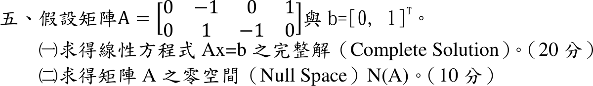

# 114 年第 5 題｜完整解與零空間

## 已知與所求

\(A=\begin{bmatrix}0&-1&0&1\\0&1&-1&0\end{bmatrix}\)、\(b=[0,\ 1]^T\)。求（一）\(Ax=b\) 的完整解（20 分）；（二）\(A\) 的零空間 \(N(A)\)（10 分）。

## 考場標準作答

**解題邏輯**：完整解 = 一組特解 \(x_p\) ＋ 零空間 \(N(A)\) 的任意向量。先對增廣矩陣 \([A\mid b]\) 做列運算化成列梯形，由主元欄判斷相容性與自由變數；（一）把自由變數設為參數、回代主元變數，再依參數拆成「常數向量＋參數 × 向量」；（二）\(Ax=0\) 用同一組列運算（右端的 0 經列運算仍為 0），解出的向量就是 \(N(A)\) 的基底。

### 步驟 1：增廣矩陣列運算（（一）、（二）共用）

**邏輯**：基本列運算不改變解集；列梯形中每列第一個非零元所在欄為主元欄，其餘欄對應自由變數。

\[
[A\mid b]=\left[\begin{array}{cccc|c}0&-1&0&1&0\\0&1&-1&0&1\end{array}\right]
\]
第 1 列乘 \(-1\)：
\[
\xrightarrow{R_1\leftarrow-R_1}
\left[\begin{array}{cccc|c}0&1&0&-1&0\\0&1&-1&0&1\end{array}\right]
\]
第 2 列減第 1 列：
\[
\xrightarrow{R_2\leftarrow R_2-R_1}
\left[\begin{array}{cccc|c}0&1&0&-1&0\\0&0&-1&1&1\end{array}\right]
\]
第 2 列乘 \(-1\)：
\[
\xrightarrow{R_2\leftarrow-R_2}
\left[\begin{array}{cccc|c}0&1&0&-1&0\\0&0&1&-1&-1\end{array}\right]
\]
- 主元在第 2、3 欄，\(\operatorname{rank}A=2=\operatorname{rank}[A\mid b]\)，方程組相容。
- 第 1、4 欄無主元，\(x_1\)、\(x_4\) 為自由變數（\(A\) 第 1 欄全為 0，\(x_1\) 不出現在任何方程中）。

### （一）完整解（20 分）

**邏輯**：列梯形的每一列是一條方程；令自由變數為參數、解出主元變數，再按參數拆開即得「特解＋零空間」的形式。

第 1 列：
\[
x_2-x_4=0
\quad\Longrightarrow\quad
x_2=x_4
\]
第 2 列：
\[
x_3-x_4=-1
\quad\Longrightarrow\quad
x_3=x_4-1
\]
令 \(x_1=c_1\)、\(x_4=c_2\)，代入得 \(x_2=c_2\)、\(x_3=c_2-1\)：
\[
x=\begin{bmatrix}c_1\\c_2\\c_2-1\\c_2\end{bmatrix}
\]
按常數、\(c_1\)、\(c_2\) 拆開：
\[
x=\begin{bmatrix}0\\0\\-1\\0\end{bmatrix}
+c_1\begin{bmatrix}1\\0\\0\\0\end{bmatrix}
+c_2\begin{bmatrix}0\\1\\1\\1\end{bmatrix}
\]
\[
\boxed{x=\begin{bmatrix}0\\0\\-1\\0\end{bmatrix}
+c_1\begin{bmatrix}1\\0\\0\\0\end{bmatrix}
+c_2\begin{bmatrix}0\\1\\1\\1\end{bmatrix},\quad c_1,c_2\in\mathbb R}
\]
其中 \(x_p=(0,0,-1,0)^T\)（\(c_1=c_2=0\)）為特解，後兩項為零空間的任意組合。

### （二）零空間（10 分）

**邏輯**：\(N(A)=\{x\mid Ax=0\}\)；對 \([A\mid 0]\) 做步驟 1 同一組列運算，係數部分相同、右端仍為 0。

第 1 列：
\[
x_2-x_4=0
\quad\Longrightarrow\quad
x_2=x_4
\]
第 2 列：
\[
x_3-x_4=0
\quad\Longrightarrow\quad
x_3=x_4
\]
令 \(x_1=c_1\)、\(x_4=c_2\)：
\[
x=\begin{bmatrix}c_1\\c_2\\c_2\\c_2\end{bmatrix}
=c_1\begin{bmatrix}1\\0\\0\\0\end{bmatrix}+c_2\begin{bmatrix}0\\1\\1\\1\end{bmatrix}
\]
\[
\boxed{N(A)=\operatorname{span}\left\{
\begin{bmatrix}1\\0\\0\\0\end{bmatrix},
\begin{bmatrix}0\\1\\1\\1\end{bmatrix}\right\}}
\]
兩向量非零分量位置不同、線性獨立，故為基底，\(\dim N(A)=2\)。

## 驗算

\(Ax_p=(0,\ 0+1)^T=(0,1)^T=b\)；\(A(1,0,0,0)^T=0\)、\(A(0,1,1,1)^T=(-1+1,\ 1-1)^T=0\)。\(\operatorname{rank}A=2\)，秩－零度定理 \(\dim N(A)=4-2=2\)，與兩個基底向量數一致。

## 失分點

- \(A\) 的第 1 欄全為 0，\(x_1\) 是自由變數；漏掉 \((1,0,0,0)^T\) 會使 \(\dim N(A)\) 只剩 1。
- 由 \(x_2-x_3=1\) 移項誤得 \(x_3=1-x_2\)，特解應為 \(x_3=-1\)（\(x_2=0\)）。
- 只給特解或只給零空間，未寫成「特解＋零空間」的完整解。
