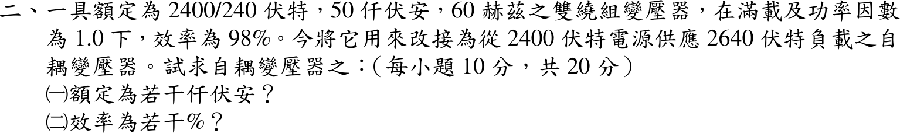
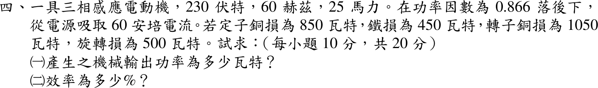
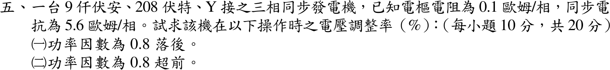

# 106 年電機工程技師｜電機機械逐題詳解

> 本頁由題級 canonical 筆記組合；每題保留官方裁切圖、校驗狀態與可追溯的推導。

## 題目導覽
- [[#一、106 年電機機械第 1 題|第 1 題：106 年電機機械第 1 題]]
- [[#二、106 年電機機械第 2 題｜雙繞組變壓器改接自耦變壓器容量與效率|第 2 題：雙繞組變壓器改接自耦變壓器容量與效率]]
- [[#三、106 年電機機械第 3 題|第 3 題：106 年電機機械第 3 題]]
- [[#四、106 年電機機械第 4 題|第 4 題：106 年電機機械第 4 題]]
- [[#五、106 年電機機械第 5 題|第 5 題：106 年電機機械第 5 題]]

---

## 一、106 年電機機械第 1 題

> 題級識別：EE-106-04-1
> canonical 來源：[[canonical/EE-106-04-1.md]]
> 題級校驗狀態：verified

### 已知與所求

線圈 \(N=400\) 匝、\(R=5\ \Omega\)，鐵心截面為邊長 5 cm 的正方形（\(A=25\ \mathrm{cm^2}=2.5\times10^{-3}\ \mathrm{m^2}\)），兩邊氣隙均為 \(g=0.1\ \mathrm{cm}=10^{-3}\ \mathrm m\)，鐵心與鐵板磁阻忽略，鐵板吸到兩氣隙 0.1 cm 時需平均吸力 550（原題印「牛頓-公尺」，吸力單位應為 N，本解取 \(F=550\ \mathrm N\)）。直流電源，求（一）電源電壓；（二）磁場儲能。

### 考場標準作答

**解題邏輯**：鐵心與鐵板磁阻忽略，磁路只剩兩個串聯的氣隙，磁場能量與吸力都集中在氣隙。（一）由題給吸力反求氣隙磁通密度 \(B\)（兩個極面各受 \(B^2A/2\mu_0\)），再用磁路（安培定律）求所需安匝 \(NI\)，除以匝數得電流；直流穩態時線圈電感不產生壓降，電源電壓只克服電阻壓降 \(IR\)。（二）儲能＝能量密度 \(B^2/2\mu_0\) × 兩氣隙體積。前提：氣隙磁場均勻、不計邊緣效應與漏磁；550 為鐵板所受總吸力（單位應為 N）；直流穩態。

#### 步驟 1：磁路與已知量

- 截面積：\(A=(0.05)^2=2.5\times10^{-3}\ \mathrm{m^2}\)；每個氣隙長 \(g=0.1\ \mathrm{cm}=10^{-3}\ \mathrm m\)；\(\mu_0=4\pi\times10^{-7}\ \mathrm{H/m}\)。
- 磁路：磁動勢 \(\mathcal F=NI\) 推動磁通 \(\Phi=BA\) 依序穿過氣隙 1、鐵板、氣隙 2 回到鐵心；鐵磁阻忽略，只剩兩個氣隙磁阻串聯，每個 \(\mathcal R_g=g/(\mu_0A)\)。
- 線圈電阻記為 \(R=5\ \Omega\)（與磁阻 \(\mathcal R_g\) 區分）。

#### （一）直流電源之電壓（10 分）

**邏輯**：每個極面的吸力＝氣隙能量密度 × 面積＝\(B^2A/2\mu_0\)，兩極面合計等於題給吸力，由此反求 \(B\)；圖 1 磁路 \(NI=\Phi\cdot2\mathcal R_g\) 求安匝；直流穩態 \(L\,di/dt=0\)，\(V=IR\)。

兩個極面的總吸力：
\[
F=2\cdot\frac{B^2A}{2\mu_0}=\frac{B^2A}{\mu_0}\ \Rightarrow\ B=\sqrt{\frac{F\mu_0}{A}}
\]
代入：
\[
F\mu_0=550(4\pi\times10^{-7})=6.912\times10^{-4}\ \mathrm{N\cdot H/m}
\]
\[
\frac{F\mu_0}{A}=\frac{6.912\times10^{-4}}{2.5\times10^{-3}}=0.2765\ \mathrm{T^2}
\]
\[
B=\sqrt{0.2765}=0.5258\ \mathrm T
\]
磁路（兩氣隙串聯）求安匝：
\[
NI=\Phi(2\mathcal R_g)=BA\cdot\frac{2g}{\mu_0A}=\frac{2Bg}{\mu_0}
\]
\[
2Bg=2(0.5258)(10^{-3})=1.0516\times10^{-3}\ \mathrm{T\cdot m}
\]
\[
NI=\frac{1.0516\times10^{-3}}{4\pi\times10^{-7}}=836.8\ \mathrm{A\cdot t}
\]
線圈電流：
\[
I=\frac{NI}{N}=\frac{836.8}{400}=2.092\ \mathrm A
\]
直流穩態電源電壓：
\[
V=IR=2.092(5)
\]
\[
\boxed{V=10.46\ \mathrm V}
\]

#### （二）磁場儲能（10 分）

**邏輯**：鐵心磁阻忽略（\(\mu\to\infty\)，鐵中 \(H\approx0\)），鐵心內不儲能，能量全在兩個氣隙；氣隙能量密度 \(u=B^2/2\mu_0\)，乘兩氣隙總體積即為儲能。

由（一）的 \(F=B^2A/\mu_0\) 得 \(B^2/\mu_0=F/A\)，能量密度：
\[
u=\frac{B^2}{2\mu_0}=\frac{F}{2A}=\frac{550}{2(2.5\times10^{-3})}=\frac{550}{5\times10^{-3}}=1.1\times10^{5}\ \mathrm{J/m^3}
\]
兩氣隙總體積：
\[
\mathrm{Vol}=2Ag=2(2.5\times10^{-3})(10^{-3})=5\times10^{-6}\ \mathrm{m^3}
\]
儲能：
\[
W=u\cdot\mathrm{Vol}=(1.1\times10^{5})(5\times10^{-6})
\]
\[
\boxed{W=0.55\ \mathrm J}
\]
（即 550 mJ。）

### 驗算

電感法：\(L=\dfrac{\mu_0N^2A}{2g}=\dfrac{(4\pi\times10^{-7})(400^2)(2.5\times10^{-3})}{2\times10^{-3}}=0.2513\ \mathrm H\)，\(\tfrac12LI^2=\tfrac12(0.2513)(2.092)^2=0.5499\ \mathrm J\approx0.55\ \mathrm J\)。虛功法：\(F=\tfrac12I^2\left|\dfrac{dL}{dg}\right|=\dfrac{W}{g}=\dfrac{0.55}{10^{-3}}=550\ \mathrm N\)，與題給吸力一致。磁鏈 \(LI=NBA=400(0.5258)(2.5\times10^{-3})=0.5258\ \mathrm{Wb\cdot t}\)。

### 失分點

- 只算一個極面的吸力（\(F=B^2A/2\mu_0\)），\(B\) 變成 \(\sqrt2(0.5258)=0.7436\ \mathrm T\)，電壓變成 14.79 V。
- 安培定律的磁路長是兩個氣隙，共 \(2g=2\times10^{-3}\ \mathrm m\)；只用 \(g\) 會讓電流與電壓少一半（5.23 V）。
- 儲能誤用 \(\tfrac12Fg=0.275\ \mathrm J\)；兩氣隙總場能 \(W=Fg=550(10^{-3})=0.55\ \mathrm J\)。

---

## 二、106 年電機機械第 2 題｜雙繞組變壓器改接自耦變壓器容量與效率

> 題級識別：EE-106-04-2
> canonical 來源：[[canonical/EE-106-04-2.md]]
> 題級校驗狀態：verified

### 已知與所求

2400/240 V、50 kVA、60 Hz 雙繞組變壓器，滿載 PF 1.0 時效率 98%。改接為由 2400 V 電源供應 2640 V 負載的自耦變壓器。求自耦變壓器（一）額定 kVA；（二）效率。（每小題 10 分）

### 考場標準作答

**解題邏輯**：先判定接法：\(2640=2400+240\)，所以 2400 V 繞組當公共繞組接電源，240 V 繞組以加極性串在其上當串聯繞組，負載跨兩繞組（升壓）。（一）自耦容量由「各繞組額定電流」決定：負載電流全部流過串聯繞組，取 \(I_{out}=\) 240 V 繞組額定電流，\(S_{auto}=V_{out}I_{out}\)，再用 KCL 檢查公共繞組電流不超過額定。（二）改接後兩繞組的電壓、電流仍恰為原額定值，銅損與鐵損都與原雙繞組滿載時相同，所以由 98% 反求損失，再以自耦輸出計效率。前提：理想自耦關係（忽略激磁電流與漏阻抗壓降）、負載 PF 1.0。

#### 步驟 1：接線與各繞組額定電流

- 2400 V 繞組為公共繞組，電源跨在它兩端（\(V_{in}=2400\ \mathrm V\)）。
- 240 V 繞組的非打點端接公共繞組的打點端（兩打點端同在上方，電壓相加），負載跨兩繞組：\(V_{out}=2400+240=2640\ \mathrm V\)。
- 參考方向：\(I_{in}\) 由電源流入分接點，\(I_{out}\) 由分接點經串聯繞組流向負載，\(I_c\) 在公共繞組中由分接點向下（圖 1）。

串聯繞組（240 V）額定電流：
\[
I_{se}=\frac{S_{2w}}{V_{se}}=\frac{50\,000}{240}=208.33\ \mathrm A
\]
公共繞組（2400 V）額定電流：
\[
I_{c,rated}=\frac{S_{2w}}{V_c}=\frac{50\,000}{2400}=20.83\ \mathrm A
\]

#### （一）額定容量（10 分）

**邏輯**：負載電流 \(I_{out}\) 全部流過串聯繞組，所以 \(I_{out}\) 的上限就是串聯繞組額定電流；自耦容量＝輸出電壓 × 輸出電流上限，再以 KCL 確認公共繞組也沒有過載。

輸出電流上限：
\[
I_{out}=I_{se}=\frac{50\,000}{240}\ \mathrm A
\]
自耦容量（保留分數，避免 208.33 的捨入誤差）：
\[
S_{auto}=V_{out}I_{out}=2640\left(\frac{50\,000}{240}\right)
\]
\[
S_{auto}=11(50\,000)=550\,000\ \mathrm{VA}
\]
\[
\boxed{S_{auto}=550\text{ kVA}}
\]
公共繞組檢查：輸入電流
\[
I_{in}=\frac{S_{auto}}{V_{in}}=\frac{550\,000}{2400}=229.17\ \mathrm A
\]
分接點 KCL（\(I_{in}=I_{out}+I_c\)），把 \(I_{out}\) 化成同分母 \(500\,000/2400\)：
\[
I_c=I_{in}-I_{out}=\frac{550\,000-500\,000}{2400}=\frac{50\,000}{2400}=20.83\ \mathrm A=I_{c,rated}
\]
兩繞組同時恰為額定，550 kVA 即為額定容量。

#### （二）效率（10 分）

**邏輯**：效率＝輸出／（輸出＋損失）；改接後各繞組的電壓與電流都等於原額定值，銅損（看電流）與鐵損（看電壓）都不變，所以損失沿用雙繞組滿載時的值，只有輸出放大成自耦容量。

雙繞組滿載輸出（PF 1.0）：
\[
P_{out,2w}=S_{2w}\cos\theta=50(1.0)=50\ \mathrm{kW}
\]
雙繞組滿載輸入：
\[
P_{in,2w}=\frac{P_{out,2w}}{\eta_{2w}}=\frac{50}{0.98}=51.020\ \mathrm{kW}
\]
滿載總損失：
\[
P_{loss}=P_{in,2w}-P_{out,2w}=51.020-50=1.020\ \mathrm{kW}
\]
自耦輸出（PF 1.0）：
\[
P_{out,auto}=S_{auto}\cos\theta=550(1.0)=550\ \mathrm{kW}
\]
自耦輸入：
\[
P_{in,auto}=P_{out,auto}+P_{loss}=550+1.020=551.020\ \mathrm{kW}
\]
\[
\eta_{auto}=\frac{P_{out,auto}}{P_{in,auto}}=\frac{550}{551.020}=0.998149
\]
\[
\boxed{\eta_{auto}=99.81\%}
\]

### 驗算

容量比公式：\(S_{auto}/S_{2w}=V_{out}/(V_{out}-V_{in})=2640/240=11\)，\(50\times11=550\ \mathrm{kVA}\)，與（一）相同。損失比例：\(1-\eta_{auto}=1.020/551.020=0.1851\%\)，\(100\%-0.1851\%=99.8149\%\approx99.81\%\)。

### 失分點

- 以 2400 V 繞組電流 20.83 A 乘 2640 V，得 55 kVA（限制負載電流的是串聯 240 V 繞組的 208.33 A）。
- 把 98% 直接當成自耦效率；損失不變、輸出變 11 倍，效率提高到 99.81%。
- 損失用 \(50(1-0.98)=1.0\ \mathrm{kW}\)：98% 效率是輸出對輸入，損失為 \(50/0.98-50=1.020\ \mathrm{kW}\)。

---

## 三、106 年電機機械第 3 題

> 題級識別：EE-106-04-3
> canonical 來源：[[canonical/EE-106-04-3.md]]
> 題級校驗狀態：needs_manual_review
> [!WARNING] 本題仍有官方資料缺口或事件定義歧義；請以 canonical 條件式解答為準。

### 已知與所求

200 V 直流並激電動機，\(R_f=200\ \Omega\)、\(R_a=0.5\ \Omega\)；無載時轉速 1000 rpm、場電流 1 A、電樞電流 4 A；忽略磁飽和與電樞反應。驅動一外接負載需 100 N·m。求（一）電樞電流；（二）轉速。（每小題 10 分）

### 考場標準作答

**解題邏輯**：並激場直接跨在 200 V 上，\(I_f=200/200=1\ \mathrm A\) 固定；忽略飽和與電樞反應，磁通固定，所以 \(E_a=K\Phi\,\omega\)、\(T_e=K\Phi I_a\) 中的 \(K\Phi\) 是常數，先由無載點（4 A、1000 rpm）以電樞 KVL 定出。題目給的是外接軸負載轉矩，又給了非零的無載電樞電流 4 A（無載時的電磁轉矩全部用來克服旋轉損失）；題面沒給損失隨轉速的模型，主解採「空載損失轉矩近似不變」：（一）電磁轉矩＝外接負載轉矩＋無載損失轉矩，除以 \(K\Phi\) 得 \(I_a\)；（二）用負載時的 KVL 重算 \(E_a\)，再依 \(E_a\propto n\) 求轉速。若改採「忽略旋轉損失」（\(T_e=100\ \mathrm{N\cdot m}\)），得 \(I_a=52.89\ \mathrm A\)、\(n=876.54\ \mathrm{rpm}\)，與其他模型一併列於條件與疑義，彼此不可混用。

#### 步驟 1：等效電路與 \(K\Phi\)

- 端電壓 \(V_t=200\ \mathrm V\) 兩端並接：場支路 \(R_f=200\ \Omega\)（\(I_f\) 向下）與電樞支路 \(R_a=0.5\ \Omega\) 串聯反電勢 \(E_a\)。
- 參考方向（電動機慣例）：\(I_a\) 由 \(V_t\) 正端經 \(R_a\) 流入 \(E_a\) 正端。

場電流（驗證題給 1 A，磁通固定）：
\[
I_f=\frac{V_t}{R_f}=\frac{200}{200}=1\ \mathrm A
\]
無載反電勢（電樞 KVL，\(I_{a0}=4\ \mathrm A\)）：
\[
E_{a0}=V_t-I_{a0}R_a=200-4(0.5)=200-2=198\ \mathrm V
\]
無載角速度：
\[
\omega_0=\frac{2\pi n_0}{60}=\frac{2\pi(1000)}{60}=104.7198\ \mathrm{rad/s}
\]
機械常數（後面要除它並求轉速到兩位小數，故保留 6 位有效數字）：
\[
K\Phi=\frac{E_{a0}}{\omega_0}=\frac{198}{104.7198}=1.89076\ \mathrm{V\cdot s/rad}
\]

#### （一）電樞電流（10 分）

**邏輯**：轉子穩速時電磁轉矩＝外接負載轉矩＋旋轉損失轉矩；損失轉矩取無載時的值 \(K\Phi I_{a0}\)（主解假設），再由 \(T_e=K\Phi I_a\) 反求 \(I_a\)。

無載損失轉矩：
\[
T_{loss}=K\Phi I_{a0}=1.89076(4)=7.56304\ \mathrm{N\cdot m}
\]
負載時電磁轉矩：
\[
T_e=T_L+T_{loss}=100+7.56304=107.56304\ \mathrm{N\cdot m}
\]
電樞電流：
\[
I_a=\frac{T_e}{K\Phi}=\frac{107.56304}{1.89076}=56.8888\ \mathrm A
\]
\[
\boxed{I_a=56.89\ \mathrm A}
\]

#### （二）轉速（10 分）

**邏輯**：磁通固定時 \(E_a\propto n\)，\(n=n_0E_a/E_{a0}\)；但負載時電樞電流變大，必須先用 KVL 重算負載反電勢，不可沿用無載的 198 V。

電樞電阻壓降：
\[
I_aR_a=56.8888(0.5)=28.4444\ \mathrm V
\]
負載反電勢：
\[
E_a=V_t-I_aR_a=200-28.4444=171.5556\ \mathrm V
\]
按比例求轉速：
\[
n=n_0\frac{E_a}{E_{a0}}=1000\frac{171.5556}{198}=866.44\ \mathrm{rpm}
\]
\[
\boxed{n=866.44\ \mathrm{rpm}}
\]

### 驗算

轉矩–轉速直線 \(\omega=(V_t-R_aT_e/K\Phi)/K\Phi\)：代 \(T_e=107.56304\ \mathrm{N\cdot m}\) 得 \(\omega=(200-28.4444)/1.89076=90.7337\ \mathrm{rad/s}\)，即 \(90.7337(60)/(2\pi)=866.44\ \mathrm{rpm}\)；代無載 \(T_e=7.56304\ \mathrm{N\cdot m}\) 得 \(\omega=(200-2)/1.89076=104.7198\ \mathrm{rad/s}\)，回到 1000 rpm，吻合無載點。

### 失分點

- 直接用 200 V 除以無載角速度求 \(K\Phi\)，漏掉無載電樞壓降 \(4(0.5)=2\ \mathrm V\)（正確 \(E_{a0}=198\ \mathrm V\)）。
- 求得 \(I_a\) 後仍用 198 V 算轉速，沒有重算負載反電勢。
- 把外接負載轉矩直接當電磁轉矩，卻又承認無載有 4 A 損失電流；要先寫明採用哪一種損失模型。

### 條件與疑義

題面只說忽略磁飽和與電樞反應，沒有說忽略旋轉損失，也沒有給損失轉矩隨轉速的關係；無載點只能固定該點的損失，不能單獨推出其在所有轉速的函數，因此沒有唯一數值解；與無載點相容的模型不只一種。

| 模型 | 電樞電流 | 轉速 |
| --- | --- | --- |
| 空載損失轉矩近似不變（主解） | 56.89 A | 866.44 rpm |
| 旋轉損失忽略（\(T_e=100\ \mathrm{N\cdot m}\)） | 52.89 A | 876.54 rpm |
| 旋轉損失功率 792 W 不變 | 57.51 A | 864.86 rpm |

---

## 四、106 年電機機械第 4 題

> 題級識別：EE-106-04-4
> canonical 來源：[[canonical/EE-106-04-4.md]]
> 題級校驗狀態：verified

### 已知與所求

三相感應電動機 230 V、60 Hz、25 hp；PF 0.866 落後時線電流 60 A。定子銅損 850 W、鐵損 450 W、轉子銅損 1050 W、旋轉損 500 W。求（一）機械輸出功率（W）；（二）效率。（每小題 10 分）

### 考場標準作答

**解題邏輯**：感應電動機的功率流是逐級扣除損失：電源輸入 \(P_{in}\) 扣定子銅損與鐵損得氣隙功率 \(P_{ag}\)，再扣轉子銅損得電磁轉換功率 \(P_{conv}\)，最後扣旋轉損得軸輸出 \(P_{out}\)。先由三相功率公式求 \(P_{in}\)（步驟 1），再沿功率流依序相減得（一），最後用 \(\eta=P_{out}/P_{in}\) 得（二）。前提：230 V、60 A 為線電壓與線電流；題給四項即全部損失（雜散損未另列，不計）；25 hp 只是銘牌額定，不是本運轉點的輸出。

#### 步驟 1：功率流與輸入功率

- 功率流方向：電源 → 定子（扣 \(P_{cu1}\)、\(P_{core}\)）→ 氣隙 → 轉子（扣 \(P_{cu2}\)）→ 電磁轉換 → 軸（扣 \(P_{rot}\)）。
- 本題把鐵損歸在定子側（在氣隙之前扣除），旋轉損（摩擦、風阻）在電磁轉換之後扣除。

三相輸入功率：
\[
P_{in}=\sqrt3\,V_LI_L\cos\theta
\]
代入 \(V_L=230\ \mathrm V\)、\(I_L=60\ \mathrm A\)、\(\cos\theta=0.866\)：
\[
P_{in}=\sqrt3(230)(60)(0.866)
\]
\[
\sqrt3(230)(60)=23\,902.30\ \mathrm{VA}
\]
\[
P_{in}=23\,902.30(0.866)=20\,699.39\ \mathrm W
\]

#### （一）機械輸出功率（10 分）

**邏輯**：題目問的是軸上的機械輸出，必須沿圖 1 扣到最後一級（旋轉損之後），不能停在 \(P_{conv}\)。

扣定子銅損與鐵損，得氣隙功率：
\[
P_{ag}=P_{in}-P_{cu1}-P_{core}
\]
\[
P_{ag}=20\,699.39-850-450=19\,399.39\ \mathrm W
\]
扣轉子銅損，得電磁轉換功率：
\[
P_{conv}=P_{ag}-P_{cu2}
\]
\[
P_{conv}=19\,399.39-1050=18\,349.39\ \mathrm W
\]
扣旋轉損，得軸輸出功率：
\[
P_{out}=P_{conv}-P_{rot}
\]
\[
P_{out}=18\,349.39-500
\]
\[
\boxed{P_{out}=17\,849.39\ \mathrm W}
\]
換算馬力（1 hp = 746 W）供對照：
\[
\frac{17\,849.39}{746}=23.93\ \mathrm{hp}
\]

#### （二）效率（10 分）

**邏輯**：效率是功率流終點與起點之比，\(P_{out}\) 已扣除全部四項損失，直接用（一）的 \(P_{out}\) 與步驟 1 的 \(P_{in}\)。

\[
\eta=\frac{P_{out}}{P_{in}}
\]
\[
\eta=\frac{17\,849.39}{20\,699.39}=0.8623
\]
\[
\boxed{\eta=86.23\%}
\]

### 驗算

總損失法：\(P_{loss}=850+450+1050+500=2850\ \mathrm W\)，\(P_{out}=20\,699.39-2850=17\,849.39\ \mathrm W\)；\(\eta=1-2850/20\,699.39=1-0.1377=86.23\%\)。滑差檢查：\(s=P_{cu2}/P_{ag}=1050/19\,399.39=0.05413\)，\(P_{conv}/P_{ag}=18\,349.39/19\,399.39=0.9459=1-0.05413\)，符合 \(P_{conv}=(1-s)P_{ag}\)。

### 失分點

- 把 \(P_{conv}=18\,349.39\ \mathrm W\) 當輸出，沒有再扣旋轉損 500 W；它是電磁轉換功率，不是軸輸出。
- 輸入功率漏乘 \(\sqrt3\) 或用 \(\sin\theta\)（0.5）取代功因 0.866。
- 將 25 hp 銘牌（18 650 W）當作實際輸出；本題實際輸出 17 849.39 W（23.93 hp）。

---

## 五、106 年電機機械第 5 題

> 題級識別：EE-106-04-5
> canonical 來源：[[canonical/EE-106-04-5.md]]
> 題級校驗狀態：verified

### 已知與所求

9 kVA、208 V、Y 接三相同步發電機，\(R_a=0.1\ \Omega\)/相、\(X_s=5.6\ \Omega\)/相。求（一）PF 0.8 落後；（二）PF 0.8 超前的電壓調整率。（每小題 10 分；題未指明負載大小，依 VR 定義取額定滿載、端電壓為額定值。）

### 考場標準作答

**解題邏輯**：電壓調整率 \(\mathrm{VR}=(|E_f|-V_\phi)/V_\phi\)：滿載時端電壓為額定 \(V_\phi\)，卸載後（場電流與轉速不變）端電壓升到 \(|E_f|\)。所以兩小題都是由每相等效電路 KVL \(\underline E_f=\underline V_\phi+\underline I_a(R_a+jX_s)\) 求 \(|E_f|\)；兩者只差在電流相角（落後 \(-36.87^\circ\)、超前 \(+36.87^\circ\)）。前提：題目未寫負載大小，依電壓調整率的定義取額定（滿載）電流 9 kVA；Y 接，相電流＝線電流；\(\underline V_\phi\) 取為相位參考 \(0^\circ\)。超前時 \(|E_f|\) 與 \(V_\phi\) 只差約 0.43 V，所以這條計算鏈保留 4 位小數，避免 VR 失真。

#### 步驟 1：每相等效電路與額定每相量

- 每相等效電路：內電勢 \(\underline E_f\) 串聯 \(R_a=0.1\ \Omega\) 與 \(jX_s=j5.6\ \Omega\) 接到端點 \(\underline V_\phi\)，再接每相負載 \(\underline Z_L\)（PF 0.8 落後或超前，圖中畫成一般阻抗方塊）。
- 參考方向：\(\underline I_a\) 由發電機流向負載，KVL 得 \(\underline E_f=\underline V_\phi+\underline I_a\underline Z_s\)，\(\underline Z_s=R_a+jX_s=0.1+j5.6\ \Omega\)。

每相端電壓（Y 接）：
\[
V_\phi=\frac{V_L}{\sqrt3}=\frac{208}{\sqrt3}=120.0889\ \mathrm V
\]
額定電樞電流：
\[
I_a=\frac{S}{\sqrt3V_L}=\frac{9000}{\sqrt3(208)}=\frac{9000}{360.2666}=24.9815\ \mathrm A
\]
PF 0.8 時 \(\cos\theta=0.8\)、\(\sin\theta=0.6\)，電流的兩個分量大小：
\[
I_a\cos\theta=24.9815(0.8)=19.9852\ \mathrm A,\qquad I_a\sin\theta=24.9815(0.6)=14.9889\ \mathrm A
\]

#### （一）PF 0.8 落後（10 分）

**邏輯**：落後時電流在 \(\underline V_\phi\) 下方 \(36.87^\circ\)，\(\underline I_a=19.9852-j14.9889\ \mathrm A\)；乘上 \(\underline Z_s\) 得壓降，與 \(\underline V_\phi\) 相加取大小即 \(|E_f|\)，代入 VR 定義。

\[
\underline I_a=24.9815\angle-36.87^\circ=19.9852-j14.9889\ \mathrm A
\]
壓降 \(\underline I_a\underline Z_s=(19.9852-j14.9889)(0.1+j5.6)\)，實部（\(-j\cdot j=+1\)）：
\[
19.9852(0.1)+14.9889(5.6)=1.99852+83.93784=85.93636\ \mathrm V
\]
虛部：
\[
19.9852(5.6)-14.9889(0.1)=111.91712-1.49889=110.41823\ \mathrm V
\]
與 \(\underline V_\phi=120.0889\angle0^\circ\) 相加：
\[
\underline E_f=(120.0889+85.9364)+j110.4182=206.0253+j110.4182\ \mathrm V
\]
大小：
\[
|E_f|=\sqrt{206.0253^2+110.4182^2}=\sqrt{42\,446.42+12\,192.18}=\sqrt{54\,638.60}=233.7490\ \mathrm V
\]
相角（功率角）：
\[
\delta=\tan^{-1}\frac{110.4182}{206.0253}=28.19^\circ
\]

電壓調整率：
\[
\mathrm{VR}=\frac{|E_f|-V_\phi}{V_\phi}\times100\%=\frac{233.7490-120.0889}{120.0889}\times100\%=\frac{113.6601}{120.0889}\times100\%=94.6466\%
\]
\[
\boxed{\mathrm{VR}=94.65\%}
\]

#### （二）PF 0.8 超前（10 分）

**邏輯**：超前時電流在 \(\underline V_\phi\) 上方 \(36.87^\circ\)，\(\underline I_a=19.9852+j14.9889\ \mathrm A\)；\(jX_s\underline I_a\) 的實部變成負值，抵銷大部分 \(V_\phi\)，\(|E_f|\) 可能小於 \(V_\phi\)，VR 為負。

\[
\underline I_a=24.9815\angle+36.87^\circ=19.9852+j14.9889\ \mathrm A
\]
壓降 \(\underline I_a\underline Z_s=(19.9852+j14.9889)(0.1+j5.6)\)，實部（\(j\cdot j=-1\)）：
\[
19.9852(0.1)-14.9889(5.6)=1.99852-83.93784=-81.93932\ \mathrm V
\]
虛部：
\[
19.9852(5.6)+14.9889(0.1)=111.91712+1.49889=113.41601\ \mathrm V
\]
與 \(\underline V_\phi\) 相加：
\[
\underline E_f=(120.0889-81.9393)+j113.4160=38.1496+j113.4160\ \mathrm V
\]
大小：
\[
|E_f|=\sqrt{38.1496^2+113.4160^2}=\sqrt{1455.39+12\,863.19}=\sqrt{14\,318.58}=119.6603\ \mathrm V
\]
相角：
\[
\delta=\tan^{-1}\frac{113.4160}{38.1496}=71.41^\circ
\]

電壓調整率：
\[
\mathrm{VR}=\frac{119.6603-120.0889}{120.0889}\times100\%=\frac{-0.4286}{120.0889}\times100\%=-0.3569\%
\]
\[
\boxed{\mathrm{VR}=-0.36\%}
\]

### 驗算

純量式（不經相量乘法）：\(|E_f|^2=V_\phi^2+2V_\phi I_a(R_a\cos\theta\pm X_s\sin\theta)+I_a^2(R_a^2+X_s^2)\)，其中 \(V_\phi I_a=9000/3=3000\ \mathrm{VA}\)、\(V_\phi^2=208^2/3=14\,421.33\)、\(I_a^2(R_a^2+X_s^2)=624.0755(31.37)=19\,577.25\)。落後取＋：\(R_a\cos\theta+X_s\sin\theta=0.08+3.36=3.44\)，\(|E_f|^2=14\,421.33+6000(3.44)+19\,577.25=54\,638.58\)；超前取－：\(0.08-3.36=-3.28\)，\(|E_f|^2=14\,421.33-6000(3.28)+19\,577.25=14\,318.58\)，與上面兩個平方和一致（落後差 0.02 為四捨五入）。

### 失分點

- 超前時 \(\sin\theta\) 取錯號：電流相角 \(+36.87^\circ\)，\(jX_s\underline I_a\) 的實部是 \(-83.94\ \mathrm V\)，不是 \(+83.94\ \mathrm V\)。
- 漏掉 \(R_a\)，或 VR 分母用 \(|E_f|\)；分母是額定端電壓 \(V_\phi\)。
- 中間值只留兩位（如 \(I_a=25.0\ \mathrm A\)）：超前 VR 只有 \(-0.36\%\)，會被進位誤差吃掉（\(25.0\ \mathrm A\) 得約 \(-0.31\%\)）。

---
