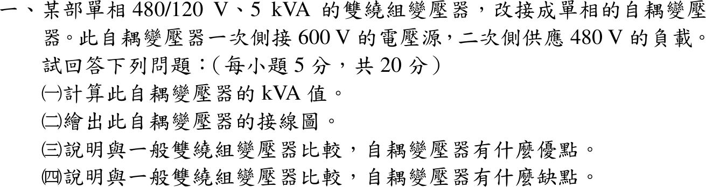
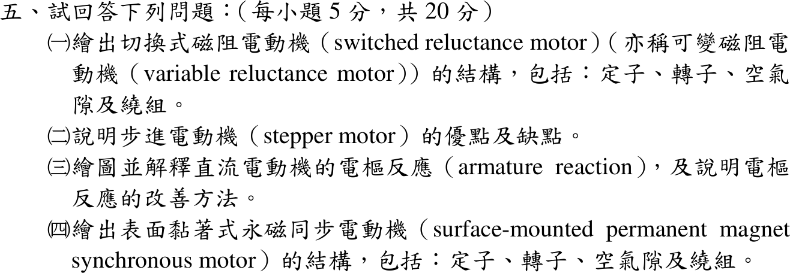

# 108 年電機工程技師｜電機機械逐題詳解

> 本頁由題級 canonical 筆記組合；每題保留 QID、官方裁切、校驗狀態與完整得分型解答。

## 題目導覽
- [[#一、108 年電機機械第 1 題｜480/120 V 降壓自耦變壓器|第 1 題：480/120 V 降壓自耦變壓器]]
- [[#二、108 年電機機械第 2 題｜他激直流電動機功率平衡|第 2 題：他激直流電動機功率平衡]]
- [[#三、108 年電機機械第 3 題｜感應電動機工作點|第 3 題：感應電動機工作點]]
- [[#四、108 年電機機械第 4 題｜同步電動機功角與最大轉矩|第 4 題：同步電動機功角與最大轉矩]]
- [[#五、108 年電機機械第 5 題｜特殊電機與電樞反應|第 5 題：特殊電機與電樞反應]]

---

## 一、108 年電機機械第 1 題｜480/120 V 降壓自耦變壓器

> 題級識別：`EE-108-04-1`
> canonical 來源：`canonical/EE-108-04-1.md`
> 題級校驗狀態：`verified`

![[01_原始試題/依考科/04_電機機械/images/questions/PE_108年_電機機械_Q01.png]]

> 官方裁切來源：`01_原始試題/依考科/04_電機機械/images/questions/PE_108年_電機機械_Q01.png`

### 已知與所求

單相 480/120 V、5 kVA 雙繞組變壓器改接為自耦變壓器，一次側接 600 V 電源，二次側供 480 V 負載。求（一）自耦變壓器 kVA；（二）接線圖；（三）優點；（四）缺點。（每小題 5 分）

### 考場標準作答

#### 步驟 1：接線判定與各繞組額定電流

設為理想自耦關係（忽略激磁電流與漏阻抗壓降），只用銘牌資料。由 \(600=480+120\)，一次側接 $600\,\mathrm{V}$ 電源跨在兩繞組兩端（加極性相加），二次側 480 V 負載只跨公共繞組（降壓）。

- 480 V 與 120 V 只有相加才能得到 600 V，且負載 480 V 必須直接取自 480 V 繞組，所以 480 V 繞組為公共繞組（\(V_c=480\ \mathrm V\)）、120 V 繞組為串聯繞組（\(V_{se}=120\ \mathrm V\)）。
- 120 V 繞組的非打點端接 480 V 繞組的打點端（兩打點端同在上方，電壓相加）；電源跨兩繞組，負載跨公共繞組。
- 參考方向：\(I_{in}\) 由電源經串聯繞組流向分接點，\(I_{out}\) 由分接點流向負載，\(I_c\) 在公共繞組中由下往上流向分接點（圖 1）。

各繞組額定電流：
\[
I_{480}=\frac{S_{2w}}{V_{480}}=\frac{5000}{480}=10.42\ \mathrm A,\qquad I_{120}=\frac{S_{2w}}{V_{120}}=\frac{5000}{120}=41.67\ \mathrm A
\]

#### （一）自耦變壓器 kVA（5 分）

輸入電流 \(I_{in}\) 全部流過 120 V 串聯繞組，上限為 \(I_{120}\)；再由分接點 KCL 確認公共繞組電流不超過 \(I_{480}\)。

輸入電流上限：
\[
I_{in}=I_{120}=\frac{5\ \mathrm{kVA}}{120\ \mathrm V}
\]
自耦容量（保留分數，避免 41.67 的捨入誤差）：
\[
S_{auto}=V_{in}I_{in}=600\ \mathrm V\left(\frac{5\ \mathrm{kVA}}{120\ \mathrm V}\right)=5(5\ \mathrm{kVA})=25\ \mathrm{kVA}
\]
負載電流（輸出功率等於輸入功率）：
\[
I_{out}=\frac{S_{auto}}{V_{load}}=\frac{25\ \mathrm{kVA}}{480\ \mathrm V}=52.08\ \mathrm A
\]
分接點 KCL（\(I_{out}=I_{in}+I_c\)），把 \(I_{in}\) 化成同分母 \(20\ \mathrm{kVA}/480\ \mathrm V\)：
\[
I_c=I_{out}-I_{in}=\frac{25\ \mathrm{kVA}-20\ \mathrm{kVA}}{480\ \mathrm V}=\frac{5\ \mathrm{kVA}}{480\ \mathrm V}=10.42\ \mathrm A=I_{480}
\]
兩繞組同時達額定，兩側功率相同：
\[
S_{auto}=600 I_{in}=480 I_{out}=25.00\,\mathrm{kVA}
\]
\[
\boxed{S_{auto}=25.00\ \mathrm{kVA}}
\]
其中經磁路感應的容量（串聯繞組電壓 × 其電流）：
\[
S_{ind}=V_{se}I_{in}=120(41.67)=5.00\ \mathrm{kVA}
\]
直接傳導的容量：
\[
S_{cond}=V_{load}I_{in}=480(41.67)=20.00\,\mathrm{kVA}
\]

#### （二）接線圖（5 分）

接線圖即步驟 1 的圖 1：兩繞組串成同一迴路且極性相加，電源與負載共用公共繞組。

畫法：

- 先畫 480 V 公共繞組，打點端在上。
- 120 V 串聯繞組的非打點端接到公共繞組的打點端上方，打點端也在上，兩繞組電壓相加：\(480+120=600\ \mathrm V\)。
- 600 V 電源接在串聯繞組上端與公共繞組下端；480 V 負載接在分接點與公共繞組下端。

\[
\boxed{\text{120 V 串聯繞組與 480 V 公共繞組同極性串聯；電源跨兩繞組，負載跨 480 V 繞組（圖 1）}}
\]

#### （三）優點（5 分）

只有串聯繞組那部分功率經磁路感應轉換，其餘直接導通，故同一鐵心與銅線可傳送較大容量。

感應部分所占比例：
\[
\frac{S_{ind}}{S_{auto}}=\frac{5.00}{25.00}=20\%
\]
容量放大倍數：
\[
\frac{S_{auto}}{S_{2w}}=\frac{25.00}{5}=5
\]
\[
\boxed{\text{同樣鐵心與銅線可傳送 5 倍容量；體積、重量、成本小，損失小而效率高，電壓調整率較佳}}
\]
因為只有 20% 功率經磁路感應轉換，其餘 80% 直接導通，損失（銅損、鐵損）只對應 5 kVA 的繞組。

#### （四）缺點（5 分）

缺點來自一、二次側共用同一繞組（有電氣連接）：沒有隔離；兩側之間的漏阻抗只剩串聯繞組部分，以自耦容量為基準的標么阻抗變小，短路電流變大。

以自耦容量為基準，標么漏阻抗縮小的比例：
\[
\frac{Z_{pu,auto}}{Z_{pu,2w}}=\frac{V_{in}-V_{load}}{V_{in}}=\frac{600-480}{600}=\frac{1}{5}
\]
\[
\boxed{\text{一、二次側有電氣連接而無隔離；標么阻抗只剩 1/5，短路電流大；變比愈大優勢愈小}}
\]
高壓側的過電壓或接地故障可直接傳到 480 V 負載側；若公共繞組斷線，負載經串聯繞組直接承受接近 600 V 的電源電壓。

### 驗算

容量比公式：\(S_{auto}=S_{2w}\dfrac{V_{in}}{V_{in}-V_{load}}=5\cdot\dfrac{600}{120}=25.00\ \mathrm{kVA}\)；感應＋傳導：\(5.00+20.00=25.00\ \mathrm{kVA}\)。公共繞組電壓 480 V、串聯繞組電壓 \(600-480=120\ \mathrm V\)，與原繞組額定電壓一致，電流 41.67 A 與 10.42 A 均恰為額定值，沒有繞組過載。

### 失分點

- 把 480 V 與 120 V 做成相減（480−120）或把負載接在 600 V 端：此題 600 V 是 480＋120 的相加串聯。
- 直接用 5 kVA 當自耦容量，漏掉傳導部分；或用 480 V 繞組電流 10.42 A 乘 600 V，得 6.25 kVA（受限繞組是 120 V 串聯繞組）。
- 優缺點只寫「效率高」「不安全」而沒有指出本題 5 倍容量與無隔離、短路電流大的具體理由。

---

## 二、108 年電機機械第 2 題｜他激直流電動機功率平衡

> 題級識別：`EE-108-04-2`
> canonical 來源：`canonical/EE-108-04-2.md`
> 題級校驗狀態：`verified`

![[01_原始試題/依考科/04_電機機械/images/questions/PE_108年_電機機械_Q02.png]]

> 官方裁切來源：`01_原始試題/依考科/04_電機機械/images/questions/PE_108年_電機機械_Q02.png`

### 已知與所求

他激式直流電動機 25 kW、125 V，運轉在 3000 rpm 且反電勢 \(E_a=125\ \mathrm V\)；\(R_a=0.03\ \Omega\)，電樞電感忽略。端電壓 \(V_t=128\ \mathrm V\) 時求（一）電樞電流；（二）輸入功率；（三）電磁功率；（四）電磁轉矩。（每小題 5 分）

### 考場標準作答

#### 步驟 1：電樞等效電路

以題給工作點（3000 rpm、反電勢 125 V、端電壓 128 V）計算，電感忽略、穩態直流；銘牌 25 kW、125 V 只是額定值，不參與計算；激磁由獨立電源供給、題未給其數據，輸入功率只計電樞端。

- 左側端電壓 \(V_t=128\ \mathrm V\)（上正下負），經 \(R_a=0.03\ \Omega\) 接反電勢 \(E_a=125\ \mathrm V\)（上正下負）。
- 參考方向（電動機慣例）：\(I_a\) 由 \(V_t\) 正端流出、經 \(R_a\) 流入 \(E_a\) 正端。
- 場繞組由另一電源激磁，與電樞迴路無電氣連接。

#### （一）電樞電流（5 分）

\(R_a\) 上的壓降：
\[
V_t-E_a=128-125=3\ \mathrm V
\]
電樞電流：
\[
I_a=\frac{V_t-E_a}{R_a}=\frac{128-125}{0.03}=100\ \mathrm A
\]
\[
\boxed{I_a=100\ \mathrm A}
\]

#### （二）輸入功率（5 分）

\[
P_{in}=V_tI_a
\]
\[
P_{in}=128(100)=12\,800\ \mathrm W
\]
\[
\boxed{P_{in}=12.80\ \mathrm{kW}}
\]

#### （三）電磁功率（5 分）

輸入功率中 \(I_a^2R_a\) 在電阻上變熱，其餘在反電勢處轉成機械功率：

\[
P_{em}=E_aI_a
\]
代入（V×A＝W，再以 kW 表示）：
\[
P_{em}=E_aI_a=125(100)=12.50\ \mathrm{kW}
\]
\[
\boxed{P_{em}=12.50\ \mathrm{kW}}
\]

#### （四）電磁轉矩（5 分）

機械角速度：
\[
\omega_m=\frac{2\pi n}{60}=\frac{2\pi(3000)}{60}=100\pi=314.16\ \mathrm{rad/s}
\]
電磁轉矩：
\[
T_{em}=\frac{P_{em}}{\omega_m}=\frac{12\,500}{314.16}=39.789\ \mathrm{N\cdot m}
\]
\[
\boxed{T_{em}=39.79\,\mathrm{N\cdot m}}
\]

### 驗算

功率平衡：電樞銅損 \(I_a^2R_a=100^2(0.03)=300\ \mathrm W\)，\(P_{in}-I_a^2R_a=12\,800-300=12\,500\ \mathrm W=P_{em}\)。轉矩常數法：\(K\phi=E_a/\omega_m=125/314.16=0.39789\ \mathrm{V\cdot s/rad}\)，\(T_{em}=K\phi I_a=0.39789(100)=39.79\ \mathrm{N\cdot m}\)。

### 失分點

- 套用發電機式 \(E_a=V_t+I_aR_a\)，得 \(I_a=-100\ \mathrm A\) 或方向錯。
- 以 3000 rpm 直接代入 \(T=P/n\)，漏 \(2\pi/60\)。
- 把 12.80 kW 當電磁功率，忘記扣電樞銅損 0.30 kW。

---

## 三、108 年電機機械第 3 題｜感應電動機工作點

> 題級識別：`EE-108-04-3`
> canonical 來源：`canonical/EE-108-04-3.md`
> 題級校驗狀態：`verified`

![[01_原始試題/依考科/04_電機機械/images/questions/PE_108年_電機機械_Q03.png]]

> 官方裁切來源：`01_原始試題/依考科/04_電機機械/images/questions/PE_108年_電機機械_Q03.png`

### 已知與所求

三相 Y 接、線電壓 220 V、60 Hz、6 極感應電動機，每相（折算至定子側）\(R_1=0.29\ \Omega\)、\(R_2=0.144\ \Omega\)、\(X_1=0.5\ \Omega\)、\(X_2=0.21\ \Omega\)、\(X_\phi=13.25\ \Omega\)；摩擦、風損與鐵損合計 403 W 且與負載無關。\(s=0.02\) 時求（一）轉子機械轉速；（二）氣隙功率；（三）輸出機械轉矩；（四）效率。

### 考場標準作答

#### 步驟 1：每相等效電路與輸入阻抗

Y 接，每相電壓＝線電壓／\(\sqrt3\)；題給 \(R_2\)、\(X_2\) 已換算至定子側，記為 \(R_2'\)、\(X_2'\)。電路中沒有鐵損電阻，題給 403 W（摩擦＋風損＋鐵損，與負載無關）整筆從轉換功率中扣除。

- 每相電源 \(\underline V_\phi\) 取為相位參考 \(0^\circ\)；\(\underline I_1\) 由電源流入定子，\(\underline I_2'\) 流經轉子支路（參考方向如圖 1）。
- 定子 \(R_1+jX_1\) 串聯；其後激磁支路 \(jX_\phi\) 與轉子支路 \(\underline Z_2'=R_2'/s+jX_2'\) 並聯，合成 \(\underline Z_p\)。

每相電壓：
\[
V_\phi=\frac{V_L}{\sqrt3}=\frac{220}{\sqrt3}=127.0171\ \mathrm V
\]
轉子支路（\(R_2'/s=0.144/0.02=7.20\ \Omega\)）：
\[
\underline Z_2'=\frac{R_2'}{s}+jX_2'=7.20+j0.21\ \Omega
\]

並聯公式：
\[
\underline Z_p=\frac{\underline Z_2'(jX_\phi)}{\underline Z_2'+jX_\phi}
\]
分子（\(j^2=-1\)）：
\[
(7.20+j0.21)(j13.25)=j95.40+j^2(2.7825)=-2.7825+j95.40\ \Omega^2
\]
分母：
\[
\underline Z_2'+jX_\phi=7.20+j(0.21+13.25)=7.20+j13.46\ \Omega
\]
分母大小平方（乘共軛用）：
\[
7.20^2+13.46^2=51.84+181.1716=233.0116\ \Omega^2
\]
分子乘分母共軛 \((7.20-j13.46)\)，實部：
\[
-2.7825(7.20)+95.40(13.46)=-20.034+1284.084=1264.05
\]
虛部：
\[
2.7825(13.46)+95.40(7.20)=37.45245+686.88=724.33245
\]
相除：
\[
\underline Z_p=\frac{1264.05}{233.0116}+j\frac{724.33245}{233.0116}=5.4248+j3.1086\ \Omega
\]
加上定子阻抗：
\[
\underline Z_{in}=(0.29+5.4248)+j(0.5+3.1086)=5.7148+j3.6086\ \Omega
\]
大小：
\[
|Z_{in}|=\sqrt{5.7148^2+3.6086^2}=\sqrt{32.6589+13.0220}=\sqrt{45.6809}=6.7588\ \Omega
\]
相角：
\[
\theta_{in}=\tan^{-1}\frac{3.6086}{5.7148}=32.27^\circ
\]

#### 步驟 2：定子電流與轉子電流

定子電流（歐姆定律）：
\[
\underline I_1=\frac{\underline V_\phi}{\underline Z_{in}}=\frac{127.0171\angle0^\circ}{6.7588\angle32.27^\circ}
\]
大小與相角：
\[
|I_1|=\frac{127.0171}{6.7588}=18.7928\ \mathrm A,\qquad \angle I_1=0^\circ-32.27^\circ=-32.27^\circ
\]
轉子電流用分流（\(\underline I_1\) 在 \(jX_\phi\) 與 \(\underline Z_2'\) 間分配，流入 \(\underline Z_2'\) 的比例是對面支路阻抗／兩支路和）：
\[
\underline I_2'=\underline I_1\frac{jX_\phi}{\underline Z_2'+jX_\phi}
\]
取大小，先求分母大小：
\[
|\underline Z_2'+jX_\phi|=\sqrt{233.0116}=15.2647\ \Omega
\]
分流比：
\[
\frac{X_\phi}{|\underline Z_2'+jX_\phi|}=\frac{13.25}{15.2647}=0.86802
\]
\[
|I_2'|=18.7928(0.86802)=16.3125\ \mathrm A
\]

#### （一）轉子機械轉速（5 分）

同步轉速：
\[
n_s=\frac{120f}{P}=\frac{120(60)}{6}=1200\ \mathrm{rpm}
\]
轉子轉速：
\[
n_m=(1-s)n_s=(1-0.02)(1200)=0.98(1200)
\]
\[
\boxed{n_m=1176\ \mathrm{rpm}}
\]

#### （二）氣隙功率（5 分）

氣隙功率等於三相轉子電流流過 \(R_2'/s\) 所吸收的功率。

公式：
\[
P_{ag}=3|I_2'|^2\frac{R_2'}{s}
\]
轉子電流平方：
\[
|I_2'|^2=16.3125^2=266.0977\ \mathrm{A^2}
\]
代入：
\[
P_{ag}=3(266.0977)(7.20)=5747.7\ \mathrm W
\]
\[
\boxed{P_{ag}=5.75\ \mathrm{kW}}
\]

#### （三）輸出機械轉矩（5 分）

\(P_{conv}\) 扣掉與負載無關的 403 W 才是軸輸出；\(\omega_m\) 用轉子實際轉速 1176 rpm。

轉換功率：
\[
P_{conv}=(1-s)P_{ag}=0.98(5747.7)=5632.7\ \mathrm W
\]
軸輸出功率：
\[
P_{out}=P_{conv}-P_{rot}=5632.7-403=5229.7\ \mathrm W
\]
轉子角速度：
\[
\omega_m=\frac{2\pi n_m}{60}=\frac{2\pi(1176)}{60}=123.15\ \mathrm{rad/s}
\]
軸轉矩：
\[
T_{out}=\frac{P_{out}}{\omega_m}=\frac{5229.7}{123.15}=42.466\ \mathrm{N\cdot m}
\]
\[
\boxed{T_{out}=42.47\,\mathrm{N\cdot m}}
\]

#### （四）效率（5 分）

輸入功率為三相電流流過 \(R_{in}=\mathrm{Re}(\underline Z_{in})\) 的功率；鐵損已含在 403 W 裡從 \(P_{conv}\) 扣掉，不可再扣一次。

公式：
\[
P_{in}=3|I_1|^2R_{in}
\]
電流平方：
\[
|I_1|^2=18.7928^2=353.1693\ \mathrm{A^2}
\]
代入：
\[
P_{in}=3(353.1693)(5.7148)=6054.9\ \mathrm W
\]
效率：
\[
\eta=\frac{P_{out}}{P_{in}}=\frac{5229.7}{6054.9}=0.86371
\]
\[
\boxed{\eta=86.37\%}
\]

### 驗算

損失逐項相加回到輸入：定子銅損 \(3(353.1693)(0.29)=307.26\ \mathrm W\)，轉子銅損 \(3(266.0977)(0.144)=114.95\ \mathrm W\)（也等於 \(sP_{ag}=0.02(5747.7)=114.95\ \mathrm W\)），\(5229.7+307.26+114.95+403=6054.91\ \mathrm W\approx P_{in}=6054.9\ \mathrm W\)。戴維寧法（\(\underline V_{th}=\underline V_\phi\,jX_\phi/[R_1+j(X_1+X_\phi)]\)、\(\underline Z_{th}=(R_1+jX_1)\parallel jX_\phi\)，\(I_2'=V_{th}/|\underline Z_{th}+\underline Z_2'|\)）同樣得 \(P_{ag}=5747.7\ \mathrm W\)。

### 失分點

- Y 接把線電壓 220 V 當相電壓，電流與功率都會錯。
- 氣隙功率用 \(R_2'=0.144\ \Omega\) 而非 \(R_2'/s=7.20\ \Omega\)；或把 \(P_{ag}\) 當軸輸出，未乘 \(1-s\) 再扣 403 W。
- 轉矩用同步角速度 \(\omega_s=125.66\ \mathrm{rad/s}\)：\(5229.7/125.66=41.62\ \mathrm{N\cdot m}\)；軸轉矩須用 1176 rpm 的 \(\omega_m\)。

---

## 四、108 年電機機械第 4 題｜同步電動機功角與最大轉矩

> 題級識別：`EE-108-04-4`
> canonical 來源：`canonical/EE-108-04-4.md`
> 題級校驗狀態：`verified`

![[01_原始試題/依考科/04_電機機械/images/questions/PE_108年_電機機械_Q04.png]]

> 官方裁切來源：`01_原始試題/依考科/04_電機機械/images/questions/PE_108年_電機機械_Q04.png`

### 已知與所求

三相 Y 接、線電壓 2300 V、1500 kW、60 Hz、30 極圓筒型同步電動機，每相 \(X_s=1.95\ \Omega\)，損失全部忽略；由 2300 V 無窮匯流排供電，額定負載下調整激磁使輸入功因為 1。求（一）反電動勢的線電壓（kV）；（二）此反電動勢下的最大功率（kW）；（三）最大轉矩（N·m）；（四）相量圖（每相輸入電壓、輸入電流、同步電抗壓降、反電動勢）。（每小題 5 分）

### 考場標準作答

#### 步驟 1：每相等效電路、相電壓與電樞電流

無窮匯流排使 \(V_\phi\) 固定，取 \(\underline V_\phi\) 為相位參考 \(0^\circ\)；損失全忽略，輸入＝額定 1500 kW；功因 1，\(\underline I_a\) 與 \(\underline V_\phi\) 同相。

- 每相：匯流排 \(\underline V_\phi\) 經 \(jX_s=j1.95\ \Omega\) 接到反電勢 \(\underline E_f\)（\(R_a\) 忽略）。
- 參考方向：\(\underline I_a\) 由匯流排流入電動機。

相電壓：
\[
V_\phi=\frac{V_L}{\sqrt3}=\frac{2300}{\sqrt3}=1327.91\ \mathrm V
\]
電樞電流（無損，輸入＝1500 kW；PF＝1）：
\[
I_a=\frac{P}{\sqrt3V_L\,\mathrm{PF}}=\frac{1500\ \mathrm{kW}}{\sqrt3\times2.3\ \mathrm{kV}\times1}=376.5328\ \mathrm A
\]
功因 1，電流與相電壓同相：
\[
\underline I_a=376.5328\angle0^\circ\ \mathrm A
\]

#### （一）反電動勢的線電壓（5 分）

同步電抗壓降：
\[
jX_s\underline I_a=j1.95(376.5328)=j734.2390\ \mathrm V\approx734.24\angle90^\circ\ \mathrm V
\]
電動機 KVL：
\[
\underline E_f=\underline V_\phi-jX_s\underline I_a=1327.91-j734.24\ \mathrm V
\]
大小：
\[
|E_f|=\sqrt{1327.91^2+734.24^2}=\sqrt{1\,763\,345.0+539\,108.4}=\sqrt{2\,302\,453.4}=1517.38\ \mathrm{V/相}
\]
角度（虛部為負，\(\underline E_f\) 落後 \(\underline V_\phi\)）：
\[
\delta=-\tan^{-1}\frac{734.24}{1327.91}=-\tan^{-1}0.5529=-28.94^\circ
\]
線電壓（Y 接乘 \(\sqrt3\)）：
\[
E_{LL}=\sqrt3|E_f|=\sqrt3(1517.38)=2628.18\ \mathrm V
\]
\[
\boxed{E_{LL}=2628.18\,\mathrm V=2.63\ \mathrm{kV}}
\]

#### （二）最大功率（5 分）

\(E_f\)、\(V_\phi\)、\(X_s\) 都固定，\(P\) 只隨 \(\delta\) 變，\(\sin|\delta|=1\)（\(|\delta|=90^\circ\)，靜態穩定極限）時最大。

最大功率公式（\(3V_\phi E_f=3\cdot\frac{V_L}{\sqrt3}\cdot\frac{E_{LL}}{\sqrt3}=V_LE_{LL}\)）：
\[
P_{max}=\frac{3V_\phi E_f}{X_s}=\frac{V_LE_{LL}}{X_s}
\]
代入：
\[
P_{max}=\frac{2300(2628.18)}{1.95}=\frac{6\,044\,814}{1.95}=3\,099\,904.6\ \mathrm W
\]
\[
\boxed{P_{max}=3099.90\ \mathrm{kW}\approx3.10\,\mathrm{MW}}
\]

#### （三）最大轉矩（5 分）

同步電動機穩態轉速固定為同步轉速，轉矩＝功率÷同步機械角速度。

同步轉速：
\[
n_s=\frac{120f}{P}=\frac{120(60)}{30}=240\ \mathrm{rpm}
\]
同步機械角速度：
\[
\omega_s=\frac{2\pi n_s}{60}=\frac{2\pi(240)}{60}=8\pi=25.1327\ \mathrm{rad/s}
\]
最大轉矩：
\[
T_{max}=\frac{P_{max}}{\omega_s}=\frac{3\,099\,904.6}{25.1327}=123\,341\ \mathrm{N\cdot m}
\]
\[
\boxed{T_{max}=123\,341\ \mathrm{N\cdot m}\approx1.23\times10^5\ \mathrm{N\cdot m}}
\]

#### （四）相量圖（5 分）

相量圖為 \(\underline V_\phi=\underline E_f+jX_s\underline I_a\) 的向量三角形；功因 1 時 \(jX_s\underline I_a\) 垂直 \(\underline V_\phi\)，為直角三角形。

畫法（圖 2，電壓同一比例，電流另用比例）：

- \(\underline V_\phi=1327.91\angle0^\circ\ \mathrm V\) 沿水平軸。
- \(\underline I_a=376.53\angle0^\circ\ \mathrm A\) 與 \(\underline V_\phi\) 同方向（功因 1）。
- \(\underline E_f=1517.38\angle-28.94^\circ\ \mathrm V\) 自原點畫在水平軸下方 \(28.94^\circ\)。
- 自 \(\underline E_f\) 尖端垂直向上畫 \(jX_s\underline I_a=734.24\angle90^\circ\ \mathrm V\)，尖端恰好落在 \(\underline V_\phi\) 尖端。

\[
\boxed{V_\phi=1327.91\angle0^\circ\ \mathrm V,\quad I_a=376.53\angle0^\circ\ \mathrm A,\quad jX_sI_a=734.24\angle90^\circ\ \mathrm V,\quad E_f=1517.38\angle-28.94^\circ\ \mathrm V}
\]

### 驗算

額定點功率：\(\sqrt3(2300)(376.5328)=1\,500\,000\ \mathrm W=1500.00\ \mathrm{kW}\)。功率角式：\(E_f\sin|\delta|\) 就是相量圖的垂直分量 734.24 V，\(\dfrac{3V_\phi(E_f\sin|\delta|)}{X_s}=\dfrac{3V_\phi(X_sI_a)}{X_s}=3(1327.91)(376.5328)=1500.00\ \mathrm{kW}\)，與額定一致。對 \(\delta\) 由 \(0^\circ\) 到 \(180^\circ\) 掃描功率角曲線，最大值確實在 \(90^\circ\)。

### 失分點

- 把 2300 V 當作每相電壓（漏除 \(\sqrt3\)），\(I_a\) 與 \(E_f\) 都會錯。
- 用發電機方程 \(\underline E_f=\underline V+jX_s\underline I\)：功因 1 時 \(|E_f|\) 雖相同，但得 \(\delta=+28.94^\circ\)，相量圖的 \(E_f\) 方向畫反。
- 以 30 極算同步轉速誤成 3600 rpm，或用 \(377\ \mathrm{rad/s}\) 算機械轉矩。

---

## 五、108 年電機機械第 5 題｜特殊電機與電樞反應

> 題級識別：`EE-108-04-5`
> canonical 來源：`canonical/EE-108-04-5.md`
> 題級校驗狀態：`verified`

![[01_原始試題/依考科/04_電機機械/images/questions/PE_108年_電機機械_Q05.png]]

> 官方裁切來源：`01_原始試題/依考科/04_電機機械/images/questions/PE_108年_電機機械_Q05.png`

### 已知與所求

（一）繪出切換式磁阻電動機（SRM，亦稱可變磁阻電動機）的結構，包括定子、轉子、氣隙及繞組；（二）說明步進電動機的優點及缺點；（三）繪圖並解釋直流電動機的電樞反應，及說明改善方法；（四）繪出表面黏著式永磁同步電動機（SPMSM）的結構，包括定子、轉子、氣隙及繞組。（每小題 5 分，共 20 分）

### 考場標準作答

#### （一）切換式磁阻電動機結構（5 分）

SRM 的轉矩來自磁阻轉矩：激磁相把最近的轉子凸極拉到磁阻最小（電感最大）的對齊位置，故轉子不需繞組或磁鐵，只要定子集中繞組依轉子位置輪流激磁。

畫法（圖 1，以常見的 6/4 SRM 為例）：

- 定子：疊片鐵心，向內 6 個凸極。
- 繞組：每個定子極套一個集中線圈，對向兩極串聯為一相（A–A′、B–B′、C–C′），共三相。
- 轉子：疊片鐵心，向外 4 個凸極；無繞組、無永磁體。定、轉子極數不同，才能在任何位置都有一相可產生轉矩。
- 氣隙：定子極面與轉子極面之間的窄間隙，對齊時磁阻最小。

\[
\boxed{\text{定子與轉子皆為凸極疊片鐵心；只有定子極有集中線圈，轉子無繞組、無永磁體；兩者間為窄氣隙}}
\]

轉矩式（磁共能對轉子角度微分）：
\[
T_e=\frac{\partial W'}{\partial\theta}=\frac12i^2\frac{dL}{d\theta}
\]
與電流方向無關，只看 \(dL/d\theta\) 的正負，所以各相須在電感上升區間（\(dL/d\theta>0\)）通電，換相時機依轉子位置決定。

#### （二）步進電動機的優缺點（5 分）

步進電動機依序激磁各相，每個脈波使轉子轉過一個固定步距角並停在該位置，優缺點皆由此而來。

- 優點：脈波數決定轉角、脈波頻率決定轉速，開迴路即可精確定位；誤差不累積；低速及停止時保持轉矩大；結構簡單、可靠、易與數位控制介面。
- 缺點：轉速升高時繞組電流來不及建立，轉矩下降；特定脈波頻率會共振；負載超過保持或牽入轉矩時失步，而開迴路控制器不知道實際位置；步進運動使振動與噪音較大；不適合高速大功率。

\[
\boxed{\text{優點：開迴路定位、脈波數定位置、頻率定速度、低速保持轉矩大、結構簡單；缺點：高速轉矩下降、易共振與失步、振動噪音大}}
\]

#### （三）直流電動機電樞反應與改善（5 分）

以兩極直流電動機、電刷位於幾何中性面說明。N 極下導體電流同向、S 極下反向，電樞磁勢 \(F_a\) 落在交軸，與主磁通 \(\Phi_f\) 垂直；兩者合成使磁通偏轉，產生畸變、中性面偏移與去磁三種效應。

畫法（圖 2）：

- 兩極：N 在左、S 在右，主磁通 \(\Phi_f\) 由左向右（直軸）。
- 電樞導體：N 極下流入紙面（⊗）、S 極下流出紙面（⊙），電刷位於上下的幾何中性面。
- 安培右手定則：\(F_a\) 指向下方（交軸）；由 \(\mathbf F=i\boldsymbol\ell\times\mathbf B\)（佛來明左手定則），左側受力向下、右側向上，電動機逆時針旋轉。
- 主磁勢 \(F_f\)（沿 \(\Phi_f\) 方向）與電樞磁勢 \(F_a\) 合成 \(F_r=F_f+F_a\)，合成磁通 \(\Phi_r\) 沿 \(F_r\) 方向向右下偏轉；與它垂直的磁中性面由幾何中性面順時針偏轉，即逆旋轉方向偏移。

三種效應：

- 磁通畸變：同一極面下一側的電樞磁勢與主磁通同向而增強（N 極上緣、S 極下緣），另一側反向而減弱。
- 中性面偏移：磁中性面逆旋轉方向偏移，但電刷仍在幾何中性面，換向中的線圈仍切割磁通、有殘餘電勢，產生火花。
- 去磁效應：增強側鐵心飽和，增加量小於減弱側的減少量，每極總磁通略為下降，電動機轉速上升、轉矩常數下降。

\[
\boxed{\text{改善：加換向極（裝在幾何中性軸、與電樞串聯）、極面補償繞組（嵌於主極極面、與電樞串聯且電流反向）、電動機電刷逆旋轉方向移到磁中性面}}
\]

#### （四）表面黏著式永磁同步電動機結構（5 分）

SPMSM 的轉子磁場由貼在轉子表面的永磁體提供，磁鐵導磁率接近空氣，故 \(d\)、\(q\) 軸磁阻相同、\(L_d\approx L_q\)，轉矩幾乎只有永磁轉矩；定子三相分布繞組產生旋轉磁場。

畫法（圖 3，以 12 槽 4 極為例）：

- 定子：疊片鐵心，內圓開 12 槽，槽內嵌三相分布繞組（相序 A–C′–B–A′–C–B′）。
- 轉子：鐵心表面黏貼 4 片弧形永磁體，N、S 交替；無繞組、無電刷與滑環。
- 氣隙：磁鐵外徑與定子內徑之間，均勻。

\[
\boxed{\text{定子為疊片鐵心加三相分布繞組；轉子表面黏貼永磁體（N、S 相間），氣隙均勻；無轉子繞組、電刷與滑環}}
\]

轉矩（\(L_d\approx L_q\)，磁阻轉矩項消失）：
\[
T_e=\frac32p\,\psi_fi_q
\]
其中 \(p\) 為極對數、\(\psi_f\) 為永磁磁鏈、\(i_q\) 為交軸（\(q\) 軸）定子電流。

### 驗算

SRM：對 \(W'=\tfrac12L(\theta)i^2\) 取 \(\partial/\partial\theta\) 得 \(T_e=\tfrac12i^2\,dL/d\theta\)，符號隨 \(dL/d\theta\) 改變，負斜率區通電會產生制動轉矩。SPMSM：一般式 \(T_e=\tfrac32p[\psi_fi_q+(L_d-L_q)i_di_q]\) 令 \(L_d=L_q\)，磁阻項消失，只剩永磁轉矩，與表面黏著式結構（氣隙均勻）一致。電樞反應方向：圖 2 的 \(F_a\) 與 \(\Phi_f\) 垂直，合成磁通向右下，磁中性面順時針偏轉，而轉子逆時針轉，符合「電動機中性面逆旋轉方向偏移」。

### 失分點

- SRM 轉子畫成有繞組或永磁體，會變成其他電機；定、轉子極數畫成相同也不對。
- 說步進電動機「不會失步」：開迴路只是不需回授，超過保持或牽入轉矩仍會失步。
- 電樞反應只寫「磁通減弱」，漏掉畸變、中性面偏移與換向火花，也沒指出換向極與補償繞組各自裝在哪裡。
