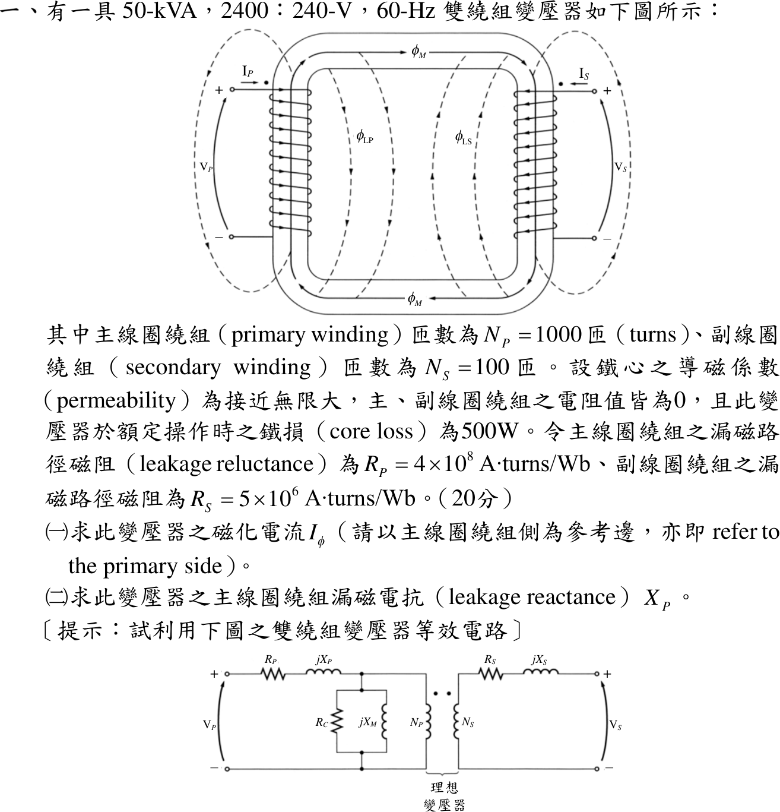
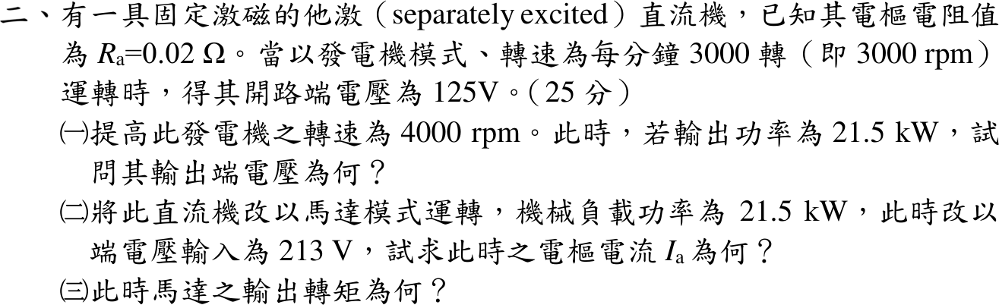
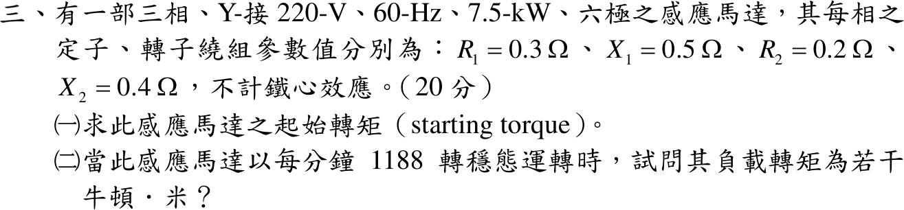
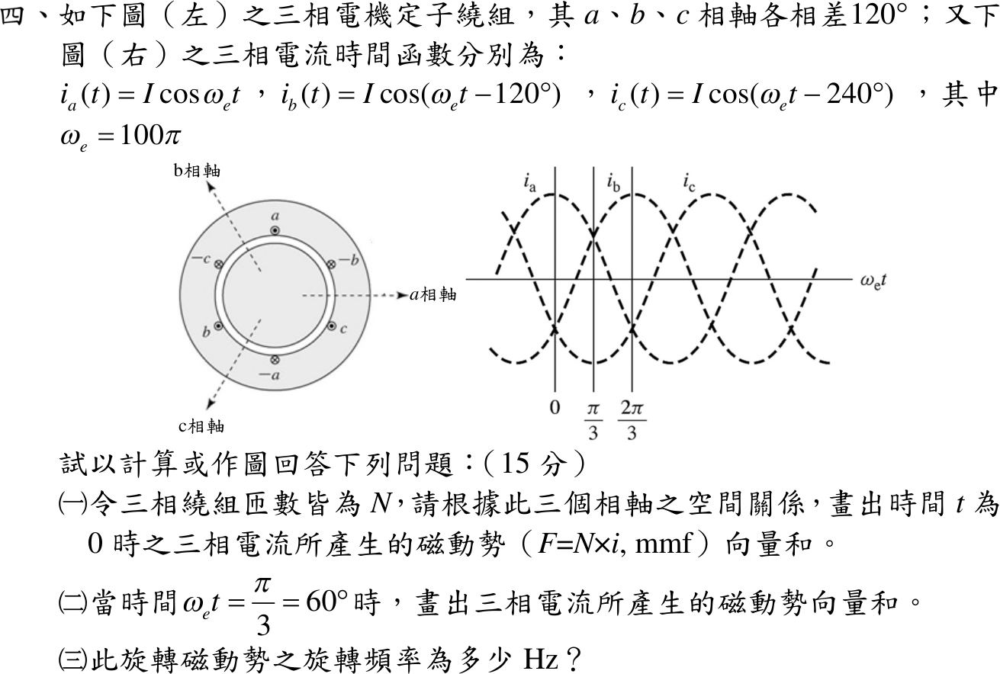

# 109 年電機工程技師｜電機機械逐題詳解

> 本頁由題級 canonical 筆記組合；每題保留官方裁切圖、校驗狀態與可追溯的推導。

## 題目導覽
- [[#一、109 年電機機械第 1 題｜磁化電流與漏磁電抗|第 1 題：磁化電流與漏磁電抗]]
- [[#二、109 年電機機械第 2 題｜他激直流機雙模式|第 2 題：他激直流機雙模式]]
- [[#三、109 年電機機械第 3 題｜滑差與感應轉矩|第 3 題：滑差與感應轉矩]]
- [[#四、109 年電機機械第 4 題｜旋轉磁動勢空間向量|第 4 題：旋轉磁動勢空間向量]]
- [[#五、109 年電機機械第 5 題｜可變磁阻電感與電磁扭力|第 5 題：可變磁阻電感與電磁扭力]]

---

## 一、109 年電機機械第 1 題｜磁化電流與漏磁電抗

> 題級識別：EE-109-04-1
> canonical 來源：[[canonical/EE-109-04-1.md]]
> 題級校驗狀態：verified

### 已知與所求

50 kVA、2400:240 V、60 Hz 雙繞組變壓器，\(N_P=1000\)、\(N_S=100\)；鐵心導磁係數趨近無限大，繞組電阻為 0，額定操作時鐵損 500 W；漏磁路徑磁阻 \(\mathcal R_P=4\times10^8\)、\(\mathcal R_S=5\times10^6\ \mathrm{A\cdot t/Wb}\)。依題附等效電路，求（一）參考一次側的磁化（激磁）電流 \(I_\phi\)；（二）一次側漏磁電抗 \(X_P\)。（共 20 分，未分配）

### 考場標準作答

**解題邏輯**：前提：\(R_P=0\)，\(I_\phi\) 在 \(jX_P\) 上的壓降（約 0.2 V）相對 2400 V 可忽略，激磁支路兩端取額定一次電壓 2400 V；二次側開路（或只看激磁支路），一次電流即 \(I_\phi\)。
1. （一）用題附等效電路的激磁支路 \(R_C\parallel jX_M\)：鐵心 \(\mu\to\infty\) 使主磁路磁阻 \(\mathcal R_M\to0\)，\(X_M=\omega N_P^2/\mathcal R_M\to\infty\)（開路），激磁電流只剩鐵損分量。
2. 由額定電壓與鐵損求 \(R_C\) 後得 \(I_\phi\)。
3. （二）漏磁路徑以磁阻 \(\mathcal R_P\) 表示，漏電感 \(L_P=N_P^2/\mathcal R_P\)。
4. 乘 \(\omega\) 得 \(X_P\)。

#### （一）磁化電流 \(I_\phi\)

**邏輯**：\(I_\phi=I_C+I_M\)（激磁支路 KCL）；\(X_M\to\infty\) 使 \(I_M=0\)，所以 \(I_\phi=I_C=V_P/R_C\)，而 \(R_C\) 由「額定電壓下 \(R_C\) 消耗的功率＝鐵損」求得。

- 圖 1 由題附等效電路取一次側：\(R_P=0\) 不畫，\(jX_P\) 串聯後接激磁支路 \(R_C\parallel jX_M\)，再接理想變壓器 \(N_P\)。
- 參考方向：\(I_\phi\) 由 + 端流入，分成 \(I_C\)（流經 \(R_C\)）與 \(I_M\)（流經 \(jX_M\)）。

主磁路磁阻與磁化電抗：
\[
\mathcal R_M=\frac{l}{\mu A}\to0\quad\Rightarrow\quad X_M=\frac{\omega N_P^2}{\mathcal R_M}\to\infty\quad\Rightarrow\quad I_M=\frac{V_P}{X_M}=0
\]
鐵損等效電阻（\(P_{core}=V_P^2/R_C\)）：
\[
R_C=\frac{V_P^2}{P_{core}}=\frac{2400^2}{500}=\frac{5\,760\,000}{500}=11\,520\ \Omega
\]
激磁電流（只剩鐵損分量）：
\[
I_\phi=I_C=\frac{V_P}{R_C}=\frac{2400}{11\,520}=0.20833\ \mathrm A
\]
\[
\boxed{I_\phi=208.33\ \mathrm{mA}\ (\text{與 }V_P\text{ 同相})}
\]

#### （二）一次側漏磁電抗 \(X_P\)

**邏輯**：一次側漏磁通 \(\phi_{LP}=N_Pi_P/\mathcal R_P\) 只交鏈一次繞組，磁鏈 \(N_P\phi_{LP}=(N_P^2/\mathcal R_P)i_P\)，所以 \(L_P=N_P^2/\mathcal R_P\)；用一次匝數配一次漏磁阻 \(\mathcal R_P\)，\(\mathcal R_S\) 屬二次側，不用。

一次側漏電感：
\[
L_P=\frac{N_P^2}{\mathcal R_P}=\frac{1000^2}{4\times10^8}=\frac{10^6}{4\times10^8}=2.5\times10^{-3}\ \mathrm H
\]
電源角頻率：
\[
\omega=2\pi f=2\pi(60)=376.99\ \mathrm{rad/s}
\]
漏磁電抗：
\[
X_P=\omega L_P=376.99(2.5\times10^{-3})=0.9425\ \Omega
\]
\[
\boxed{X_P=0.94\ \Omega}
\]
（4 位有效數字：\(X_P=0.9425\ \Omega\)。）

### 驗算

功率回代：\(V_PI_\phi=2400(0.20833)=500.0\ \mathrm W\)，等於鐵損。壓降假設：\(I_\phi X_P=0.20833(0.9425)=0.1964\ \mathrm V\)，僅為 2400 V 的 0.008%，取 \(V_P\) 為激磁支路電壓合理。匝數用法另驗：二次漏抗 \(X_S=\omega N_S^2/\mathcal R_S=376.99(100^2)/(5\times10^6)=0.7540\ \Omega\)，折算一次側 \(a^2X_S=10^2(0.7540)=75.40\ \Omega\)，與 \(\omega N_P^2/\mathcal R_S=376.99(10^6)/(5\times10^6)=75.40\ \Omega\) 一致，確認 \(L=N^2/\mathcal R\) 的匝數配法。

### 失分點

- 以為 \(\mu\to\infty\) 時激磁電流為 0；磁化分量為 0，但鐵損分量 208.33 mA 仍在。
- 用二次電壓 240 V 算 \(R_C\)，得 2.08 A（那是參考二次側的值）。
- 漏感寫成 \(N_P/\mathcal R_P\) 漏掉平方，或把 \(\mathcal R_S\) 配 \(N_P\) 當成一次側漏抗。

---

## 二、109 年電機機械第 2 題｜他激直流機雙模式

> 題級識別：EE-109-04-2
> canonical 來源：[[canonical/EE-109-04-2.md]]
> 題級校驗狀態：verified

### 已知與所求

固定激磁的他激直流機，\(R_a=0.02\ \Omega\)；發電機模式 3000 rpm 時開路端電壓 125 V（全題 25 分）。求（一）轉速 4000 rpm、輸出 21.5 kW 時的輸出端電壓；（二）改作馬達、機械負載 21.5 kW、端電壓 213 V 時的電樞電流 \(I_a\)；（三）此時的輸出轉矩。

### 考場標準作答

**解題邏輯**：固定激磁表示磁通不變，反電勢 \(E_a=Kn\) 與轉速成正比；開路時 \(I_a=0\)，端電壓就是 \(E_a\)。前提：題目只計 \(R_a\) 的損失（旋轉損失、電刷壓降不計），故機械負載 21.5 kW 即電磁轉換功率，也是輸出功率。
1. 由 3000 rpm、125 V 定出 \(K\)，發電與電動兩種模式共用。
2. （一）發電機電流由 \(E_a\) 正端流出，\(V_t=E_a-I_aR_a\)，輸出 \(P=V_tI_a\)，得 \(I_a\) 的二次式。
3. （二）電動機電流流入，\(V_t=E_a+I_aR_a\)，機械負載功率＝轉換功率 \(E_aI_a\)，同樣得二次式；兩者都取正常工作點的小電流根。
4. （三）由 \(E_a\) 反推轉速，轉矩＝機械功率÷角速度。

#### 步驟 1：反電勢與轉速的比例、兩種模式的電樞迴路

開路 \(I_a=0\)，\(E_a=125\ \mathrm V\) 於 3000 rpm：
\[
K=\frac{E_a}{n}=\frac{125}{3000}\ \mathrm{V/rpm}
\]
- 發電機（圖 1(a)）：\(I_a\) 由 \(E_a\) 正端流出經 \(R_a\) 到端點，KVL \(V_t=E_a-I_aR_a\)。
- 電動機（圖 1(b)）：\(I_a\) 由端點流入經 \(R_a\) 進 \(E_a\) 正端，KVL \(V_t=E_a+I_aR_a\)。

#### （一）發電機 4000 rpm、輸出 21.5 kW 的端電壓

**邏輯**：先按轉速比例求 4000 rpm 的 \(E_a\)；輸出功率 \(P_{out}=V_tI_a=(E_a-I_aR_a)I_a\) 只含 \(I_a\) 一個未知數，解二次式取正常工作點的根，再由 \(V_t=P_{out}/I_a\) 得端電壓。

4000 rpm 的反電勢：
\[
E_a=Kn=\frac{125}{3000}(4000)=\frac{500}{3}=166.6667\ \mathrm V
\]
輸出功率代入 KVL：
\[
P_{out}=V_tI_a=(E_a-R_aI_a)I_a\ \Rightarrow\ R_aI_a^2-E_aI_a+P_{out}=0
\]
代入數值：
\[
0.02I_a^2-166.6667I_a+21\,500=0
\]
判別式：
\[
\Delta=\left(\frac{500}{3}\right)^2-4(0.02)(21\,500)=27\,777.78-1720=26\,057.78
\]
\[
\sqrt\Delta=161.4242
\]
大根：
\[
I_a=\frac{166.6667+161.4242}{2(0.02)}=\frac{328.0909}{0.04}=8202.27\ \mathrm A
\]
小根（公式分子是兩接近數相減，分子分母同乘 \(E_a+\sqrt\Delta\) 改用等價式）：
\[
I_a=\frac{2P_{out}}{E_a+\sqrt\Delta}=\frac{2(21\,500)}{328.0909}=\frac{43\,000}{328.0909}=131.0612\ \mathrm A
\]
取根：大根時 \(V_t=166.6667-0.02(8202.27)=2.62\ \mathrm V\)、銅損 \(0.02(8202.27)^2=1.35\ \mathrm{MW}\)，不是正常工作點；取小根 \(I_a=131.06\text{ A}\)（另一根 \(8202.27\text{ A}\) 捨去）。

端電壓：
\[
V_t=\frac{P_{out}}{I_a}=\frac{21\,500}{131.0612}=164.0455\ \mathrm V
\]
\[
\boxed{V_t=164.05\ \mathrm V}
\]

#### （二）馬達模式的電樞電流

**邏輯**：電動機 KVL \(E_a=V_t-I_aR_a\)；機械負載 21.5 kW 等於轉換功率 \(E_aI_a\)，代入後得 \(I_a\) 的二次式，取小根。

轉換功率代入 KVL：
\[
P_{conv}=E_aI_a=(V_t-R_aI_a)I_a\ \Rightarrow\ R_aI_a^2-V_tI_a+P_{conv}=0
\]
代入數值：
\[
0.02I_a^2-213I_a+21\,500=0
\]
判別式：
\[
\Delta=213^2-4(0.02)(21\,500)=45\,369-1720=43\,649
\]
\[
\sqrt\Delta=208.9234
\]
大根：
\[
I_a=\frac{213+208.9234}{2(0.02)}=\frac{421.9234}{0.04}=10\,548.09\ \mathrm A
\]
此時 \(E_a=213-0.02(10\,548.09)=2.04\ \mathrm V\)，幾乎全部電壓降在 \(R_a\) 上，不是正常工作點，捨去。小根（同樣用等價式）：
\[
I_a=\frac{2P_{conv}}{V_t+\sqrt\Delta}=\frac{43\,000}{421.9234}=101.9142\ \mathrm A
\]
\[
\boxed{I_a=101.91\text{ A}}
\]

#### （三）輸出轉矩

**邏輯**：由 KVL 求馬達的 \(E_a\)，以 \(E_a=Kn\) 反推轉速；題目只計 \(R_a\) 損失，所以軸上輸出功率就是 21.5 kW，轉矩＝21.5 kW÷\(\omega_m\)。

反電勢（\(0.02(101.9142)=2.0383\ \mathrm V\)）：
\[
E_a=V_t-I_aR_a=213-2.0383=210.9617\ \mathrm V
\]
轉速：
\[
n=\frac{E_a}{K}=3000\times\frac{210.9617}{125}=5063.08\ \mathrm{rpm}
\]
機械角速度：
\[
\omega_m=\frac{2\pi n}{60}=\frac{2\pi(5063.08)}{60}=530.2045\ \mathrm{rad/s}
\]
輸出轉矩：
\[
T=\frac{P}{\omega_m}=\frac{21\,500}{530.2045}=40.5504\ \mathrm{N\cdot m}
\]
\[
\boxed{T=40.55\ \mathrm{N\cdot m}}
\]

### 驗算

轉矩常數法：\(K\phi=\dfrac{125}{3000(2\pi/60)}=\dfrac{125}{314.1593}=0.397887\ \mathrm{V\cdot s}\)，\(T=K\phi I_a=0.397887(101.9142)=40.55\ \mathrm{N\cdot m}\)，與功率法一致。（一）KVL：\(E_a-I_aR_a=166.6667-0.02(131.0612)=166.6667-2.6212=164.0455\ \mathrm V\)，與 \(P_{out}/I_a\) 相同。

### 失分點

- 4000 rpm 仍用 125 V 當 \(E_a\)；他激固定磁通時 \(E_a\) 與轉速成正比。
- 發電機式寫成 \(V_t=E_a+I_aR_a\)，或馬達式寫成 \(V_t=E_a-I_aR_a\)，方向顛倒。
- （三）用輸入功率 \(213\times101.91\) 除以 \(\omega_m\)；題目的 21.5 kW 已是機械功率。

---

## 三、109 年電機機械第 3 題｜滑差與感應轉矩

> 題級識別：EE-109-04-3
> canonical 來源：[[canonical/EE-109-04-3.md]]
> 題級校驗狀態：verified

### 已知與所求

三相 Y 接、220 V、60 Hz、7.5 kW、六極感應馬達，每相 \(R_1=0.3\)、\(X_1=0.5\)、\(R_2=0.2\)、\(X_2=0.4\ \Omega\)（轉子量已換算至定子側），不計鐵心效應。求（一）起動轉矩；（二）以 1188 rpm 穩態運轉時的負載轉矩（N·m）。（共 20 分，未分配）

### 考場標準作答

**解題邏輯**：不計鐵心效應即等效電路沒有激磁支路，定子與轉子成為單一串聯迴路，\(I_1=I_2\)。電磁轉矩＝氣隙功率／同步角速度，\(T=3I_2^2(R_2/s)/\omega_s\)；兩小題只差在轉差率：起動 \(s=1\)，1188 rpm 時 \(s=0.01\)。先在步驟 1 求共用的相電壓平方與同步角速度，再分別代入。前提：穩態負載轉矩＝電磁轉矩（題目未給機械損，不計旋轉損）；7.5 kW 為銘牌額定，不參與計算。

#### 步驟 1：每相等效電路與共用量

- 每相等效電路：\(V_\phi\) 串 \(R_1\)、\(jX_1\)、\(jX_2\)、\(R_2/s\)，無激磁支路（圖 1）。
- 參考方向：\(I_1=I_2\) 由電源 + 端流出，順時針流過迴路。

Y 接相電壓的平方（轉矩式只用 \(V_\phi^2\)，保留精確值）：
\[
V_\phi^2=\left(\frac{220}{\sqrt3}\right)^2=\frac{48\,400}{3}=16\,133.33\ \mathrm{V^2}
\]
同步轉速與同步角速度（六極、60 Hz）：
\[
n_s=\frac{120f}{P}=\frac{120(60)}{6}=1200\ \mathrm{rpm}
\]
\[
\omega_s=\frac{2\pi n_s}{60}=\frac{2\pi(1200)}{60}=125.66\ \mathrm{rad/s}
\]
迴路電流與轉矩的通式：
\[
I_2^2=\frac{V_\phi^2}{(R_1+R_2/s)^2+(X_1+X_2)^2},\qquad T=\frac{P_{ag}}{\omega_s}=\frac{3I_2^2\,(R_2/s)}{\omega_s}
\]
電抗和：
\[
X_1+X_2=0.5+0.4=0.9\ \Omega
\]

#### （一）起動轉矩

**邏輯**：起動瞬間轉子靜止，\(s=1\)，\(R_2/s=R_2\)；代入通式得起動電流與起動轉矩。

起動時轉子電阻項與迴路電阻：
\[
\frac{R_2}{s}=\frac{0.2}{1}=0.2\ \Omega,\qquad R_1+\frac{R_2}{s}=0.3+0.2=0.5\ \Omega
\]
阻抗大小的平方：
\[
|Z|^2=0.5^2+0.9^2=0.25+0.81=1.06\ \Omega^2
\]
電流平方與電流：
\[
I_2^2=\frac{16\,133.33}{1.06}=15\,220.12\ \mathrm{A^2},\qquad I_2=\sqrt{15\,220.12}=123.37\ \mathrm A
\]
氣隙功率：
\[
P_{ag}=3I_2^2\frac{R_2}{s}=3(15\,220.12)(0.2)=9132.07\ \mathrm W
\]
起動轉矩：
\[
T_{st}=\frac{P_{ag}}{\omega_s}=\frac{9132.07}{125.66}
\]
\[
\boxed{T_{st}=72.67\text{ N}\cdot\text{m}}
\]

#### （二）1188 rpm 的負載轉矩

**邏輯**：先由轉速求轉差率，再同法求電磁轉矩；穩態時轉速不變，負載轉矩與電磁轉矩平衡（不計旋轉損）。

轉差率：
\[
s=\frac{n_s-n}{n_s}=\frac{1200-1188}{1200}=\frac{12}{1200}=0.01
\]
轉子電阻項與迴路電阻：
\[
\frac{R_2}{s}=\frac{0.2}{0.01}=20\ \Omega,\qquad R_1+\frac{R_2}{s}=0.3+20=20.3\ \Omega
\]
阻抗大小的平方：
\[
|Z|^2=20.3^2+0.9^2=412.09+0.81=412.90\ \Omega^2
\]
電流平方與電流：
\[
I_2^2=\frac{16\,133.33}{412.90}=39.073\ \mathrm{A^2},\qquad I_2=\sqrt{39.073}=6.251\ \mathrm A
\]
氣隙功率：
\[
P_{ag}=3I_2^2\frac{R_2}{s}=3(39.073)(20)=2344.38\ \mathrm W
\]
電磁轉矩＝負載轉矩：
\[
T_L=\frac{P_{ag}}{\omega_s}=\frac{2344.38}{125.66}
\]
\[
\boxed{T_L=18.66\text{ N}\cdot\text{m}}
\]

### 驗算

機械功率法：\(P_{conv}=(1-s)P_{ag}=0.99(2344.38)=2320.94\ \mathrm W\)，\(\omega_m=2\pi(1188)/60=124.41\ \mathrm{rad/s}\)，\(T=2320.94/124.41=18.66\ \mathrm{N\cdot m}\)，與氣隙功率法相同。量級：2.32 kW 低於 7.5 kW 額定，屬輕載；起動電流 123.37 A 約為 1188 rpm 時 6.251 A 的 20 倍，符合直接起動大電流的特性。

### 失分點

- 轉矩用 \(P_{ag}\) 卻除以轉子角速度 \(\omega_m\)（或用 \(P_{conv}\) 卻除以 \(\omega_s\)），兩者混用。
- 用線電壓 220 V 當相電壓，轉矩變成 3 倍。
- 六極 60 Hz 同步轉速誤為 1800 rpm，使 \(s=0.34\)。

---

## 四、109 年電機機械第 4 題｜旋轉磁動勢空間向量

> 題級識別：EE-109-04-4
> canonical 來源：[[canonical/EE-109-04-4.md]]
> 題級校驗狀態：verified

### 已知與所求

定子 a、b、c 相軸分別在 \(0^\circ\)（向右）、\(120^\circ\)、\(240^\circ\)（逆時針量角）；\(i_a=I\cos\omega_et\)、\(i_b=I\cos(\omega_et-120^\circ)\)、\(i_c=I\cos(\omega_et-240^\circ)\)，\(\omega_e=100\pi\ \mathrm{rad/s}\)；每相 \(N\) 匝，各相磁動勢 \(F=Ni\) 沿各自相軸。（一）畫出 \(t=0\) 的合成磁動勢；（二）畫出 \(\omega_et=60^\circ\) 的合成磁動勢；（三）求旋轉頻率。（共 15 分，未分配）

### 考場標準作答

**解題邏輯**：各相磁動勢是空間向量：大小 \(N|i|\)，方向在該相相軸上，電流為正時指向相軸正方向、為負時指向反方向（角度加 \(180^\circ\)）。某一瞬間的合成磁動勢＝三相磁動勢向量和：先代入該瞬間求三相電流，再把三個向量化成直角分量相加，最後寫出大小與角度。（三）由一般時刻的合成向量角度隨時間變化的速率得旋轉頻率。記號：\(\mathbf F_a,\mathbf F_b,\mathbf F_c\) 為各相磁動勢向量，\(\mathbf F\) 為合成。

#### （一）\(t=0\) 的合成磁動勢

**邏輯**：\(t=0\) 時 \(i_a\) 為正最大、\(i_b=i_c\) 為負，b、c 兩相磁動勢指向 \(-b\)、\(-c\) 方向，兩者的垂直分量互相抵消、水平分量與 \(\mathbf F_a\) 同向相加。

三相電流：
\[
i_a=I\cos0^\circ=I,\qquad i_b=I\cos(-120^\circ)=-\tfrac12I,\qquad i_c=I\cos(-240^\circ)=-\tfrac12I
\]
各相磁動勢向量（負電流角度加 \(180^\circ\)：\(120^\circ-180^\circ=-60^\circ\)，\(240^\circ-180^\circ=60^\circ\)）：
\[
\mathbf F_a=NI\angle0^\circ,\qquad \mathbf F_b=\tfrac12NI\angle-60^\circ,\qquad \mathbf F_c=\tfrac12NI\angle60^\circ
\]
化成直角分量（\(\cos60^\circ=\tfrac12\)、\(\sin60^\circ=\tfrac{\sqrt3}{2}\)）：
\[
\mathbf F_a=NI(1+j0),\qquad \mathbf F_b=NI\left(\tfrac14-j\tfrac{\sqrt3}{4}\right),\qquad \mathbf F_c=NI\left(\tfrac14+j\tfrac{\sqrt3}{4}\right)
\]
三者相加：
\[
\mathbf F=NI\left[\left(1+\tfrac14+\tfrac14\right)+j\left(0-\tfrac{\sqrt3}{4}+\tfrac{\sqrt3}{4}\right)\right]=NI(1.5+j0)
\]
大小與角度：
\[
|\mathbf F|=\sqrt{(1.5NI)^2+0^2}=1.5NI,\qquad \theta=\tan^{-1}\frac{0}{1.5}=0^\circ
\]
\[
\boxed{\mathbf F(0)=1.5 N I \angle 0^\circ\ \text{（沿 a 相軸）}}
\]

作圖：

- 畫 a、b、c 三相軸（\(0^\circ\)、\(120^\circ\)、\(240^\circ\)）。
- 自原點畫 \(\mathbf F_a\)（長 \(NI\)，沿 a 軸）、\(\mathbf F_b\)（長 \(0.5NI\)，沿 \(-b\) 即 \(-60^\circ\)）、\(\mathbf F_c\)（長 \(0.5NI\)，沿 \(-c\) 即 \(60^\circ\)）。
- 首尾相接（虛線）：\(\mathbf F_a\) 尖端接 \(\mathbf F_c\)，再接 \(\mathbf F_b\)，終點在 a 軸上 \(1.5NI\) 處，原點連到終點即 \(\mathbf F\)（藍色粗線，由 O 起算，前 \(NI\) 段與 \(\mathbf F_a\) 重疊）。

#### （二）\(\omega_et=60^\circ\) 的合成磁動勢

**邏輯**：同（一）的疊加：先算 \(\omega_et=60^\circ\) 的瞬時電流，此時 \(i_c\) 為負最大，\(\mathbf F_c\) 指向 \(-c\) 方向（\(60^\circ\)），再與 \(\mathbf F_a\)、\(\mathbf F_b\) 相加。

三相電流：
\[
i_a=I\cos60^\circ=\tfrac12I,\qquad i_b=I\cos(60^\circ-120^\circ)=I\cos(-60^\circ)=\tfrac12I,\qquad i_c=I\cos(60^\circ-240^\circ)=I\cos(-180^\circ)=-I
\]
各相磁動勢向量（\(i_c<0\)：\(240^\circ-180^\circ=60^\circ\)）：
\[
\mathbf F_a=\tfrac12NI\angle0^\circ,\qquad \mathbf F_b=\tfrac12NI\angle120^\circ,\qquad \mathbf F_c=NI\angle60^\circ
\]
化成直角分量（\(\cos120^\circ=-\tfrac12\)、\(\sin120^\circ=\tfrac{\sqrt3}{2}\)）：
\[
\mathbf F_a=NI\left(\tfrac12+j0\right),\qquad \mathbf F_b=NI\left(-\tfrac14+j\tfrac{\sqrt3}{4}\right),\qquad \mathbf F_c=NI\left(\tfrac12+j\tfrac{\sqrt3}{2}\right)
\]
三者相加：
\[
\mathbf F=NI\left[\left(\tfrac12-\tfrac14+\tfrac12\right)+j\left(0+\tfrac{\sqrt3}{4}+\tfrac{\sqrt3}{2}\right)\right]=NI\left(\tfrac34+j\tfrac{3\sqrt3}{4}\right)=NI(0.75+j1.299)
\]
大小：
\[
|\mathbf F|=NI\sqrt{\left(\tfrac34\right)^2+\left(\tfrac{3\sqrt3}{4}\right)^2}=NI\sqrt{\tfrac{9}{16}+\tfrac{27}{16}}=NI\sqrt{\tfrac{36}{16}}=1.5NI
\]
角度：
\[
\theta=\tan^{-1}\frac{3\sqrt3/4}{3/4}=\tan^{-1}\sqrt3=60^\circ
\]
\[
\boxed{\mathbf F(60^\circ)=1.5 N I \angle 60^\circ}
\]

作圖：自原點畫 \(\mathbf F_a\)（\(0.5NI\)，a 軸）、\(\mathbf F_b\)（\(0.5NI\)，b 軸 \(120^\circ\)）、\(\mathbf F_c\)（\(NI\)，\(-c\) 方向 \(60^\circ\)），依 \(\mathbf F_a\)→\(\mathbf F_c\)→\(\mathbf F_b\) 的順序首尾相接（虛線），原點連到終點的合成向量長 \(1.5NI\)、指向 \(60^\circ\)：與（一）相比大小不變，方向逆時針轉了 \(60^\circ\)，恰等於 \(\omega_et\) 的增量。

#### （三）旋轉頻率

**邏輯**：寫出任意時刻的合成向量：大小固定 \(1.5NI\)、角度等於 \(\omega_et\)，所以合成磁動勢以電角速度 \(\omega_e\) 逆時針（a→b→c）旋轉，每秒轉數＝\(\omega_e/2\pi\)。

任意時刻三相磁動勢向量和的直角分量（相軸 \(0^\circ\)、\(120^\circ\)、\(240^\circ\)；電流帶正負號，負值自動指向相軸反方向）：
\[
F_x=N\left(i_a\cos0^\circ+i_b\cos120^\circ+i_c\cos240^\circ\right)=N\left[i_a-\tfrac12(i_b+i_c)\right]
\]
\[
F_y=N\left(i_b\sin120^\circ+i_c\sin240^\circ\right)=\tfrac{\sqrt3}{2}N(i_b-i_c)
\]
平衡三相電流相加為零：
\[
i_a+i_b+i_c=0\ \Rightarrow\ i_b+i_c=-i_a
\]
代入 \(F_x\)：
\[
F_x=N\left(i_a+\tfrac12i_a\right)=\tfrac32Ni_a=\tfrac32NI\cos\omega_et
\]
\(i_b-i_c\) 用和差化積（\(\cos A-\cos B=-2\sin\tfrac{A+B}{2}\sin\tfrac{A-B}{2}\)，\(A=\omega_et-120^\circ\)、\(B=\omega_et-240^\circ\)）：
\[
i_b-i_c=I\left[\cos(\omega_et-120^\circ)-\cos(\omega_et-240^\circ)\right]=-2I\sin(\omega_et-180^\circ)\sin60^\circ=\sqrt3I\sin\omega_et
\]
代入 \(F_y\)：
\[
F_y=\tfrac{\sqrt3}{2}N\left(\sqrt3I\sin\omega_et\right)=\tfrac32NI\sin\omega_et
\]
大小：
\[
|\mathbf F|=\sqrt{F_x^2+F_y^2}=\tfrac32NI\sqrt{\cos^2\omega_et+\sin^2\omega_et}=1.5NI
\]
角度：
\[
\theta=\tan^{-1}\frac{F_y}{F_x}=\tan^{-1}\frac{\sin\omega_et}{\cos\omega_et}=\omega_et
\]
所以
\[
\mathbf F(t)=1.5NI\angle\omega_et
\]
旋轉頻率：
\[
f=\frac{\omega_e}{2\pi}=\frac{100\pi}{2\pi}
\]
\[
\boxed{f=50\text{ Hz}}
\]
圖示為兩極繞組，每電氣週期轉一圈，即每秒 50 轉（3000 rpm）。

### 驗算

用（三）的一般式回代：\(\omega_et=0\) 得 \((F_x,F_y)=(1.5NI,0)\)；\(\omega_et=60^\circ\) 得 \((1.5NI\cos60^\circ,1.5NI\sin60^\circ)=(0.75NI,1.299NI)\)，與（一）、（二）逐相相加的結果相同。由（一）到（二）時間經過 \(\Delta t=(\pi/3)/(100\pi)=1/300\ \mathrm s\)，向量轉 \(60^\circ\)＝\(1/6\) 圈，轉速 \((1/6)/(1/300)=50\) 圈／秒，與（三）一致。

### 失分點

- 合成大小寫成 \(3NI\) 或 \(NI\)；三相平衡的合成磁動勢為單相峰值 \(NI\) 的 1.5 倍。
- 負電流仍畫在正相軸方向，導致 \(t=0\) 合成為 0 或方向錯。
- 旋轉頻率寫成 \(100\pi\ \mathrm{Hz}\) 或 \(100\ \mathrm{Hz}\)；\(\omega_e=2\pi f\)。

---

## 五、109 年電機機械第 5 題｜可變磁阻電感與電磁扭力

> 題級識別：EE-109-04-5
> canonical 來源：[[canonical/EE-109-04-5.md]]
> 題級校驗狀態：verified

### 已知與所求

線圈 \(N=120\)，氣隙 \(g=3\ \mathrm{mm}\)（轉子兩端各一），鐵心厚度 \(h=1.8\ \mathrm{cm}\)，轉子半徑 \(r_1=2.5\ \mathrm{cm}\)，\(\mu_0=4\pi\times10^{-7}\ \mathrm{H/m}\)，鐵心 \(\mu_r\to\infty\)；\(\theta\) 為轉子極面與定子極面的重疊角。求（一）\(L(\theta)\)；（二）\(\theta=30^\circ\)、\(i=20\ \mathrm A\) 的扭力。（兩小題合計 20 分）

### 考場標準作答

**解題邏輯**：鐵心 \(\mu_r\to\infty\)，磁阻只剩兩個氣隙：磁通由定子一極穿過氣隙進入轉子，再穿過另一端氣隙回到定子，兩氣隙串聯；每個氣隙的截面積是「重疊弧長 \(r_1\theta\) × 厚度 \(h\)」，所以磁阻隨 \(\theta\) 變。前提：忽略邊緣效應與漏磁，氣隙面積以轉子半徑 \(r_1\) 計（\(g\ll r_1\)）；\(\theta\) 以弧度計，且在部分重疊範圍內（重疊面積與 \(\theta\) 成正比）。
1. （一）\(L=N^2/\mathcal R(\theta)\)。
2. （二）磁路線性，用共能 \(W'=\tfrac12L(\theta)i^2\)。
3. 在電流固定下對 \(\theta\) 微分得扭力。

#### （一）電感 \(L(\theta)\)

**邏輯**：磁路歐姆定律：兩氣隙磁阻串聯，\(\mathcal R=2\mathcal R_g\)；線圈電感 \(L=N\Phi/i=N^2/\mathcal R\)。

畫法（圖 1）：線圈為磁動勢源 \(\mathcal F=Ni\)；串聯兩個氣隙磁阻 \(\mathcal R_g\)；定子與轉子鐵心磁阻為零，畫成導線；磁通 \(\Phi\) 沿迴路流動。

每個氣隙的有效面積（重疊弧長乘厚度）：
\[
A(\theta)=r_1\theta h
\]
每個氣隙的磁阻：
\[
\mathcal R_g=\frac{g}{\mu_0A(\theta)}=\frac{g}{\mu_0r_1h\theta}
\]
兩氣隙串聯：
\[
\mathcal R(\theta)=2\mathcal R_g=\frac{2g}{\mu_0r_1h\theta}
\]
電感：
\[
L(\theta)=\frac{N^2}{\mathcal R(\theta)}=\frac{\mu_0N^2r_1h}{2g}\,\theta
\]
代入數值，先算 \(\mu_0N^2\)（\(N^2=120^2=14\,400\)）：
\[
\mu_0N^2=(4\pi\times10^{-7})(14\,400)=0.018096\ \mathrm{H/m}
\]
乘上 \(r_1h=(0.025)(0.018)=4.5\times10^{-4}\ \mathrm{m^2}\)：
\[
\mu_0N^2r_1h=0.018096(4.5\times10^{-4})=8.1432\times10^{-6}\ \mathrm{H\cdot m}
\]
除以 \(2g=2(0.003)=0.006\ \mathrm m\)：
\[
\frac{dL}{d\theta}=\frac{\mu_0N^2r_1h}{2g}=\frac{8.1432\times10^{-6}}{0.006}=1.3572\times10^{-3}\ \mathrm{H/rad}
\]
\[
\boxed{L(\theta)=1.36 \times 10^{-3}\,\theta\ \mathrm H\quad(\theta\text{ 以 rad 計})}
\]
（4 位有效數字：\(L(\theta)=1.357\times10^{-3}\,\theta\ \mathrm H\)。）

#### （二）扭力

**邏輯**：線性磁路共能 \(W'=\tfrac12L(\theta)i^2\)，固定電流下 \(T=\partial W'/\partial\theta=\tfrac12i^2\,dL/d\theta\)；\(L\) 對 \(\theta\) 為線性，\(dL/d\theta\) 是常數，所以扭力與 \(30^\circ\) 無關。

扭力公式：
\[
T=\frac{\partial W'}{\partial\theta}\bigg|_{i}=\frac12i^2\frac{dL}{d\theta}
\]
\(\tfrac12i^2\)：
\[
\frac12i^2=\frac12(20)^2=200\ \mathrm{A^2}
\]
代入（一）的 \(dL/d\theta\)：
\[
T=200(1.357\times10^{-3})=0.2714\ \mathrm{N\cdot m}
\]
\[
\boxed{T=0.27\text{ N}\cdot\text{m}\ \text{（使重疊角增大的方向）}}
\]
（4 位有效數字：\(T=0.2714\ \mathrm{N\cdot m}\)。）\(dL/d\theta>0\)，扭力朝電感增大、重疊角 \(\theta\) 增大（轉子與定子極面對齊）的方向。此時 \(\theta=30^\circ=\pi/6=0.5236\ \mathrm{rad}\)，\(L=1.357\times10^{-3}(0.5236)=0.7105\ \mathrm{mH}\)，只供參考，不影響扭力。

### 驗算

定磁鏈能量法：\(W=\lambda^2/2L(\theta)\)，\(T=-\partial W/\partial\theta|_\lambda=\dfrac{\lambda^2}{2L^2}\dfrac{dL}{d\theta}\)，代 \(\lambda=Li\) 得 \(\tfrac12i^2\,dL/d\theta=0.2714\ \mathrm{N\cdot m}\)，與共能法相同。單位：\(\mathrm{H/rad\cdot A^2}=\mathrm{J/rad}=\mathrm{N\cdot m}\)。

### 失分點

- 只算一個氣隙（\(\mathcal R=g/\mu_0A\)），\(L\) 與 \(T\) 都多 2 倍。
- \(\theta\) 用度代入 \(L(\theta)\)，得 \(L(30)=1.357\times10^{-3}(30)=40.71\ \mathrm{mH}\)；必須用弧度。
- 用 \(T=\tfrac12Li^2\) 或 \(L(30^\circ)\) 直接算扭力；扭力取決於 \(dL/d\theta\)。

### 條件與疑義

題目只給轉子半徑 \(r_1\)，本解以 \(r_1\theta h\) 為氣隙面積。若改用氣隙平均半徑 \(r_1+g/2=2.65\ \mathrm{cm}\)，係數為 \(1.3572\times10^{-3}(2.65/2.5)=1.4386\times10^{-3}\ \mathrm{H/rad}\)、\(T=200(1.4386\times10^{-3})=0.2877\ \mathrm{N\cdot m}\)（約大 6%）；邊緣效應另忽略。

---
