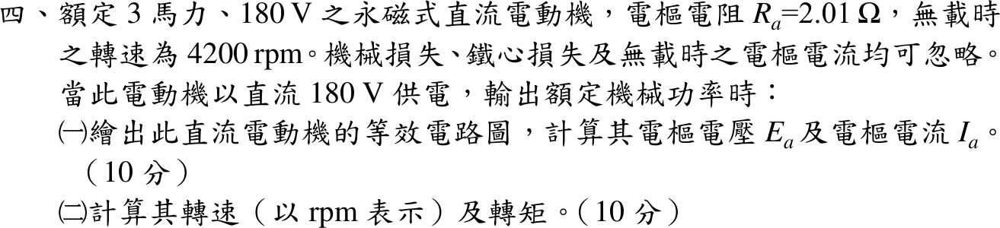
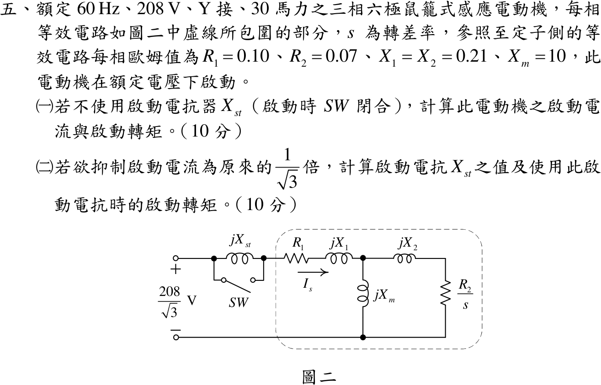

# 110 年電機工程技師｜電機機械逐題詳解

> 本頁由題級 canonical 筆記組合；每題保留官方裁切圖、校驗狀態與可追溯的推導。

## 題目導覽
- [[#一、110 年電機機械第 1 題｜差動串聯磁路|第 1 題：差動串聯磁路]]
- [[#二、110 年電機機械第 2 題｜自耦變壓器與 V–V 容量|第 2 題：自耦變壓器與 V–V 容量]]
- [[#三、110 年電機機械第 3 題｜同步電動機相量與轉矩角|第 3 題：同步電動機相量與轉矩角]]
- [[#四、110 年電機機械第 4 題｜永磁式直流電動機額定工作點|第 4 題：永磁式直流電動機額定工作點]]
- [[#五、110 年電機機械第 5 題｜感應電動機啟動電抗器|第 5 題：感應電動機啟動電抗器]]

---

## 一、110 年電機機械第 1 題｜差動串聯磁路

> 題級識別：EE-110-04-1
> canonical 來源：[[canonical/EE-110-04-1.md]]
> 題級校驗狀態：verified

### 已知與所求

鐵心平均長度 \(l_c=45\ \mathrm{cm}\)、截面積 \(A_c=15\ \mathrm{cm^2}\)、\(\mu_r=3300\)；左柱繞組 \(N_1=100\)、右柱繞組 \(N_2=85\)，兩繞組依圖一串聯，通直流 \(I=550\ \mathrm{mA}\)，忽略漏磁。求鐵心中的磁通密度 \(B\) 與儲能 \(W_m\)。（20 分）

### 考場標準作答

#### 步驟 1：繞向判定（和動或差動）

設鐵心線性（\(\mu_r\) 定值、未飽和）、無漏磁、無氣隙，磁通全部沿平均路徑 \(l_c\)，截面處處為 \(A_c\)。兩繞組串聯通同一電流，總磁動勢相加或相減由繞向決定。

依圖一逐段追線（以紙面朝外為前側；圖中橫跨鐵心柱的直線段為前側導線，柱緣弧線表示繞到背面）：

- 電流由 \(+\) 端沿最上方引線進入 \(N_1\)，在 \(N_1\) 中由上往下繞，前側直線段電流向右；繞完由左柱外側下方引出。
- 引出線經外圍底部接到右側，再接 \(N_2\) 的**下端**，電流在 \(N_2\) 中由下往上繞，前側直線段電流向左；由上端引出回到 \(-\) 端。
- 右手定則（四指沿電流環繞柱、拇指為磁通）：\(N_1\) 前側向右 → 左柱磁通向上；\(N_2\) 前側向左 → 右柱磁通向下。
- 左柱向上、右柱向下，在磁路迴圈上同為順時針，兩磁動勢同向，為和動串聯。若改把直線段視為背側，兩柱磁通同時反向，仍為同向。

#### 步驟 2：總磁動勢與鐵心磁阻

單位換算：\(I=550\ \mathrm{mA}=0.55\ \mathrm A\)。和動串聯總磁動勢：
\[
\mathcal F=(N_1+N_2)I=(100+85)(0.55)=185(0.55)=101.75\ \mathrm{A\cdot t}
\]
單位換算：\(l_c=0.45\ \mathrm m\)，\(A_c=15\ \mathrm{cm^2}=15\times10^{-4}\ \mathrm{m^2}=1.5\times10^{-3}\ \mathrm{m^2}\)。鐵心導磁係數：
\[
\mu=\mu_r\mu_0=3300(4\pi\times10^{-7})=4.1469\times10^{-3}\ \mathrm{H/m}
\]
鐵心磁阻：
\[
\mathcal R_c=\frac{l_c}{\mu A_c}=\frac{0.45}{(4.1469\times10^{-3})(1.5\times10^{-3})}=\frac{0.45}{6.2204\times10^{-6}}=72\,343\ \mathrm{A\cdot t/Wb}
\]

#### 磁通密度

鐵心磁通：
\[
\Phi=\frac{\mathcal F}{\mathcal R_c}=\frac{101.75}{72\,343}=1.4065\times10^{-3}\ \mathrm{Wb}
\]
磁通密度：
\[
B=\frac{\Phi}{A_c}=\frac{1.4065\times10^{-3}}{1.5\times10^{-3}}=0.9377\ \mathrm T
\]
\[
\boxed{B=0.94\ \mathrm T}
\]

#### 儲能

線性磁路 \(W_m=\tfrac12\mathcal F\Phi\)（等同 \(\tfrac12LI^2\)），\(\Phi\) 取上一段的 \(1.4065\times10^{-3}\ \mathrm{Wb}\)（保留 5 位）：

\[
W_m=\tfrac12\mathcal F\Phi=\tfrac12(101.75)(1.4065\times10^{-3})
\]
\[
W_m=0.071556\ \mathrm J
\]
\[
\boxed{W_m=71.56\ \mathrm{mJ}}
\]

### 驗算

能量密度法：\(H=\mathcal F/l_c=101.75/0.45=226.11\ \mathrm{A/m}\)，\(B=\mu H=(4.1469\times10^{-3})(226.11)=0.9377\ \mathrm T\)；\(W_m=\tfrac12BH\,(A_cl_c)=\tfrac12(0.9377)(226.11)(6.75\times10^{-4})=0.071558\ \mathrm J\approx71.56\ \mathrm{mJ}\)。電感法：\(L=(N_1+N_2)^2/\mathcal R_c=34\,225/72\,343=0.4731\ \mathrm H\)，\(\tfrac12LI^2=\tfrac12(0.4731)(0.55)^2=0.071556\ \mathrm J\)。量級：\(B\approx0.94\ \mathrm T\) 在矽鋼未飽和範圍內，線性假設合理。

### 失分點

- 誤以為 \(N_1\) 下端接 \(N_2\) 上端而判成差動串聯：\(\mathcal F=(100-85)(0.55)=8.25\ \mathrm{A\cdot t}\)，得 \(B=0.07603\ \mathrm T\)、\(W_m=0.4704\ \mathrm{mJ}\)。
- 只比較兩線圈「同在柱上向上／向下」而忘了兩柱位於磁路迴圈的對邊：左柱向上與右柱向下才是同一環繞方向。
- 截面積換算 \(15\ \mathrm{cm^2}=1.5\times10^{-3}\ \mathrm{m^2}\) 錯成 \(1.5\times10^{-4}\)。

---

## 二、110 年電機機械第 2 題｜自耦變壓器與 V–V 容量

> 題級識別：EE-110-04-2
> canonical 來源：[[canonical/EE-110-04-2.md]]
> 題級校驗狀態：verified

### 已知與所求

60 Hz、220/160 V、30 kVA 雙繞組單相變壓器改接為自耦變壓器，由 380 V 供 220 V 單相負載。求（一）電路圖（極性、電壓）；（二）kVA 容量；（三）兩台組成 380 V → 220 V 三相組的接線圖；（四）三相組容量。（每小題 5 分）

### 考場標準作答

#### （一）單相自耦接線（5 分）

設理想自耦關係（忽略激磁電流與漏阻抗壓降）、三相平衡負載。兩繞組電壓相加才得 380 V（\(380=160+220\)），220 V 負載須直接取自 220 V 繞組，故 220 V 為公共繞組、160 V 為串聯繞組，串聯繞組的非打點端接公共繞組的打點端（加極性）。

畫法：

- 公共繞組 220 V 打點端在上，下端為共同端 \(N\)。
- 串聯繞組 160 V 的非打點端接公共繞組的打點端（分接點 \(X\)），其打點端為高壓端 \(H\)。
- 380 V 電源跨 \(H\)–\(N\)，220 V 負載跨 \(X\)–\(N\)。
- 參考方向：\(I_H\) 由 \(H\) 流入串聯繞組，\(I_L\) 由 \(X\) 流向負載，\(I_c\) 在公共繞組中由 \(N\) 往上流向 \(X\)（圖 1）。

兩繞組電壓相加：
\[
V_{HN}=V_{se}+V_c=160+220=380\ \mathrm V,\qquad V_{XN}=V_c=220\ \mathrm V
\]
\[
\boxed{\text{160 V 串聯繞組與 220 V 公共繞組加極性串接，380 V 跨 H–N、220 V 取自 X–N}}
\]

#### （二）單相自耦容量（5 分）

\(I_H\) 全部流過 160 V 串聯繞組，上限為串聯繞組額定電流；負載電流由功率相等求出，再由分接點 KCL 確認公共繞組不超過額定。

串聯繞組額定電流：
\[
I_{se}=\frac{S_{2w}}{V_{se}}=\frac{30\ \mathrm{kVA}}{160\ \mathrm V}=187.50\ \mathrm A
\]
公共繞組額定電流：
\[
I_{c,rated}=\frac{S_{2w}}{V_c}=\frac{30\ \mathrm{kVA}}{220\ \mathrm V}=136.36\ \mathrm A
\]
輸入電流上限 \(I_H=I_{se}=187.50\ \mathrm A\)，自耦容量：
\[
S_{auto}=V_HI_H=380\ \mathrm V\times187.50\ \mathrm A=71.25\ \mathrm{kVA}
\]
\[
\boxed{S_{auto}=71.25\ \mathrm{kVA}}
\]
負載電流（輸出功率等於輸入功率）：
\[
I_L=\frac{S_{auto}}{V_{XN}}=\frac{71.25\ \mathrm{kVA}}{220\ \mathrm V}=323.86\ \mathrm A
\]
分接點 KCL（\(I_L=I_H+I_c\)），公共繞組電流：
\[
I_c=I_L-I_H=323.86-187.50=136.36\ \mathrm A=I_{c,rated}
\]
兩繞組同時恰為額定。

#### （三）三相 V–V（開放三角）自耦接線（5 分）

兩台自耦變壓器各跨一個高壓線電壓（\(A\)–\(B\)、\(C\)–\(B\)），公共端共接 \(B\) 線；每台把所跨的線電壓按 \(220/380\) 縮小，第三個線電壓由相量差得到，三線間皆 220 V。

畫法：

- 第 1 台跨 \(A\)–\(B\)：串聯繞組打點端接 \(A\)，分接點引出 \(a\)，公共繞組打點端在分接點 \(a\)、另一端接 \(B\)。
- 第 2 台跨 \(C\)–\(B\)：串聯繞組打點端接 \(C\)，分接點引出 \(c\)，公共繞組打點端在分接點 \(c\)、另一端接 \(B\)。
- \(B\) 線直通為低壓 \(b\) 線；\(a\)、\(b\)、\(c\) 接三相 220 V 負載（圖 2）。

每台分接點電壓（以 \(B\) 為共同端，\(k=220/380\)）：
\[
\underline V_a-\underline V_B=k(\underline V_A-\underline V_B),\qquad \underline V_c-\underline V_B=k(\underline V_C-\underline V_B)
\]
因此 \(\underline V_{ab}=k\underline V_{AB}\)、\(\underline V_{cb}=k\underline V_{CB}\)；第三個線電壓兩式相減：
\[
\underline V_{ac}=\underline V_a-\underline V_c=k(\underline V_A-\underline V_C)=k\underline V_{AC}
\]
大小：
\[
|\underline V_{ab}|=|\underline V_{cb}|=|\underline V_{ac}|=\frac{220}{380}(380)=220\ \mathrm V
\]
\[
\boxed{\text{兩台自耦變壓器 V–V 接於 A–B、C–B，共用 B 線，380 V 降為三相 220 V}}
\]

#### （四）三相組容量（5 分）

每台的安匝平衡與單相時相同，兩繞組同時達額定時，低壓線電流上限仍為（二）的 \(I_L=323.86\ \mathrm A\)，\(S_{3\phi}=\sqrt3V_{LL}I_L\)。

參考方向：\(I_A\) 由 \(A\) 流入第 1 台串聯繞組，\(I_a\) 由分接點 \(a\) 流出到負載，公共繞組電流 \(I_a-I_A\) 由 \(B\) 往上流向 \(a\)；\(I_A\) 與 \(I_a\) 同相，所以可直接以大小相減。第 1 台安匝平衡：
\[
160I_A=220(I_a-I_A)\ \Rightarrow\ 380I_A=220I_a\ \Rightarrow\ I_A=\frac{220}{380}I_a=kI_a
\]
高壓線電流（第 1 台串聯繞組電流）：
\[
I_A=kI_a=\frac{220}{380}(323.86)=187.50\ \mathrm A=I_{se}
\]
公共繞組電流 \(I_a-I_A=323.86-187.50=136.36\ \mathrm A\)，恰為額定。三相容量：
\[
S_{3\phi}=\sqrt3V_{LL}I_L=\sqrt3(220)(323.86)
\]
\[
\sqrt3(220)=381.05\ \mathrm V,\qquad 381.05\ \mathrm V\times323.86\ \mathrm A=123.41\ \mathrm{kVA}
\]
等效寫法（\(220\times323.86=V_HI_H=71.25\ \mathrm{kVA}\)）：
\[
S_{3\phi}=\sqrt3\times71.25=123.41\ \mathrm{kVA}
\]
\[
\boxed{S_{3\phi}=123.41\ \mathrm{kVA}}
\]

### 驗算

功率守恆：\(220\times323.86=71.249\ \mathrm{kVA}\approx380\times187.50=71.250\ \mathrm{kVA}\)；其中變壓器感應傳送 \(160\times187.50=30\ \mathrm{kVA}\)（即原額定）、傳導 \(220\times187.50=41.25\ \mathrm{kVA}\)，合計 71.25 kVA。三相組：\(123.41/(2\times71.25)=0.866=\sqrt3/2\)，與開放三角的利用率一致。

### 失分點

- 以雙繞組 30 kVA 當自耦容量，或用公共繞組電流算成 \(380\times136.36=51.82\ \mathrm{kVA}\)；限制輸入電流的是 160 V 串聯繞組的 187.50 A。
- 兩繞組減極性串接只得 \(220-160=60\ \mathrm V\)，不是 380 V。
- V–V 容量寫成 \(2\times71.25=142.50\ \mathrm{kVA}\)；開放三角只有 \(\sqrt3\) 倍單台容量。

---

## 三、110 年電機機械第 3 題｜同步電動機相量與轉矩角

> 題級識別：EE-110-04-3
> canonical 來源：[[canonical/EE-110-04-3.md]]
> 題級校驗狀態：verified

### 已知與所求

380 V、60 Hz、15 kW、八極、Y 接三相同步電動機，每相 \(X_s=5.80\ \Omega\)，電樞電阻、鐵損、機械損均忽略。求（一）額定電壓、額定輸出、PF 0.8 落後時的每相等效電路、\(I_a\)、每相 \(E_a\)、轉矩角 \(\delta\)（10 分）；（二）供電降為 342 V、激磁電流與機械輸出不變時的 \(\delta\)、\(I_a\)、功率因數（10 分）。

### 考場標準作答

#### 步驟 1：每相等效電路與相電壓

取 \(\underline V_\phi\) 為相位參考 \(0^\circ\)，\(\delta\) 為 \(\underline E_a\) 相對 \(\underline V_\phi\) 的角（負值表示落後）；八極只決定同步轉速 900 rpm，不影響電路計算；損失全忽略，輸入功率＝輸出 15 kW。

- 每相：電源 \(\underline V_\phi\) 經 \(jX_s=j5.80\ \Omega\) 接到內生電勢 \(\underline E_a\)（\(R_a\) 忽略）。
- 參考方向：\(\underline I_a\) 由電源流入電動機。

Y 接，相電壓＝線電壓／\(\sqrt3\)：
\[
V_\phi=\frac{380}{\sqrt3}=219.3931\ \mathrm V
\]

#### （一）額定運轉的 \(I_a\)、\(E_a\)、\(\delta\)（10 分）

電樞電流大小：
\[
I_a=\frac{P}{\sqrt3V_L\,\mathrm{PF}}=\frac{15\ \mathrm{kW}}{\sqrt3\times0.380\ \mathrm{kV}\times0.8}=\frac{15\ \mathrm{kW}}{0.52654\ \mathrm{kV}}=28.4877\ \mathrm A
\]
\[
\boxed{I_a=28.49\ \mathrm A}
\]
PF 0.8 落後：\(\varphi=\cos^{-1}0.8=36.87^\circ\)，\(\sin\varphi=0.6\)，
\[
\underline I_a=28.4877\angle-36.87^\circ\ \mathrm A
\]
化成直角座標：
\[
\underline I_a=28.4877(0.8)-j28.4877(0.6)=22.7902-j17.0926\ \mathrm A
\]
同步電抗壓降（\(j\cdot(-j17.0926)=+17.0926\)）：
\[
jX_s\underline I_a=j5.8(22.7902-j17.0926)=5.8(17.0926)+j5.8(22.7902)=99.1371+j132.1832\ \mathrm V
\]
電動機 KVL：
\[
\underline E_a=\underline V_\phi-jX_s\underline I_a=(219.3931-99.1371)-j132.1832=120.2560-j132.1832\ \mathrm V
\]
大小：
\[
|E_a|=\sqrt{120.2560^2+132.1832^2}=\sqrt{14\,461.51+17\,472.40}=\sqrt{31\,933.91}=178.7006\ \mathrm V
\]
\[
\boxed{E_a=178.70\text{ V/相}}
\]
角度（虛部為負，\(\underline E_a\) 落後 \(\underline V_\phi\)）：
\[
\delta=-\tan^{-1}\frac{132.1832}{120.2560}=-\tan^{-1}1.0992=-47.71^\circ
\]
\[
\boxed{\delta=-47.71^\circ}
\]

相量圖畫法（圖 2）：\(\underline V_\phi\) 沿水平軸；\(\underline I_a\) 落後 \(36.87^\circ\)；\(\underline E_a\) 在水平軸下方 \(47.71^\circ\)；自 \(\underline E_a\) 尖端畫 \(jX_s\underline I_a\)（大小 \(5.8(28.4877)=165.23\ \mathrm V\)，角度 \(-36.87^\circ+90^\circ=53.13^\circ\)）剛好到 \(\underline V_\phi\) 尖端。

#### （二）電壓降為 342 V（10 分）

激磁電流不變，\(|E_a|=178.70\ \mathrm V\) 不變（轉速固定為同步轉速）；機械輸出不變、無損，輸入仍為 15 kW，\(P=3V_\phi E_a\sin|\delta|/X_s\) 中只剩 \(\delta'\) 未知。

新相電壓：
\[
V_\phi'=\frac{342}{\sqrt3}=197.4538\ \mathrm V
\]
功率角公式解 \(\sin|\delta'|\)：
\[
\sin|\delta'|=\frac{PX_s}{3V_\phi'E_a}=\frac{15\,000(5.8)}{3(197.4538)(178.70)}=\frac{87\,000}{105\,855.0}=0.821879
\]
\[
|\delta'|=\sin^{-1}0.821879=55.27^\circ\quad(\text{取 }|\delta'|<90^\circ\text{ 的穩定解，捨去 }124.73^\circ)
\]
\[
\boxed{\delta'=-55.27^\circ}
\]
\(\cos|\delta'|=\sqrt{1-0.821879^2}=\sqrt{0.324515}=0.569662\)，新內生電勢（落後，虛部取負）：
\[
\underline E_a'=178.70(0.569662)-j178.70(0.821879)=101.7986-j146.8698\ \mathrm V
\]
\(jX_s\) 上的電壓：
\[
\underline V_\phi'-\underline E_a'=(197.4538-101.7986)+j146.8698=95.6552+j146.8698\ \mathrm V
\]
除以 \(jX_s\)（除以 \(j\) 等於乘 \(-j\)）：
\[
\underline I_a'=\frac{95.6552+j146.8698}{j5.8}=\frac{146.8698-j95.6552}{5.8}=25.3224-j16.4923\ \mathrm A
\]
大小：
\[
|I_a'|=\sqrt{25.3224^2+16.4923^2}=\sqrt{641.2240+271.9960}=\sqrt{913.2200}=30.2195\ \mathrm A
\]
\[
\boxed{I_a'=30.22\ \mathrm A}
\]
角度（虛部為負，電流落後）：
\[
\theta'=-\tan^{-1}\frac{16.4923}{25.3224}=-33.08^\circ
\]
功率因數：
\[
\mathrm{PF}=\frac{\mathrm{Re}(\underline I_a')}{|I_a'|}=\frac{25.3224}{30.2195}=0.8379
\]
\[
\boxed{\mathrm{PF}=0.84\text{ 落後}}
\]

### 驗算

功率回代：\(3V_\phi\,\mathrm{Re}(\underline I_a)=3(219.3931)(22.7902)=15.00\,\mathrm{kW}\)；\(3V_\phi'\,\mathrm{Re}(\underline I_a')=3(197.4538)(25.3224)=15.00\,\mathrm{kW}\)。功率角式回查（一）：\(\sin47.71^\circ=0.7397\)，\(3(219.3931)(178.70)(0.7397)/5.8=15.00\,\mathrm{kW}\)。八極同步轉速 \(n_s=120(60)/8=900\ \mathrm{rpm}\)，\(\omega_s=2\pi(900)/60=94.25\ \mathrm{rad/s}\)，轉矩 \(15\,000/94.25=159.15\ \mathrm{N\cdot m}\) 前後不變。

### 失分點

- 電動機誤用發電機式 \(\underline E=\underline V+jX_s\underline I\)，得 \(|E_a|=344.87\ \mathrm V\)、\(\delta\) 為正。
- （二）沿用原電流 28.49 A 或原功因；應固定 \(|E_a|\) 與 \(P\) 先解 \(\delta'\)，再求 \(\underline I_a'\)。
- \(\sin\delta\) 式中誤用線電壓而漏乘 3，或用 \(V_L\) 搭配相電壓 \(E_a\)。

---

## 四、110 年電機機械第 4 題｜永磁式直流電動機額定工作點

> 題級識別：EE-110-04-4
> canonical 來源：[[canonical/EE-110-04-4.md]]
> 題級校驗狀態：verified

### 已知與所求

3 hp、180 V 永磁式直流電動機，\(R_a=2.01\ \Omega\)，無載轉速 4200 rpm；機械損、鐵損及無載電樞電流均忽略。以 180 V 供電、輸出額定機械功率時，求（一）等效電路、\(E_a\)、\(I_a\)（10 分）；（二）轉速與轉矩（10 分）。

### 考場標準作答

#### （一）等效電路、\(E_a\) 與 \(I_a\)（10 分）

設 1 hp＝746 W，機械損、鐵損與電刷壓降不計，故 \(P_{out}=E_aI_a\)；與 KVL \(V_t=E_a+I_aR_a\) 聯立得 \(I_a\) 的二次式，取額定運轉的小電流根。

等效電路畫法（圖 1）：

- 左側直流電源 \(V_t=180\ \mathrm V\)（上正下負），經 \(R_a=2.01\ \Omega\) 接到電樞反電勢 \(E_a\)（上正下負），再回電源負端。
- 永磁場沒有場繞組，磁通 \(\phi\) 固定，不畫場電路。
- 參考方向：\(I_a\) 由電源正端流出、經 \(R_a\) 流入 \(E_a\) 正端。

輸出功率（題目給額定 3 hp）：
\[
P_{out}=3(746)=2238\ \mathrm W
\]
電樞 KVL：
\[
E_a=V_t-I_aR_a=180-2.01I_a
\]
功率關係 \(P_{out}=E_aI_a\)，代入 \(E_a\)：
\[
(180-2.01I_a)I_a=2238
\]
展開移項：
\[
2.01I_a^2-180I_a+2238=0
\]
判別式：
\[
\Delta=180^2-4(2.01)(2238)=32\,400-17\,993.52=14\,406.48
\]
\[
\sqrt\Delta=120.0270
\]
兩根：
\[
I_a=\frac{180\mp120.0270}{2(2.01)}=\frac{180\mp120.0270}{4.02}
\]
小根：
\[
I_a=\frac{59.9730}{4.02}=14.9187\ \mathrm A
\]
大根：
\[
I_a=\frac{300.0270}{4.02}=74.6336\ \mathrm A
\]
取根：大根時 \(E_a=180-2.01(74.6336)=29.99\ \mathrm V\)，銅損 \(2.01(74.6336)^2=11\,196\ \mathrm W\) 遠大於輸出 2238 W（效率只有 \(2238/(180\times74.6336)=16.66\%\)），不可能是額定運轉點；取小根。
\[
\boxed{I_a=14.92\ \mathrm A}
\]
反電勢（KVL 回代，\(2.01(14.9187)=29.9866\ \mathrm V\)）：
\[
E_a=180-29.9866=150.0134\ \mathrm V
\]
\[
\boxed{E_a=150.01\ \mathrm V}
\]

#### （二）轉速與轉矩（10 分）

磁通固定，\(E_a=Kn\)，由無載點（\(I_a=0\)，\(E_a=180\ \mathrm V\) 對 4200 rpm）按比例換算轉速。

無載點定比例常數：
\[
K=\frac{180}{4200}\ \mathrm{V/rpm}
\]
轉速：
\[
n=\frac{E_a}{K}=4200\times\frac{150.0134}{180}=3500.31\ \mathrm{rpm}
\]
\[
\boxed{n=3500.31\ \mathrm{rpm}}
\]
機械角速度：
\[
\omega_m=\frac{2\pi n}{60}=\frac{2\pi(3500.31)}{60}=366.5516\ \mathrm{rad/s}
\]
轉矩：
\[
T=\frac{P_{out}}{\omega_m}=\frac{2238}{366.5516}=6.1056\ \mathrm{N\cdot m}
\]
\[
\boxed{T=6.11\ \mathrm{N\cdot m}}
\]

### 驗算

轉矩常數法：\(K_T=\dfrac{180}{4200(2\pi/60)}=\dfrac{180}{439.8230}=0.4093\ \mathrm{N\cdot m/A}\)，\(T=K_TI_a=0.4093(14.9187)=6.11\ \mathrm{N\cdot m}\)，與功率法一致。KVL：\(150.0134+29.9866=180.0000\ \mathrm V\)。功率平衡（\(I_a=14.91866\ \mathrm A\)）：輸入 \(180(14.91866)=2685.36\ \mathrm W\)＝輸出 2238 W＋銅損 \(2.01(14.91866)^2=447.36\ \mathrm W\)。

### 失分點

- 把 \(P_{out}=2238\ \mathrm W\) 當輸入功率，算成 \(I_a=2238/180=12.43\ \mathrm A\)，漏掉 \(I_a^2R_a\)。
- 二次式取大根 74.63 A，得 699.69 rpm、30.54 N·m。
- 轉矩用 rpm 直接除：\(T=P/n\)；須換成 \(\omega_m=2\pi n/60\)。

---

## 五、110 年電機機械第 5 題｜感應電動機啟動電抗器

> 題級識別：EE-110-04-5
> canonical 來源：[[canonical/EE-110-04-5.md]]
> 題級校驗狀態：verified

### 已知與所求

60 Hz、208 V、Y 接、30 hp 三相六極鼠籠式感應電動機，每相 \(R_1=0.10\)、\(R_2=0.07\)、\(X_1=X_2=0.21\)、\(X_m=10\ \Omega\)；\(jX_{st}\) 串在電源與 \(R_1\) 之間，SW 閉合時短路。求（一）不用 \(X_{st}\) 的啟動電流與轉矩；（二）使啟動電流降為 \(1/\sqrt3\) 的 \(X_{st}\) 與啟動轉矩。

### 考場標準作答

#### 步驟 1：每相電壓、同步角速度與等效電路

設額定電壓直接加在端子（電源無內阻抗）、等效電路參數不隨轉差改變；題目未給鐵損電阻 \(R_c\)，激磁支路只有 \(jX_m\)；30 馬力為銘牌額定，計算用不到。

- Y 接，每相等效電路如圖 1；\(s=1\) 時 \(R_2/s=0.07\ \Omega\)。
- 參考方向：\(I_s\) 由電源流入 \(R_1\)，\(I_2'\) 由激磁分流點流向 \(R_2/s\)。

每相電壓（Y 接，相電壓＝線電壓／\(\sqrt3\)）：
\[
V_\phi=\frac{V_L}{\sqrt3}=\frac{208}{\sqrt3}=120.089\ \mathrm V
\]
同步轉速（6 極、60 Hz）：
\[
n_s=\frac{120f}{P}=\frac{120(60)}{6}=1200\ \mathrm{rpm}
\]
同步角速度：
\[
\omega_s=\frac{2\pi n_s}{60}=\frac{2\pi(1200)}{60}=125.664\ \mathrm{rad/s}
\]

#### （一）直接啟動的電流與轉矩（10 分）

SW 閉合使 \(jX_{st}\) 被短路，電源直接接 \(R_1+jX_1+Z_p\)。

激磁支路與轉子支路並聯：
\[
Z_p=\frac{jX_m(R_2+jX_2)}{R_2+j(X_m+X_2)}
\]
代入：
\[
Z_p=\frac{j10(0.07+j0.21)}{0.07+j(10+0.21)}
\]
分子展開（\(j^2=-1\)）：
\[
j10(0.07+j0.21)=j0.7+j^2(2.1)=-2.1+j0.7\ \Omega^2
\]
分母：
\[
0.07+j10.21\ \Omega
\]
分子分母同乘分母共軛 \(0.07-j10.21\)；分母大小平方：
\[
0.07^2+10.21^2=0.0049+104.2441=104.249\ \Omega^2
\]
分子乘共軛：
\[
(-2.1+j0.7)(0.07-j10.21)=-0.147+j21.441+j0.049+7.147=7.000+j21.490\ \Omega^3
\]
相除（以下阻抗改用 \(\mathrm{m\Omega}\) 並保留三位小數，使 \(I_s\) 照字面算得到框內值）：
\[
Z_p=\frac{7.000+j21.490}{104.249}=0.067147+j0.206141\ \Omega=67.147+j206.141\ \mathrm{m\Omega}
\]
與 \(R_1+jX_1=100+j210\ \mathrm{m\Omega}\) 串聯：
\[
Z=(100+67.147)+j(210+206.141)=167.147+j416.141\ \mathrm{m\Omega}
\]
大小：
\[
|Z|=\sqrt{167.147^2+416.141^2}=\sqrt{27\,938.1+173\,173.3}=\sqrt{201\,111.4}=448.454\ \mathrm{m\Omega}
\]
角度：
\[
\theta_Z=\tan^{-1}\frac{416.141}{167.147}=\tan^{-1}2.4897=68.12^\circ
\]
啟動電流（大小；相位落後 \(V_\phi\) \(68.12^\circ\)）：
\[
I_s=\frac{V_\phi}{|Z|}=\frac{120.089\ \mathrm V}{448.454\ \mathrm{m\Omega}}=0.267784\ \mathrm{kA}=267.784\ \mathrm A
\]
\[
\boxed{I_{st}=267.78\ \mathrm A}
\]
轉子電流（分流：\(jX_m\) 與 \(R_2+jX_2\) 並聯，流入轉子支路的比例為 \(jX_m/[R_2+j(X_m+X_2)]\)）：
\[
I_2'=I_s\left|\frac{jX_m}{R_2+j(X_m+X_2)}\right|=I_s\frac{X_m}{\sqrt{R_2^2+(X_m+X_2)^2}}
\]
分流比大小：
\[
\frac{10}{\sqrt{104.249}}=\frac{10}{10.2102}=0.97941
\]
\[
I_2'=267.784(0.97941)=262.270\ \mathrm A
\]
氣隙功率（三相，\(s=1\)）：
\[
P_{ag}=\frac{3I_2'^2R_2}{s}=3(262.270)^2(0.07)
\]
\[
P_{ag}=3(68\,785.6)(0.07)=14\,445.0\ \mathrm W
\]
啟動轉矩：
\[
T_{st}=\frac{P_{ag}}{\omega_s}=\frac{14\,445.0}{125.664}=114.949\ \mathrm{N\cdot m}
\]
\[
\boxed{T_{st}=114.95\ \mathrm{N\cdot m}}
\]

#### （二）啟動電抗器 \(X_{st}\) 與啟動轉矩（10 分）

SW 打開，\(jX_{st}\) 串入；電壓不變而電流降為 \(1/\sqrt3\)，故 \(|Z+jX_{st}|=\sqrt3|Z|\)。\(X_{st}\) 在分流點之前，分流比不變，轉矩隨電流平方降為 \(1/3\)。

所需的總阻抗大小：
\[
|Z+jX_{st}|=\sqrt3|Z|=\sqrt3(448.454)=776.745\ \mathrm{m\Omega}
\]
寫成實部、虛部（\(R=167.147\)、\(X=416.141\ \mathrm{m\Omega}\)）：
\[
R^2+(X+X_{st})^2=776.745^2
\]
\[
167.147^2+(X+X_{st})^2=603\,332.8
\]
\[
(X+X_{st})^2=603\,332.8-27\,938.1=575\,394.7
\]
取正根：
\[
X+X_{st}=\sqrt{575\,394.7}=758.548\ \mathrm{m\Omega}
\]
\[
X_{st}=758.548-416.141=342.407\ \mathrm{m\Omega}
\]
\[
\boxed{X_{st}=342.41\ \mathrm{m\Omega}}
\]
（即 \(0.3424\ \Omega\)。）

啟動轉矩：\(X_{st}\) 在激磁分流點之前，分流比 \(0.97941\) 不變，轉子電流同降為 \(1/\sqrt3\)：
\[
I_2''=\frac{I_2'}{\sqrt3}=\frac{262.270}{\sqrt3}=151.422\ \mathrm A
\]
轉矩與 \(I_2'^2\) 成正比，降為 \(1/3\)：
\[
T_{st}'=\frac{T_{st}}{3}=\frac{114.949}{3}=38.316\ \mathrm{N\cdot m}
\]
\[
\boxed{T_{st}'=38.32\text{ N}\cdot\text{m}}
\]

### 驗算

戴維寧法：\(\underline V_{th}=120.089\dfrac{j10}{0.10+j10.21}\)、\(Z_{th}=\dfrac{(0.10+j0.21)(j10)}{0.10+j10.21}\)，\(T=\dfrac{3|V_{th}|^2R_2}{\omega_s|Z_{th}+0.07+j0.21|^2}=114.95\ \mathrm{N\cdot m}\)，與直接法相同。加 \(X_{st}\) 後 \(I_s'=120.089/0.776745=154.605\ \mathrm A=267.784/\sqrt3\)；\(3(151.422)^2(0.07)/125.664=38.32\ \mathrm{N\cdot m}\)。

### 失分點

- 忽略 \(X_m\) 並聯而只用串聯阻抗 \(0.17+j0.42\ \Omega\)，啟動電流與轉矩都略偏大。
- 把 \(X_{st}\) 直接取 \((\sqrt3-1)|Z|=328.29\ \mathrm{m\Omega}\)：阻抗是相量，\(X_{st}\) 只加在虛部，大小不能直接相加。
- 啟動轉矩只降為 \(1/\sqrt3\)；轉矩與電流平方成正比，應為 \(1/3\)。

---
