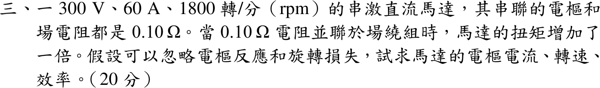

# 113 年電機工程技師｜電機機械逐題詳解

> 本頁由題級 canonical 筆記組合；每題保留官方裁切圖、校驗狀態與可追溯的推導。

## 題目導覽
- [[#一、113 年第 1 題｜獨立驗證|第 1 題：獨立驗證]]
- [[#二、113 年第 2 題｜同步發電機標么阻抗、銅損與轉矩|第 2 題：同步發電機標么阻抗、銅損與轉矩]]
- [[#三、113 年第 3 題｜串激直流馬達分流調速與效率|第 3 題：串激直流馬達分流調速與效率]]
- [[#四、113 年電機機械第 4 題｜三相感應馬達等效電路與轉矩（參考書主解）|第 4 題：三相感應馬達等效電路與轉矩（參考書主解）]]
- [[#五、113 年第 5 題｜電容啟動單相感應馬達|第 5 題：電容啟動單相感應馬達]]

---

## 一、113 年第 1 題｜獨立驗證

> 題級識別：EE-113-04-1
> canonical 來源：[[canonical/EE-113-04-1.md]]
> 題級校驗狀態：verified

### 已知與所求

單相變壓器 \(V_1/V_2\)、\(I_1/I_2\)、\(N_1/N_2\)，漏磁通 \(\phi_{l1}/\phi_{l2}\)、鐵心磁通 \(\phi_M\)；鐵心磁阻 \(\mathcal R_M\)，漏磁阻 \(\mathcal R_{l1}/\mathcal R_{l2}\)。圖中 \(I_1\)、\(I_2\) 皆由打點端流入。求磁路、含銅損與鐵損的等效電路，以及各電感（以匝數與磁阻表示）。

### 考場標準作答

#### 磁路（含磁動勢、磁阻、磁通）

設鐵心與漏磁路線性（磁阻為定值）；\(I_1\)、\(I_2\) 皆由打點端流入，兩磁動勢對 \(\phi_M\) 同向相加。漏磁通只由自身繞組驅動、只經漏磁阻，故漏磁阻直接跨在自身磁動勢兩端；主磁通由兩磁動勢串聯驅動經 \(\mathcal R_M\)。

畫法：

- 左、右各一個磁動勢源 \(N_1I_1\)、\(N_2I_2\)；兩電流都由打點端流入，兩者在鐵心迴路上推動 \(\phi_M\) 的方向相同（圖 1 皆為順時針）。
- \(\mathcal R_{l1}\) 直接並在 \(N_1I_1\) 兩端，\(\mathcal R_{l2}\) 直接並在 \(N_2I_2\) 兩端。
- \(\mathcal R_M\)（整個鐵心路徑的磁阻）把兩側連成主磁路。

主磁路迴圈（兩磁動勢串聯相加）：
\[
\phi_M=\frac{N_1I_1+N_2I_2}{\mathcal R_M}
\]
兩漏磁路（各自磁動勢直接跨在漏磁阻上）：
\[
\phi_{l1}=\frac{N_1I_1}{\mathcal R_{l1}},\qquad \phi_{l2}=\frac{N_2I_2}{\mathcal R_{l2}}
\]

#### 步驟 1：磁鏈與端電壓方程

以下以瞬時值 \(i_1\)、\(i_2\) 推導（\(\lambda\) 要對時間微分）；圖 2 的相量形式對應 \(I_1\)、\(I_2\)，\(d/dt\to j\omega\)。

一次繞組交鏈 \(\phi_{l1}\) 與 \(\phi_M\)：
\[
\lambda_1=N_1(\phi_{l1}+\phi_M)=\frac{N_1^2}{\mathcal R_{l1}}i_1+\frac{N_1(N_1i_1+N_2i_2)}{\mathcal R_M}
\]
令 \(a=N_1/N_2\)、\(i_2'=i_2/a=(N_2/N_1)i_2\)，第二項提出 \(N_1^2/\mathcal R_M\)：
\[
\lambda_1=\frac{N_1^2}{\mathcal R_{l1}}i_1+\frac{N_1^2}{\mathcal R_M}\left(i_1+i_2'\right)
\]
一次側端電壓（繞組電阻壓降＋磁鏈變化率）：
\[
v_1=R_1i_1+\frac{d\lambda_1}{dt}=R_1i_1+\frac{N_1^2}{\mathcal R_{l1}}\frac{di_1}{dt}+\frac{N_1^2}{\mathcal R_M}\frac{d(i_1+i_2')}{dt}
\]
二次繞組交鏈 \(\phi_{l2}\) 與 \(\phi_M\)：
\[
\lambda_2=N_2(\phi_{l2}+\phi_M)=\frac{N_2^2}{\mathcal R_{l2}}i_2+\frac{N_2(N_1i_1+N_2i_2)}{\mathcal R_M}
\]
第二項提出 \(N_1^2/\mathcal R_M\)（\(N_2(N_1i_1+N_2i_2)=\frac{N_2}{N_1}N_1^2\left(i_1+\frac{N_2}{N_1}i_2\right)\)）：
\[
\lambda_2=\frac{N_2^2}{\mathcal R_{l2}}i_2+\frac{N_2}{N_1}\cdot\frac{N_1^2}{\mathcal R_M}\left(i_1+i_2'\right)
\]
二次側端電壓：
\[
v_2=R_2i_2+\frac{N_2^2}{\mathcal R_{l2}}\frac{di_2}{dt}+\frac{1}{a}\cdot\frac{N_1^2}{\mathcal R_M}\frac{d(i_1+i_2')}{dt}
\]
兩式的最後一項都來自 \(\phi_M\)：一次側為 \(e_1=N_1\,d\phi_M/dt=\frac{N_1^2}{\mathcal R_M}\frac{d(i_1+i_2')}{dt}\)，二次側為 \(e_2=e_1/a\)，正是匝比 \(N_1:N_2\) 的理想變壓器。

#### 等效電路（含銅損與鐵損）

銅損以繞組電阻 \(R_1\)、\(R_2\) 表示；\(\phi_M\) 項為跨在理想變壓器一次側的激磁電感，\(i_1+i_2'\) 即激磁電流；鐵損與 \(e_1^2\) 成正比，以 \(R_c\) 並聯在激磁支路（\(R_c\) 不能由磁阻求得）。

畫法（圖 2，相量形式 \(X=\omega L\)）：

- 一次側：\(V_1\) → \(R_1\)（一次銅損）→ \(j\omega L_{l1}\)（一次漏感）→ 激磁支路 \(R_c\parallel j\omega L_m\) 跨接。
- 理想變壓器 \(N_1:N_2\)，兩側打點端在上，\(I_1\)、\(I_2\) 都由打點端流入（與題圖相同）。
- 二次側：理想變壓器二次 → \(j\omega L_{l2}\)（二次漏感）→ \(R_2\)（二次銅損）→ \(V_2\)。
- 激磁電流 \(I_\varphi=I_1+I_2/a\)，流經 \(R_c\parallel j\omega L_m\)。

若把二次側折算到一次側，則 \(R_2\to a^2R_2\)、\(L_{l2}\to a^2L_{l2}\)、\(V_2\to aV_2\)、\(I_2\to I_2/a\)，得一般的 T 型等效電路。

#### 各電感公式（以匝數與磁阻表示）

比對步驟 1 端電壓方程中 \(di/dt\) 的係數，各電感皆為交鏈匝數平方／所經磁阻。

一次漏感（\(\phi_{l1}\) 只交鏈 \(N_1\)）：
\[
L_{l1}=\frac{N_1^2}{\mathcal R_{l1}}
\]
二次漏感（\(\phi_{l2}\) 只交鏈 \(N_2\)）；折算至一次側乘 \(a^2\)：
\[
L_{l2}=\frac{N_2^2}{\mathcal R_{l2}},\qquad a^2L_{l2}=\frac{N_1^2}{N_2^2}\cdot\frac{N_2^2}{\mathcal R_{l2}}=\frac{N_1^2}{\mathcal R_{l2}}
\]
激磁電感（以一次側為準）：
\[
L_m=\frac{N_1^2}{\mathcal R_M}
\]
\[
\boxed{L_{l1}=\frac{N_1^2}{\mathcal R_{l1}},\quad L_{l2}=\frac{N_2^2}{\mathcal R_{l2}}\ \Big(a^2L_{l2}=\frac{N_1^2}{\mathcal R_{l2}}\Big),\quad L_m=\frac{N_1^2}{\mathcal R_M}}
\]
自感與互感（耦合電感寫法）：\(L_{11}=N_1^2/\mathcal R_{l1}+N_1^2/\mathcal R_M=L_{l1}+L_m\)、\(L_{22}=N_2^2/\mathcal R_{l2}+N_2^2/\mathcal R_M\)、\(M=N_1N_2/\mathcal R_M=L_m/a\)。

### 驗算

由端點方程反推：\(\partial\lambda_1/\partial i_1=N_1^2/\mathcal R_{l1}+N_1^2/\mathcal R_M=L_{l1}+L_m\)，\(\partial\lambda_1/\partial i_2=N_1N_2/\mathcal R_M=L_m/a\)，代入 \(i_2=ai_2'\) 即得 \(L_m\,d(i_1+i_2')/dt\) 項；二次側乘 \(a\) 後漏感為 \(a^2N_2^2/\mathcal R_{l2}=N_1^2/\mathcal R_{l2}\)，與 T 型電路一致。極限：\(\mathcal R_M\to0\)（理想鐵心）時 \(L_m\to\infty\)，激磁支路開路，只剩漏感與銅損，符合理想鐵心變壓器的近似。

### 失分點

- 激磁電感寫成 \(N_1N_2/\mathcal R_M\)（那是互感 \(M\)）；以一次側為準的 \(L_m\) 為 \(N_1^2/\mathcal R_M\)。
- 鐵損電阻 \(R_c\) 畫成串聯；它應與 \(j\omega L_m\) 並聯在激磁支路。
- 磁路把漏磁阻串在主磁路上：漏磁通只由自身繞組驅動，漏磁阻應直接跨在自身磁動勢兩端。

---

## 二、113 年第 2 題｜同步發電機標么阻抗、銅損與轉矩

> 題級識別：EE-113-04-2
> canonical 來源：[[canonical/EE-113-04-2.md]]
> 題級校驗狀態：verified

### 已知與所求

三相同步發電機 600 kVA、1800 rpm、4.2 kV、60 Hz、效率 0.9，於 0.9 滯後功因供額定電流；每相同步阻抗 \(Z_s=2+j20\ \Omega\)。求極數、以額定容量與電壓為基準的同步阻抗標么值、定子銅損與所產生的電機轉矩。（20 分）

### 考場標準作答

#### 步驟 1：額定電流

「所產生的電機轉矩」取電磁（感應）轉矩；4.2 kV 為線電壓、600 kVA 為三相容量；定子視為 Y 接每相等效（相電流＝線電流）；效率 0.9 只用於條件與疑義的軸轉矩對照。

三相視在功率 \(S_{3\phi}=\sqrt3V_{LL}I_a\)：
\[
I_a=\frac{S_{3\phi}}{\sqrt3\,V_{LL}}=\frac{600\ \mathrm{kVA}}{\sqrt3\times4.2\ \mathrm{kV}}=82.48\ \mathrm A
\]
銅損要用電流平方，直接由公式平方（避免用四捨五入後的 82.48 再平方）：
\[
I_a^2=\frac{S_{3\phi}^2}{3V_{LL}^2}=\frac{(600\ \mathrm{kVA})^2}{3(4.2\ \mathrm{kV})^2}=\frac{360\,000\ \mathrm{kVA^2}}{52.92\ \mathrm{kV^2}}=6802.72\ \mathrm A^2
\]

#### 極數

\[
P=\frac{120f}{n_s}=\frac{120(60)}{1800}=\frac{7200}{1800}
\]
\[
\boxed{P=4\ \text{極}}
\]

#### 同步阻抗標么值

基準阻抗：
\[
Z_b=\frac{V_{LL}^2}{S_{3\phi}}=\frac{(4.2\ \mathrm{kV})^2}{600\ \mathrm{kVA}}=\frac{17.64\ \mathrm{kV^2}}{0.6\ \mathrm{MVA}}=29.40\ \Omega
\]
實部與虛部分別除以 \(Z_b\)：
\[
R_{pu}=\frac{2}{29.40}=0.06803\ \mathrm{pu},\qquad X_{pu}=\frac{20}{29.40}=0.6803\ \mathrm{pu}
\]
\[
\boxed{Z_{s,pu}=0.07+j0.68\ \mathrm{pu}}
\]
（四位有效：\(0.06803+j0.6803\ \mathrm{pu}\)。）

#### 定子銅損

同步阻抗 \(2+j20\ \Omega\) 中只有實部 \(R_a=2\ \Omega\) 耗實功。

\[
P_{cu}=3I_a^2R_a=3(6802.72\ \mathrm A^2)(2\ \Omega)=40.8163\ \mathrm{kW}
\]
\[
\boxed{P_{cu}=40.82\ \mathrm{kW}}
\]

#### 所產生的電機轉矩

發電機的電磁功率一部分成為電輸出、一部分在定子電阻變成銅損，故 \(P_{em}=P_o+P_{cu}\)，再除以同步機械角速度 \(\omega_m\)。

額定輸出實功：
\[
P_o=S_{3\phi}\cos\varphi=600\ \mathrm{kVA}\times0.9=540\ \mathrm{kW}
\]
電磁功率：
\[
P_{em}=P_o+P_{cu}=540\ \mathrm{kW}+40.8163\ \mathrm{kW}=580.8163\ \mathrm{kW}
\]

同步機械角速度：
\[
\omega_m=\frac{2\pi n_s}{60}=\frac{2\pi(1800)}{60}=60\pi=188.4956\ \mathrm{rad/s}
\]
\[
T_{em}=\frac{P_{em}}{\omega_m}=\frac{580.8163\ \mathrm{kW}}{188.4956\ \mathrm{rad/s}}=3.08133\ \mathrm{kN\cdot m}
\]
\[
\boxed{T_{em}=3081.33\ \mathrm{N\cdot m}}
\]

### 驗算

標么法求銅損：額定電流 \(I_{pu}=1\)，\(P_{cu}=I_{pu}^2R_{pu}S_b=(1)^2(0.06803)(600)=40.82\ \mathrm{kW}\)，與步驟計算一致。功率平衡：效率 0.9 對應機械輸入 \(540/0.9=600\ \mathrm{kW}\)，\(600-540-40.82=19.18\ \mathrm{kW}\) 為題目未分列的鐵損與機械損，非負，數據自洽。

### 失分點

- 以相電壓 \(4200/\sqrt3\) 配三相容量求基準，\(Z_b\) 錯為 9.80 Ω。
- 用 \(|Z_s|=20.10\ \Omega\) 算銅損；銅損只取實部 \(R_a=2\ \Omega\)。
- 轉矩用電氣角頻率 \(377\ \mathrm{rad/s}\)，或只用 \(P_o\) 而漏加銅損。

### 條件與疑義

題目給總效率 0.9，但未分列鐵損、機械損，「所產生的電機轉矩」可有兩種解讀：主解為電磁轉矩 3081.33 N·m；若指原動機軸端輸入轉矩，\(T_{shaft}=(540\,000/0.9)/188.4956=600\,000/188.4956=3183.10\ \mathrm{N\cdot m}\)。作答時應寫明採用的定義。

---

## 三、113 年第 3 題｜串激直流馬達分流調速與效率

> 題級識別：EE-113-04-3
> canonical 來源：[[canonical/EE-113-04-3.md]]
> 題級校驗狀態：verified

### 已知與所求

串激直流馬達 300 V、60 A、1800 rpm，電樞電阻 \(R_a=0.10\ \Omega\)、串激場電阻 \(R_s=0.10\ \Omega\)；將 \(R_d=0.10\ \Omega\) 並聯於場繞組後扭矩增加一倍。忽略電樞反應與旋轉損失，求分流後的電樞電流、轉速、效率。（20 分）

### 考場標準作答

#### 步驟 1：分流前工作點與分流關係

設電樞反應、旋轉損失與電刷壓降皆忽略；串激，線電流＝電樞電流；題目未給磁化曲線，僅設 \(\Phi(I_f)\) 單調遞增。

分流前電樞與場繞組串聯，迴路電阻 \(R_a+R_s\)，KVL：
\[
E_{a1}=V_t-I_{a1}(R_a+R_s)=300-60(0.10+0.10)=300-12=288\ \mathrm V
\]
分流前場電流＝電樞電流：
\[
I_{f1}=I_{a1}=60\ \mathrm A
\]
分流後，電樞電流 \(I_{a2}\) 流到場繞組 \(R_s\) 與分流電阻 \(R_d\) 的並聯組合，依分流定則：
\[
I_{f2}=I_{a2}\frac{R_d}{R_s+R_d}=I_{a2}\frac{0.10}{0.10+0.10}=\frac{I_{a2}}{2}
\]
分流後串聯迴路的等效電阻（場繞組與分流電阻並聯）：
\[
R_s\parallel R_d=\frac{R_sR_d}{R_s+R_d}=\frac{0.10(0.10)}{0.10+0.10}=0.05\ \Omega
\]

#### 電樞電流

分流後場電流只有 \(I_{a2}/2\)；以試代法找出滿足扭矩加倍的 \(I_{a2}\)，並由單調性說明解唯一，故不需要磁化曲線。

扭矩比：
\[
\frac{T_2}{T_1}=\frac{K\Phi(I_{f2})I_{a2}}{K\Phi(I_{f1})I_{a1}}=2
\]
代入 \(I_{f2}=I_{a2}/2\)、\(I_{f1}=I_{a1}=60\ \mathrm A\)：
\[
\Phi\!\left(\frac{I_{a2}}{2}\right)I_{a2}=2\,\Phi(60)\times60=\Phi(60)\times120
\]
試 \(I_{a2}=120\ \mathrm A\)：左式 \(=\Phi(120/2)\times120=\Phi(60)\times120\)，恰等於右式。左式 \(\Phi(I_a/2)\,I_a\) 隨 \(I_a\) 嚴格遞增（兩因子都遞增），所以解唯一，對任何單調磁化曲線都成立：
\[
\boxed{I_{a2}=120\ \mathrm A}
\]
此時場電流與磁通：
\[
I_{f2}=\frac{120}{2}=60\ \mathrm A=I_{f1}\ \Rightarrow\ \Phi_2=\Phi_1
\]
（線性模型 \(\Phi\propto I_f\) 下即 \(I_{a2}^2/2=2(60^2)=7200\)，\(I_{a2}^2=14\,400\)，\(I_{a2}=120\ \mathrm A\)，結果相同。）

#### 轉速

分流前後 \(\Phi_2=\Phi_1\)，\(n_2/n_1=E_{a2}/E_{a1}\)；分流後迴路電阻由 \(R_a+R_s\) 變為 \(R_a+R_s\parallel R_d\)。

分流後 KVL：
\[
E_{a2}=V_t-I_{a2}(R_a+R_s\parallel R_d)=300-120(0.10+0.05)=300-120(0.15)=300-18=282\ \mathrm V
\]
轉速比例（\(\Phi_2=\Phi_1\)）：
\[
n_2=n_1\frac{E_{a2}}{E_{a1}}\frac{\Phi_1}{\Phi_2}=1800\times\frac{282}{288}\times1=\frac{507\,600}{288}
\]
\[
\boxed{n_2=1762.50\ \mathrm{rpm}}
\]

#### 效率

忽略旋轉損失，軸輸出功率＝\(E_{a2}I_{a2}\)；串激馬達線電流即 \(I_{a2}\)，場繞組與分流電阻的銅損都含在輸入與輸出的差額中。

輸出功率：
\[
P_{out}=E_{a2}I_{a2}=282(120)=33\,840\ \mathrm W
\]
輸入功率：
\[
P_{in}=V_tI_{a2}=300(120)=36\,000\ \mathrm W
\]
\[
\boxed{\eta=\frac{P_{out}}{P_{in}}=\frac{33\,840}{36\,000}=94.00\%}
\]

### 驗算

逐元件損失：電樞 \(120^2(0.1)=1440\ \mathrm W\)，場繞組 \(60^2(0.1)=360\ \mathrm W\)，分流電阻 \(60^2(0.1)=360\ \mathrm W\)，合計 \(1440+360+360=2160\ \mathrm W\)；\(36\,000-2160=33\,840\ \mathrm W=282\times120\)，與 \(E_{a2}I_{a2}\) 相符。

### 失分點

- 忘記分流後場電流只剩 \(I_a/2\)，直接用 \(T\propto I_a^2\) 得 \(I_{a2}=84.85\ \mathrm A\)。
- 分流後電樞迴路電阻應為 \(0.1+0.1\parallel0.1=0.15\ \Omega\)，不是 0.2 Ω。
- 轉速只用反電勢比，卻沒有交代 \(\Phi_2=\Phi_1\)；若磁通改變，必須再乘 \(\Phi_1/\Phi_2\)。

### 條件與疑義

- 題目未給磁化曲線，也未聲明未飽和。但分流後場電流恰回到 \(60\ \mathrm A\)，\(I_{a2}=120\ \mathrm A\) 對任何單調磁化曲線都滿足扭矩加倍，磁通不變，故三個答案不依賴線性假設；前提是題示「忽略電樞反應」。

---

## 四、113 年電機機械第 4 題｜三相感應馬達等效電路與轉矩（參考書主解）

> 題級識別：EE-113-04-4
> canonical 來源：[[canonical/EE-113-04-4.md]]
> 題級校驗狀態：needs_manual_review
> [!WARNING] 本題仍有官方資料缺口或事件定義歧義；請以 canonical 條件式解答為準。

### 已知與所求

220 V、60 Hz、1120 rpm 三相感應馬達，每相等效電路：\(Z_1=0.1+j0.25\ \Omega\)，激磁支路 \(60\ \Omega\parallel j15\ \Omega\)，轉子支路 \(j0.35\ \Omega\) 串 \(0.2/s\ \Omega\)，相電壓 \(220/\sqrt3\)。忽略旋轉損失與激磁阻抗，求（1）啟動電流；（2）滿載電流、功因、扭矩、效率；（3）最大扭矩時滑差與電流；（4）計入激磁阻抗的啟動電流。提示：扭矩＝產生功率／實際轉速，產生功率為 \(0.1(1-s)/s\) 上的功率。

### 考場標準作答

#### 步驟 1：同步轉速、滑差與每相電壓

依電路圖取 \(R_2/s=0.2/s\)（\(R_2=0.2\ \Omega\)，機械負載電阻 \(0.2(1-s)/s\)），提示的 0.1 見條件與疑義；除（4）外忽略旋轉損失與激磁阻抗；相電壓 \(V_\phi=220/\sqrt3\)。

1120 rpm 略低於 1200 rpm，取 6 極（60 Hz 時 6 極同步轉速）：
\[
n_s=\frac{120f}{P}=\frac{120(60)}{6}=1200\ \mathrm{rpm}
\]
滑差：
\[
s=\frac{n_s-n}{n_s}=\frac{1200-1120}{1200}=\frac{80}{1200}=\frac1{15}=0.06667
\]
每相電壓（Y 等效相電壓，平方值後面要用）：
\[
V_\phi=\frac{220}{\sqrt3}=127.017\ \mathrm V,\qquad V_\phi^2=\frac{220^2}{3}=16\,133.33\ \mathrm V^2
\]

- 圖 1 畫法：\(Z_1=0.1+j0.25\ \Omega\) 串到中間節點；節點對地接激磁支路 \(60\ \Omega\parallel j15\ \Omega\)（（1）～（3）忽略，視為開路）；節點再串 \(jX_2=j0.35\ \Omega\) 與 \(R_2/s=0.2/s\ \Omega\) 回到底線。
- 參考方向：\(\underline I\) 由電源 \(+\) 端流入 \(Z_1\)，與題圖箭頭相同。

#### （1）啟動電流

忽略激磁阻抗，只有一條串聯迴路。

串聯總阻抗（\(s=1\)）：
\[
Z_{st}=(R_1+R_2)+j(X_1+X_2)=(0.1+0.2)+j(0.25+0.35)=0.30+j0.60\ \Omega
\]
\[
|Z_{st}|=\sqrt{0.30^2+0.60^2}=\sqrt{0.09+0.36}=\sqrt{0.45}=0.6708\ \Omega
\]
\[
|I_{st}|=\frac{V_\phi}{|Z_{st}|}=\frac{127.017}{0.6708}
\]
\[
\boxed{|I_{st}|=189.35\ \mathrm A}
\]

#### （2）滿載電流、功率因數、扭矩與效率

扭矩依提示＝機械負載電阻 \(R_L=R_2(1-s)/s\) 上的三相功率÷實際角速度；忽略旋轉損失與激磁，輸入實功只消耗在 \(R_1\) 與 \(R_2/s\)，效率＝\(R_L/(R_1+R_2/s)\)。

轉子支路電阻：
\[
\frac{R_2}{s}=0.2\times15=3.00\ \Omega
\]
串聯總阻抗：
\[
Z_{fl}=(0.1+3.00)+j(0.25+0.35)=3.10+j0.60\ \Omega
\]
\[
|Z_{fl}|=\sqrt{3.10^2+0.60^2}=\sqrt{9.61+0.36}=\sqrt{9.97}=3.1575\ \Omega
\]
滿載電流：
\[
|I_{fl}|=\frac{V_\phi}{|Z_{fl}|}=\frac{127.017}{3.1575}
\]
\[
\boxed{|I_{fl}|=40.23\ \mathrm A}
\]
功率因數（阻抗角餘弦，感性故滯後）：
\[
\mathrm{pf}=\cos\theta=\frac{R_1+R_2/s}{|Z_{fl}|}=\frac{3.10}{3.1575}
\]
\[
\boxed{\mathrm{pf}=0.98\ \text{滯後}}
\]
機械負載電阻：
\[
R_L=R_2\frac{1-s}{s}=0.2\times\frac{1-1/15}{1/15}=0.2(14)=2.80\ \Omega
\]
電流平方（用 \(V_\phi^2/|Z_{fl}|^2\)，避免用四捨五入的 40.23 再平方）：
\[
I_{fl}^2=\frac{V_\phi^2}{|Z_{fl}|^2}=\frac{16\,133.33}{9.97}=1618.188\ \mathrm A^2
\]
產生的機械功率（三相）：
\[
P_{mech}=3I_{fl}^2R_L=3(1618.188)(2.80)=4854.564(2.80)=13\,592.78\ \mathrm W
\]
實際機械角速度（1120 rpm）：
\[
\omega_m=\frac{2\pi n}{60}=\frac{2\pi(1120)}{60}=117.29\ \mathrm{rad/s}
\]
扭矩：
\[
\boxed{T=\frac{13\,592.78}{117.29}=115.89\ \mathrm{N\cdot m}}
\]
輸入功率 \(P_{in}=3I_{fl}^2(R_1+R_2/s)\)、輸出 \(P_{mech}=3I_{fl}^2R_L\)，相除時 \(3I_{fl}^2\) 約去：
\[
\eta=\frac{P_{mech}}{P_{in}}=\frac{3I_{fl}^2(2.80)}{3I_{fl}^2(3.10)}=\frac{2.80}{3.10}
\]
\[
\boxed{\eta=90.32\%}
\]

#### （3）最大扭矩時的滑差與電流

忽略激磁時，由最大功率轉移，\(R_2/s\) 等於其餘串聯阻抗大小 \(|R_1+j(X_1+X_2)|\) 時氣隙功率（即扭矩）最大。

最大扭矩條件：
\[
\frac{R_2}{s_{max}}=\sqrt{R_1^2+(X_1+X_2)^2}=\sqrt{0.10^2+0.60^2}=\sqrt{0.01+0.36}=\sqrt{0.37}=0.6083\ \Omega
\]
解滑差：
\[
s_{max}=\frac{R_2}{0.6083}=\frac{0.2}{0.6083}=0.3288
\]
\[
\boxed{s_{max}=0.33}
\]
此時串聯總阻抗：
\[
Z_{Tmax}=(0.10+0.6083)+j0.60=0.7083+j0.60\ \Omega
\]
\[
|Z_{Tmax}|=\sqrt{0.7083^2+0.60^2}=\sqrt{0.5017+0.36}=\sqrt{0.8617}=0.9283\ \Omega
\]
\[
|I_{Tmax}|=\frac{V_\phi}{|Z_{Tmax}|}=\frac{127.017}{0.9283}
\]
\[
\boxed{|I_{Tmax}|=136.83\ \mathrm A}
\]

#### （4）計入激磁阻抗的啟動電流

激磁支路接回圖 1 的中間節點，與 \(s=1\) 的轉子支路 \(0.2+j0.35\) 並聯，再與 \(Z_1\) 串聯；並聯以導納相加。

轉子支路（\(s=1\)）導納：
\[
Y_r=\frac{1}{0.2+j0.35}=\frac{0.2-j0.35}{0.2^2+0.35^2}=\frac{0.2-j0.35}{0.1625}=1.2308-j2.1538\ \mathrm S
\]
激磁支路導納（\(60\ \Omega\) 與 \(j15\ \Omega\) 並聯）：
\[
Y_0=\frac1{60}+\frac1{j15}=0.01667-j0.06667\ \mathrm S
\]
節點並聯導納：
\[
Y_p=Y_r+Y_0=(1.2308+0.01667)-j(2.1538+0.06667)=1.2475-j2.2205\ \mathrm S
\]
取倒數（分子分母乘共軛）：
\[
Z_p=\frac{1.2475+j2.2205}{1.2475^2+2.2205^2}=\frac{1.2475+j2.2205}{1.5563+4.9306}=\frac{1.2475+j2.2205}{6.4869}=0.1923+j0.3423\ \Omega
\]
加上 \(Z_1\)：
\[
Z_{in}=(0.1+0.1923)+j(0.25+0.3423)=0.2923+j0.5923\ \Omega
\]
\[
|Z_{in}|=\sqrt{0.2923^2+0.5923^2}=\sqrt{0.08544+0.35082}=\sqrt{0.43626}=0.6605\ \Omega
\]
\[
|I_{st,m}|=\frac{V_\phi}{|Z_{in}|}=\frac{127.017}{0.6605}
\]
\[
\boxed{|I_{st,m}|=192.30\ \mathrm A}
\]

### 驗算

扭矩改由氣隙功率除以同步角速度 \(\omega_s=2\pi(1200)/60=125.664\ \mathrm{rad/s}\)：\(T=3I_{fl}^2(R_2/s)/\omega_s=3(1618.188)(3.00)/125.664=14\,563.69/125.664=115.89\ \mathrm{N\cdot m}\)，與 \(P_{mech}/\omega_m\) 相同。最大扭矩點：\(R_2/s_{max}=0.6083\ \Omega=|0.1+j0.6|\)，符合最大功率轉移條件。（4）的電流 192.30 A 略大於（1）的 189.35 A，因激磁支路與轉子支路並聯使阻抗變小，方向合理。

### 失分點

- 用電氣角頻率 \(377\ \mathrm{rad/s}\) 或同步轉速 1200 rpm 除機械功率；應用實際轉速 1120 rpm（或以氣隙功率除 \(\omega_s\)）。
- 效率分母只放 \(R_2/s\) 而漏掉 \(R_1\) 銅損。
- 用四捨五入後的 40.23 A 再平方，\(P_{mech}\) 與扭矩末位對不上；應用 \(V_\phi^2/|Z|^2\)。

### 條件與疑義

- 來源矛盾：圖示 0.2/s（\(R_2=0.2\ \Omega\)），提示文字卻寫機械負載電阻 0.1(1-s)/s（對應 \(R_2=0.1\ \Omega\)）。兩者不能同時成立。主解採電路圖。
- 若以提示為準，令 \(R_2=0.1\ \Omega\) 全面重算，完整重算的第二組結果：\(I_{st}=200.83\ \mathrm A\)、\(I_{fl}=74.33\ \mathrm A\)、pf \(0.94\) 滯後、\(T=197.85\ \mathrm{N\cdot m}\)、\(\eta=87.50\%\)、\(s_{max}=0.1644\)、\(I_{Tmax}=136.83\ \mathrm A\)、計入激磁之啟動電流 \(203.69\ \mathrm A\)。
- 參考書主解採混合慣例：電流用圖示 \(0.2/s\)（啟動電流 189.35 A、滿載 40.23 A、pf 0.98），機械功率卻用 \(0.1(1-s)/s\) 與 \(s=0.067\)，得 6761.30 W、轉矩 57.67 N·m、效率約 45%。此組違反功率平衡：氣隙功率 \(3(40.23)^2(3.0)=14.56\ \mathrm{kW}\)，轉子銅損 \(sP_{ag}=0.97\ \mathrm{kW}\) 加 6.76 kW 機械功率只有 7.73 kW，不宜作為考場答案。

---

## 五、113 年第 5 題｜電容啟動單相感應馬達

> 題級識別：EE-113-04-5
> canonical 來源：[[canonical/EE-113-04-5.md]]
> 題級校驗狀態：verified

### 已知與所求

240 V、60 Hz、4 極電容啟動單相感應馬達，轉子靜止時主繞組 \(Z_m=3.5+j6.2\ \Omega\)、輔助繞組 \(Z_a=7.2+j4.8\ \Omega\)。求使主、輔繞組電流相差 \(90^\circ\) 的啟動電容，並比較有、無啟動電容的啟動扭力。（20 分）

### 考場標準作答

#### 步驟 1：主繞組電流

轉子靜止（啟動瞬間）、兩繞組空間相隔 \(90^\circ\)，取 \(\underline V=240\angle0^\circ\) V 為相位參考；扭力常數 \(K\) 與電容無關；4 極只影響轉速，與啟動電容、扭力比無關。兩繞組並聯接同一電源，電流相角＝阻抗角的負值。

主繞組阻抗大小：
\[
|Z_m|=\sqrt{3.5^2+6.2^2}=\sqrt{12.25+38.44}=\sqrt{50.69}=7.120\ \Omega
\]
阻抗角：
\[
\angle Z_m=\tan^{-1}\frac{6.2}{3.5}=60.55^\circ
\]
主繞組電流（大小＝電壓／阻抗大小，相角＝\(-\angle Z_m\)）：
\[
|I_m|=\frac{240}{7.120}=33.71\ \mathrm A,\qquad \angle I_m=-60.55^\circ
\]

#### 步驟 2：無電容時的輔助繞組電流

阻抗大小：
\[
|Z_a|=\sqrt{7.2^2+4.8^2}=\sqrt{51.84+23.04}=\sqrt{74.88}=8.653\ \Omega
\]
阻抗角：
\[
\angle Z_a=\tan^{-1}\frac{4.8}{7.2}=33.69^\circ
\]
電流：
\[
|I_{a0}|=\frac{240}{8.653}=27.74\ \mathrm A,\qquad \angle I_{a0}=-33.69^\circ
\]
兩電流相角差：
\[
\alpha_0=\angle I_{a0}-\angle I_m=-33.69^\circ-(-60.55^\circ)=26.86^\circ
\]

#### 啟動電容大小

\(Z_m\) 固定，只能靠輔助繞組串聯電容改變 \(\angle Z_{aC}\)；電流相角＝\(-\)阻抗角，故 \(\underline I_a\) 超前 \(\underline I_m\) 共 \(90^\circ\) 等價於 \(\angle Z_{aC}=\angle Z_m-90^\circ\)。

輔助繞組電流需要的相角：
\[
\angle I_{aC}=\angle I_m+90^\circ=-60.55^\circ+90^\circ=29.45^\circ
\]
所以串聯電容後的阻抗角：
\[
\angle Z_{aC}=-29.45^\circ
\]
\(Z_{aC}=7.2+j(4.8-X_C)\)，其正切（\(\tan29.45^\circ=\cot60.55^\circ=3.5/6.2\)）：
\[
\tan\angle Z_{aC}=\frac{4.8-X_C}{7.2}=-\tan29.45^\circ=-\frac{3.5}{6.2}
\]
移項解 \(X_C\)：
\[
X_C=4.8+\frac{7.2(3.5)}{6.2}=4.8+\frac{25.2}{6.2}=4.8+4.0645=8.8645\ \Omega
\]
\(X_C=1/(\omega C)\)，\(\omega=2\pi(60)=376.99\ \mathrm{rad/s}\)：
\[
C=\frac{1}{\omega X_C}=\frac{1}{376.99(8.8645)}=\frac{1}{3341.83}
\]
換成毫法：
\[
C=\frac{1}{3341.83}=0.29924\ \mathrm{mF}
\]
\[
\boxed{C=299.24\ \mu\mathrm F}
\]

接上電容後的輔助繞組電流（下一部分要用）：
\[
Z_{aC}=7.2+j(4.8-8.8645)=7.2-j4.0645\ \Omega
\]
\[
|Z_{aC}|=\sqrt{7.2^2+4.0645^2}=\sqrt{51.84+16.52}=\sqrt{68.36}=8.268\ \Omega
\]
\[
|I_{aC}|=\frac{240}{8.268}=29.03\ \mathrm A,\qquad \angle I_{aC}=+29.45^\circ
\]
相角差：
\[
\alpha_C=29.45^\circ-(-60.55^\circ)=90^\circ
\]

相量圖畫法（圖 2）：\(\underline V\) 沿水平軸；\(\underline I_m\) 落後 \(60.55^\circ\)；無電容的 \(\underline I_{a0}\) 落後 \(33.69^\circ\)，與 \(\underline I_m\) 只差 \(26.86^\circ\)；有電容的 \(\underline I_{aC}\) 超前 \(29.45^\circ\)，與 \(\underline I_m\) 垂直。

#### 有、無啟動電容的啟動扭力比較

兩情形的 \(K\)、\(|I_m|\) 相同，比值只剩 \(|I_a|\sin\alpha\) 之比，須同時代入電流大小與相角差的變化。

啟動扭力式：
\[
T_{st}=K|I_m||I_a|\sin\alpha
\]
無電容：
\[
T_{st,0}=K(33.71)(27.74)\sin26.86^\circ
\]
有電容：
\[
T_{st,C}=K(33.71)(29.03)\sin90^\circ
\]
相除，\(K\) 與 33.71 約去（\(\sin26.86^\circ=0.4518\)）：
\[
\frac{T_{st,C}}{T_{st,0}}=\frac{29.03\sin90^\circ}{27.74\sin26.86^\circ}=\frac{29.03(1)}{27.74(0.4518)}=\frac{29.03}{12.53}
\]
\[
\boxed{\frac{T_{st,C}}{T_{st,0}}=2.32}
\]
有啟動電容的啟動扭力約為無電容時的 2.32 倍。

### 驗算

不用正切公式，直接對 \(X_C\) 數值求根使 \(\angle I_a-\angle I_m=90^\circ\)，得 \(X_C=8.86\ \Omega\)；扭力比改用 \(\operatorname{Im}(\underline I_a\underline I_m^*)\)（等於 \(|I_a||I_m|\sin\alpha\)）計算，比值同為 2.32。

### 失分點

- \(X_C=1/(\omega C)\) 誤用 \(\omega=60\) 而非 \(2\pi(60)\)，得 \(C=1.88\ \mathrm{mF}\)，大 \(2\pi\) 倍。
- 比較扭力時忘記電流大小也改變，只取 \(1/\sin26.86^\circ=2.21\)。
- 把「相差 \(90^\circ\)」寫成 \(\angle Z_{aC}=-90^\circ\)（純電容），忽略主繞組電流本身已落後 \(60.55^\circ\)。

---
