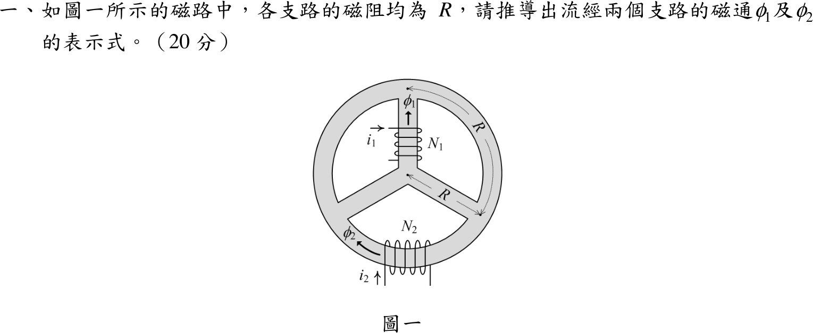
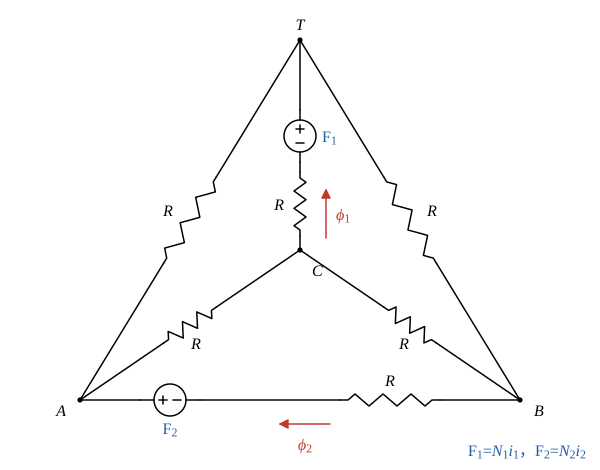

# 104 年電機機械第 1 題｜磁路磁通推導

## 已知與所求

圖一為外環加 Y 形三輻條的鐵心：中心節點 \(C\)，環上三點 \(T\)（上）、\(B\)（右下）、\(A\)（左下）。\(N_1\) 線圈在上輻條 \(C\!-\!T\)（電流 \(i_1\)，磁通 \(\phi_1\) 向上），\(N_2\) 線圈在下方圓弧 \(B\!-\!A\)（電流 \(i_2\)，磁通 \(\phi_2\) 自 \(B\) 向 \(A\)）。題目說各支路磁阻均為 \(R\)。求 \(\phi_1,\phi_2\) 的表示式。磁動勢 \(\mathcal F_1=N_1i_1\)、\(\mathcal F_2=N_2i_2\)，由圖示繞向，正向與 \(\phi\) 一致。

## 考場標準作答

### 步驟 1：磁阻網路

設鐵心線性（磁阻固定、不飽和）、漏磁忽略；依圖示繞向（右手定則），\(\mathcal F_1=N_1i_1\) 推動磁通沿 \(\phi_1\) 參考方向（\(C\to T\)），\(\mathcal F_2=N_2i_2\) 沿 \(\phi_2\) 參考方向（\(B\to A\)）。

- 節點：中心 \(C\)、環上 \(T\)（上）、\(B\)（右下）、\(A\)（左下）；六段支路（三輻條 \(CT,CB,CA\)，三段圓弧 \(TB,BA,AT\)）磁阻皆為 \(R\)，四個節點兩兩相連。圓弧在圖上畫成直線，不影響拓樸。
- 支路 \(CT\)：\(\mathcal F_1\) 串 \(R\)，\(\phi_1\) 參考方向 \(C\to T\)；支路 \(BA\)：\(\mathcal F_2\) 串 \(R\)，\(\phi_2\) 參考方向 \(B\to A\)；其餘四段只有 \(R\)。
- 以 \(U\) 表示節點磁位；支路磁通＝（起點磁位－終點磁位＋該支路磁動勢）／\(R\)。

### 步驟 2：只有 \(\mathcal F_1\) 作用

令 \(\mathcal F_2=0\)（\(BA\) 支路只剩 \(R\)）。\(B\)、\(A\) 都各以 \(R\) 接到 \(C\) 與 \(T\)，互換 \(B\)、\(A\) 網路不變，所以兩點磁位相等：
\[
U_B=U_A
\]
\(BA\) 支路磁通（電橋平衡）：
\[
\phi_2'=\frac{U_B-U_A}{R}=0
\]
\(BA\) 支路無磁通，可拿掉。磁通由 \(T\) 經兩條路徑回到 \(C\)，各為兩段串聯：
\[
R_{TBC}=R+R=2R,\qquad R_{TAC}=R+R=2R
\]
兩路徑並聯：
\[
R_{TC}=\frac{(2R)(2R)}{2R+2R}=R
\]
迴路總磁阻＝源支路 \(R\)＋外部 \(R_{TC}\)：
\[
R_{tot}=R+R=2R
\]
源支路磁通：
\[
\phi_1'=\frac{\mathcal F_1}{R_{tot}}=\frac{\mathcal F_1}{2R}
\]

### 步驟 3：只有 \(\mathcal F_2\) 作用

令 \(\mathcal F_1=0\)（\(CT\) 支路只剩 \(R\)）。\(C\)、\(T\) 都各以 \(R\) 接到 \(B\) 與 \(A\)，互換 \(C\)、\(T\) 網路不變：
\[
U_C=U_T
\]
\(CT\) 支路磁通：
\[
\phi_1''=\frac{U_C-U_T}{R}=0
\]
磁通由 \(A\) 經 \(A\!-\!C\!-\!B\)、\(A\!-\!T\!-\!B\) 兩條 \(2R\) 路徑回到 \(B\)，並聯為：
\[
R_{AB}=\frac{(2R)(2R)}{2R+2R}=R
\]
\[
R_{tot}=R+R=2R
\]
\[
\phi_2''=\frac{\mathcal F_2}{R_{tot}}=\frac{\mathcal F_2}{2R}
\]

### 求 \(\phi_1\)、\(\phi_2\)（20 分）

磁路線性，由疊加定理，同一支路磁通為兩磁動勢各自單獨作用時該支路磁通的代數和（參考方向相同）：

\[
\phi_1=\phi_1'+\phi_1''=\frac{\mathcal F_1}{2R}+0
\]
\[
\boxed{\phi_1=\frac{N_1i_1}{2R}}
\]
\[
\phi_2=\phi_2'+\phi_2''=0+\frac{\mathcal F_2}{2R}
\]
\[
\boxed{\phi_2=\frac{N_2i_2}{2R}}
\]
兩線圈的磁動勢互不影響對方支路的磁通（\(CT\) 與 \(BA\) 是不相鄰的兩支路，互為對方的平衡電橋對角）。

## 驗算

節點磁位法（兩源同時作用，\(U_C=0\)）：解 \(T,B,A\) 三節點磁通連續得 \(U_T=\tfrac{\mathcal F_1}{2}\)、\(U_B=\tfrac{\mathcal F_1-\mathcal F_2}{4}\)、\(U_A=\tfrac{\mathcal F_1+\mathcal F_2}{4}\)。\(\phi_1=(\mathcal F_1+U_C-U_T)/R=\mathcal F_1/2R\)、\(\phi_2=(\mathcal F_2+U_B-U_A)/R=\mathcal F_2/2R\)。節點 \(T\) 磁通連續：\(\phi_{TB}+\phi_{TA}=\tfrac{\mathcal F_1+\mathcal F_2}{4R}+\tfrac{\mathcal F_1-\mathcal F_2}{4R}=\tfrac{\mathcal F_1}{2R}=\phi_1\)。數值（\(\mathcal F_1=3,\ \mathcal F_2=5,\ R=1\)）直接聯立得 \(\phi_1=1.50,\ \phi_2=2.50\)，與公式一致。

## 失分點

- 只列單一迴路（如 \(\mathcal F_1\) 經一條外環）會漏掉並聯路徑，答成 \(\phi_1=\mathcal F_1/3R\)；必須每個節點磁通連續。
- 極性：依右手定則，\(i_1\) 由上方引線向右、在上輻條前方繞過，磁動勢向上，與 \(\phi_1\) 同向；\(i_2\) 由左側引線向上、在下弧前方繞過，磁動勢向左（\(B\to A\)），與 \(\phi_2\) 同向，故兩式皆取正號。
- 疊加只能把同一支路的磁通相加；不可把另一線圈的磁動勢直接加到本支路的磁通式中。
