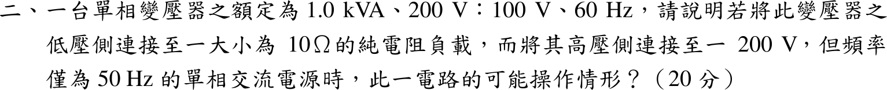
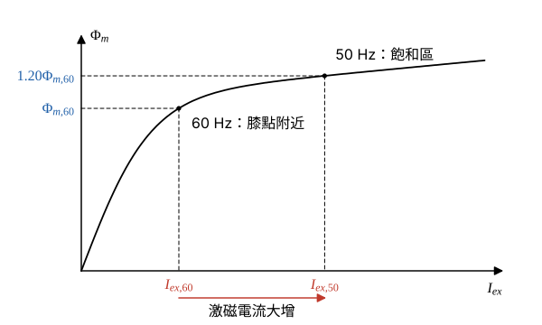

# 104 年電機機械第 2 題｜60 Hz 變壓器接 50 Hz 電源

## 已知與所求

單相變壓器額定 \(1.0\ \mathrm{kVA}\)、\(200\ \mathrm V:100\ \mathrm V\)、\(60\ \mathrm{Hz}\)；低壓側接 \(10\ \Omega\) 純電阻，高壓側接 \(200\ \mathrm V\)、\(50\ \mathrm{Hz}\) 電源。說明可能的操作情形。

## 考場標準作答

**解題邏輯**：「操作情形」從三件事判斷：（1）鐵心磁通由伏赫比決定（\(V_1\approx4.44fN_1\Phi_m\)），頻率降低而電壓不變，磁通上升、鐵心趨於飽和；（2）負載電流由匝比與負載電阻決定，再與額定電流比較；（3）鐵損與漏抗隨 \(f\)、\(B_m\) 改變。最後綜合溫升判斷能否長期運轉，並提出維持額定伏赫比的改善。前提：漏阻抗壓降忽略（\(V_1\approx E_1\)，二次電壓＝\(V_1/a\)），匝比不隨頻率改變。

### 步驟 1：匝比與額定電流

\[
a=\frac{V_{1,rated}}{V_{2,rated}}=\frac{200}{100}=2
\]
\[
I_{1,rated}=\frac{S}{V_{1,rated}}=\frac{1000}{200}=5\ \mathrm A,\qquad
I_{2,rated}=\frac{S}{V_{2,rated}}=\frac{1000}{100}=10\ \mathrm A
\]

### 可能的操作情形（20 分）

**邏輯**：匝數 \(N_1\) 固定，\(\Phi_m=V_1/(4.44fN_1)\propto V_1/f\)，所以先比較兩種頻率的伏赫比得磁通倍數；負載電流與頻率無關，只由 \(V_1/a\) 與 \(10\ \Omega\) 決定；最後用 \(P_e\propto f^2B_m^2\)、\(P_h\propto fB_m^n\)、\(X\propto f\) 判斷損耗與漏抗。

**（1）鐵心磁通**

\[
\Phi_m=\frac{V_1}{4.44fN_1}\ \propto\ \frac{V_1}{f}
\]
額定（60 Hz）與實際（50 Hz）的伏赫比：
\[
\left.\frac{V_1}{f}\right|_{60}=\frac{200}{60}=3.333\ \mathrm{V/Hz},\qquad
\left.\frac{V_1}{f}\right|_{50}=\frac{200}{50}=4\ \mathrm{V/Hz}
\]
兩者相除（\(V_1\) 相同，只剩頻率比）：
\[
\frac{\Phi_{m,50}}{\Phi_{m,60}}=\frac{200/50}{200/60}=\frac{60}{50}
\]
\[
\boxed{\frac{\Phi_{m,50}}{\Phi_{m,60}}=1.20}
\]
額定伏赫比的工作點設計在磁化曲線膝點附近；磁通升為 1.20 倍即進入飽和區（圖 1），激磁電流 \(I_{ex}\) 的增加遠大於 20%，且波形變成含三次等奇次諧波的尖峰波；確切倍數須由磁化曲線決定（題目未給）。

**（2）負載電流**

二次電壓（漏阻抗壓降忽略）：
\[
V_2=\frac{V_1}{a}=\frac{200}{2}=100\ \mathrm V
\]
負載電流：
\[
I_2=\frac{V_2}{R_L}=\frac{100}{10}
\]
\[
\boxed{I_2=10.00\ \mathrm A}
\]
等於步驟 1 的 \(I_{2,rated}=10\ \mathrm A\)。一次側負載分量：
\[
I_1'=\frac{I_2}{a}=\frac{10}{2}=5\ \mathrm A=I_{1,rated}
\]
負載功率：
\[
P_L=V_2I_2=100(10)=1000\ \mathrm W=S
\]
繞組電流已達額定（銅損達額定值），一次側再疊加飽和後變大的激磁電流，總電流與銅損超過額定。

**（3）鐵損與漏抗**

頻率比 \(f_{50}/f_{60}=50/60=5/6\)，磁通密度比 \(B_{m,50}/B_{m,60}=6/5\)。

渦流損 \(P_e\propto f^2B_m^2\)：
\[
\frac{P_{e,50}}{P_{e,60}}=\left(\frac56\right)^2\left(\frac65\right)^2=1
\]
磁滯損 \(P_h\propto fB_m^{n}\)（史坦麥茲指數 \(n\approx1.6\text{–}2\)）：
\[
\frac{P_{h,50}}{P_{h,60}}=\frac56(1.2)^n
\]
\(n=1.6\)：
\[
\frac56(1.2)^{1.6}=0.8333(1.339)=1.116
\]
\(n=2\)：
\[
\frac56(1.2)^{2}=\frac56(1.44)=1.20
\]
鐵損上升約 12%–20%（渦流損不變、磁滯損上升）。漏抗 \(X=2\pi fL_\ell\propto f\)：
\[
\frac{X_{50}}{X_{60}}=\frac{50}{60}=0.8333
\]
漏抗略減，電壓調整率略小，影響不大。

**（4）結論與改善**

可以運轉並供出約 10 A、1 kW，但鐵心飽和、激磁電流與鐵損增加，加上繞組已滿載，溫升將超過設計值，不宜長時間滿載運轉。長期使用應把電源電壓降到維持額定伏赫比：
\[
V_1'=V_{1,rated}\frac{f_{50}}{f_{60}}=200\times\frac{50}{60}
\]
\[
\boxed{V_1'=166.67\ \mathrm V}
\]
此時二次電壓與負載功率（用精確分數避免進位誤差）：
\[
V_2'=\frac{V_1'}{a}=\frac{500/3}{2}=\frac{250}{3}=83.33\ \mathrm V
\]
\[
P_L'=\frac{V_2'^2}{R_L}=\frac{(250/3)^2}{10}=\frac{62\,500}{90}=694.44\ \mathrm W
\]
或依製造商資料降額使用。

## 驗算

一次側反射電阻 \(a^2R_L=2^2(10)=40\ \Omega\)，\(I_1'=200/40=5\ \mathrm A\)，\(200(5)=100(10)=1000\ \mathrm W\)，與二次側計算一致。伏赫比改善後 \(V_1'/f=166.67/50=3.333\ \mathrm{V/Hz}\)，回到額定值。

## 失分點

- 只看 \(I_2=10\ \mathrm A\) 等於額定就判定「正常滿載」，忽略磁通升為 1.20 倍造成的飽和與激磁電流大增。
- 以 \(P_e\propto f^2\) 推論渦流損降為 \(\tfrac{25}{36}=0.6944\) 倍；\(B_m\) 同時升為 1.2 倍，電壓不變時渦流損實際不變。
- 誤以為頻率降低磁通也降低（把 \(\Phi\propto V/f\) 寫成 \(\Phi\propto Vf\)）。
