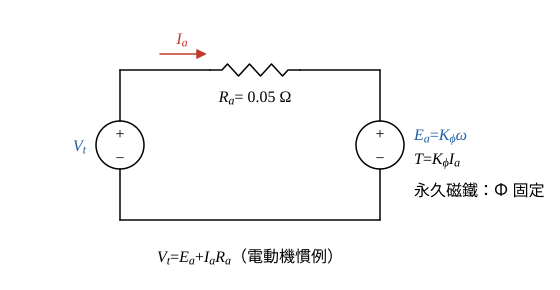

# 104 年電機機械第 3 題｜永磁直流電動機

## 已知與所求

永磁直流電動機額定 3.0 V，\(R_a=0.05\ \Omega\)，摩擦等機械損忽略，負載轉矩固定。(\(V_t,I_a\))=(3.0 V, 2.0 A) 時 600 rpm。求（一）輸出功率；電壓升至 3.1 V、轉矩不變、轉速「升至 612 rpm」時，求（二）電樞電流；（三）整體效率。

## 考場標準作答

**解題邏輯**：永磁電動機的磁通 \(\Phi\) 由磁鐵固定，所以 \(E_a=K_\phi\omega\)、\(T=K_\phi I_a\)，\(K_\phi\) 為常數，電樞迴路 KVL 為 \(V_t=E_a+I_aR_a\)；三小題合計 20 分（官方未分配各小題配分）。前提：題目同時給「轉矩不變」與「612 rpm」，兩者互相矛盾（見條件與疑義），本解以物理條件「轉矩不變」為準。
1. （一）先由 KVL 求反電勢，機械損忽略，輸出功率＝電磁功率 \(E_aI_a\)。
2. （二）負載轉矩不變且無機械損，電磁轉矩不變，\(T=K_\phi I_a\) 直接決定 \(I_a\)。
3. （三）再由 KVL 求新反電勢，效率＝\(E_aI_a/(V_tI_a)\)。

### 步驟 1：電樞等效電路與兩個工作點

- 電樞迴路：端電壓 \(V_t\) 經 \(R_a=0.05\ \Omega\) 接反電勢 \(E_a\)；無場繞組，\(\Phi\) 固定。
- 參考方向（電動機慣例）：\(I_a\) 由 \(V_t\) 正端流出、流入 \(E_a\) 正端。
- 工作點 1：\(V_{t1}=3.0\ \mathrm V\)、\(I_{a1}=2.0\ \mathrm A\)、\(n_1=600\ \mathrm{rpm}\)；工作點 2：\(V_{t2}=3.1\ \mathrm V\)、轉矩與工作點 1 相同。

### （一）輸出功率

**邏輯**：沿圖 1 寫 KVL 求 \(E_{a1}\)；電能在反電勢處轉成機械能，機械損忽略，所以軸輸出功率＝電磁功率 \(E_{a1}I_{a1}\)。

\[
E_{a1}=V_{t1}-I_{a1}R_a=3.0-2.0(0.05)=3.0-0.10=2.90\ \mathrm V
\]
\[
P_{out}=E_{a1}I_{a1}=2.90(2.0)=5.80\ \mathrm W
\]
\[
\boxed{P_{out}=5.80\ \mathrm W}
\]

### （二）電樞電流

**邏輯**：負載轉矩固定、機械損忽略，穩態電磁轉矩＝負載轉矩，前後相等；永磁 \(K_\phi\) 不變，\(T=K_\phi I_a\) 使電流只由轉矩決定，與端電壓、轉速無關。

工作點 1 的角速度：
\[
\omega_1=\frac{2\pi n_1}{60}=\frac{2\pi(600)}{60}=62.83\ \mathrm{rad/s}
\]
機械常數：
\[
K_\phi=\frac{E_{a1}}{\omega_1}=\frac{2.90}{62.83}=0.04616\ \mathrm{V\cdot s/rad}
\]
工作點 1 的電磁轉矩：
\[
T_1=K_\phi I_{a1}=0.04616(2.0)=0.09232\ \mathrm{N\cdot m}
\]
轉矩不變（\(T_2=T_1\)），代入 \(T=K_\phi I_a\) 解電流：
\[
I_{a2}=\frac{T_2}{K_\phi}=\frac{0.09232}{0.04616}=2.000\ \mathrm A
\]
\[
\boxed{I_{a2}=2.00\ \mathrm A}
\]

### （三）整體效率

**邏輯**：效率＝輸出／輸入。輸入是電源端功率 \(V_{t2}I_{a2}\)（含電樞銅損）；輸出因機械損忽略而等於 \(E_{a2}I_{a2}\)，所以先由 KVL 求新反電勢。

\[
E_{a2}=V_{t2}-I_{a2}R_a=3.1-2.00(0.05)=3.1-0.10=3.00\ \mathrm V
\]
輸入功率：
\[
P_{in}=V_{t2}I_{a2}=3.1(2.00)=6.20\ \mathrm W
\]
輸出功率：
\[
P_{out,2}=E_{a2}I_{a2}=3.00(2.00)=6.00\ \mathrm W
\]
\[
\eta=\frac{P_{out,2}}{P_{in}}\times100\%=\frac{6.00}{6.20}\times100\%
\]
\[
\boxed{\eta=96.77\%}
\]

## 驗算

銅損平衡：\(I_{a2}^2R_a=2.00^2(0.05)=0.20\ \mathrm W\)，\(P_{out,2}+I_{a2}^2R_a=6.00+0.20=6.20\ \mathrm W=P_{in}\)。轉速檢查：\(n_2=n_1E_{a2}/E_{a1}=600(3.00/2.90)=620.69\ \mathrm{rpm}\)，與題給 612 rpm 不同（題幹矛盾，見下節）。

## 失分點

- 由 \(T\) 固定直接得 \(I_a\) 不變，不可由 612 rpm 反推電流（與轉矩不變矛盾，見條件與疑義）。
- 效率為 \(P_{out}/P_{in}\)，輸入功率 \(V_tI_a\) 含銅損 0.20 W，不是 \(E_aI_a\)。
- 輸出功率用 \(V_tI_a=6.00\ \mathrm W\)（工作點 1）是把銅損算進輸出；應為 \(E_aI_a=5.80\ \mathrm W\)。

## 條件與疑義

題幹給的 612 rpm 與「轉矩不變且無機械損」互不相容：\(I_a=2\ \mathrm A\) 時 \(E_{a2}=3.00\ \mathrm V\)，\(n_2=600(3.00/2.90)=620.69\ \mathrm{rpm}\)。本解依「轉矩不變」取 \(I_a=2.0\ \mathrm A\)、\(\eta=96.77\%\)。若改以 612 rpm 為準（\(E_{a2}=2.90(612/600)=2.958\ \mathrm V\)），則 \(I_a=\left(3.1-2.90\tfrac{612}{600}\right)/0.05=2.84\ \mathrm A\)、\(\eta=2.90\tfrac{612}{600}/3.1=95.42\%\)，但此時轉矩已增加，與題設衝突。
