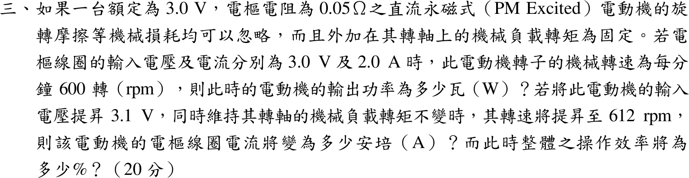

# 104 年電機機械第 3 題｜永磁直流電動機

## 已知與所求

永磁直流電動機額定 3.0 V，\(R_a=0.05\ \Omega\)，摩擦等機械損忽略，負載轉矩固定。(\(V_t,I_a\))=(3.0 V, 2.0 A) 時 600 rpm。求（一）輸出功率；電壓升至 3.1 V、轉矩不變、轉速「升至 612 rpm」時，求（二）電樞電流；（三）整體效率。

## 考場標準作答

### （一）輸出功率

永磁電動機的電樞迴路滿足 KVL：\(V_t=E_a+I_aR_a\)，磁通由永久磁鐵提供而固定。先求反電勢，再因機械損忽略，輸出功率等於電磁功率 \(E_aI_a\)：
\[
E_{a1}=V_t-I_aR_a=3.0-2.0(0.05)=2.90\ \mathrm V
\]
\[
\boxed{P_{out}=E_{a1}I_a=2.90(2.0)=5.80\ \mathrm W}
\]

### （二）電樞電流

永磁磁通 \(\Phi\) 固定，電磁轉矩 \(T=K_\phi I_a\)，其中 \(K_\phi\) 為常數；機械負載轉矩固定且機械損忽略，所以新、舊兩個穩態的電磁轉矩相等，電樞電流只由轉矩決定，與端電壓和轉速無關。先由（一）的工作點求出 \(K_\phi\) 與轉矩：
\[
\omega_1=\frac{2\pi(600)}{60}=62.83\ \mathrm{rad/s},\qquad
K_\phi=\frac{E_{a1}}{\omega_1}=\frac{2.90}{62.83}=4.62\times10^{-2}\ \mathrm{V\cdot s/rad}
\]
\[
T_1=K_\phi I_{a1}=4.62\times10^{-2}(2.0)=9.23\times10^{-2}\ \mathrm{N\cdot m}
\]
轉矩不變，\(T_2=T_1\)，代入 \(T=K_\phi I_a\) 解電流：
\[
I_{a2}=\frac{T_2}{K_\phi}=\frac{9.23\times10^{-2}}{4.62\times10^{-2}}\ \Rightarrow\ \boxed{I_{a2}=2.00\ \mathrm A}
\]

### （三）效率

整體效率為輸出功率與輸入功率之比；輸入功率取電源端 \(V_{t2}I_{a2}\)（含電樞銅損），輸出功率因機械損忽略而等於 \(E_{a2}I_{a2}\)。先由 KVL 求新的反電勢：
\[
E_{a2}=V_{t2}-I_{a2}R_a=3.1-2.00(0.05)=3.00\ \mathrm V
\]
\[
P_{in}=V_{t2}I_{a2}=3.1(2.00)=6.20\ \mathrm W,\qquad P_{out}=E_{a2}I_{a2}=3.00(2.00)=6.00\ \mathrm W
\]
\[
\boxed{\eta=\frac{P_{out}}{P_{in}}=\frac{6.00}{6.20}=96.77\%}
\]

## 驗算

銅損平衡：\(P_{in}=3.1(2.00)=6.20\ \mathrm W=P_{out}+I_a^2R_a=6.00+0.20\ \mathrm W\)。

## 失分點

- 由 \(T\) 固定直接得 \(I_a\) 不變，不可由 612 rpm 反推電流（與轉矩不變矛盾，見條件與疑義）。
- 效率為 \(P_{out}/P_{in}\)，輸入功率 \(V_tI_a\) 含銅損 0.2 W，不是 \(E_aI_a\)。

## 條件與疑義

題幹給的 612 rpm 與「轉矩不變且無機械損」互不相容：\(I_a=2\ \mathrm A\) 時 \(E_{a2}=3.00\ \mathrm V\)，\(n_2=600(3.00/2.90)=620.7\ \mathrm{rpm}\)。本解依「轉矩不變」取 \(I_a=2.0\ \mathrm A\)、\(\eta=96.77\%\)。若改以 612 rpm 為準（\(E_{a2}=2.958\ \mathrm V\)），則 \(I_a=(3.1-2.958)/0.05=2.84\ \mathrm A\)、\(\eta=2.958/3.1=95.42\%\)，但此時轉矩已增加，與題設衝突。
