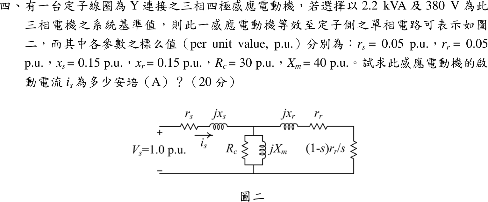
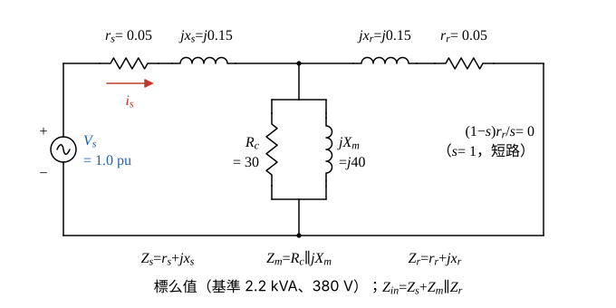

# 104 年電機機械第 4 題｜感應電動機起動電流

## 已知與所求

Y 接三相四極感應電動機，系統基準 \(S_b=2.2\ \mathrm{kVA}\)、\(V_b=380\ \mathrm V\)；標么值 \(r_s=r_r=0.05\)、\(x_s=x_r=0.15\)、\(R_c=30\)、\(X_m=40\)，\(V_s=1.0\ \mathrm{pu}\)。求起動電流 \(i_s\)（A）。

## 考場標準作答

**解題邏輯**：起動瞬間轉子靜止，轉差率 \(s=1\)，代表機械負載的電阻 $(1-s)r_r/s$ 變為 0（短路），但轉子支路仍有串聯的 \(r_r+jx_r\)。依圖二，激磁支路 \(R_c\parallel jX_m\) 接在定子阻抗之後，所以輸入阻抗 \(Z_{in}=Z_s+(Z_m\parallel Z_r)\)；標么起動電流 \(i_{s,pu}=V_s/|Z_{in}|\)，再乘電流基準值 \(I_b\) 換成安培。前提：基準 2.2 kVA 為三相容量、380 V 為線電壓，定子 Y 接，相電流＝線電流，故 \(I_b=S_b/(\sqrt3V_b)\)。

### 步驟 1：起動時的等效電路與各支路阻抗

- \(s=1\)：$(1-s)r_r/s=0$，負載電阻以短路線代替；\(r_r\) 仍與 \(jx_r\) 串聯。
- 參考方向：\(i_s\) 由電源正端流入定子支路。

定子阻抗：
\[
Z_s=r_s+jx_s=0.05+j0.15\ \mathrm{pu}
\]
轉子支路（\(s=1\)）：
\[
Z_r=r_r+jx_r+\frac{(1-s)r_r}{s}=0.05+j0.15+0=0.05+j0.15\ \mathrm{pu}
\]
激磁支路（並聯）：
\[
Z_m=\frac{R_c(jX_m)}{R_c+jX_m}=\frac{30(j40)}{30+j40}=\frac{j1200}{30+j40}
\]
分子分母同乘 \(30-j40\)（分母 \(30^2+40^2=2500\)）：
\[
Z_m=\frac{j1200(30-j40)}{2500}=\frac{48\,000+j36\,000}{2500}=19.20+j14.40\ \mathrm{pu}
\]

### 步驟 2：轉子與激磁支路並聯

\[
Z_p=Z_r\parallel Z_m=\frac{Z_rZ_m}{Z_r+Z_m}
\]
分子（\(j\cdot j=-1\)）：
\[
Z_rZ_m=(0.05+j0.15)(19.20+j14.40)=0.96+j0.72+j2.88-2.16=-1.20+j3.60
\]
分母：
\[
Z_r+Z_m=(0.05+19.20)+j(0.15+14.40)=19.25+j14.55
\]
分子分母同乘分母共軛 \(19.25-j14.55\)。新分母：
\[
19.25^2+14.55^2=370.5625+211.7025=582.265
\]
新分子：
\[
(-1.20+j3.60)(19.25-j14.55)=-23.10+j17.46+j69.30+52.38=29.28+j86.76
\]
\[
Z_p=\frac{29.28}{582.265}+j\frac{86.76}{582.265}=0.05029+j0.1490\ \mathrm{pu}
\]

### 起動電流 \(i_s\)（20 分）

**邏輯**：定子阻抗與並聯組 \(Z_p\) 串聯即輸入阻抗；\(V_s=1.0\ \mathrm{pu}\) 除以 \(|Z_{in}|\) 得標么電流；標么值乘電流基準（Y 接線電流）才是安培。

輸入阻抗：
\[
Z_{in}=Z_s+Z_p=(0.05+0.05029)+j(0.15+0.1490)=0.1003+j0.2990\ \mathrm{pu}
\]
大小：
\[
|Z_{in}|=\sqrt{0.1003^2+0.2990^2}=\sqrt{0.01006+0.08940}=\sqrt{0.09946}=0.3154\ \mathrm{pu}
\]
角度：
\[
\angle Z_{in}=\tan^{-1}\frac{0.2990}{0.1003}=71.46^\circ
\]
標么起動電流（大小與相角）：
\[
i_{s,pu}=\frac{V_s}{|Z_{in}|}=\frac{1.0}{0.3154}=3.171\ \mathrm{pu},\qquad \angle i_s=0^\circ-71.46^\circ=-71.46^\circ
\]
電流基準值（三相 \(S_b\)、線電壓 \(V_b\)、Y 接）：
\[
I_b=\frac{S_b}{\sqrt3V_b}=\frac{2200}{\sqrt3(380)}=\frac{2200}{658.18}=3.343\ \mathrm A
\]
換成安培：
\[
i_s=i_{s,pu}I_b=3.171(3.343)
\]
\[
\boxed{i_s=10.60\ \mathrm A}
\]

## 驗算

網目法（不經 \(Z_{in}\)）：以 \(V_s=1\) 對兩網目列方程，\(\begin{bmatrix}Z_s+Z_m&-Z_m\\-Z_m&Z_m+Z_r\end{bmatrix}\begin{bmatrix}I_1\\I_2\end{bmatrix}=\begin{bmatrix}1\\0\end{bmatrix}\)，解得 \(I_1=3.171\angle-71.46^\circ\ \mathrm{pu}\)、\(|I_2|=3.154\ \mathrm{pu}\)，與上面一致。功率平衡：\(\mathrm{Re}(V_sI_1^*)=1.008\ \mathrm{pu}\)，等於 \(|I_1|^2r_s+|I_2|^2r_r+|V_p|^2/R_c=0.5027+0.4973+0.0083=1.008\ \mathrm{pu}\)（\(V_p=Z_m(I_1-I_2)\)，\(|V_p|=0.4986\ \mathrm{pu}\)；各項以完整精度計算）。

## 失分點

- 起動時只有 $(1-s)r_r/s$ 為零，串聯的 \(r_r\) 不能省；寫成 \(Z_r=jx_r\) 會得約 11 A，偏高。
- Y 接線電流為 \(I_b=S_b/(\sqrt3V_b)\)，不是 \(S_b/V_b\)（否則 \(I_b=5.789\ \mathrm A\)，答案大 \(\sqrt3\) 倍）。
- 直接略去激磁支路（近似法）得 \(1/|0.10+j0.30|=3.162\ \mathrm{pu}\)、10.57 A，比正解低 0.03 A；題目已給 \(R_c\)、\(X_m\)，應完整並聯計算。
