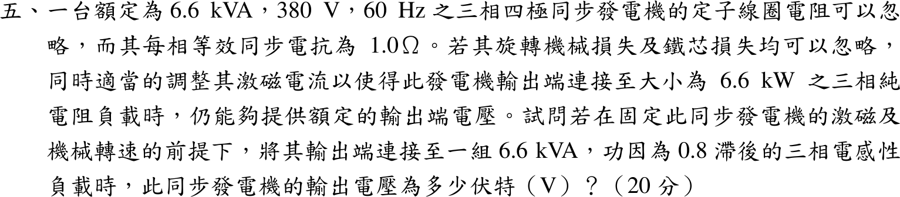
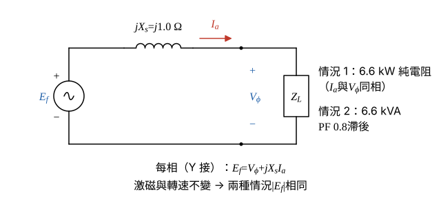
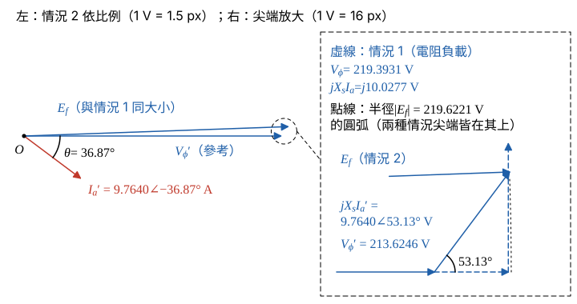

# 104 年電機機械第 5 題｜固定激磁下的端電壓

## 已知與所求

三相四極同步發電機：6.6 kVA、380 V、60 Hz，\(R_a\approx0\)、\(X_s=1.0\ \Omega\)/相，機械與鐵損忽略。先調激磁使 6.6 kW 三相純電阻負載下端電壓為額定 380 V；之後激磁與轉速不變，改接 6.6 kVA、功因 0.8 滯後的電感性負載。求此時輸出（線）電壓。

## 考場標準作答

### 步驟 1：每相等效電路

設 \(R_a\approx0\)、機械損與鐵損忽略，情況 1 的 6.6 kW 全由電樞電流以單位功因供給；以 Y 接每相分析（負載若為 Δ 接，換成等值 Y 後結果相同）。情況 2 的負載取「額定 380 V 下吸收 6.6 kVA、PF 0.8 滯後」的定阻抗（其他讀法見條件與疑義）。\(|E_f|\) 與端電壓只差約 0.1%，計算保留 4 位小數。

- 每相：內電勢 \(\underline E_f\) 串聯 \(jX_s=j1.0\ \Omega\)（\(R_a\approx0\)）接到端點，端點接每相負載 \(\underline Z_L\)。
- 參考方向：\(\underline I_a\) 由發電機流向負載；每種情況各以自己的端電壓為相位參考 \(0^\circ\)。

### 步驟 2：由情況 1（純電阻、額定電壓）求 \(|E_f|\)

每相端電壓（Y 接）：
\[
V_\phi=\frac{V_L}{\sqrt3}=\frac{380}{\sqrt3}=219.3931\ \mathrm V
\]
電樞電流（純電阻，功因角 \(\theta=0^\circ\)、\(\cos\theta=1\)，\(P=\sqrt3V_LI_a\)）：
\[
I_a=\frac{P}{\sqrt3V_L}=\frac{6600}{\sqrt3(380)}=10.0277\ \mathrm A
\]
電流與 \(\underline V_\phi\) 同相，\(jX_s\underline I_a\) 超前 \(90^\circ\)，與 \(\underline V_\phi\) 垂直：
\[
\underline E_f=V_\phi+jX_sI_a=219.3931+j(1.0)(10.0277)=219.3931+j10.0277\ \mathrm V
\]
大小（直角三角形）：
\[
|E_f|=\sqrt{219.3931^2+10.0277^2}=\sqrt{48\,133.33+100.5548}=\sqrt{48\,233.89}=219.6221\ \mathrm V
\]

### 改接 0.8 滯後負載時的輸出電壓（20 分）

激磁與轉速不變，故 \(|E_f|=219.6221\ \mathrm V\) 不變；負載為定阻抗 \(\underline Z_L\)，\(|E_f|\) 加在 \(jX_s+\underline Z_L\) 串聯迴路上。

每相負載阻抗大小（380 V 下 6.6 kVA，每相 \(Z=V_\phi^2/(S/3)=V_L^2/S\)）：
\[
|Z_L|=\frac{V_L^2}{S}=\frac{380^2}{6600}=\frac{144\,400}{6600}=21.8788\ \Omega
\]
PF 0.8 滯後，阻抗角 \(\theta=\cos^{-1}0.8=36.87^\circ\)（\(\cos\theta=0.8\)、\(\sin\theta=0.6\)）：
\[
R_L=|Z_L|\cos\theta=21.8788(0.8)=17.5030\ \Omega,\qquad X_L=|Z_L|\sin\theta=21.8788(0.6)=13.1273\ \Omega
\]
串聯總阻抗：
\[
\underline Z_L+jX_s=17.5030+j(13.1273+1.0)=17.5030+j14.1273\ \Omega
\]
大小：
\[
|\underline Z_L+jX_s|=\sqrt{17.5030^2+14.1273^2}=\sqrt{306.3550+199.5806}=\sqrt{505.9356}=22.4930\ \Omega
\]
角度（即 \(\underline I_a'\) 落後 \(\underline E_f\) 的角度；求端電壓只用到大小）：
\[
\angle(\underline Z_L+jX_s)=\tan^{-1}\frac{14.1273}{17.5030}=38.91^\circ
\]
電樞電流大小：
\[
I_a'=\frac{|E_f|}{|\underline Z_L+jX_s|}=\frac{219.6221}{22.4930}=9.7640\ \mathrm A
\]
新端電壓（每相）：
\[
V_\phi'=I_a'|Z_L|=9.7640(21.8788)=213.6246\ \mathrm V
\]
以 \(\underline V_\phi'\) 為參考，\(\underline I_a'=9.7640\angle-36.87^\circ\ \mathrm A\)，同步電抗壓降（相角 \(-36.87^\circ+90^\circ=53.13^\circ\)）：
\[
jX_s\underline I_a'=(1.0\angle90^\circ)(9.7640\angle-36.87^\circ)=9.7640\angle53.13^\circ\ \mathrm V
\]

相量圖畫法（圖 2）：

- \(\underline V_\phi'=213.6246\angle0^\circ\) 沿水平軸；\(\underline I_a'\) 在水平軸下方 \(36.87^\circ\)。
- 自 \(\underline V_\phi'\) 尖端畫 \(jX_s\underline I_a'\)（與水平軸夾 \(53.13^\circ\)），原點連到其尖端即 \(\underline E_f\)。
- 尖端放大：情況 1（虛線）的 \(V_\phi=219.3931\) 加垂直的 \(j10.0277\)，情況 2 的 \(213.6246\) 加斜向的 \(9.7640\angle53.13^\circ\)，兩個尖端都落在半徑 \(|E_f|=219.6221\ \mathrm V\) 的圓弧上；滯後電流的壓降有一大段與端電壓同向，所以端電壓必須變小。

輸出（線）電壓（Y 接乘 \(\sqrt3\)）：
\[
V_L'=\sqrt3\,V_\phi'=\sqrt3(213.6246)=370.0087\ \mathrm V
\]
\[
\boxed{V_L'=370.01\ \mathrm V}
\]

## 驗算

回代 KVL：\(jX_s\underline I_a'=9.7640(0.6)+j9.7640(0.8)=5.8584+j7.8112\ \mathrm V\)，\(\underline V_\phi'+jX_s\underline I_a'=(213.6246+5.8584)+j7.8112=219.4830+j7.8112\ \mathrm V\)，大小 \(\sqrt{219.4830^2+7.8112^2}=219.6220\ \mathrm V\approx|E_f|\)（末位差為四捨五入）。

## 失分點

- 滯後負載使電樞反應去磁，端電壓低於額定；若沿用情況 1 的 \(I_a\) 與 \(V_\phi\) 同相，會得 380 V。
- \(|E_f|\) 由「純電阻、額定電壓」的情況 1 得出，不是由 0.8 滯後條件以 380 V 反推（那會得到錯誤的 \(|E_f|=225.55\ \mathrm V\)）。
- 把 \(jX_s\underline I_a'\) 與 \(\underline V_\phi'\) 當同相代數相減：\(219.6221-9.7640=209.8581\ \mathrm V\)，線電壓誤為 363.48 V；兩者夾 \(53.13^\circ\)，必須用相量（或串聯分壓）計算。

## 條件與疑義

「6.6 kVA 0.8 滯後負載」可有三種讀法，皆與 370 V 差 0.2% 以內：恆定阻抗（上式）370.01 V；負載恆定取 6.6 kVA（電流隨電壓 \(I=6600/3V_\phi\) 變化）369.41 V；電流固定為額定 10.03 A 369.72 V。
