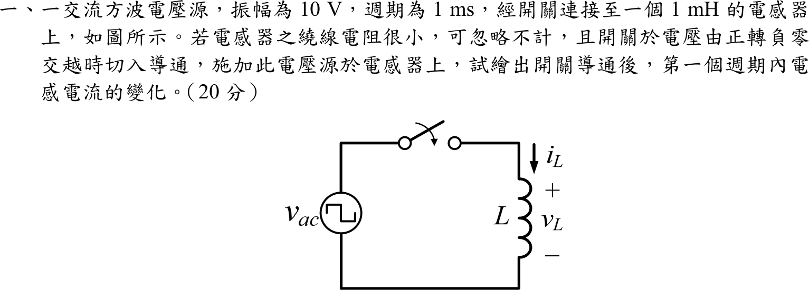
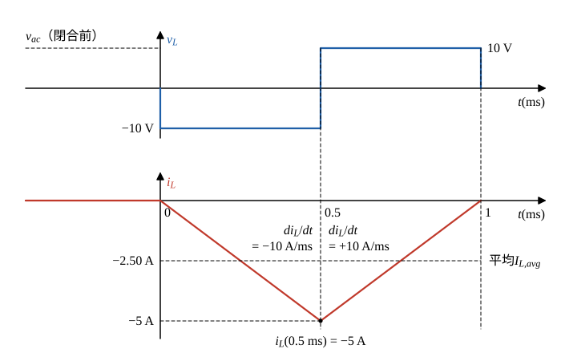

# 105 年電機機械第 1 題｜方波電壓施於電感

## 已知與所求

方波電壓源振幅 \(\pm10\ \mathrm V\)、\(T=1\ \mathrm{ms}\)，接電感 \(L=1\ \mathrm{mH}\)（電阻忽略），開關於電壓由正轉負的零交越切入。繪出導通後第一個週期的 \(i_L(t)\)。

## 考場標準作答

### 步驟 1：起始條件與每半週的電壓

設開關與電壓源理想、繞線電阻忽略，迴路中只有 \(L\)，由 KVL 得 \(v_L=v_{ac}\)。

- 以開關閉合瞬間為 \(t=0\)。閉合前迴路斷開，電感電流連續，\(i_L(0)=0\)。
- 參考方向依題圖：\(i_L\) 由上往下流過 \(L\)，\(v_L\) 上正下負（被動符號慣例）。

閉合於電壓「由正轉負」的零交越，所以閉合後第一個半週為負（KVL：\(v_L=v_{ac}\)）：
\[
v_L=v_{ac}=\begin{cases}-10\ \mathrm V, & 0<t<0.5\ \mathrm{ms}\\ +10\ \mathrm V, & 0.5\ \mathrm{ms}<t<1\ \mathrm{ms}\end{cases}
\]

### 第一個週期的電感電流（20 分）

每半週 \(v_L\) 為定值，\(di_L/dt=v_L/L\) 為常數，電流為直線；第二段以第一段終值為起點。

電流斜率大小：
\[
\left|\frac{di_L}{dt}\right|=\frac{|v_L|}{L}=\frac{10\ \mathrm V}{1\ \mathrm{mH}}=10\ \mathrm{A/ms}
\]

**第一段（\(0\le t\le0.5\ \mathrm{ms}\)，\(v_L=-10\ \mathrm V\)）**：
\[
i_L(t)=i_L(0)+\frac1L\int_0^t(-10)\,d\tau=0-10\ \mathrm{A/ms}\cdot t
\]
半週終點：
\[
i_L(0.5\ \mathrm{ms})=-10\ \mathrm{A/ms}\times0.5\ \mathrm{ms}=-5\ \mathrm A
\]

**第二段（\(0.5\le t\le1\ \mathrm{ms}\)，\(v_L=+10\ \mathrm V\)）**：
\[
i_L(t)=i_L(0.5\ \mathrm{ms})+\frac1L\int_{0.5\,\mathrm{ms}}^{t}(+10)\,d\tau=-5\ \mathrm A+10\ \mathrm{A/ms}\,(t-0.5\ \mathrm{ms})
\]
週期終點：
\[
i_L(1\ \mathrm{ms})=-5+10\ \mathrm{A/ms}\times0.5\ \mathrm{ms}=-5+5=0\ \mathrm A
\]
\[
\boxed{i_L:\ 0\ \mathrm A\ \xrightarrow{\text{直線下降}}\ -5.00\ \mathrm A\ (t=0.50\ \mathrm{ms})\ \xrightarrow{\text{直線上升}}\ 0\ \mathrm A\ (t=1\ \mathrm{ms})}
\]

平均值（每段為直線，平均等於兩端點的平均）：
\[
I_{L,avg}=\frac{0+(-5)}{2}=-2.50\ \mathrm A
\]
理想電感無電阻，此直流偏移不衰減，之後每週期都重複同一個 \(0\to-5\to0\ \mathrm A\) 的三角波。

## 驗算

伏秒平衡：前半週 \(\int v_L\,dt=-10\ \mathrm V\times0.5\ \mathrm{ms}=-5\ \mathrm{V\cdot ms}\)，除以 \(L=1\ \mathrm{mH}\) 得 \(\Delta i_L=-5\ \mathrm A\)；後半週 \(+5\ \mathrm{V\cdot ms}\)，\(\Delta i_L=+5\ \mathrm A\)；整週期 \(\Delta i_L=0\)，故 \(t=1\ \mathrm{ms}\) 回到 0。

## 失分點

- 零交越為「正轉負」，第一段電壓為 \(-10\ \mathrm V\)，電流先往負方向；畫成先上升即符號錯。
- 電流是三角波（電壓的積分），不是方波，也不是正弦；且在 0 與 \(-5\ \mathrm A\) 之間擺動，不是對稱於 0 的 \(\pm2.5\ \mathrm A\)。
- 忘記 \(i_L(0)=0\) 的起始條件，直接畫成穩態對稱三角波。
