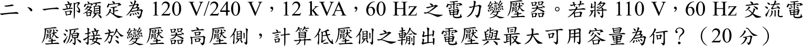
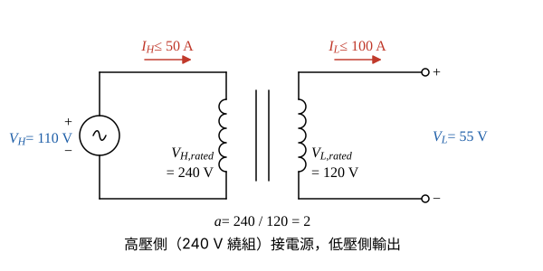

# 105 年電機機械第 2 題｜變壓器降壓使用

## 已知與所求

單相電力變壓器額定 120 V／240 V、12 kVA、60 Hz。把 110 V、60 Hz 交流電源接到高壓側（240 V 繞組），求低壓側輸出電壓與最大可用容量（全題 20 分）。

## 考場標準作答

### 步驟 1：匝數比與繞組額定電流

設漏阻抗壓降與激磁電流忽略（理想變壓器）；頻率仍為 60 Hz，電壓降低使磁通減少、不會飽和。匝數比不隨外加電壓改變，容量上限由繞組溫升（即各繞組額定電流）決定，電壓降低時額定電流不變。

\[
a=\frac{V_{H,rated}}{V_{L,rated}}=\frac{240}{120}=2
\]
繞組額定電流（溫升限制，與外加電壓無關）：
\[
I_{H,rated}=\frac{S_{rated}}{V_{H,rated}}=\frac{12\ \mathrm{kVA}}{240\ \mathrm V}=50\ \mathrm A
\]
\[
I_{L,rated}=\frac{S_{rated}}{V_{L,rated}}=\frac{12\ \mathrm{kVA}}{120\ \mathrm V}=100\ \mathrm A
\]

### 低壓側輸出電壓

110 V 接在 240 V 繞組，匝數比 \(a=2\) 不變（降壓）：

\[
V_L=\frac{V_H}{a}=\frac{110}{2}
\]
\[
\boxed{V_L=55.00\ \mathrm V}
\]

### 最大可用容量

兩側電流各不得超過額定電流，電壓固定為 110 V／55 V，故 \(S_{\max}\)＝電壓 × 額定電流，兩側結果應相同。

高壓側計算：
\[
S_{\max}=V_HI_{H,rated}=110(50)=5500\ \mathrm{VA}
\]
低壓側核對：
\[
S_{\max}=V_LI_{L,rated}=55(100)=5500\ \mathrm{VA}
\]
\[
\boxed{S_{\max}=5.50\ \mathrm{kVA}}
\]
與額定容量之比：
\[
\frac{S_{\max}}{S_{rated}}=\frac{5.50}{12}=0.4583
\]
恰等於電壓比 \(110/240=0.4583\)，即容量按電壓比例降為額定的 45.83%。

## 驗算

磁通 \(\propto V/f\)：高壓側 \(110/240=0.4583\)、低壓側 \(55/120=0.4583\)，兩側一致且 \(f\) 仍為 60 Hz，磁通只有額定的 45.83%，鐵心不飽和，激磁電流可忽略的前提成立。

## 失分點

- 容量不可仍答 12 kVA；電壓降低但繞組電流上限不變，\(S=VI\) 隨電壓降低。
- 高壓側是 240 V 繞組，輸出為降壓 55 V，不是升壓到 220 V。
- 用 \(S_{rated}/V_H=12\ \mathrm{kVA}/110\ \mathrm V=109.09\ \mathrm A\) 當高壓側電流上限，超過繞組額定 50 A 而過熱。
