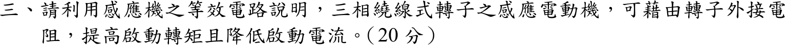
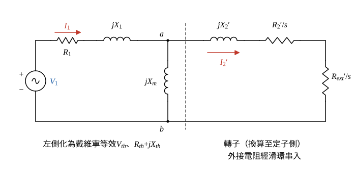
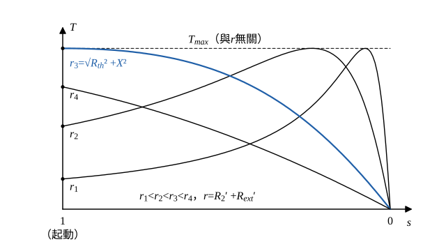

# 105 年電機機械第 3 題｜繞線式轉子外接電阻

## 已知與所求

三相繞線式轉子感應機，轉子外接電阻 \(R_{ext}\)（經滑環）。利用等效電路說明為何可同時提高起動轉矩並降低起動電流。（本題為論述題，無數值給定。）

## 考場標準作答

### 步驟 1：每相等效電路與戴維寧等效

設鐵損電阻 \(R_c\) 忽略；參數為定值（起動時轉子頻率＝電源頻率，\(X_2'\) 以電源頻率計），不計飽和與集膚效應。

- 每相：\(\underline V_1\) 經 \(R_1+jX_1\) 到節點 \(a\)；\(a\)、\(b\) 間接激磁電抗 \(jX_m\)；轉子支路為 \(jX_2'\) 串 \(R_2'/s\) 串 \(R_{ext}'/s\)。
- 參考方向：\(\underline I_1\) 由電源流入定子，\(\underline I_2'\) 由 \(a\) 流入轉子支路。
- 記號：\(r=R_2'+R_{ext}'\)（轉子電路總電阻，換算至定子側），\(X=X_{th}+X_2'\)。

由 \(a\)、\(b\) 向左看（虛線左側）化成戴維寧等效（\(jX_m\) 分壓、\(R_1+jX_1\) 與 \(jX_m\) 並聯）：
\[
\underline V_{th}=\underline V_1\frac{jX_m}{R_1+j(X_1+X_m)},\qquad R_{th}+jX_{th}=\frac{jX_m(R_1+jX_1)}{R_1+j(X_1+X_m)}
\]

### 步驟 2：起動時（\(s=1\)）的電流與轉矩式

轉子支路電阻 \(r/s\) 在 \(s=1\) 時等於 \(r\)，戴維寧迴路總阻抗：
\[
\underline Z_{st}=(R_{th}+r)+jX
\]
起動轉子電流（換算值）：
\[
I_{2,st}'=\frac{V_{th}}{|\underline Z_{st}|}=\frac{V_{th}}{\sqrt{(R_{th}+r)^2+X^2}}
\]
氣隙功率（三相）在 \(s=1\) 時：
\[
P_{ag}=3I_2'^2\frac{r}{s}=3I_{2,st}'^2\,r
\]
起動轉矩＝氣隙功率／同步角速度：
\[
T_{st}=\frac{P_{ag}}{\omega_s}=\frac{3}{\omega_s}\cdot\frac{V_{th}^2\,r}{(R_{th}+r)^2+X^2}
\]

### 降低起動電流

\(V_{th}\)、\(R_{th}\)、\(X\) 都與 \(r\) 無關，\(r\) 只出現在 \(I_{2,st}'\) 的分母。

分母平方項對 \(r\) 微分：
\[
\frac{d}{dr}\left[(R_{th}+r)^2+X^2\right]=2(R_{th}+r)>0
\]
所以 \(r\) 增加 → \(|\underline Z_{st}|\) 增加 → \(I_{2,st}'\) 減小。定子電流 \(\underline I_1=\underline I_m+\underline I_2'\)，起動時激磁電流 \(I_m\) 遠小於 \(I_2'\) 且不隨 \(r\) 改變，\(I_{1,st}\approx I_{2,st}'\) 一起下降：
\[
\boxed{r=R_2'+R_{ext}'\uparrow\ \Rightarrow\ I_{st}\downarrow}
\]

### 提高起動轉矩

\(T_{st}\) 的分子（\(\propto r\)）與分母都隨 \(r\) 增加，須對 \(r\) 微分判斷。

令 \(D=(R_{th}+r)^2+X^2\)，\(T_{st}=\dfrac{3V_{th}^2}{\omega_s}\cdot\dfrac{r}{D}\)。商的微分：
\[
\frac{d}{dr}\left(\frac rD\right)=\frac{D\cdot1-r\,\dfrac{dD}{dr}}{D^2}=\frac{(R_{th}+r)^2+X^2-2r(R_{th}+r)}{D^2}
\]
展開分子：
\[
R_{th}^2+2R_{th}r+r^2+X^2-2R_{th}r-2r^2=R_{th}^2+X^2-r^2
\]
所以
\[
\frac{dT_{st}}{dr}>0\iff r<\sqrt{R_{th}^2+X^2}
\]
原轉子電阻 \(R_2'\) 遠小於 \(\sqrt{R_{th}^2+X^2}\)，加入 \(R_{ext}'\) 使 \(r\) 增加時 \(T_{st}\) 上升。極值點（分子為 0）：
\[
r_{opt}=\sqrt{R_{th}^2+X^2}\ \Rightarrow\ R_{ext}'=\sqrt{R_{th}^2+X^2}-R_2'
\]
代入 \(r=r_{opt}\)，記 \(Z=\sqrt{R_{th}^2+X^2}\)（\(Z^2=R_{th}^2+X^2\)），分母化簡：
\[
D=(R_{th}+Z)^2+X^2=R_{th}^2+2R_{th}Z+Z^2+X^2=2Z^2+2R_{th}Z=2Z(Z+R_{th})
\]
\[
T_{st}\big|_{r_{opt}}=\frac{3V_{th}^2}{\omega_s}\cdot\frac{Z}{2Z(Z+R_{th})}=\frac{3V_{th}^2}{2\omega_s\left(R_{th}+\sqrt{R_{th}^2+X^2}\right)}=T_{max}
\]
此式不含 \(r\)：最大轉矩 \(T_{max}\) 與轉子電阻無關，外接電阻只把最大轉矩滑差 \(s_{max}=r/\sqrt{R_{th}^2+X^2}\) 往 \(s=1\) 移；\(r=r_{opt}\) 時 \(s_{max}=1\)，最大轉矩恰在起動點（圖 2 藍線）。\(r\) 再增加（圖 2 的 \(r_4\)）則 \(T_{st}\) 反而下降。
\[
\boxed{R_{ext}'=\sqrt{R_{th}^2+X^2}-R_2'\ \Rightarrow\ T_{st}=T_{max},\ \ I_{st}\ \text{下降}}
\]

起動完成後逐段切除外接電阻，使運轉時滑差小、轉子銅損低、效率高。

## 驗算

取示範值（非題目給定）\(R_{th}=0.30,\ X=1,\ R_2'=0.20\)，並取 \(3V_{th}^2/\omega_s=1\)、\(V_{th}=1\)：

- 不外接（\(r=0.20\)）：\(R_{th}+r=0.50\)，\(D=0.50^2+1=1.25\)，\(T_{st}=0.20/1.25=0.16\)，\(I_{st}=1/\sqrt{1.25}=0.8944\)。
- 外接到 \(r=\sqrt{0.09+1}=1.0440\)：\(R_{th}+r=1.3440\)，\(D=1.3440^2+1=1.8063+1=2.8063\)，\(T_{st}=1.0440/2.8063=0.3720\)，\(I_{st}=1/\sqrt{2.8063}=0.5969\)。
- \(T_{max}=1/[2(0.30+1.0440)]=1/2.688=0.3720\)，與上一行相同。

轉矩由 0.16 升為 0.3720、電流由 0.8944 降為 0.5969，與推導一致。

## 失分點

- 外接電阻只改變 \(s_{max}\)，\(T_{max}\) 不變；寫成「電阻愈大轉矩愈大」會漏掉 \(r>\sqrt{R_{th}^2+X^2}\) 時轉矩反降。
- 兩個效果須分別由 \(I\) 與 \(T\) 的式子說明：電流下降靠阻抗增加，轉矩上升靠 \(dT_{st}/dr>0\) 的條件 \(r<\sqrt{R_{th}^2+X^2}\)。
- 起動轉矩用 \(P_{ag}/\omega_s\)（同步角速度），不是除以轉子角速度（起動時轉子角速度為 0）。
