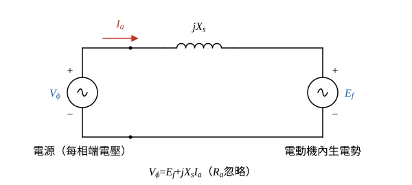
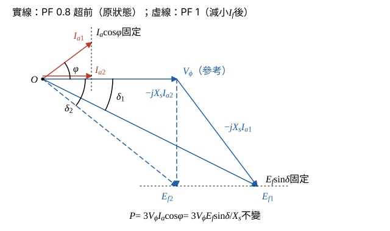

# 105 年電機機械第 4 題｜同步電動機功因調整

## 已知與所求

三相同步電動機原操作於功率因數 0.8 超前，欲調整激磁電流 \(I_f\) 使功率因數提高至 1.0。須以同步機等效電路與相量圖說明（論述題 20 分，無數值給定）。

## 考場標準作答

**解題邏輯**：電動機每相等效電路的前提：電樞電阻 \(R_a\) 忽略；\(E_f\) 隨 \(I_f\) 單調增加（未飽和時成正比）。
1. 以每相等效電路寫電動機 KVL \(\underline V_\phi=\underline E_f+jX_s\underline I_a\)，得 \(\underline E_f=\underline V_\phi-jX_s\underline I_a\)。
2. 調整 \(I_f\) 時負載（軸功率）不變、端電壓 \(V_\phi\) 與頻率不變，所以 \(P=3V_\phi I_a\cos\varphi\) 固定。
3. \(\underline I_a\) 尖端只能沿「\(I_a\cos\varphi=\) 常數」的垂直線移動，\(\underline E_f\) 尖端只能沿「\(E_f\sin\delta=\) 常數」的水平線移動。
4. 比較 PF 0.8 超前與 PF 1 兩個狀態的 \(|E_f|\)，即知 \(I_f\) 應增或減。

### 步驟 1：每相等效電路與電動機 KVL

- 每相等效電路：電源端電壓 \(\underline V_\phi\) 經同步電抗 \(jX_s\) 接到內生電勢 \(\underline E_f\)（\(R_a\) 忽略）。
- 參考方向（電動機慣例）：\(\underline I_a\) 由電源流入電動機；以 \(\underline V_\phi\) 為相位參考 \(0^\circ\)。

沿迴路寫 KVL：
\[
\underline V_\phi=\underline E_f+jX_s\underline I_a
\]
移項得內生電勢：
\[
\underline E_f=\underline V_\phi-jX_s\underline I_a
\]

### 步驟 2：功率不變的兩條限制

輸入功率（\(R_a\) 忽略，等於電磁功率）：
\[
P=3V_\phi I_a\cos\varphi=\frac{3V_\phi E_f\sin\delta}{X_s}
\]
\(P\)、\(V_\phi\)、\(X_s\) 都不變，所以：
\[
I_a\cos\varphi=\text{常數},\qquad E_f\sin\delta=\text{常數}
\]
其中 \(E_f\sin\delta\) 就是 \(jX_s\underline I_a\) 垂直分量的大小 \(X_sI_a\cos\varphi\)。

### 如何調整激磁電流（20 分）

**邏輯**：把兩個狀態的 \(\underline E_f=\underline V_\phi-jX_s\underline I_a\) 分別展開成實部、虛部；虛部（\(-X_sI_a\cos\varphi\)）兩狀態相同，只比較實部即可判斷 \(|E_f|\) 變大或變小，進而決定 \(I_f\) 的調整方向。

**狀態 1：PF 0.8 超前**。電流超前 \(\varphi_1=\cos^{-1}0.8=36.87^\circ\)，\(\cos\varphi_1=0.8\)、\(\sin\varphi_1=0.6\)：
\[
\underline I_{a1}=I_{a1}\angle36.87^\circ=I_{a1}(0.8+j0.6)
\]
電抗壓降 \(jX_s\underline I_{a1}\) 取負號（\(-j\cdot j=+1\)）：
\[
-jX_s\underline I_{a1}=-jX_sI_{a1}(0.8+j0.6)=0.6X_sI_{a1}-j0.8X_sI_{a1}
\]
\[
\underline E_{f1}=(V_\phi+0.6X_sI_{a1})-j0.8X_sI_{a1}
\]
大小：
\[
|E_{f1}|=\sqrt{(V_\phi+0.6X_sI_{a1})^2+(0.8X_sI_{a1})^2}
\]

**狀態 2：PF 1**。\(P\) 不變、\(\cos\varphi_2=1\)，由步驟 2 的 \(I_a\cos\varphi=\) 常數：
\[
I_{a2}=I_{a2}\cos\varphi_2=I_{a1}\cos\varphi_1=0.8I_{a1}
\]
\(\underline I_{a2}=0.8I_{a1}\angle0^\circ\)，電抗壓降 \(jX_s\underline I_{a2}\) 取負號：
\[
-jX_s\underline I_{a2}=-j0.8X_sI_{a1}
\]
\[
\underline E_{f2}=V_\phi-j0.8X_sI_{a1}
\]
大小：
\[
|E_{f2}|=\sqrt{V_\phi^2+(0.8X_sI_{a1})^2}
\]

**比較**：兩者虛部同為 \(-0.8X_sI_{a1}\)（即 \(E_f\sin\delta\) 不變），實部由 \(V_\phi+0.6X_sI_{a1}\) 降為 \(V_\phi\)，所以
\[
|E_{f2}|<|E_{f1}|
\]
功率角由 \(\delta_1=\tan^{-1}\dfrac{0.8X_sI_{a1}}{V_\phi+0.6X_sI_{a1}}\) 增為 \(\delta_2=\tan^{-1}\dfrac{0.8X_sI_{a1}}{V_\phi}\)，電流由 \(I_{a1}\) 降為 \(0.8I_{a1}\)。

相量圖畫法（圖 2，兩狀態疊畫）：

- \(\underline V_\phi\) 沿水平軸畫為參考。
- 狀態 1（實線）：\(\underline I_{a1}\) 在水平軸上方 \(36.87^\circ\)；自 \(\underline V_\phi\) 尖端畫 \(-jX_s\underline I_{a1}\)（比 \(\underline I_{a1}\) 落後 \(90^\circ\)，指向右下），原點連到其尖端為 \(\underline E_{f1}\)，在 \(\underline V_\phi\) 下方 \(\delta_1\)。
- 狀態 2（虛線）：\(\underline I_{a2}\) 與 \(\underline V_\phi\) 同相，\(-jX_s\underline I_{a2}\) 垂直向下；\(\underline E_{f2}\) 尖端與 \(\underline E_{f1}\) 尖端在同一條水平線上（\(E_f\sin\delta\) 固定），但較靠左、較短。

\(|E_f|\) 隨 \(I_f\) 單調增加，要使 \(|E_f|\) 由 \(|E_{f1}|\) 降到 \(|E_{f2}|\)：
\[
\boxed{\text{減小 }I_f\ \Rightarrow\ |\underline E_f|\downarrow,\ \delta\uparrow,\ \underline I_a\ \text{由超前轉為與 }\underline V_\phi\text{ 同相（PF}=1\text{）}}
\]
原 PF 0.8 超前表示過激磁；PF 1 時 \(I_a=0.8I_{a1}\) 為此功率下的最小電樞電流（V 形曲線最低點）。\(I_f\) 若再繼續減小，\(\underline I_a\) 轉為落後（欠激磁），\(I_a\) 又變大。

## 驗算

示範值（非題目給定）：\(V_\phi=1\)、\(X_s=1\)、\(P/3=0.8\ \mathrm{pu}\)。狀態 1：\(I_{a1}=0.8/0.8=1.0\ \mathrm{pu}\)，\(\underline E_{f1}=1-j(0.8+j0.6)=1.6-j0.8\)，\(|E_{f1}|=\sqrt{1.6^2+0.8^2}=\sqrt{3.2}=1.789\ \mathrm{pu}\)；狀態 2：\(I_{a2}=0.8\ \mathrm{pu}\)，\(\underline E_{f2}=1-j0.8\)，\(|E_{f2}|=\sqrt{1.64}=1.281\ \mathrm{pu}\)。\(|E_f|\) 下降、\(I_a\) 由 1.0 降為 0.8，且兩狀態虛部同為 \(-0.8\)（\(E_f\sin\delta=0.8\) 不變），符合上述結論。

## 失分點

- 電動機與發電機的相量式符號相反：電動機 \(\underline E_f=\underline V_\phi-jX_s\underline I_a\)，若用 \(+\) 號會把超前判成欠激磁而得到「增加 \(I_f\)」。
- 調整時有功功率不變，須說明 \(E_f\sin\delta\) 與 \(I_a\cos\varphi\) 為定值，\(\delta\) 隨 \(E_f\) 減小而增大，不可畫成 \(\delta\) 不變。
- PF 1 時電樞電流是 \(0.8I_{a1}\) 而非維持 \(I_{a1}\)；畫成同長度會使有功功率增加。
