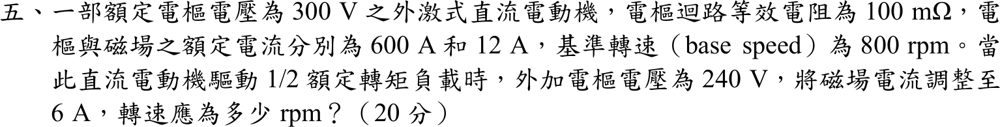
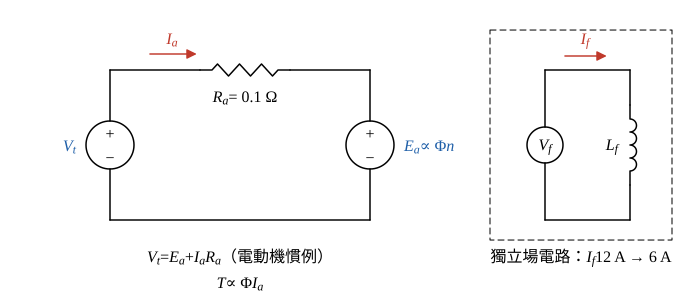

# 105 年電機機械第 5 題｜外激直流電動機減磁降壓調速

## 已知與所求

外激式直流電動機：額定電樞電壓 \(V_{t1}=300\ \mathrm V\)、\(R_a=100\ \mathrm{m\Omega}=0.1\ \Omega\)、額定 \(I_{a1}=600\ \mathrm A\)、\(I_{f1}=12\ \mathrm A\)、基準轉速 \(n_1=800\ \mathrm{rpm}\)。負載為額定轉矩的 \(1/2\)，\(V_{t2}=240\ \mathrm V\)，\(I_{f2}=6\ \mathrm A\)。求轉速 \(n_2\)。題目未給磁化曲線，磁通比 \(r=\Phi_2/\Phi_1\) 為假設量。

## 考場標準作答

**解題邏輯**：直流電動機兩條基本關係：電樞迴路 KVL \(V_t=E_a+I_aR_a\)、\(E_a=K\Phi\omega\propto\Phi n\)，以及轉矩 \(T=K\Phi I_a\propto\Phi I_a\)。先由額定點求額定反電勢 \(E_{a1}\)（對應基準轉速 800 rpm）；新工作點磁通變為 \(\Phi_2=r\Phi_1\)，由「轉矩為額定的 1/2」求 \(I_{a2}\)，再由 KVL 求 \(E_{a2}\)，最後用 \(E_a\propto\Phi n\) 的比值求 \(n_2\)。前提：外激（場電路獨立，\(I_f\) 只改變 \(\Phi\)）、電樞反應與電刷壓降不計；題目未給磁化曲線，採線性未飽和 \(\Phi\propto I_f\)，所以 \(r=I_{f2}/I_{f1}\)（此假設見條件與疑義）。

### 步驟 1：電樞等效電路與額定反電勢

- 電樞迴路：端電壓 \(V_t\)（上正下負）經 \(R_a=100\ \mathrm{m\Omega}=0.1\ \Omega\) 接反電勢 \(E_a\)；場繞組由另一電源供電，與電樞無電氣連接。
- 參考方向（電動機慣例）：\(I_a\) 由 \(V_t\) 正端流出、流入 \(E_a\) 正端。

額定點（\(V_{t1}=300\ \mathrm V\)、\(I_{a1}=600\ \mathrm A\)、\(I_{f1}=12\ \mathrm A\)、\(n_1=800\ \mathrm{rpm}\)）的 KVL：
\[
E_{a1}=V_{t1}-I_{a1}R_a
\]
\[
E_{a1}=300-600(0.1)=300-60=240\ \mathrm V
\]

### 步驟 2：磁通比

設新工作點磁通 \(\Phi_2=r\Phi_1\)。未飽和時 \(\Phi\propto I_f\)：
\[
r=\frac{\Phi_2}{\Phi_1}=\frac{I_{f2}}{I_{f1}}=\frac{6}{12}=0.50
\]
以下先保留符號 \(r\) 推導，最後再代入 0.50。

### 求轉速 \(n_2\)（20 分）

**邏輯**：轉矩條件決定新電樞電流（\(T\propto\Phi I_a\)，磁通減半時電流要加倍才有半額定轉矩）；有了 \(I_{a2}\) 才能由 KVL 求 \(E_{a2}\)；最後 \(E_a\propto\Phi n\) 的比值同時含磁通比與轉速比，解出 \(n_2\)。

新電樞電流（\(T\propto\Phi I_a\)，\(T_2=\tfrac12T_1\)）：
\[
\frac{T_2}{T_1}=\frac{\Phi_2I_{a2}}{\Phi_1I_{a1}}=r\,\frac{I_{a2}}{I_{a1}}=0.50
\]
\[
r\,I_{a2}=0.50\,I_{a1}=0.50(600)=300\ \mathrm A
\]
\[
I_{a2}=\frac{300}{r}\ \mathrm{A}
\]
新反電勢（KVL，\(V_{t2}=240\ \mathrm V\)）：
\[
E_{a2}=V_{t2}-I_{a2}R_a=240-0.1\left(\frac{300}{r}\right)=240-\frac{30}{r}\ \mathrm V
\]
轉速比（\(E_a\propto\Phi n\)）：
\[
\frac{E_{a2}}{E_{a1}}=\frac{\Phi_2n_2}{\Phi_1n_1}=r\,\frac{n_2}{n_1}
\quad\Rightarrow\quad
n_2=n_1\,\frac{E_{a2}}{r\,E_{a1}}
\]
代入 \(n_1=800\ \mathrm{rpm}\)、\(E_{a1}=240\ \mathrm V\)：
\[
n_2=800\,\frac{240-30/r}{240\,r}=\frac{800(240)}{240\,r}-\frac{800(30)}{240\,r^2}=\frac{800}{r}-\frac{100}{r^2}\ \mathrm{rpm}
\]
代入 \(r=0.50\)。電樞電流：
\[
I_{a2}=\frac{300}{0.50}=600\ \mathrm A\quad(\text{等於額定，未過載})
\]
反電勢：
\[
E_{a2}=240-0.1(600)=240-60=180\ \mathrm V
\]
轉速：
\[
n_2=800\times\frac{180}{240}\times\frac{1}{0.50}=800(0.75)(2)=1200\ \mathrm{rpm}
\]
\[
\boxed{n_2=1200\ \mathrm{rpm}}
\]

## 驗算

通式代回：\(n_2=\dfrac{800}{0.50}-\dfrac{100}{0.50^2}=1600-400=1200\ \mathrm{rpm}\)，與逐步代入一致。轉矩比（\(T=E_aI_a/\omega\propto E_aI_a/n\)）：\(\dfrac{T_2}{T_1}=\dfrac{180(600)/1200}{240(600)/800}=\dfrac{90}{180}=0.50\)，正是半額定轉矩。

## 失分點

- 減磁後電樞電流不是「半載就減半」：磁通減半時 \(I_a\) 須為 600 A 才得半額定轉矩；若仍用 300 A 則 \(E_{a2}=210\ \mathrm V\)，轉速誤為 \(1400\ \mathrm{rpm}\)。
- 只用 \(E_a\) 比值而忘了磁通也變為 0.50 倍：\(800(180/240)=600\ \mathrm{rpm}\)，方向完全錯（減磁應升速）。
- 磁通比隨飽和而偏離 0.5 時結果改變，見下表。

## 條件與疑義

題幹未給磁化曲線也未註明未飽和，\(r\) 無法由 \(I_f=6\ \mathrm A\) 唯一決定；上式 \(r=0.5\) 為明示假設。

| \(r=\Phi_2/\Phi_1\) | \(I_{a2}\) (A) | \(E_{a2}\) (V) | \(n_2\) (rpm) |
|---:|---:|---:|---:|
| 0.45 | 666.667 | 173.333 | 1283.951 |
| 0.50 | 600.000 | 180.000 | 1200.000 |
| 0.55 | 545.455 | 185.455 | 1123.967 |
| 0.60 | 500.000 | 190.000 | 1055.556 |

每列皆滿足 \(rI_{a2}=300\ \mathrm A\) 與 \(E_{a2}=240-0.1I_{a2}\)。
